# Manual del colportor (app del teléfono)

Este manual te muestra cómo usar la app de Colportaje en tu teléfono: desde crear tu cuenta hasta registrar las casas que visitás, tus ventas y tus cobros.

Lo que cargás en la app queda guardado en tu teléfono, aunque no tengas conexión. Cuando vuelve la conexión, la app lo envía sola.

Si te trabás con algo, mirá los [Problemas frecuentes](./problemas-frecuentes.md). Si no conocés una palabra, está en el [Glosario](./glosario.md). Para volver al índice general: [Manual de usuario](./README.md).

## Contenido

- [1. Primeros pasos: tu cuenta](#1-primeros-pasos-tu-cuenta)
  - [1.1 Abrir la app por primera vez](#11-abrir-la-app-por-primera-vez)
  - [1.2 Crear tu cuenta](#12-crear-tu-cuenta)
  - [1.3 Verificar tu correo](#13-verificar-tu-correo)
  - [1.4 Iniciar sesión](#14-iniciar-sesión)
  - [1.5 Recuperar tu contraseña](#15-recuperar-tu-contraseña)
  - [1.6 Preparar el espacio seguro del teléfono](#16-preparar-el-espacio-seguro-del-teléfono)
  - [1.7 Recuperar tus datos desde un respaldo](#17-recuperar-tus-datos-desde-un-respaldo)
  - [1.8 Terminar jornadas que quedaron abiertas](#18-terminar-jornadas-que-quedaron-abiertas)
  - [1.9 Permitir las notificaciones](#19-permitir-las-notificaciones)
  - [1.10 Esperar que te asignen a una campaña](#110-esperar-que-te-asignen-a-una-campaña)
- [2. La pantalla principal y tu jornada](#2-la-pantalla-principal-y-tu-jornada)
  - [2.1 Conocer la pantalla principal](#21-conocer-la-pantalla-principal)
  - [2.2 Entender los avisos de arriba de «Hoy»](#22-entender-los-avisos-de-arriba-de-hoy)
  - [2.3 Ver la pestaña «Hoy»](#23-ver-la-pestaña-hoy)
  - [2.4 Iniciar la jornada](#24-iniciar-la-jornada)
  - [2.5 Trabajar con la jornada iniciada](#25-trabajar-con-la-jornada-iniciada)
  - [2.6 Finalizar la jornada](#26-finalizar-la-jornada)
  - [2.7 Leer el resumen del día](#27-leer-el-resumen-del-día)
  - [2.8 Corregir una jornada que quedó abierta](#28-corregir-una-jornada-que-quedó-abierta)
  - [2.9 Cerrar las jornadas por cerrar](#29-cerrar-las-jornadas-por-cerrar)
- [3. El mapa y las casas](#3-el-mapa-y-las-casas)
  - [3.1 Conocer la pestaña «Mapa»](#31-conocer-la-pestaña-mapa)
  - [3.2 Usar tu ubicación y el botón de seguimiento](#32-usar-tu-ubicación-y-el-botón-de-seguimiento)
  - [3.3 Ver el mapa sin conexión](#33-ver-el-mapa-sin-conexión)
  - [3.4 Descargar mapas para usar sin conexión](#34-descargar-mapas-para-usar-sin-conexión)
  - [3.5 Registrar una casa nueva](#35-registrar-una-casa-nueva)
  - [3.6 Registrar un edificio y sus departamentos](#36-registrar-un-edificio-y-sus-departamentos)
  - [3.7 Tocar una casa: la hoja de la casa](#37-tocar-una-casa-la-hoja-de-la-casa)
  - [3.8 Escribir notas del lugar](#38-escribir-notas-del-lugar)
  - [3.9 Buscar en la pestaña «Lista»](#39-buscar-en-la-pestaña-lista)
  - [3.10 Editar una casa o un edificio](#310-editar-una-casa-o-un-edificio)
  - [3.11 Dar de baja una ubicación y reactivarla](#311-dar-de-baja-una-ubicación-y-reactivarla)
  - [3.12 Revisar posibles duplicados](#312-revisar-posibles-duplicados)
- [4. Personas, visitas y agenda](#4-personas-visitas-y-agenda)
  - [4.1 Agregar una persona a una casa](#41-agregar-una-persona-a-una-casa)
  - [4.2 Ver la ficha de una persona](#42-ver-la-ficha-de-una-persona)
  - [4.3 Editar a una persona](#43-editar-a-una-persona)
  - [4.4 Dar de baja a una persona](#44-dar-de-baja-a-una-persona)
  - [4.5 Escribir notas de una persona](#45-escribir-notas-de-una-persona)
  - [4.6 Registrar una visita](#46-registrar-una-visita)
  - [4.7 Dar una entrevista](#47-dar-una-entrevista)
  - [4.8 Agendar una visita](#48-agendar-una-visita)
  - [4.9 Usar la pestaña «Agenda»](#49-usar-la-pestaña-agenda)
  - [4.10 Ver, modificar y cancelar una agenda](#410-ver-modificar-y-cancelar-una-agenda)
  - [4.11 Recibir recordatorios de las visitas agendadas](#411-recibir-recordatorios-de-las-visitas-agendadas)
- [5. Ventas, entregas, cobros y tu cuenta](#5-ventas-entregas-cobros-y-tu-cuenta)
  - [5.1 La venta en la calle, de punta a punta](#51-la-venta-en-la-calle-de-punta-a-punta)
  - [5.2 Consultar los precios](#52-consultar-los-precios)
  - [5.3 Registrar una venta](#53-registrar-una-venta)
  - [5.4 Entregar, cobrar y agendar la cobranza](#54-entregar-cobrar-y-agendar-la-cobranza)
  - [5.5 Volver otro día a cobrar](#55-volver-otro-día-a-cobrar)
  - [5.6 Cobrar una venta](#56-cobrar-una-venta)
  - [5.7 Pagar en cuotas](#57-pagar-en-cuotas)
  - [5.8 Devolver una venta](#58-devolver-una-venta)
  - [5.9 Entrevista sin venta: lo que dejaste](#59-entrevista-sin-venta-lo-que-dejaste)
  - [5.10 Registrar un depósito](#510-registrar-un-depósito)
  - [5.11 Mirar tu cuenta](#511-mirar-tu-cuenta)
- [6. Configuración, respaldo y trabajo sin conexión](#6-configuración-respaldo-y-trabajo-sin-conexión)
  - [6.1 Abrir Configuración y conocer sus secciones](#61-abrir-configuración-y-conocer-sus-secciones)
  - [6.2 Trabajar sin conexión](#62-trabajar-sin-conexión)
  - [6.3 Ver tus notificaciones (la campana)](#63-ver-tus-notificaciones-la-campana)
  - [6.4 Ajustar las notificaciones y los recordatorios](#64-ajustar-las-notificaciones-y-los-recordatorios)
  - [6.5 Conectar el respaldo en tu Google Drive](#65-conectar-el-respaldo-en-tu-google-drive)
  - [6.6 Ver el estado del respaldo y desconectarlo](#66-ver-el-estado-del-respaldo-y-desconectarlo)
  - [6.7 Recuperar tu respaldo en un teléfono nuevo](#67-recuperar-tu-respaldo-en-un-teléfono-nuevo)
  - [6.8 Mostrar u ocultar el aviso de privacidad](#68-mostrar-u-ocultar-el-aviso-de-privacidad)
  - [6.9 Borrar los datos de este teléfono](#69-borrar-los-datos-de-este-teléfono)
  - [6.10 Cerrar sesión](#610-cerrar-sesión)
  - [6.11 Pedir ayuda y ver la versión de la app](#611-pedir-ayuda-y-ver-la-versión-de-la-app)

## 1. Primeros pasos: tu cuenta

Este capítulo te acompaña desde que abrís la app por primera vez hasta que tu cuenta queda lista para trabajar: crear la cuenta, confirmar tu correo, entrar, preparar tu teléfono, decidir si querés notificaciones y esperar a que tu coordinador te asigne a una campaña.

Vas a ver las pantallas en este orden la primera vez que usás la app en un teléfono:

1. Entrada (iniciar sesión o crear tu cuenta).
2. Verificá tu cuenta (solo si creaste la cuenta recién).
3. Preparación del espacio seguro del teléfono.
4. Recuperar tus datos desde un respaldo (solo en un teléfono sin datos).
5. Jornadas sin cerrar (solo si quedó alguna abierta de antes).
6. Permiso de notificaciones.
7. Esperando asignación, o directo a tu pantalla principal si ya te asignaron.

> **Importante.** La app entra solo con correo y contraseña. No hay inicio de sesión con Google y la app no tiene un PIN propio. El único bloqueo es el de tu teléfono (PIN, patrón, contraseña o huella), y la app lo necesita para proteger tus datos (ver [Preparar el espacio seguro del teléfono](#16-preparar-el-espacio-seguro-del-teléfono)).

> **Importante.** La app guarda todo lo que cargás en el teléfono y lo manda sola cuando hay conexión. Para crear la cuenta y para entrar por primera vez en un teléfono sí necesitás conexión. Después podés trabajar sin ella.

### 1.1 Abrir la app por primera vez

La primera vez que tocás el ícono de la app.

1. Abrí la app. Un instante ves la pantalla de arranque del teléfono, con el logo de Flutter sobre fondo blanco. Mientras la app revisa si ya hay una sesión iniciada, puede verse apenas un círculo girando sobre fondo claro. Enseguida aparece la entrada.

2. Aparece la pantalla de entrada. Arriba ves «COLPORTAJE» con el cuadrado azul de la marca, la leyenda «COLPORTAJE · URUGUAY» y el título «Iniciá tu jornada».
3. Más abajo están los campos «CORREO» y «CONTRASEÑA», el enlace «¿Olvidaste tu clave?», el botón «Entrar», la frase «Podés trabajar sin conexión después de entrar» y, al pie, «¿No tenés cuenta? Registrate».

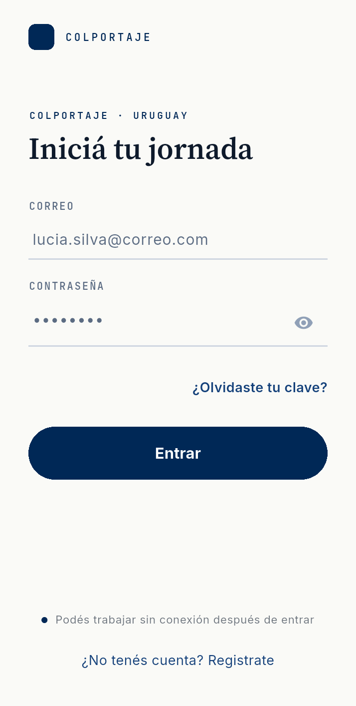

4. Si todavía no tenés cuenta, seguí con [Crear tu cuenta](#12-crear-tu-cuenta). Si ya tenés una, andá a [Iniciar sesión](#14-iniciar-sesión).

### 1.2 Crear tu cuenta

Lo hacés una sola vez, la primera vez que usás la app.

**Antes de empezar**

- Tené conexión a internet (datos móviles o Wi-Fi).
- Tené a mano tu cédula y un correo al que puedas entrar desde este mismo teléfono: ahí te llega el enlace para confirmar la cuenta.
- La cuenta no te une a ninguna campaña. De eso se encarga tu coordinador después (ver [Esperar que te asignen a una campaña](#110-esperar-que-te-asignen-a-una-campaña)).

**Pasos**

1. En la pantalla de entrada tocá «¿No tenés cuenta? Registrate». Se abre «Creá tu cuenta», con el rótulo «DATOS PERSONALES». Arriba a la izquierda hay una flecha («Volver») para volver a la entrada. Al deslizar hacia abajo, al pie, está «¿Ya tenés cuenta? Entrar».

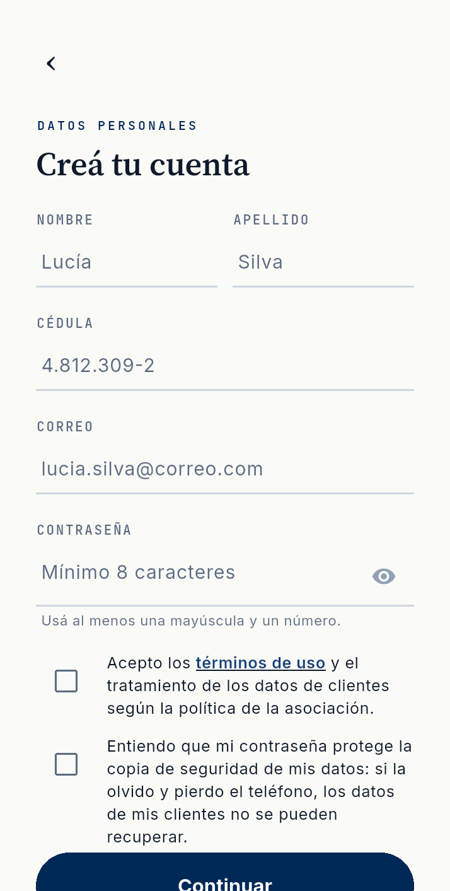

2. En «NOMBRE» escribí tu nombre (hasta 60 caracteres).
3. En «APELLIDO» escribí tu apellido (hasta 60 caracteres).
4. En «CÉDULA» escribí tu número de cédula, de 7 u 8 números. Podés escribir solo los números o ponerlos con puntos y guion; la app muestra lo que escribís tal cual.
5. En «CORREO» escribí tu correo. No hace falta cuidar las mayúsculas ni los espacios de más: la app los corrige.
6. En «CONTRASEÑA» escribí la contraseña que vas a usar para entrar. Tiene que tener al menos 8 caracteres, una letra mayúscula (vale una con tilde o la Ñ) y un número. Debajo del campo se lee «Usá al menos una mayúscula y un número.». Para ver lo que escribís, tocá el ojo a la derecha del campo («Mostrar contraseña»).

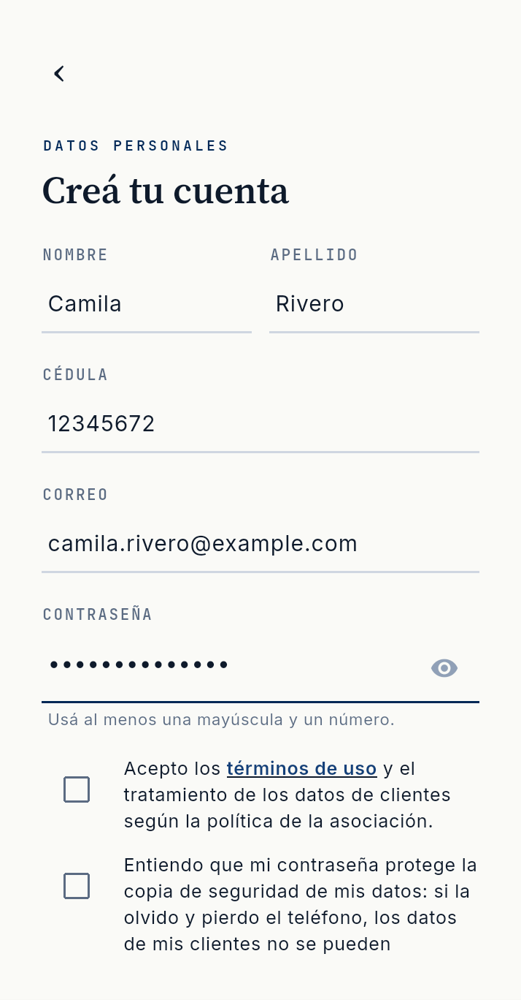

7. Marcá las dos casillas. Ninguna viene marcada y las dos son obligatorias:
   - «Acepto los términos de uso y el tratamiento de los datos de clientes según la política de la asociación.»
   - «Entiendo que mi contraseña protege la copia de seguridad de mis datos: si la olvido y pierdo el teléfono, los datos de mis clientes no se pueden recuperar.»

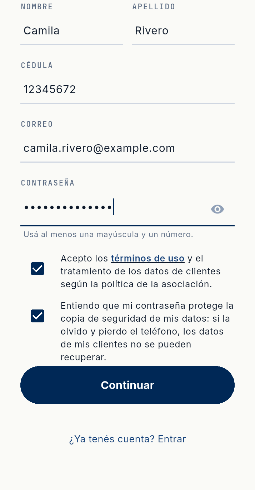

8. Tocá «Continuar». La cuenta se crea enseguida; esperá sin tocar nada más.
9. Se abre la pantalla «Verificá tu cuenta». Seguí con [Verificar tu correo](#13-verificar-tu-correo).

> **Importante.** Tu contraseña es también la llave de la copia de seguridad de tus datos. Si la olvidás y además perdés el teléfono, no hay forma de recuperar los datos de tus clientes. Elegí una que puedas recordar.

> **Consejo.** Si tocás «términos de uso» dentro del texto de la primera casilla, por ahora solo aparece el aviso «Disponible próximamente».

> **Próximamente.** El texto completo de los términos de uso y de la política de la asociación todavía no se puede leer desde la app.

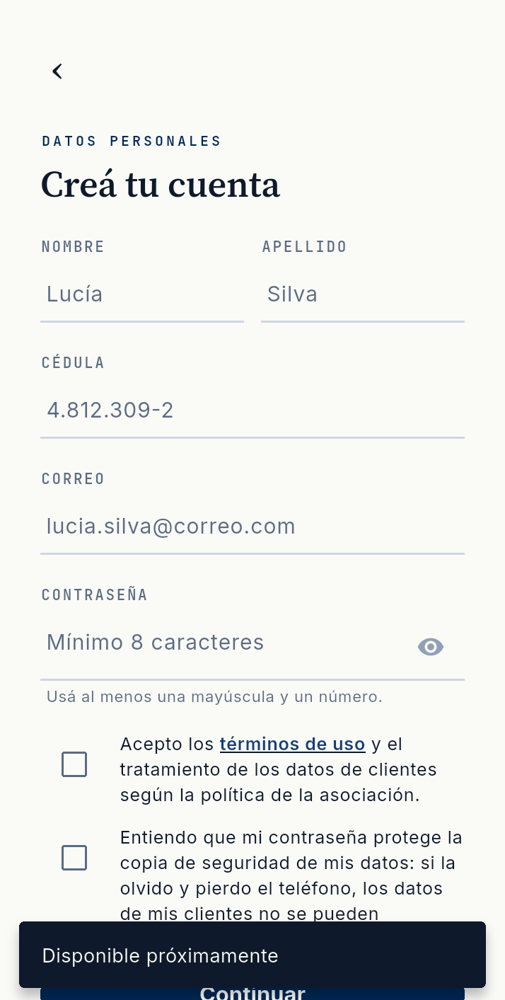

**Qué puede pasar**

| Si ves… | Qué significa | Qué hacer |
|---|---|---|
| «Ingresá tu nombre», «Ingresá tu apellido», «Ingresá tu cédula», «Ingresá tu email», «Ingresá tu contraseña» | Dejaste un campo vacío. El aviso sale en rojo debajo del campo y la pantalla te lleva al primero que falta. | Completá el campo. |
| «Tenés que aceptar los términos.» y «Tenés que aceptar el trade-off de tu contraseña.» | Falta marcar una de las casillas (o las dos). La segunda se llama así en pantalla: es la que explica que tu contraseña protege la copia de seguridad. | Marcá la casilla que falta y tocá «Continuar». |
| «La cédula no es válida» | La cédula tiene letras o no tiene 7 u 8 números. | Revisá los números. Podés usar puntos y guion. |
| «El email no es válido» | Al correo le falta algo: la arroba, el dominio o la terminación. | Revisalo y escribilo completo. |
| «Revisá el email: no puede llevar tildes, ñ, espacios ni comas.» | El correo tiene un carácter que no se acepta en direcciones de correo. | Quitá la tilde, la ñ, el espacio o la coma. |
| «Revisá el email: no podemos mandar correos a esa dirección.» | El correo tiene forma de correo, pero no puede recibir mensajes (por ejemplo, el dominio está mal escrito). | Revisá cómo lo escribiste. Si está bien, probá con otro correo. |
| «Usá al menos 8 caracteres, una mayúscula y un número.» | La contraseña no cumple alguno de los requisitos. | Armá una contraseña que cumpla los tres. |
| «Es demasiado larga. Acortala.» | La contraseña es larguísima (el límite es 72 bytes; las letras con tilde, la ñ y los emojis cuentan más de uno). El botón «Continuar» queda apagado y la app nunca te recorta lo escrito. | Escribí una contraseña más corta. |
| «La contraseña es demasiado débil.» | El sistema no aceptó la contraseña. | Probá con otra, más larga o con más variedad de letras y números. |
| «Ya existe una cuenta con ese email. ¿Querés iniciar sesión o recuperar tu contraseña?» y los botones «Iniciar sesión» y «Recuperar contraseña» | Ese correo ya tiene una cuenta. | Si es tuya, tocá «Iniciar sesión» o, si no te acordás de la contraseña, «Recuperar contraseña» (ver [Recuperar tu contraseña](#15-recuperar-tu-contraseña)). |
| «Necesitás conexión para registrarte por primera vez» | No hay internet. La app borra la contraseña que escribiste por seguridad y conserva el resto. | Conectate, volvé a escribir la contraseña y tocá «Continuar». |
| «Demasiados intentos. Esperá unos minutos y volvé a probar.» | Se pidieron demasiados correos en poco tiempo. | Esperá unos minutos y tocá «Continuar» de nuevo. |
| «No pudimos crear tu cuenta. Probá de nuevo en unos minutos.» (texto rojo encima de «Continuar», sin botón «Reintentar») | El servidor no pudo crear la cuenta. No depende de tu teléfono. | Esperá unos minutos y tocá «Continuar» de nuevo. |

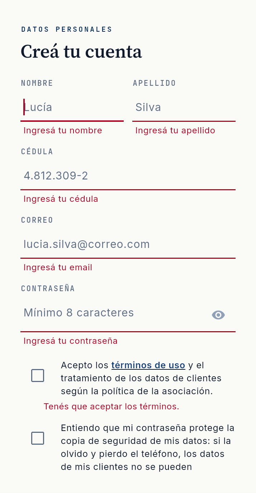
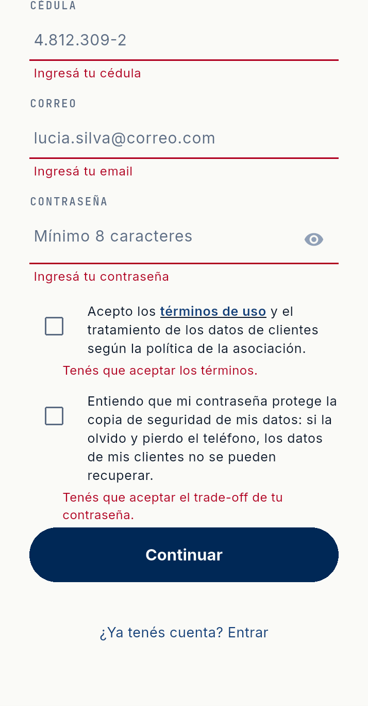
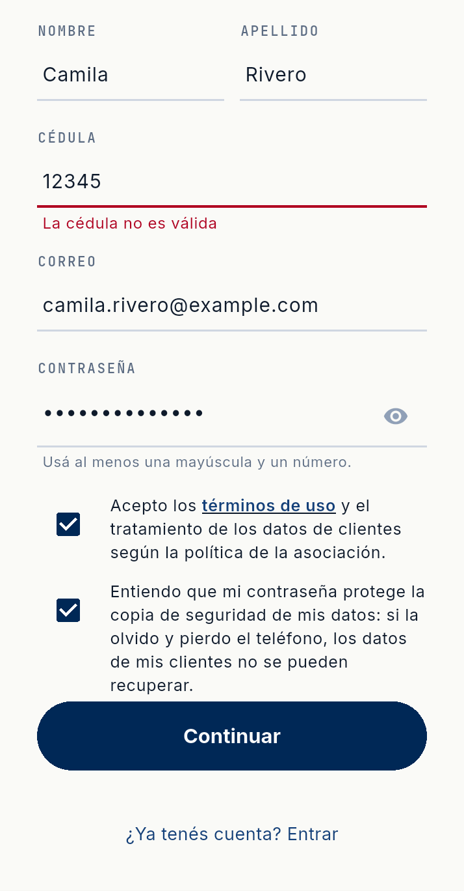
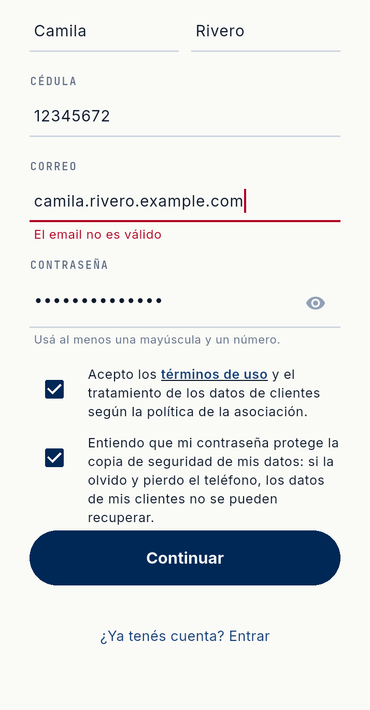
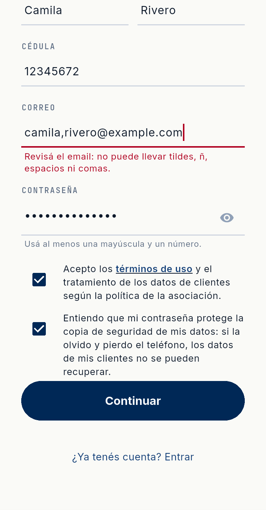
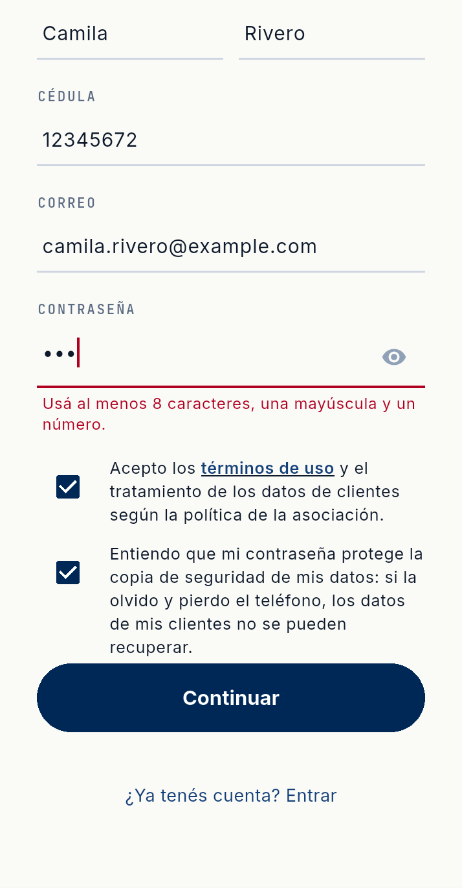
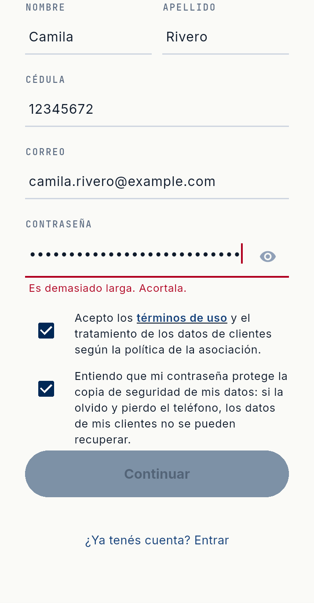
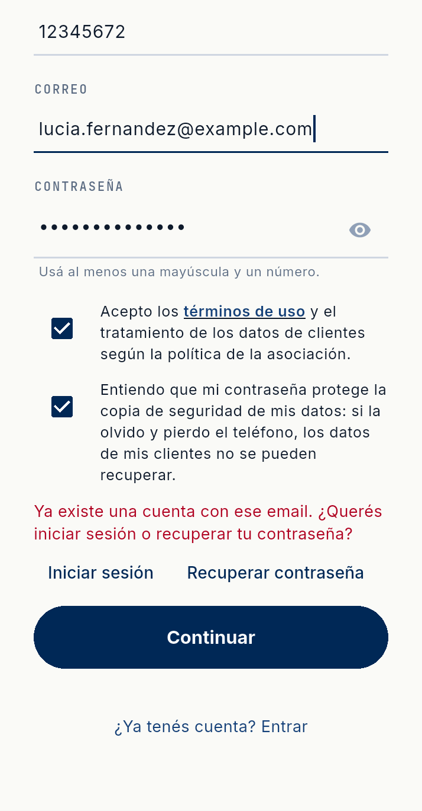
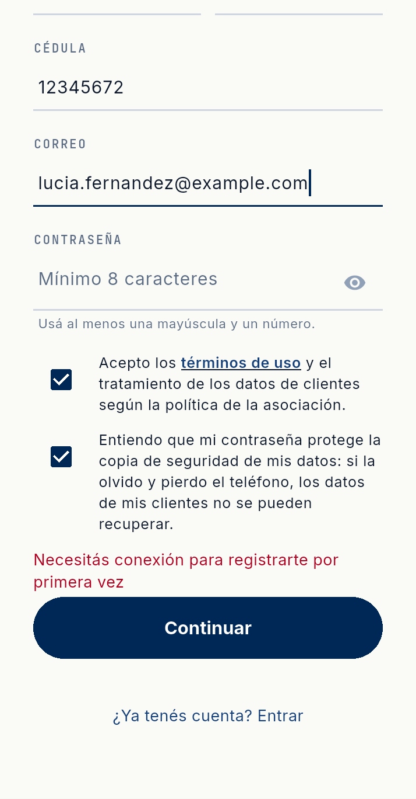
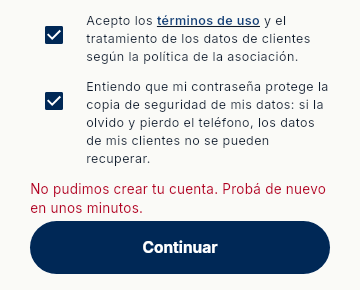

### 1.3 Verificar tu correo

Se hace una vez, justo después de crear la cuenta. Hasta que no confirmes el correo no podés entrar.

**Antes de empezar**

- Tené el correo abierto en este mismo teléfono.
- Para confirmar y para reenviar el correo necesitás conexión.

**Pasos**

1. Al terminar el registro se abre «Verificá tu cuenta», con el rótulo «VERIFICACIÓN DE EMAIL». Dice «Te enviamos un correo a» y, en una tarjeta, muestra tu correo (por ejemplo, camila.rivero@example.com).
2. Abajo se lee «Abrí el enlace para verificar tu cuenta.» y «Si no lo encontrás, revisá la carpeta de spam.».

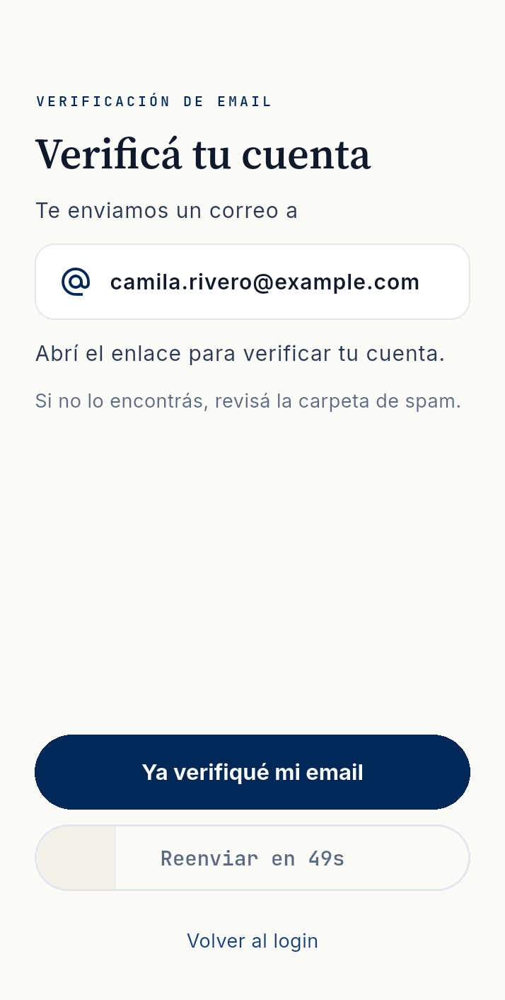

3. Abrí tu correo, buscá el mensaje que te mandamos y tocá el enlace.
4. La app se abre sola y muestra «Email verificado», con el texto «Email verificado. Esperá la asignación de tu coordinador.». Tocá «Continuar».

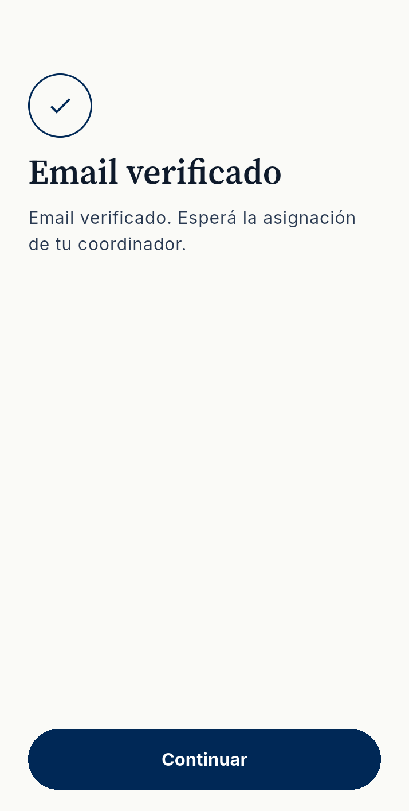

5. Si confirmaste el correo pero la app sigue en «Verificá tu cuenta», tocá «Ya verifiqué mi email». La app prueba entrar con los datos que acabás de escribir.

**Si no te llegó el correo**

1. Revisá la carpeta de spam.
2. Esperá a que termine la cuenta regresiva. Después de crear la cuenta, el botón dice «Reenviar en 60s» y baja segundo a segundo. Mientras corre no se puede tocar.
3. Cuando el botón diga «Reenviar email», tocalo. Aparece «Te reenviamos el correo. Puede tardar unos minutos.» y la cuenta regresiva empieza de nuevo.

> **Consejo.** Cuando reenviás el correo, abrí el más nuevo: el enlace del correo anterior deja de servir y la app te muestra «El enlace expiró».

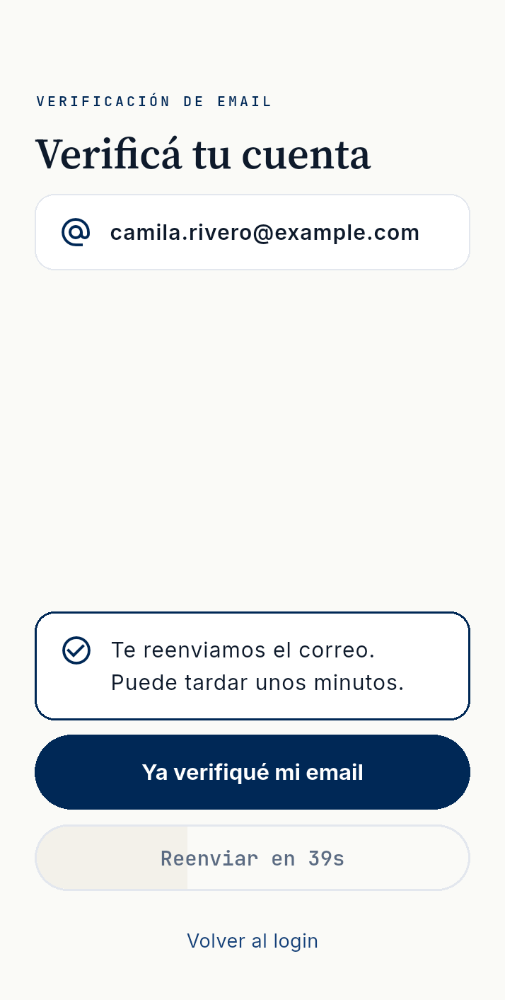
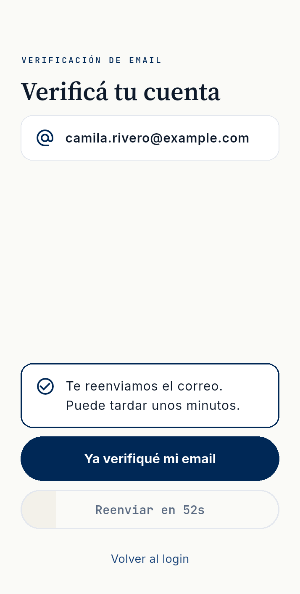

**Qué puede pasar**

| Si ves… | Qué significa | Qué hacer |
|---|---|---|
| «Reenviar en 59s» (el número baja) | Tenés que esperar 60 segundos entre un reenvío y el siguiente. | Esperá a que el botón diga «Reenviar email». |
| «Te reenviamos el correo. Puede tardar unos minutos.» | El correo salió de nuevo. | Revisá tu bandeja y el spam. |
| «Email verificado» | Confirmaste el correo. | Tocá «Continuar». |
| «El enlace expiró» y «Pedí uno nuevo y abrilo desde este teléfono. Lo mandamos a camila.rivero@example.com.» | El enlace que tocaste ya no sirve porque pasó el tiempo. | Tocá «Reenviar email de verificación» y abrí el enlace nuevo desde este teléfono. «Volver al login» te lleva a la entrada. |
| «Tu email ya está verificado» y «Ya podés entrar a tu inicio.» | Ya habías confirmado el correo con ese enlace. La pantalla no se cierra sola. | Tocá «Ir a mi inicio» (si ya tenés la sesión abierta) o «Ir al login» (si no). |
| «Este enlace ya no sirve: puede que ya lo hayas usado o que haya vencido. Si ya verificaste tu email, entrá con tu contraseña. Si no, pedí un enlace nuevo.» y un campo «CORREO» para escribir tu correo | La app no puede saber si el enlace venció o ya se usó, ni cuál es tu correo. | Si ya lo habías confirmado, tocá «Ir al login» y entrá. Si no, escribí tu correo y tocá «Reenviar email de verificación». |
| «Ingresá tu email» debajo del campo «CORREO» | Tocaste «Reenviar email de verificación» con el campo vacío. | Escribí tu correo y tocá el botón de nuevo. |
| «Todavía no verificaste tu cuenta. Revisá tu correo (y la carpeta de spam) o pedí uno nuevo.» y un campo «CORREO» vacío | Llegaste a esta pantalla sin que la app sepa tu correo. | Escribí tu correo en el campo y tocá «Reenviar email». |
| «Tenés que verificar tu correo antes de entrar. Revisá tu bandeja.» | Tocaste «Ya verifiqué mi email», pero todavía no confirmaste. | Abrí el enlace del correo y volvé a intentar. |
| «Necesitás conexión para verificar tu cuenta. Conectate y probá de nuevo.» | No hay internet al tocar «Ya verifiqué mi email». | Conectate y volvé a tocar el botón. |
| «Necesitás conexión para reenviar el email. Conectate y probá de nuevo.» | No hay internet al tocar «Reenviar email». | Conectate y volvé a tocar el botón. |
| «Demasiados intentos. Probá nuevamente en una hora.» y el botón de reenviar apagado con un candado | Se pidieron demasiados reenvíos a ese correo. Con el tiempo el aviso pasa a decir «en 10 minutos», «en 1 minuto», etc. | Esperá el tiempo que dice el aviso. Mientras tanto, revisá tu bandeja y el spam. |
| «No podemos mandar correos a esa dirección. Volvé al login y registrate con otro email.» | El correo con el que te registraste no puede recibir mensajes. | Tocá «Volver al login» y creá la cuenta con otro correo. |
| «No pudimos reenviar el email. Probá de nuevo en unos minutos.» | Otro error que no depende de vos. | Esperá unos minutos y volvé a tocar el botón. |

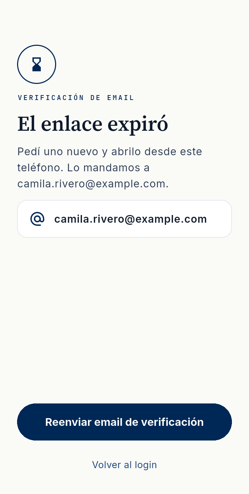
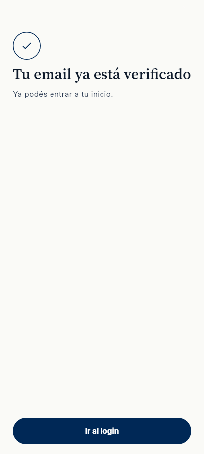
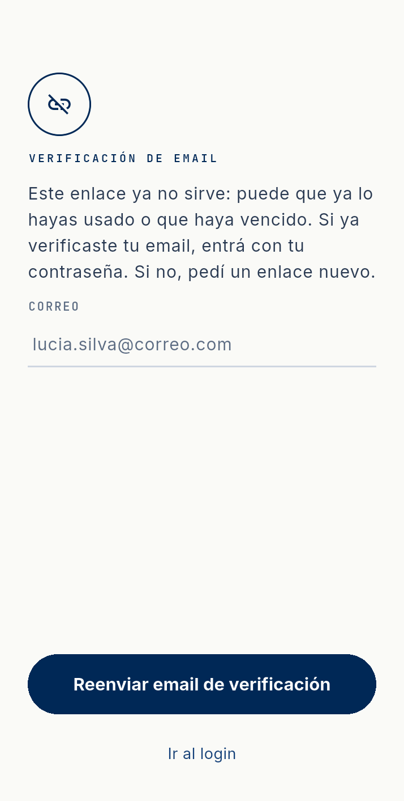
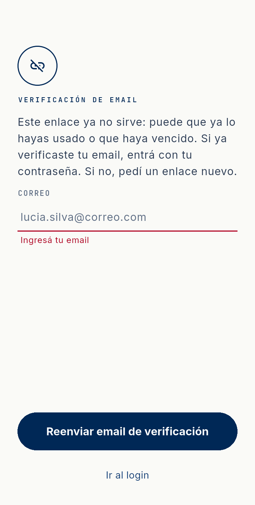
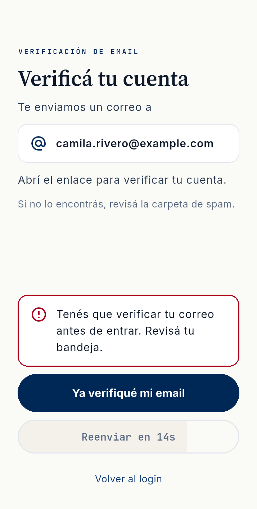
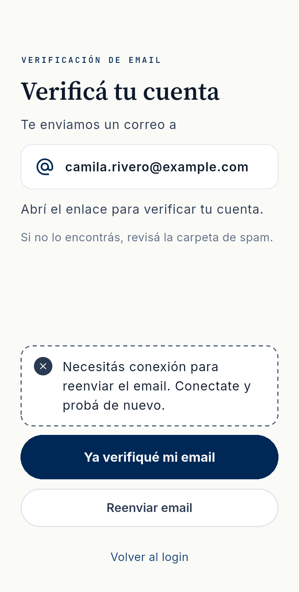
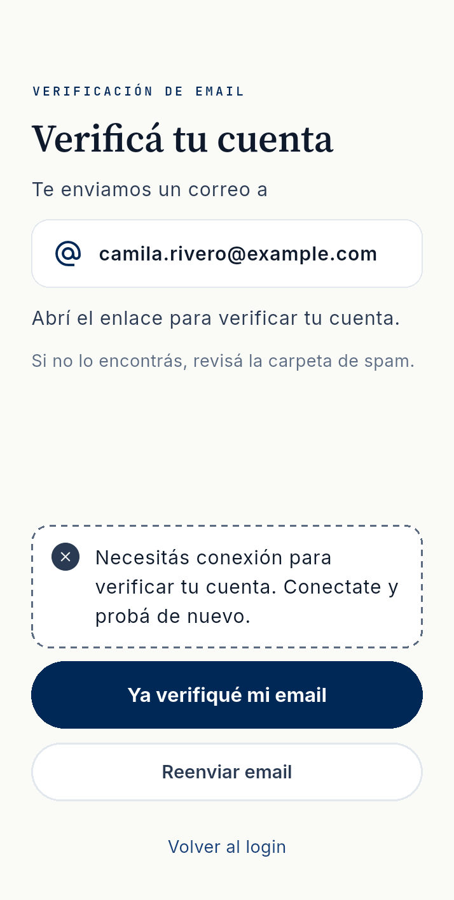
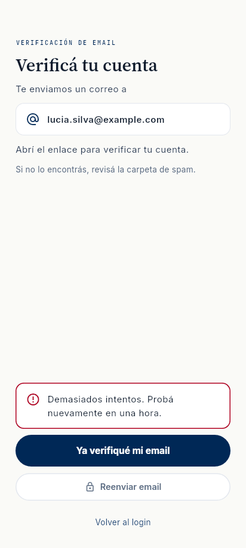

### 1.4 Iniciar sesión

Cada vez que la app te pide entrar: la primera vez en un teléfono, después de cerrar sesión o cuando la sesión se vence.

**Antes de empezar**

- Tu correo tiene que estar confirmado (ver [Verificar tu correo](#13-verificar-tu-correo)).
- La primera vez que entrás en un teléfono necesitás conexión. Después, mientras tu sesión siga vigente, podés abrir la app y trabajar sin conexión.

**Pasos**

1. En la pantalla de entrada, en «CORREO» escribí el correo con el que creaste la cuenta (no la cédula).
2. En «CONTRASEÑA» escribí tu contraseña. El ojo a la derecha («Mostrar contraseña») te deja verla.
3. Tocá «Entrar». El botón se pone gris y muestra un círculo girando mientras la app comprueba los datos; el enlace «¿Olvidaste tu clave?» y «Registrate» también se ponen grises.

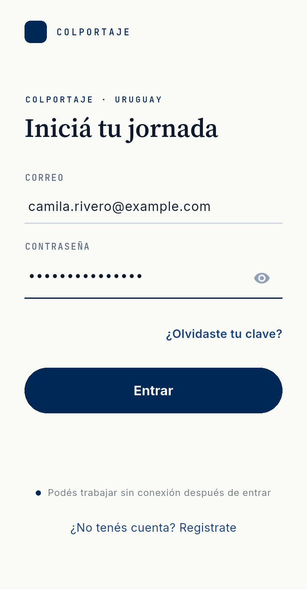

4. Si todo está bien, la app sigue con [Preparar el espacio seguro del teléfono](#16-preparar-el-espacio-seguro-del-teléfono) (la primera vez en este teléfono) o te lleva a tu pantalla principal.

> **Importante.** No existe una casilla «Mantener sesión». Tu sesión dura 30 días desde la última vez que usaste la app y se renueva sola cada vez que la usás. Se cierra antes solo si tocás «Cerrar sesión» o si se cambia la contraseña.

**Cuando la app te devuelve a la entrada**

Si tu sesión se cerró sola, la entrada cambia: en lugar de «Iniciá tu jornada» dice «Hola de nuevo» (o «Hola de nuevo, Lucía», con tu nombre), tu correo ya viene escrito, y arriba aparece un aviso que dice por qué. El enlace de recuperación pasa a decir «Recuperar acceso». El aviso se puede cerrar con la ✕ («Cerrar aviso»), pero si no entrás, vuelve a aparecer cada vez que abrís la app.

**Qué puede pasar**

| Si ves… | Qué significa | Qué hacer |
|---|---|---|
| «Ingresá tu email» | Dejaste el correo vacío. | Escribilo. |
| «El email no es válido» | Al correo le falta la arroba, el dominio o la terminación. | Revisalo. |
| «Revisá el email: no puede llevar tildes, ñ, espacios ni comas.» | El correo tiene un carácter que no se acepta. | Quitá ese carácter. |
| «Revisá el email: no podemos mandar correos a esa dirección.» | Esa dirección no puede recibir correos. | Revisá cómo la escribiste. |
| «Ingresá tu contraseña» | Dejaste la contraseña vacía. | Escribila. |
| «La contraseña tiene al menos 8 caracteres» | Escribiste menos de 8 caracteres. | Revisá la contraseña. |
| «Email o contraseña incorrectos» | El correo o la contraseña no coinciden con una cuenta. La app no dice cuál de los dos está mal, a propósito. | Revisá los dos. Si no te acordás de la contraseña, tocá «¿Olvidaste tu clave?». |
| «Tenés que verificar tu correo antes de entrar. Revisá tu bandeja.» | Todavía no confirmaste el correo. La entrada solo muestra el aviso: no te lleva a «Verificá tu cuenta». | Abrí el enlace del correo (ver [Verificar tu correo](#13-verificar-tu-correo)). |
| «Necesitás conexión para iniciar sesión por primera vez en este dispositivo.» | Es la primera vez que entrás en este teléfono y no hay internet. | Conectate y tocá «Entrar». |
| «Necesitás conexión para iniciar sesión.» | Tu cuenta ya estuvo en este teléfono, pero ahora hace falta internet para entrar. | Conectate y tocá «Entrar». |
| «Demasiados intentos. Esperá unos minutos y volvé a probar.» | Probaste muchas veces en poco tiempo. | Esperá unos minutos o recuperá tu contraseña. |
| «No pudimos iniciar tu sesión. Probá de nuevo en unos minutos.» (texto rojo, sin botón «Reintentar») | El servidor no pudo iniciar tu sesión. No depende de vos. | Esperá unos minutos y tocá «Entrar» de nuevo. |
| «Tu sesión expiró por inactividad. Iniciá sesión nuevamente.» | Pasaron 30 días sin usar la app. Lo que tenías guardado en el teléfono sigue ahí. | Escribí tu contraseña y tocá «Entrar». |
| «Tu sesión expiró. Necesitás conexión para renovarla.» y, debajo del botón, «Vas a poder entrar cuando vuelva la señal.» | La sesión venció y no hay internet. Este aviso no se puede cerrar: dura mientras no haya señal. | Conectate y tocá «Entrar». |
| «Tu sesión se cerró porque se cerró sesión en todos tus teléfonos o se cambió la contraseña. Entrá de nuevo.» | Alguien cerró tus sesiones, o cambiaste la contraseña. | Entrá con tu contraseña actual. Si no la recordás, tocá «Recuperar acceso». |

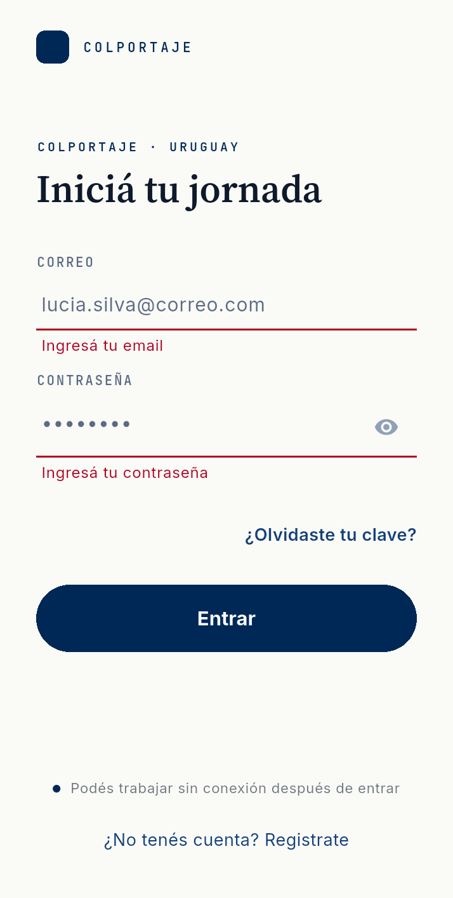
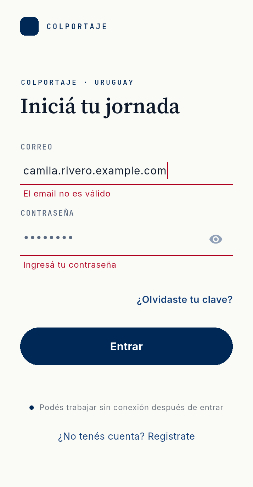
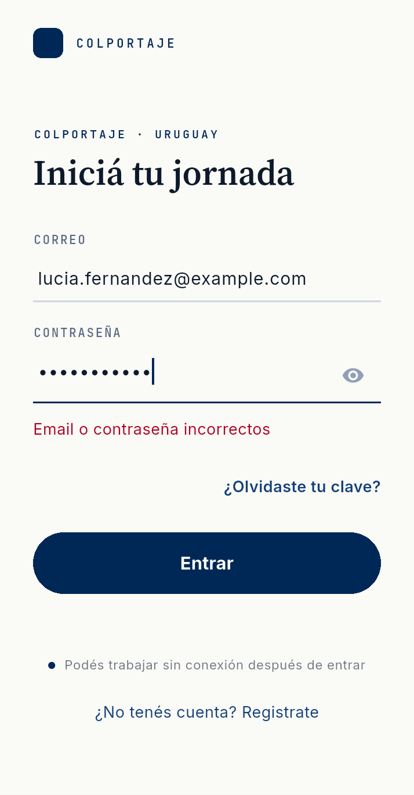
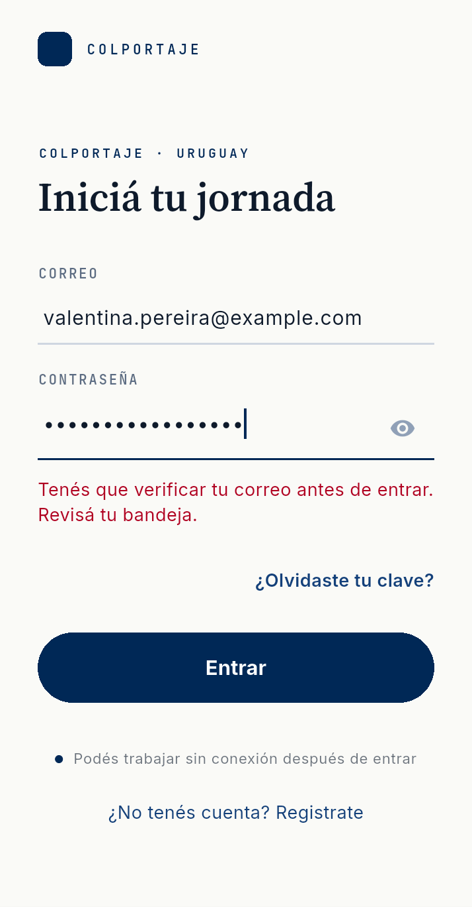
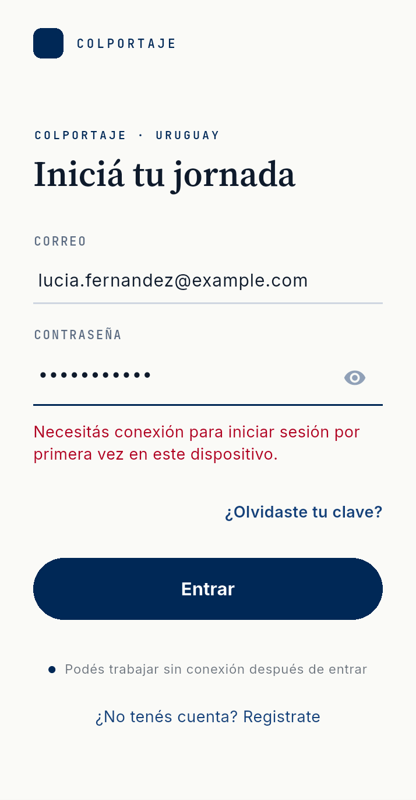
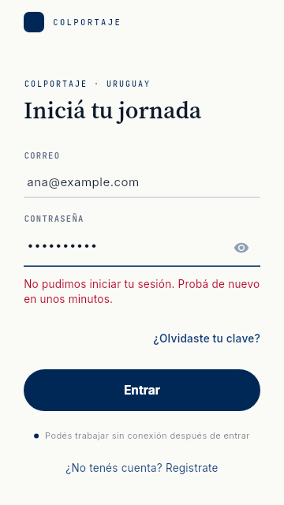
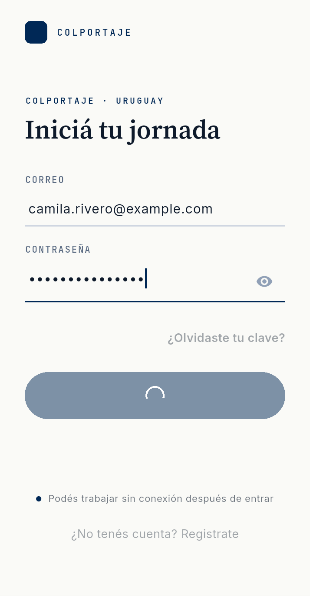

### 1.5 Recuperar tu contraseña

Cuando no te acordás de la contraseña.

**Antes de empezar**

- Necesitás conexión a internet.
- Tené abierto en este teléfono el correo de tu cuenta.

**Pasos**

1. En la pantalla de entrada tocá «¿Olvidaste tu clave?». Si ya escribiste tu correo, la pantalla lo trae cargado.
2. Se abre «¿Olvidaste tu contraseña?», con el rótulo «RECUPERAR CONTRASEÑA». Leé el aviso «Tus datos guardados en este teléfono se conservan.»: cambiar la contraseña no borra nada de lo que ya tenés cargado.
3. En «CORREO» escribí el correo de tu cuenta y tocá «Enviar enlace de recuperación». El botón dice «Enviando…» un momento.

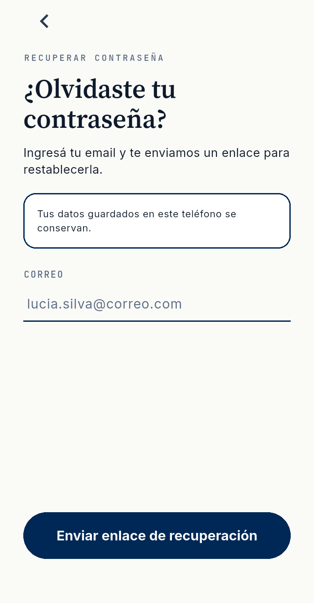
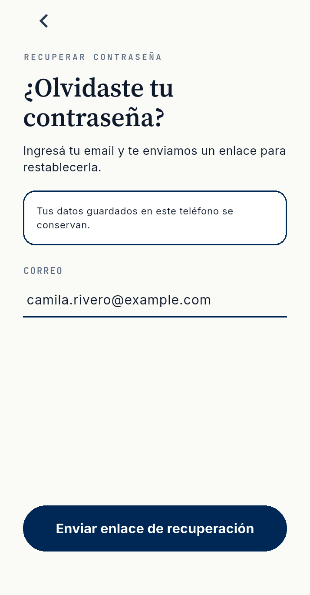

4. Aparece «Si el email está registrado, te enviamos un enlace de recuperación» y, debajo, «Si no lo encontrás, revisá la carpeta de spam.». El mensaje es siempre el mismo, tengas cuenta con ese correo o no.

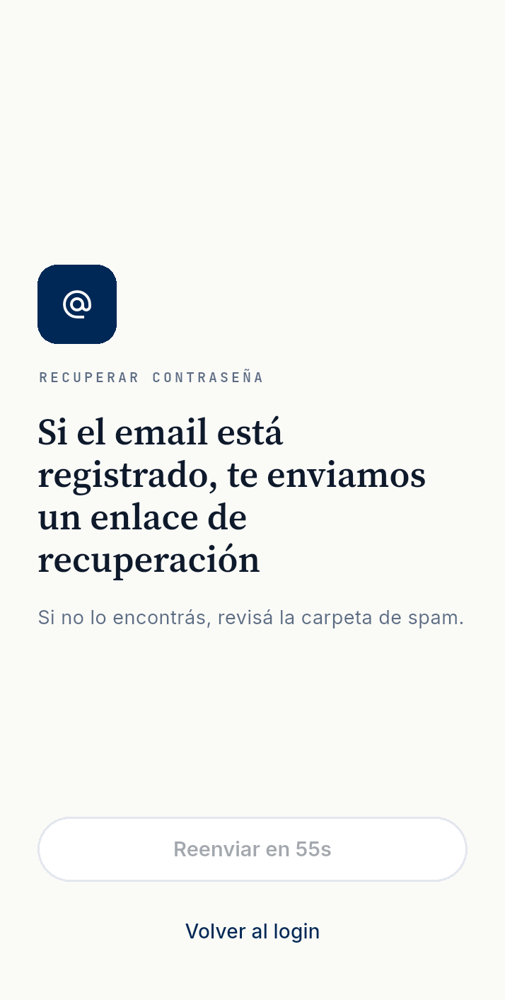

5. Abrí tu correo en este teléfono y tocá el enlace. La app se abre en «Elegí una contraseña nueva».
6. En «CONTRASEÑA NUEVA» escribí la contraseña nueva. Debajo, tres renglones te muestran qué requisitos cumple, y se actualizan mientras escribís: «Al menos 8 caracteres» (con «faltan N» mientras no llegues), «Una mayúscula» y «Un número». Cada uno dice «cumple» o «no cumple» (por ejemplo, «Al menos 8 caracteres, faltan 3: no cumple»). Cuando cumple los tres, el rótulo pasa a «CONTRASEÑA NUEVA · ✓ CUMPLE LOS REQUISITOS».
7. En «REPETIR CONTRASEÑA» escribila otra vez. Cuando coinciden, el rótulo pasa a «REPETIR CONTRASEÑA · ✓ COINCIDEN». El texto «Mostrar contraseña» (a la derecha de cada campo) te deja ver lo que escribís.

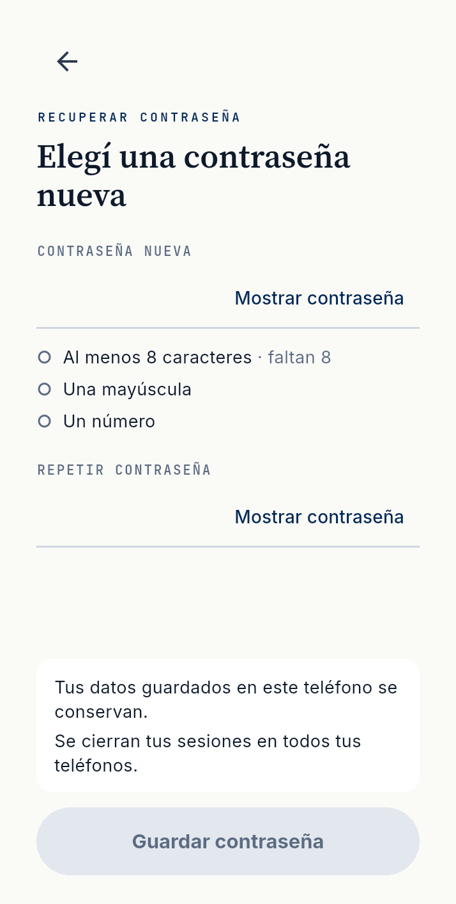
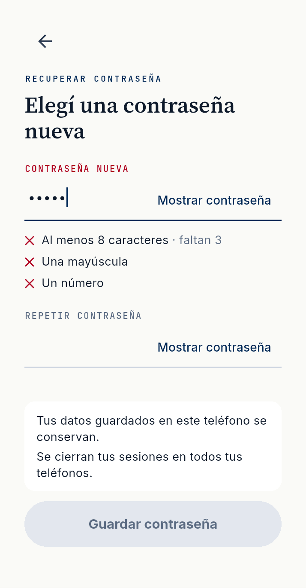
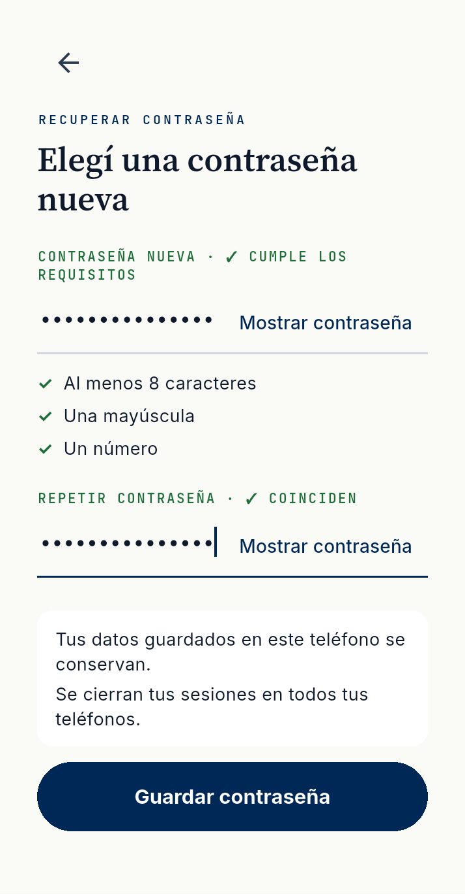

8. Tocá «Guardar contraseña». El botón dice «Guardando…». Abajo, antes de guardar, la app te avisa que «Al guardarla se cierran tus sesiones en todos tus teléfonos: vas a entrar de nuevo con la contraseña nueva.» (si ya hay datos en este teléfono dice «Tus datos guardados en este teléfono se conservan.» y «Se cierran tus sesiones en todos tus teléfonos.»).
9. Aparece «Contraseña actualizada. Iniciá sesión.» (ver abajo la variante más larga). Tocá «Ir al login» y entrá con la contraseña nueva.

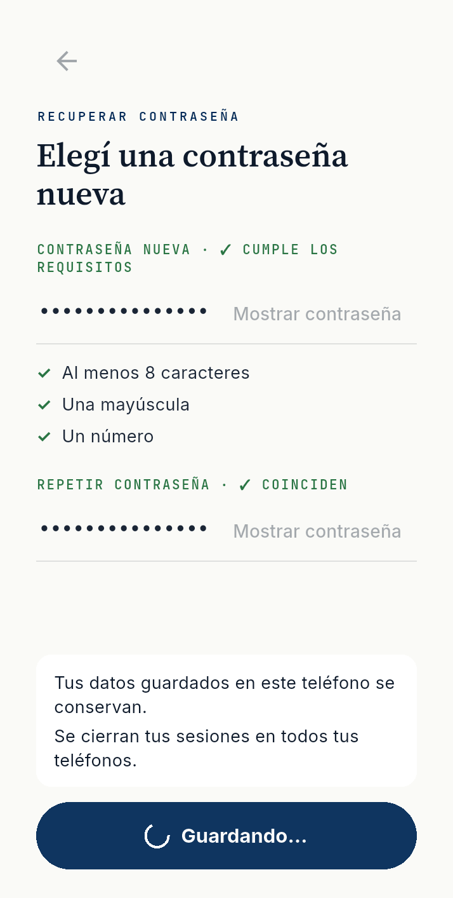
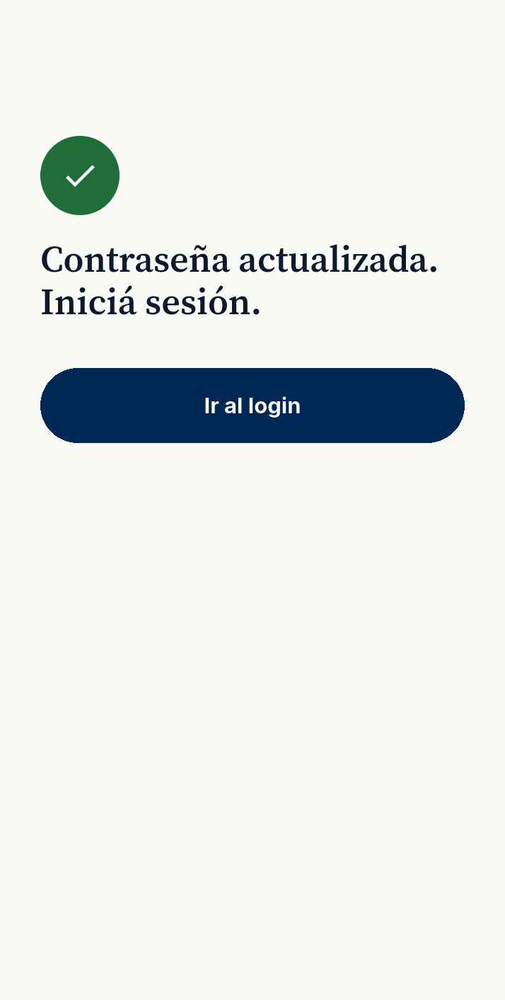

> **Importante.** Podés pedir un enlace nuevo cada 60 segundos. Mientras esperás, la pantalla dice «Podés pedir otro enlace en Ns.» y el botón de reenviar muestra «Reenviar en Ns». Esa espera se mantiene aunque salgas de la pantalla y vuelvas.

> **Consejo.** Si abrís el enlace con la sesión ya iniciada, los botones de salida dicen «Volver» o «Ir a mi inicio» en lugar de «Volver al login».

**Qué puede pasar**

| Si ves… | Qué significa | Qué hacer |
|---|---|---|
| «Ingresá tu email» | Dejaste el correo vacío. | Escribilo. |
| «Revisá el email: parece incompleto.» | Al correo le falta algo. | Revisalo. |
| «Revisá el email: no puede llevar tildes, ñ, espacios ni comas.» | El correo tiene un carácter que no se acepta. | Quitá ese carácter. |
| «Necesitás conexión para solicitar la recuperación» | No hay internet. | Conectate y volvé a tocar el botón. |
| «No pudimos enviar el enlace. Probá de nuevo en unos minutos.» | Falló algo que no depende de vos. | Esperá unos minutos y volvé a probar. |
| «No pudimos comprobar si ya pediste un enlace hace poco. Esperá unos segundos y probá de nuevo.» | El teléfono tardó en contestar. | Esperá unos segundos y tocá el botón otra vez. |
| «Podés pedir otro enlace en 42s.» | Pasó menos de un minuto desde el último pedido. | Esperá a que el botón se active. |
| «Reenviar en 42s» / «Reenviar enlace» | El reenvío de la pantalla de enlace enviado. | Cuando diga «Reenviar enlace», tocalo para pedir otro. |
| «Ingresá la contraseña nueva» | Dejaste la contraseña nueva vacía. | Escribila. |
| «Repetí la contraseña nueva» | Falta repetirla. | Escribila de nuevo en «REPETIR CONTRASEÑA». |
| «Las contraseñas no coinciden» | Las dos contraseñas son distintas. | Escribilas de nuevo. |
| «Escribí la contraseña nueva.», «Todavía no cumple los requisitos de abajo.» o «Repetí la contraseña para confirmar que está bien escrita.» | Tocaste «Listo» en el teclado antes de que se pueda guardar. | Completá lo que dice el aviso. |
| «Es demasiado larga. Acortala.» (el rótulo «CONTRASEÑA NUEVA» pasa a rojo) | La contraseña pasa el límite de 72 bytes. «Guardar contraseña» queda apagado. | Escribí una más corta. |
| «Tiene que ser distinta de la anterior.» | Escribiste la misma contraseña de antes. | Elegí otra. |
| ENLACE NO VÁLIDO · «Este enlace ya no sirve: venció o ya se usó. Solicitá uno nuevo.» y los botones «Solicitar un enlace nuevo» y «Volver al login» (con la sesión abierta, «Ir a mi inicio») | El enlace venció, ya se usó o se abrió en otro teléfono. La app no puede saber cuál de los casos es. | Tocá «Solicitar un enlace nuevo». |
| «Sin conexión» · «Necesitás conexión para abrir el enlace. Cuando tengas señal, volvé a abrirlo desde el correo.» y, con la sesión abierta, el botón «Ir a mi inicio» | Tocaste el enlace sin internet. El enlace sigue sirviendo. | Conectate y volvé a tocar el enlace del correo. |
| «Sin conexión» · «Conectate para guardar la contraseña. No perdés lo que escribiste.» | Se cortó la conexión al guardar. | Conectate y tocá «Guardar contraseña» otra vez. |
| «No pudimos guardar la contraseña. Probá de nuevo.» | Falló algo que no depende de vos. | Tocá «Guardar contraseña» otra vez. |
| «Demasiados intentos. Esperá unos minutos y volvé a probar.» | Se intentó demasiadas veces seguidas. | Esperá unos minutos y volvé a tocar «Guardar contraseña». |
| «Contraseña actualizada. Iniciá sesión ahora: al entrar cerramos tus sesiones en los otros teléfonos.» (con «Ir al login») | La contraseña cambió, pero no se pudo cerrar las sesiones de tus otros teléfonos en ese momento. | Entrá con la contraseña nueva; en ese momento se cierran. |
| «Cambiaste la contraseña, pero no pudimos cerrar la sesión en este teléfono. Cerrala desde Configuración.» y el botón «Volver al inicio» | La contraseña cambió, pero la sesión de este teléfono no se cerró. | Tocá «Volver al inicio» y cerrá la sesión desde Configuración (ver el capítulo de Configuración). |

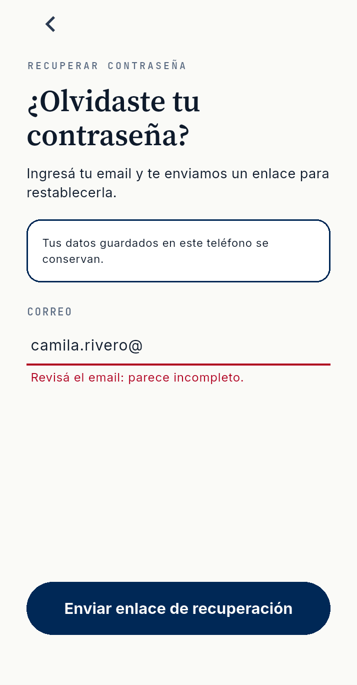
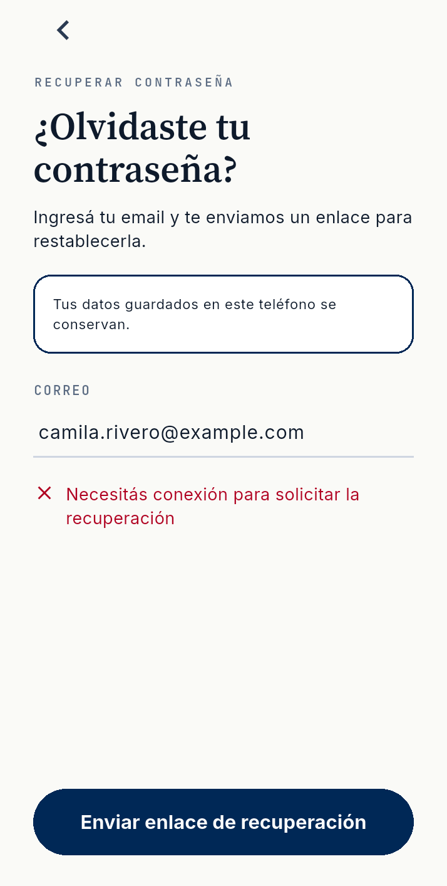
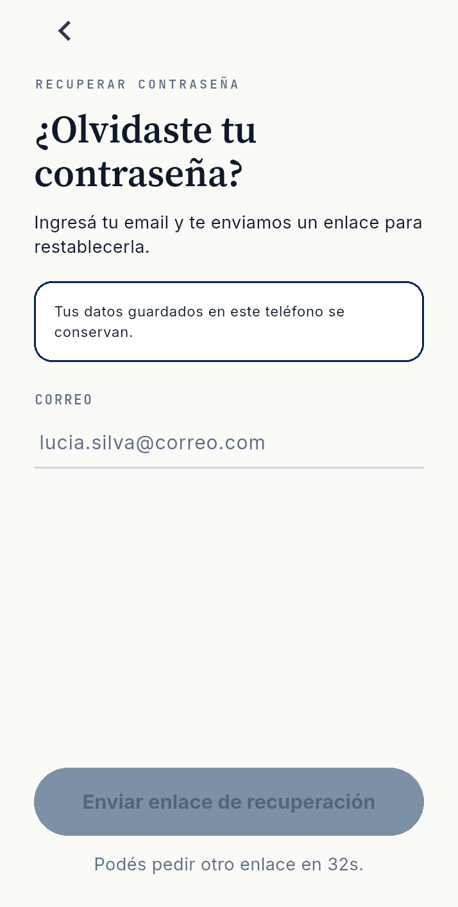
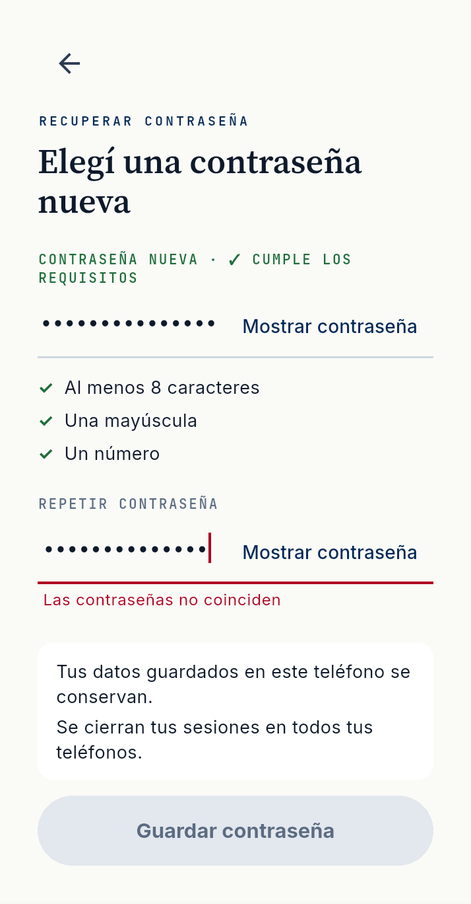
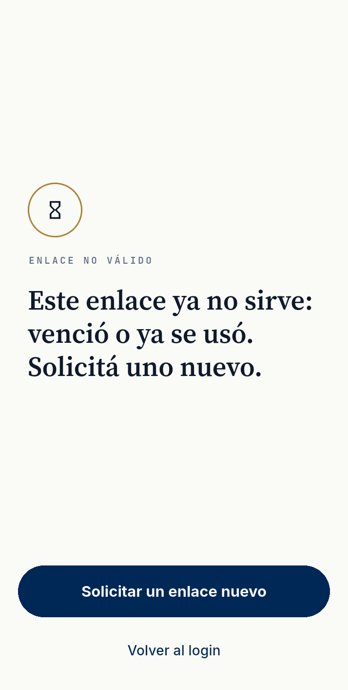
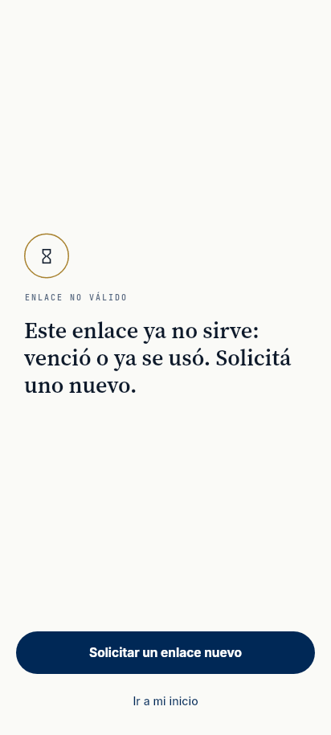
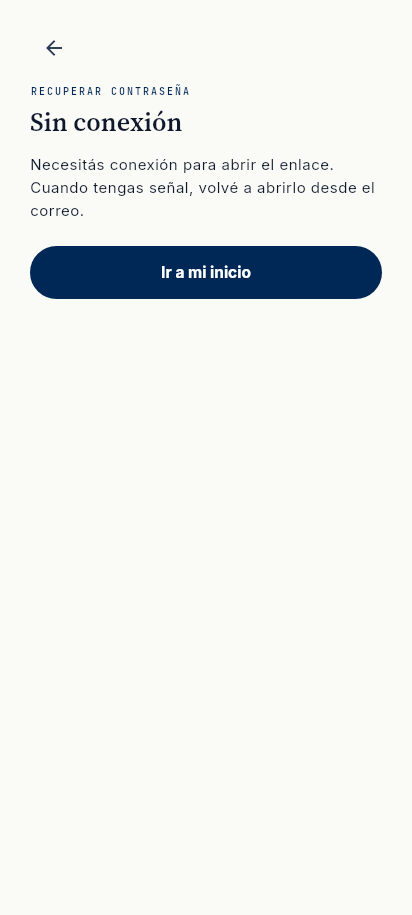

### 1.6 Preparar el espacio seguro del teléfono

La primera vez que entrás en un teléfono, la app prepara un lugar protegido adentro del aparato donde guarda lo que cargues (casas, personas, visitas, ventas). Así podés trabajar sin conexión y nadie más que vos puede abrir esos datos. Se hace una sola vez por teléfono, y suele tardar unos segundos.

Para protegerlos, la app usa el bloqueo de pantalla de tu teléfono. Por eso el teléfono tiene que tener un PIN, un patrón, una contraseña o la huella configurados. La app no tiene un PIN propio.

**Pasos**

1. Si tu teléfono guarda las claves de una forma menos segura, antes de preparar nada aparece «Antes de seguir» (rótulo «PASO 2 DE 3 · EN PAUSA»). Marcá «Entiendo el riesgo y quiero continuar»: hasta que la marques, «Continuar» está apagado. Después tocá «Continuar». Si preferís no seguir, mirá «Salir sin preparar» en la tabla de abajo.

2. Se abre una pantalla con el rótulo «PRIMER INGRESO EN ESTE TELÉFONO». Arriba dice «Preparando tu espacio seguro…». En el primer paso el título va solo; desde el segundo paso lleva el contador («2/3» y después «3/3»).
3. Debajo se ven los tres pasos, con una barra que se va llenando: «Revisando el bloqueo de pantalla», «Creando y guardando tu clave» y «Creando tu base cifrada». Cada uno trae una línea de apoyo: en el primero, «Lo que cargues queda cifrado en este teléfono. Se hace una sola vez.»; en el segundo, «La clave se guarda en el almacenamiento seguro del teléfono. Nadie más la ve.».
4. No toques nada. Dura apenas unos segundos. Cuando termina, la app sigue sola a la pantalla siguiente.

**Si la app te pide tu contraseña**

En algunos casos (por ejemplo, cuando la preparación se cortó a la mitad) la app te pide confirmar tu contraseña antes de seguir: es la misma contraseña con la que protege tus datos.

1. En la pantalla «Confirmá tu contraseña» escribí tu contraseña en «CONTRASEÑA».
2. Tocá «Confirmar contraseña». La pantalla muestra «Un momento» y «Confirmando tu contraseña…».

**Qué puede pasar**

| Si ves… | Qué significa | Qué hacer |
|---|---|---|
| «Activá el bloqueo de pantalla» (rótulo «PASO 1 DE 3 · EN PAUSA») y «Para proteger los datos de tus clientes, tu teléfono necesita un bloqueo de pantalla. Configurá un PIN, un patrón, una contraseña o tu huella en los ajustes de seguridad del teléfono y volvé a intentar.» | Tu teléfono no tiene bloqueo de pantalla. La pantalla indica «CÓMO CONFIGURARLO»: «Ajustes > Seguridad > Bloqueo de pantalla» y «Elegí PIN, patrón o contraseña y volvé a la app.». | Tocá «Abrir Ajustes» (se abre «Seguridad y privacidad» del teléfono), configurá el bloqueo, volvé a la app y tocá «Ya lo configuré». Si tocás «Ya lo configuré» sin haber puesto el bloqueo, no pasa nada: la pantalla sigue igual. Si en tu teléfono los menús se llaman distinto, buscá «bloqueo de pantalla» en los ajustes. |
| «No pudimos abrir los ajustes. Abrilos a mano desde el menú del teléfono.» | La app no pudo abrir los ajustes por vos. | Abrí los ajustes del teléfono a mano y configurá el bloqueo; después tocá «Ya lo configuré». |
| «Antes de seguir» (rótulo «PASO 2 DE 3 · EN PAUSA») y «Tu dispositivo tiene almacenamiento menos seguro. Los datos siguen cifrados pero el nivel de protección es menor.» | Tu teléfono guarda las claves de una forma menos segura que los modelos nuevos. Los datos siguen protegidos. | Si querés seguir, marcá «Entiendo el riesgo y quiero continuar» y tocá «Continuar». Si no, tocá «Salir sin preparar», que te lleva a «Usá otro celular». |
| «Usá otro celular» y «No preparamos tu espacio seguro. Para usar la app con la protección completa, iniciá sesión desde otro celular. Los modelos de los últimos años guardan las claves en un chip aparte, que es lo más seguro.» | Elegiste «Salir sin preparar». | Tocá «Cerrar sesión» y entrá desde otro teléfono, o «Prefiero seguir con este celular» para volver a «Antes de seguir». |
| «Recuperá tus datos» y «Tu almacenamiento seguro falló. Ingresá tu contraseña para recuperar tus datos» | El teléfono perdió la clave que abría tus datos, pero tu contraseña puede reconstruirla. | Escribí tu contraseña y tocá «Recuperar mis datos» (muestra «Recuperando tus datos…»). «Reintentar sin la contraseña» prueba de nuevo sin ella. |
| «Esa no es la contraseña de tu cuenta. Probá de nuevo.» | La contraseña que escribiste no es la de tu cuenta. | Escribila de nuevo. Si no la recordás, tocá «¿Olvidaste tu contraseña?». |
| «Necesitás conexión para confirmar tu contraseña.» | No hay internet. | Conectate y volvé a tocar «Confirmar contraseña». |
| «No pudimos confirmar tu contraseña. Probá de nuevo en unos minutos.» | Falló algo que no depende de vos. | Esperá unos minutos y volvé a probar. |
| «No hay espacio suficiente para preparar el app» y «Liberá espacio borrando fotos, videos o apps que no uses, y volvé a intentarlo.» | El teléfono está lleno. | Liberá espacio y tocá «Reintentar». «Abrir almacenamiento» te lleva a los ajustes. |
| «La preparación se cortó» y «La app se cerró antes de terminar. Volvemos a empezar desde el paso 1 para que todo quede bien.» (el paso en que se cortó dice «· cortado») | Se cerró la app o se apagó el teléfono a mitad de la preparación. No se perdió nada, porque todavía no había datos. | Tocá «Empezar de nuevo». No te vuelve a pedir el correo. A veces te pide confirmar la contraseña: «La app se cerró mientras preparaba tus datos. Para protegerlos, confirmá tu contraseña.». |
| «No se pudo terminar» y, según el caso, «No pudimos preparar el almacenamiento seguro. Consultá a soporte antes de reinstalar la app.» seguido de «Si reintentás, empezamos de cero. No se perdió nada: todavía no había datos.» | Falló la preparación por un motivo del teléfono. | Tocá «Reintentar desde cero». Si vuelve a pasar, tocá «Contactar a soporte». No desinstales la app antes de hablar con soporte. |
| «No pudimos abrir WhatsApp. Escribile a soporte al … y decile este código: …» | El teléfono no pudo abrir el chat de soporte. | Escribile a soporte al número que muestra y pasale el código. |
| «No pudimos abrir tus datos» y «No pudimos abrir los datos guardados en este teléfono: se perdieron la llave que los protege y la copia que se abre con tu contraseña. No se borró nada.» | No se pueden abrir los datos guardados en este teléfono. | Tocá «Reintentar». Si vuelve a fallar, aparece «Si sigue sin funcionar, podés empezar de nuevo con este teléfono.» y el botón «Empezar de nuevo». También podés tocar «Contactar a soporte». |
| «¿Empezar de nuevo?» y «Los datos guardados en este teléfono no se pueden abrir sin la llave que los protege. Si empezás de nuevo, se borran: se pierden las personas y las notas (que nunca se suben) y todo lo que todavía no se subió, como jornadas, ubicaciones y ventas. Lo que ya se subió no se pierde. No se puede deshacer.» | Es la confirmación antes de borrar lo que hay en este teléfono. | Si estás seguro, tocá «Borrar y empezar de nuevo». Si no, tocá «Cancelar». |
| «Actualizá la app» (rótulo «ACTUALIZACIÓN NECESARIA») y «Tus datos son de una versión más nueva de la app. Actualizala para seguir usando tus datos.» | Los datos del teléfono los guardó una versión más nueva que la que tenés instalada. | Tocá «Actualizar»: aparece «Buscá Colportores en la tienda de tu celular (Google Play o App Store) y actualizala.». |

> **Importante.** «Empezar de nuevo» después de «No pudimos abrir tus datos» borra datos del teléfono y no se puede deshacer. Antes de tocarlo, consultá con soporte, sobre todo si cargaste personas o notas: esas nunca se suben.

### 1.7 Recuperar tus datos desde un respaldo

Se muestra en el primer arranque, justo después de preparar el espacio seguro, y solo si el teléfono no tiene ningún dato cargado. Sirve para traer lo que tenías en otro teléfono desde la copia que la app guarda en tu Google Drive (ver [Conectar el respaldo en tu Google Drive](#65-conectar-el-respaldo-en-tu-google-drive)). Si es tu primera vez con la app, lo único que corresponde acá es «Empezar sin recuperar».

**Antes de empezar**

- Necesitás conexión a internet, mejor Wi-Fi.
- Para traer una copia necesitás la cuenta de Google con la que se hizo el respaldo y la contraseña que usabas cuando se hizo.

**Pasos para traer tu respaldo**

1. Se abre una pantalla con el rótulo «RECUPERAR · PASO 1 DE 3». Si todavía no conectaste Google, aparece directo «Buscá tu respaldo» con el texto «Si ya usaste Colportaje en otro teléfono, tu respaldo está en tu Google Drive. Conectalo para buscarlo; solo esta app puede abrir esos archivos. Si es la primera vez que usás la app, tocá «Empezar sin recuperar».».

2. Tocá «Conectar con Google» y elegí tu cuenta en la pantalla de Google. Cuando Google ya está conectado, la app busca tu respaldo y ves «Buscando tu respaldo» y «Buscando tu respaldo en Google Drive…», con un círculo girando.

3. Si hay una copia, aparece «Encontramos un respaldo», con «Podés traer a este teléfono todo lo que tenías: ubicaciones, personas, notas, ventas y cobros.» y una tarjeta con la fecha, la cantidad de partes y el tamaño (por ejemplo, «Respaldo del 22/10 a las 03:10» y «15 partes · 38 MB»). La tarjeta no muestra tu cuenta de Google. Tocá «Recuperar mis datos».

4. En el paso 2, «Abrí tu copia», escribí en «CONTRASEÑA» la que usabas cuando se hizo el respaldo (debajo se lee «La que usabas cuando se hizo este respaldo.»). Antes de empezar, la pantalla te avisa cuánto pesa: «Vamos a restaurar 38 MB. La operación puede tardar varios minutos.». Tocá «Abrir copia».

5. En el paso 3, «Restaurando», se ve cuánto falta («Bajando base…», «Bajando partes…», «12/15 partes», «Armando tu copia…», «Reenviando lo que estaba pendiente…», «Trayendo lo último de tu cuenta…»). La pantalla aclara «Lo que había en este teléfono no se toca hasta que termine. Si se corta, no se pierde nada.». Si querés frenar, tocá «Cancelar».

6. Al terminar aparece «Tus datos están de vuelta», con «Como el 22/10 a las 03:10» y el resumen de «Ubicaciones», «Personas», «Ventas» y «Cobros» que volvieron. Tocá «Ir a mi inicio».

**Si no querés traer nada**

1. Tocá «Empezar sin recuperar». Se abre una hoja «¿Empezar sin recuperar?» que dice «Podés traer tu respaldo después desde Configuración, en «Recuperar mi respaldo», mientras no hayas cargado nada en este teléfono. Una vez que cargues datos, ya no vas a poder traerlo.».
2. Tocá «Empezar sin recuperar» para seguir, o «Volver» para quedarte en el asistente.

> **Importante.** Mientras el teléfono no tenga datos cargados, la fila «Recuperar mi respaldo» de Configuración (con la leyenda «Traé lo que tenías en otro teléfono. Solo mientras no hayas cargado nada acá.») te deja volver a este asistente. Cuando ya cargaste algo, la app avisa «Ya hay datos cargados en este teléfono, así que no se puede traer el respaldo.». El detalle de cada pantalla y de cada aviso está en [Recuperar tu respaldo en un teléfono nuevo](#67-recuperar-tu-respaldo-en-un-teléfono-nuevo).

**Qué puede pasar**

| Si ves… | Qué significa | Qué hacer |
|---|---|---|
| «Encontramos más de un respaldo» y «Encontramos 2 respaldos de teléfonos que usaste antes. Los traemos todos juntos y los juntamos en este teléfono: no se borra nada. Tarda más porque se descarga todo.» | Usaste la app en más de un teléfono. | Tocá «Recuperar todos mis datos». Después, «Abrí tus copias» te pide la contraseña («La que usabas cuando se hicieron estos respaldos.») y el botón dice «Abrir copias». |
| «No encontramos un respaldo» y «En tu Google Drive no hay un respaldo de Colportaje. Si lo hiciste con otra cuenta de Google, probá con esa.» | La cuenta de Google que conectaste no tiene respaldo. | Tocá «Probar con otra cuenta», o «Empezar sin recuperar» si es tu primera vez. |
| «Esta contraseña no abre tu copia; probá la que usabas cuando hiciste el último respaldo.» (en plural: «Esta contraseña no abre tus copias; probá la que usabas cuando hiciste los últimos respaldos.») | La contraseña no es la que tenías cuando se hizo la copia. | Probá con la que usabas entonces. Tu contraseña de hoy puede ser distinta. |
| «No conectamos tu Drive. Podés hacerlo cuando quieras.» (aviso azul; el botón principal pasa a decir «Reintentar») | Cerraste la pantalla de Google sin elegir cuenta. | Tocá «Reintentar», o «Empezar sin recuperar». |
| «No pudimos conectar tu Drive. Probá de nuevo.» (aviso rojo; el botón principal pasa a decir «Reintentar») | Falló la conexión con Google. | Tocá «Reintentar». |
| «Google ya no nos deja abrir tu Drive. Conectalo de nuevo para seguir con tu respaldo.» (cuadro rojo; el botón principal dice «Reintentar») | Google retiró el permiso de la app. | Tocá «Reintentar» y volvé a conectar tu cuenta de Google. |
| «Recuperar mis datos» y «Necesitás conexión (mejor Wi-Fi) para traer tu respaldo.», con «Reintentar» apagado | No hay internet. | Conectate: cuando vuelve la señal, «Reintentar» se activa. |
| «No pudimos buscar tu respaldo» y «Algo falló al mirar tu Google Drive. Probá de nuevo; si sigue pasando, podés empezar sin recuperar.» | Falló la búsqueda. | Tocá «Reintentar». |
| «Se cortó la conexión» · «Quedó en la parte 12» (o «Todavía no bajamos ninguna parte») y «Se cortó la conexión. Lo que tenías antes en el teléfono no se tocó. Cuando vuelva, seguimos desde la parte 12.» | Se perdió la conexión durante la restauración. No se perdió nada. | Cuando vuelve la conexión, sigue sola. También podés tocar «Reintentar» (se enciende cuando hay conexión) o «Cancelar». |
| «Recuperamos casi todo» y «La parte 14 de 15 está dañada. Restauramos todo hasta el 21/10 a las 03:10; lo posterior quedó afuera.» con «Quedó afuera: Lo registrado después del 21/10» y «Restaurado: Todo lo anterior» | Una parte de la copia está dañada. Se trajo todo hasta ahí. | Tocá «Seguir con lo recuperado», «Ver qué quedó afuera» (que explica «Lo que ya había subido a tu cuenta vuelve con la sincronización. Lo que registraste después del último respaldo y no llegó a subir solo está en el teléfono anterior.») o «Reintentar». Si tenés el teléfono viejo, lo posterior al 21/10 puede estar ahí. |
| «No pudimos reintentar. Lo que ya recuperaste sigue en este teléfono.» | Falló el reintento de una copia dañada. | Tocá «Seguir con lo recuperado». |
| «No pudimos abrir 1 respaldo con tu contraseña. Sigue en tu Google Drive, sin tocar.» (o «No pudimos abrir 2 respaldos…») | Con varias copias, alguna no se abre con esa contraseña. No se borró. | Seguí; esa copia sigue en tu Drive. |
| «No podemos abrir este respaldo» y «Este respaldo no tiene la clave que hace falta para abrirlo, y ninguna contraseña la reemplaza. No se tocó nada de tu teléfono.» | La copia no se puede abrir. | Tocá «Reintentar» o «Empezar sin recuperar». |
| «No pudimos leer tu respaldo» y «El respaldo está dañado y no hay nada para traer. No se tocó nada de tu teléfono.» | La copia está dañada del todo. | Tocá «Reintentar» o «Empezar sin recuperar». |
| «No pudimos recuperar tus datos» y «Algo falló y no se pudo terminar. No se tocó nada de tu teléfono. Probá de nuevo en unos minutos.» | Falló la restauración. | Tocá «Reintentar» en unos minutos. |
| «Actualizá la app» y «Tus datos son de una versión más nueva de la app. Actualizala para seguir usando tus datos.» | La copia es de una versión más nueva de la app. | Tocá «Actualizar»: aparece «Buscá Colportores en la tienda de tu celular (Google Play o App Store) y actualizala.». |
| «No pudimos revisar si este teléfono tiene datos. Probá de nuevo en unos minutos.» (desde Configuración, «Recuperar mi respaldo») | La app no pudo comprobar si el teléfono está vacío. | Esperá unos minutos y volvé a probar. |

### 1.8 Terminar jornadas que quedaron abiertas

Si en el teléfono hay una jornada de un día anterior que quedó abierta y después empezó otra, antes de llegar a tu pantalla principal la app te pide cerrar la anterior. Es lo que puede pasar, por ejemplo, después de recuperar los datos de otro teléfono. La app nunca cierra una jornada con la hora de ahora, porque se contarían horas que no trabajaste.

1. Se abre «¿A qué hora terminaste?», con el rótulo «JORNADA SIN CERRAR». El texto dice, por ejemplo, «Tu jornada del lunes 21 empezó a las 18:00 y quedó abierta. Cerrala para empezar la de hoy.».
2. Debajo, en «A QUÉ HORA TERMINASTE», ves «--:--» y el botón «Elegir la hora». Más abajo se lee hasta cuándo podés elegir, por ejemplo «Lunes 21 · después de las 18:00».
3. Tocá «Elegir la hora», elegí a qué hora terminaste (siguiendo lo que se explica en [Corregir una jornada que quedó abierta](#28-corregir-una-jornada-que-quedó-abierta), capítulo de la jornada) y tocá el botón de abajo. Ese botón dice «Cerrar» y está apagado hasta que elegís la hora; después pasa a decir, por ejemplo, «Terminé a las 23:50». Si hay más de una jornada abierta, vas cerrándolas una por una.

**Qué puede pasar**

| Si ves… | Qué significa | Qué hacer |
|---|---|---|
| «La hora tiene que estar entre las 18:01 y las 19:00. Elegí otra hora y volvé a intentar.» (cuadro rojo) | La hora que elegiste queda fuera del rango permitido para esa jornada. | Elegí otra hora dentro del rango que dice el aviso y tocá «Cerrar». |

### 1.9 Permitir las notificaciones

Se muestra una sola vez, la primera vez que entrás, después de los pasos anteriores y antes de tu pantalla principal.

**Pasos**

1. Se abre «Activá notificaciones para no perderte avisos importantes», con tres motivos: «Recordatorios de tus visitas» (con la aclaración «Con la dirección y el tipo, sin el nombre del cliente»), «Pedidos y tickets revisados» y «Cambios de zona y de campaña».
2. Tocá «Activar notificaciones». El teléfono muestra su propio cuadro pidiéndote permiso («¿Quieres permitir que colportores_mobile te envíe notificaciones?»); mientras tanto el botón muestra un círculo. Tocá «Permitir» en ese cuadro. Ese cuadro lo escribe el teléfono, por eso su texto puede cambiar según el aparato.
3. Se ve el aviso «Notificaciones activadas.», con una tilde verde, y seguís a la pantalla siguiente.

Si no querés notificaciones ahora, tocá «Ahora no». La pantalla no se vuelve a mostrar. En Hoy queda una franja que dice «Las notificaciones están apagadas. Podés activarlas en configuración.», con el botón «Ir a configuración» y una ✕ («Cerrar aviso») para sacarla. Podés activarlas cuando quieras: tocá «Ir a configuración», en Notificaciones tocá «Activar» y después «Permitir» en el cuadro del teléfono. Al activarlas, la franja desaparece y se ve «Notificaciones activadas.».

**Si ya tenés campaña y zona**

Al llegar a Hoy, la primera vez se abre una hoja «Bajá el mapa de tu ciudad»: «Estás con Wi-Fi: bajá el mapa de Montevideo (11 MB) para usarlo sin señal.», con los botones «Descargar» y «Ahora no». Si tocás «Ahora no», la hoja vuelve a salir cada vez que abrís la app mientras no descargues el mapa.

**Qué puede pasar**

| Si ves… | Qué significa | Qué hacer |
|---|---|---|
| «No pudimos pedir el permiso. Probá de nuevo, o tocá «Ahora no» y activalas después en Configuración.» | El teléfono no mostró su cuadro de permiso. | Tocá «Activar notificaciones» otra vez, o «Ahora no». |
| «Activadas. Los recordatorios ya funcionan; los avisos de tu coordinador empiezan a llegar cuando haya conexión.» | Activaste las notificaciones sin conexión. | No hace falta hacer nada: los recordatorios ya suenan. |
| «Las notificaciones están bloqueadas en los ajustes del teléfono. Desde la app no las podemos activar.» y «Abrir ajustes del teléfono» (en Configuración › Notificaciones) | Tocaste «No permitir» en el cuadro del teléfono (alcanza con una vez), y desde entonces solo se activan en los ajustes del teléfono. | Tocá «Abrir ajustes del teléfono» y activá las notificaciones de la app. |
| «Las notificaciones están apagadas en el teléfono. Estas opciones valen cuando las actives.» y el botón «Activar» (en Configuración › Notificaciones) | Tocaste «Ahora no» y todavía no las activaste. No es lo mismo que «bloqueadas»: acá la app sí puede pedir el permiso. | Tocá «Activar» y «Permitir» en el cuadro del teléfono. |

### 1.10 Esperar que te asignen a una campaña

Es lo que ves si tu cuenta todavía no tiene campaña. Quien te asigna es tu coordinador desde su panel: no hay forma de pedirlo desde la app.

**Pasos**

1. Al abrir la app ves un instante «Revisando con el servidor…» con un círculo, mientras la app consulta el estado de tu cuenta. Suele durar un par de segundos.
2. Después aparece «Esperando asignación», con el rótulo «CUENTA PENDIENTE» y el texto «Tu cuenta fue creada. Estamos esperando que tu coordinador te asigne a una campaña.». Arriba a la derecha ves el engranaje «Configuración»; no hay campana de notificaciones.
3. Debajo se ven tres pasos: «Cuenta creada», «Esperando asignación · ahora» (con la nota «Depende de tu coordinador.») y «Listo para trabajar». Al pie, «Última revisión: hoy a las 22:48» y el botón «Actualizar».
4. Para ver si ya te asignaron, deslizá la pantalla hacia abajo o tocá «Actualizar». El botón dice «Consultando…» y abajo se lee «Revisando con el servidor…».
5. Cuando tu coordinador te asigna, la pantalla cambia sola a «Ya te asignaron». Solo ves el tilde verde, el título «Ya te asignaron», una barra de progreso y «Abriendo tu pantalla principal…». A los pocos segundos entrás a Hoy, ya sin candados en la barra de abajo.

Si abrís la app sin conexión, ves la misma pantalla «Esperando asignación», sin «Última revisión» y sin ningún aviso.

> **Consejo.** Cuando entrás a Hoy con campaña y zona asignadas, puede verse la franja «Te asignaron la zona Pocitos en Verano 2026-2027.» con el botón «Entendido».

> **Consejo.** Mientras esperás podés tocar el engranaje de arriba a la derecha para abrir Configuración, que sí está disponible (ahí ves tu nombre, tu correo, «Notificaciones», «Respaldo», «Recuperar mi respaldo», «Privacidad y datos» y «Cerrar sesión»). Las pestañas de abajo (Mapa, Lista, Agenda, Ventas) están bloqueadas: si tocás una, aparece «Disponible cuando tu coordinador te asigne a una campaña.».

**Qué puede pasar**

| Si ves… | Qué significa | Qué hacer |
|---|---|---|
| «Aún no asignado» y «Revisado recién, a las 22:52.» | Consultaste y tu cuenta sigue sin campaña. | Esperá a que tu coordinador te asigne. Probá de nuevo más tarde. |
| «Sin conexión» y «No hay conexión para revisar tu cuenta. Conectate a internet y tocá Reintentar.» | La app nunca pudo consultar tu cuenta y no hay internet. El botón dice «Reintentar». | Conectate y tocá «Reintentar». |
| «Necesitás conexión para saber si ya te asignaron a una campaña. Conectate y tocá Actualizar.» | Tocaste «Actualizar» sin internet. | Conectate y tocá «Actualizar». |
| «No pudimos revisar tu cuenta» y «No pudimos consultar el estado de tu cuenta. Tocá Reintentar para probar de nuevo; si sigue pasando, avisale a tu coordinador.» | Falló la consulta por un motivo que no depende de vos. | Tocá «Reintentar». Si sigue, avisale a tu coordinador. |
| «No pudimos revisar tu cuenta» y «Probá de nuevo en unos minutos.» | Falló una revisión que pediste. | Esperá unos minutos y tocá «Reintentar». |
| «CUENTA SUSPENDIDA» · «Cuenta suspendida» y «Tu cuenta está suspendida. Contactá al administrador.» | Tu cuenta no puede trabajar por ahora. No hay botón «Actualizar». | Contactá a tu coordinador o al administrador. Podés abrir Configuración con «Ir a Configuración». |
| «Tu jornada sigue abierta desde las 13:15. Poné la hora a la que terminaste y guardala.», «HORA DE FIN» con «Ahora · 14:41» y «Cambiar ›», y el botón «Terminar jornada» (se ve solo si había una jornada abierta cuando la cuenta se restringió; en «Esperando asignación» sale arriba de «Actualizar») | Tenías una jornada abierta y la cuenta pasó a pendiente o suspendida. | Elegí la hora en que terminaste y tocá «Terminar jornada» (ver [Corregir una jornada que quedó abierta](#28-corregir-una-jornada-que-quedó-abierta)). No se puede empezar una nueva desde acá. |
| «Disponible cuando tu coordinador te asigne a una campaña.» | Tocaste una pestaña bloqueada. | Esperá la asignación. |
| «Tu cuenta está suspendida. Contactá al administrador. Podés terminar y guardar lo que tenés abierto.» (franja con el botón «Entendido») | Tu cuenta se restringió mientras tenías algo abierto. | Terminá y guardá lo que estabas haciendo, y tocá «Entendido». |

## 2. La pantalla principal y tu jornada

Este capítulo te muestra cómo es la pantalla principal de la app, qué te avisa cuando la abrís y cómo iniciar y cerrar tu jornada de trabajo.

### 2.1 Conocer la pantalla principal

La vas a ver cada vez que abrís la app con tu cuenta ya iniciada. Desde acá llegás a todo lo demás.

La pantalla principal tiene tres partes:

- **La barra de arriba.** A la izquierda dice «COLPORTAJE». A la derecha tiene dos íconos: la campana de notificaciones y el engranaje de Configuración.
- **El centro.** Muestra la pestaña que elegiste. Al abrir la app, siempre arranca en «Hoy».
- **La barra de abajo.** Tiene seis pestañas, en este orden: «Hoy», «Mapa», «Lista», «Agenda», «Ventas» y «Cuenta». La pestaña en la que estás se ve resaltada.

**La barra de arriba**

| Tocá | Para qué sirve |
|---|---|
| La campana (se lee «Notificaciones») | Abre tus notificaciones. Si tenés avisos sin leer, aparece un número sobre la campana (si son más de 99, dice «99+»). Ver [Ver tus notificaciones (la campana)](#63-ver-tus-notificaciones-la-campana). |
| El engranaje (se lee «Configuración») | Abre Configuración: tu cuenta, el respaldo, los mapas y más. Ver [Configuración](#6-configuración-respaldo-y-trabajo-sin-conexión). |

**La barra de abajo**

| Pestaña | Qué hay |
|---|---|
| «Hoy» | Tu jornada: iniciarla, ver cuánto llevás y finalizarla. Es lo que explica este capítulo. |
| «Mapa» | El mapa con tus casas. Si todavía no registraste ninguna, dice «Todavía no registraste ubicaciones» y el botón «Registrar tu primera ubicación». Ver [Registrar una casa](#35-registrar-una-casa-nueva) y [Registrar una visita](#46-registrar-una-visita). |
| «Lista» | Las mismas ubicaciones, en una lista. Si todavía no registraste ninguna, dice «Todavía no registraste ubicaciones» y «Las casas, los negocios y los edificios que registres aparecen acá y también en el mapa.», con el botón «Registrar tu primera ubicación». |
| «Agenda» | Tus visitas de hoy y de los próximos 7 días, con los filtros «Todas», «Entrevistas» y «Cobranzas». Si no tenés visitas, dice «No tenés visitas en los próximos 7 días» y ofrece el botón «+ Agendar». |
| «Ventas» | Hoy muestra «Esta sección llega pronto.» y un botón «Precios» para consultar los precios. |
| «Cuenta» | Se llama «Mi Cuenta» y muestra cuatro tarjetas con la plata de tu campaña: «DEUDA CON LA CASA EDITORA», «DEPOSITADO», «EN MANO» y «POR COBRAR». Cada una compara con la semana anterior; si todavía no hay datos, dice «Sin datos de la semana anterior». |

> **Próximamente.** La pestaña «Ventas» todavía no tiene su pantalla propia. Por ahora la venta se registra desde la casa (ver [Registrar una venta](#53-registrar-una-venta)).

> **Consejo.** Si estás en otra pestaña y usás el botón «atrás» de tu teléfono, volvés a «Hoy». Si ya estás en «Hoy», el botón «atrás» cierra la app.

**Si tu cuenta está pendiente de asignación**

Si tu coordinador todavía no te asignó a una campaña, en vez de la pantalla de «Hoy» ves una pantalla de espera, con la misma barra de abajo. Las pestañas «Mapa», «Lista», «Agenda», «Ventas» y «Cuenta» aparecen con un candado. Si tocás una, la app te avisa: «Disponible cuando tu coordinador te asigne a una campaña.» Si tu cuenta está suspendida, el aviso dice: «Tu cuenta está suspendida. Contactá al administrador.» Ver [Esperar que te asignen a una campaña](#110-esperar-que-te-asignen-a-una-campaña).

### 2.2 Entender los avisos de arriba de «Hoy»

A veces aparece un aviso arriba de la pantalla, debajo de «COLPORTAJE». Los avisos no te impiden trabajar. Si hay varios a la vez, ocupan como mucho el 40 % de la pantalla y se pueden desplazar con el dedo. Si abrís el teclado, los avisos se esconden y vuelven al cerrarlo.

**Qué puede pasar**

| Si ves… | Qué significa | Qué hacer |
|---|---|---|
| «Te asignaron la zona Centro en Campaña Primavera 2026.» | Tu coordinador te asignó una zona. Aparece en cualquier pestaña. | Tocá «Entendido» para cerrarlo. Ver [Conocer la pestaña «Mapa»](#31-conocer-la-pestaña-mapa). |
| «Ya no tenés zona en Campaña Primavera 2026.» | Tu coordinador te sacó la zona de esa campaña. Aparece en cualquier pestaña. | Tocá «Entendido». Si no esperabas el cambio, hablá con tu coordinador. |
| «Llevás 9 días sin respaldo. Revisá tu conexión y reintentá.» (con el botón «Reintentar») | Pasaron más de 7 días sin copia de seguridad de tus datos en tu Google Drive. Solo aparece en «Hoy». | Conectate a internet y tocá «Reintentar». Mientras trabaja dice «Reintentando…». Si sale bien, el aviso desaparece solo. Ver [Ver el estado del respaldo y desconectarlo](#66-ver-el-estado-del-respaldo-y-desconectarlo). |
| «Necesitás conexión para hacer el respaldo.» (dentro del aviso de respaldo) | Tocaste «Reintentar» sin conexión. | Conectate a Wi-Fi o a tus datos y tocá «Reintentar» de nuevo. |
| «No pudimos hacer el respaldo. Probá de nuevo en un rato.» (dentro del aviso de respaldo) | El respaldo falló. | Esperá un rato y tocá «Reintentar». |
| «Las notificaciones están apagadas. Podés activarlas en configuración.» (con «Ir a configuración» y una ✕) | Las notificaciones están apagadas en tu teléfono: dijiste que no al pedido de permiso o las apagaste después desde los ajustes del teléfono. Solo aparece en «Hoy». | Tocá «Ir a configuración» para activarlas. Si no querés verlas, tocá la ✕ (se lee «Cerrar aviso»): el aviso no vuelve a salir. Se va solo si las activás. Ver [Ajustar las notificaciones y los recordatorios](#64-ajustar-las-notificaciones-y-los-recordatorios). |
| «Bajá el mapa de tu zona» (en una hoja que sube desde abajo) | La app te sugiere descargar el mapa de tu zona para usarlo sin señal. Dice: «Te asignaron Pocitos. Estás con Wi-Fi: bajá su mapa (…) para usarlo sin señal.» Si no tenés zona, dice «Bajá el mapa de tu ciudad». | Tocá «Descargar» para bajarlo, o «Ahora no» para dejarlo. Ver [Descargar mapas para usar sin conexión](#34-descargar-mapas-para-usar-sin-conexión). |

### 2.3 Ver la pestaña «Hoy»

«Hoy» es la primera pestaña. Es donde empezás y cerrás tu jornada de trabajo. Lo que ves depende del estado en que esté.

**Qué puede pasar**

| Si ves… | Qué significa | Qué hacer |
|---|---|---|
| «Cargando tu jornada…» (con un círculo girando) | La app está leyendo tu jornada guardada en el teléfono. | Esperá un momento. |
| «No pudimos leer tu jornada.» y debajo «Tocá “Reintentar” para volver a cargarla. Tus datos siguen guardados en este teléfono.» | No se pudo leer lo guardado. No se perdió nada. | Tocá «Reintentar». |
| «Sin jornada en curso» y «Marcá el inicio cuando salgas a trabajar.» (con la marca «Sin jornada») | No tenés una jornada abierta. | Seguí con [Iniciar la jornada](#24-iniciar-la-jornada). |
| «Jornada activa» y «Desde las 18:23» (con la marca «En curso») | Tenés una jornada abierta. | Trabajá con el mapa; cuando termines, [Finalizar la jornada](#26-finalizar-la-jornada). |

> **Importante.** Iniciar y finalizar la jornada no necesita conexión. La app guarda todo en el teléfono y lo manda sola cuando hay conexión.

### 2.4 Iniciar la jornada

Lo usás cuando salís a trabajar. Solo puede haber una jornada abierta a la vez. Cuando finalizás una, podés iniciar otra el mismo día.

**Antes de empezar**

- No tener otra jornada abierta. Si tenés una, ver [Finalizar la jornada](#26-finalizar-la-jornada).

**Pasos**

1. Abrí la pestaña «Hoy». Arriba ves la fecha (por ejemplo, «LUNES 9 DE NOVIEMBRE»), la marca «Sin jornada» y «Sin jornada en curso».
2. Mirá la fila «HORA DE INICIO». Dice «Ahora · 18:23»: la hora de ahora. Debajo está la nota «Podés marcar el inicio hasta 30 minutos hacia atrás.»
3. Si empezaste a trabajar antes, tocá la fila para cambiarla. Seguí con *Ajustar la hora de inicio*.
4. Tocá «Iniciar jornada». Mientras guarda, el botón dice «Iniciando…».
5. La pantalla cambia a «Jornada activa», con la marca «En curso». Arriba dice «Desde las 18:23» y, debajo, «LLEVÁS» con el tiempo que pasó desde la hora de inicio que elegiste (por ejemplo, «12 min»). Más abajo aparecen la fila «HORA DE FIN» y los botones «Abrir el mapa» y «Finalizar jornada». Ver [Trabajar con la jornada iniciada](#25-trabajar-con-la-jornada-iniciada).

**Qué puede pasar**

| Si ves… | Qué significa | Qué hacer |
|---|---|---|
| «Podés marcar el inicio hasta 30 minutos hacia atrás.» (nota bajo la hora de inicio) | Es la regla de la hora de inicio. | Si te olvidaste de iniciar hace más de 30 minutos, elegí la hora más lejana permitida. |
| «Tenés una jornada en curso. Cerrala antes de iniciar otra.» (con el botón «Iniciar jornada» apagado y un candado, y el botón «Ver jornada en curso · desde 14:05») | Ya hay una jornada abierta, por ejemplo iniciada en otro teléfono. | Tocá «Ver jornada en curso · desde 14:05» y finalizala. |
| «La hora tiene que estar entre las 18:03 y las 18:33. Elegí otra hora y volvé a intentar.» (aviso rojo, en lugar de la nota de 30 minutos) | La hora que elegiste quedó fuera de lo permitido (por ejemplo, pasó el tiempo desde que la elegiste). La jornada no se inicia. | Tocá la fila «HORA DE INICIO», elegí otra hora y tocá «Iniciar jornada» de nuevo. |
| «No pudimos guardar el inicio de tu jornada. Probá de nuevo; si sigue pasando, avisale a tu coordinador.» | Falló el guardado en el teléfono. | Tocá «Iniciar jornada» otra vez. Si sigue igual, avisale a tu coordinador. |

#### Ajustar la hora de inicio

Lo usás si empezaste a trabajar antes de tocar «Iniciar jornada».

**Pasos**

1. En «Hoy», tocá la fila «HORA DE INICIO» (dice «Cambiar ›» a la derecha). Se abre una hoja que pregunta «¿A qué hora empezaste?» y debajo «Entre las 17:55 y las 18:25.» La hora grande arranca en «18:25», con «Ahora» debajo.
2. Tocá «−5» para correr la hora 5 minutos hacia atrás. Cada toque resta 5 minutos. Debajo de la hora dice cuánto falta: «Hace 10 min». Cuando llegás a «Hace 30 min», «−5» se apaga: es lo más atrás que se puede. Ese límite es la hora de ahora menos 30 minutos justos, así que el último paso puede ser de menos de 5 minutos.
3. Si te pasaste, tocá «+5» para volver 5 minutos hacia adelante. Cuando llegás a «Ahora», «+5» se apaga: no se puede elegir una hora que todavía no llegó.
4. Tocá «Usar 18:15» (el botón dice la hora que elegiste). Para dejarlo como estaba, tocá «Cancelar».
5. Si preferís escribir una hora exacta, en la hoja tocá la hora grande. Se abre «Otra hora» con la indicación «Escribila en formato 24 h.». El campo ya trae la hora que estabas eligiendo, por ejemplo «18:15».
6. Escribí la hora, por ejemplo `18:05` (también la acepta sin los dos puntos: `1805`), y tocá «Usar esta hora». Ese botón elige la hora y cierra toda la hoja de una vez: no hace falta tocar nada más. Para volver al ajuste de ±5 minutos, tocá «Volver».
7. La fila «HORA DE INICIO» ahora dice, por ejemplo, «18:05 · hace 23 min», y los minutos se actualizan solos. Tocá «Iniciar jornada».

> **Importante.** Podés marcar el inicio hasta 30 minutos hacia atrás. No se aceptan horas futuras. La app nunca corrige tu hora sola: si queda fuera de lo permitido, te lo dice y te muestra el rango.

**Qué puede pasar**

Estos avisos salen mientras escribís (o al borrar todo): no hace falta tocar nada más. Mientras se ve un aviso, «Usar esta hora» queda apagado. La hora de ejemplo que muestra el aviso cambia y siempre está dentro del rango permitido.

| Si ves… | Qué significa | Qué hacer |
|---|---|---|
| «Escribí la hora, por ejemplo 18:10.» | Dejaste el campo vacío. | Escribí una hora de 4 cifras, como `18:10` o `1810`. |
| «No entendimos esa hora. Escribila en formato 24 h, por ejemplo 18:10.» | Lo que escribiste no es una hora válida (por ejemplo `25:00`). | Escribila de nuevo en formato de 24 horas. |
| «La hora tiene que estar entre las 17:55 y las 18:25.» | La hora que escribiste está fuera de los 30 minutos permitidos o es una hora futura. | Escribí una hora dentro del rango que dice el aviso. |

### 2.5 Trabajar con la jornada iniciada

Con la jornada en curso, «Hoy» te muestra desde qué hora empezaste y cuánto llevás, y cambia los botones de abajo. Si la pantalla no entra entera, deslizá hacia arriba para ver el resto.

- **«HORA DE FIN».** Una fila con «Ahora» y la hora actual (por ejemplo, «Ahora · 18:35»). Tocala para elegir otra hora de fin (ver [Finalizar la jornada](#26-finalizar-la-jornada)). Si la jornada recién empezó, la fila se ve apagada («Cambiar ›» en gris) y no se abre; en el primer minuto, «LLEVÁS» dice «menos de 1 min».
- **«Abrir el mapa».** Te lleva a la pestaña «Mapa» para empezar a visitar casas. Ver [Registrar una visita](#46-registrar-una-visita).
- **«Finalizar jornada».** Cierra la jornada. Ver el flujo siguiente.
- **«Iniciar jornada».** Queda apagado, con un candado, y encima dice «Tenés una jornada en curso. Cerrala antes de iniciar otra.»

> **Consejo.** Las visitas que registres mientras la jornada está en curso quedan asociadas a esa jornada. Si no tenés una jornada abierta, la visita se guarda igual, pero sin jornada.

> **Próximamente.** Indicar quién te acompaña durante la jornada (el coordinador, un profesor u otro colportor) todavía no está disponible en la app.

### 2.6 Finalizar la jornada

Lo usás cuando terminás de trabajar por el día.

**Antes de empezar**

- Tener una jornada en curso.
- Si dejaste una entrevista abierta, la app te pide terminarla antes de cerrar la jornada (ver [Dar una entrevista](#47-dar-una-entrevista)). Si no la terminás, la jornada y la entrevista siguen abiertas: no se pierde nada.

**Pasos**

1. En «Hoy», mirá la fila «HORA DE FIN». Dice «Ahora · 18:35»: la hora de ahora.
2. Si terminaste antes, tocá la fila («Cambiar ›»). Se abre la hoja «¿A qué hora terminaste?» con «Entre las 18:23 y las 18:35.», que funciona igual que la de inicio: «−5» y «+5» cambian la hora de a 5 minutos, y tocando la hora grande podés escribir otra en formato 24 h («Otra hora»; ahí, «Usar esta hora» elige la hora y cierra toda la hoja).
3. Tocá «Usar …» con la hora que elegiste (por ejemplo, «Usar 18:35»), o «Cancelar» para dejarla como estaba. La fila queda con la hora elegida y cuánto hace.
4. Tocá «Finalizar jornada». Mientras guarda, el botón dice «Finalizando…».
5. Se abre el resumen del día. Ver [Leer el resumen del día](#27-leer-el-resumen-del-día).

> **Importante.** Podés marcar el fin hasta 30 minutos hacia atrás, y nunca antes de la hora en que empezó la jornada. Podés dejar la hora de fin igual a la de inicio. No se aceptan horas futuras. Si la jornada recién empezó y no queda margen para cambiar la hora, la fila «HORA DE FIN» se ve apagada y la jornada se cierra con la hora de ahora.

**Qué puede pasar**

| Si ves… | Qué significa | Qué hacer |
|---|---|---|
| «La hora tiene que estar entre las 18:25 y las 18:55. Elegí otra hora y volvé a intentar.» | La hora elegida quedó fuera de lo permitido (por ejemplo, pasó el tiempo desde que la elegiste). La jornada sigue abierta y la marca de arriba cambia de «En curso» a «Sigue en curso». | Tocá «HORA DE FIN», elegí otra hora y tocá «Finalizar jornada» de nuevo. |
| «La hora del teléfono es anterior al inicio de tu jornada. Revisá la fecha y hora del teléfono y volvé a intentar.» | La fecha o la hora de tu teléfono está atrasada. | Corregí la fecha y hora en los ajustes del teléfono y volvé a intentar. |
| «No pudimos guardar el fin de tu jornada, que sigue abierta. Probá de nuevo; si sigue pasando, avisale a tu coordinador.» | Falló el guardado. La jornada sigue abierta. | Tocá «Finalizar jornada» otra vez. Si sigue igual, avisale a tu coordinador. |
| «Tu jornada del lunes 21 empezó a las 18:00 y quedó abierta. Cerrala para empezar la de hoy.» | La jornada se quedó abierta de un día anterior. | Seguí con [Corregir una jornada que quedó abierta](#28-corregir-una-jornada-que-quedó-abierta). |

### 2.7 Leer el resumen del día

Aparece solo, después de finalizar la jornada.

**Qué ves**

- «JORNADA FINALIZADA» y un saludo con tu nombre de pila: «Buen trabajo, Lucía».
- «TRABAJASTE» con el tiempo total, por ejemplo «22 min», y debajo «De las 18:23 a las 18:45».
- Tres casilleros: «Casas visitadas», «Ventas» y «Cobros». Hoy muestran «—», porque todavía no cargan cifras en esta pantalla.
- «Copia de seguridad» con el texto «Todavía no disponible».

**Pasos**

1. Leé el resumen.
2. Tocá «Volver al inicio». Volvés a «Hoy», ya sin jornada en curso y con «Iniciar jornada» disponible: si trabajás de nuevo ese día, podés iniciar otra jornada.

> **Consejo.** Si tenés Google Drive conectado, Wi-Fi y al menos 30 % de batería, la app también hace sola un respaldo al cerrar la jornada. No tenés que hacer nada. Ver [Conectar el respaldo en tu Google Drive](#65-conectar-el-respaldo-en-tu-google-drive).

### 2.8 Corregir una jornada que quedó abierta

Lo usás si te olvidaste de finalizar la jornada de un día anterior. Cerrarla con la hora de hoy sumaría horas que no trabajaste, así que la app te pregunta a qué hora terminaste.

**Antes de empezar**

- Tener una jornada que empezó en un día anterior y sigue abierta. En «Hoy» se ve como «Jornada activa» con la hora de ese día.

**Pasos**

1. En «Hoy», tocá «Finalizar jornada». La fila «HORA DE FIN» se ve apagada: en este caso no se puede cerrar con la hora de ahora.
2. Se abre la pantalla «JORNADA SIN CERRAR», con la pregunta «¿A qué hora terminaste?» y el texto «Tu jornada del lunes 21 empezó a las 18:00 y quedó abierta. Cerrala para empezar la de hoy.»
3. Tocá «Elegir la hora». Debajo del casillero «A QUÉ HORA TERMINASTE», que dice «--:--», ves el día y la hora de inicio: «Lunes 21 · después de las 18:00».
4. En la hoja «¿A qué hora terminaste?», elegí la hora con «−5» y «+5», o tocá la hora grande y escribila en formato 24 h. Tocá «Usar …».
5. El botón de abajo, que decía «Cerrar», ahora dice «Terminé a las 23:50». Tocalo. Mientras guarda dice «Finalizando…».
6. Se abre el resumen del día. Ver [Leer el resumen del día](#27-leer-el-resumen-del-día).

> **Importante.** La hora de fin tiene que ser posterior al inicio de la jornada y puede ser hasta 12 horas después. No puede ser una hora futura. Si tenés una jornada posterior a esa, el fin no puede pasar de la hora en que empezó la siguiente: así las mismas horas no se cuentan dos veces.

> **Importante.** En esta pantalla no hay flecha para volver atrás ni funciona el botón «atrás» del teléfono: primero indicás a qué hora terminaste. Si no hay ninguna hora posible, aparece la flecha «Volver».

**Qué puede pasar**

| Si ves… | Qué significa | Qué hacer |
|---|---|---|
| «Termina el miércoles 23, al día siguiente.» | La hora que elegiste pasó la medianoche y cae al día siguiente. | Si es correcto, seguí. Si no, elegí otra hora. |
| «La hora tiene que estar entre las 18:01 y las 19:00. Elegí otra hora y volvé a intentar.» | La hora elegida quedó fuera de lo permitido. | Elegí otra hora dentro del rango que dice el aviso. |
| «La hora del teléfono es anterior al inicio de tu jornada. Revisá la fecha y hora del teléfono y volvé a intentar.» | La fecha o la hora de tu teléfono está atrasada. | Corregí la fecha y hora del teléfono y volvé a intentar. |
| «Esta jornada y la siguiente empezaron a la misma hora (18:00), así que no hay una hora para cerrarla. Avisale a tu coordinador.» | No hay ningún minuto entre las dos jornadas. | Tocá la flecha «Volver» y avisale a tu coordinador. |
| «No pudimos guardar el fin de tu jornada, que sigue abierta. Probá de nuevo; si sigue pasando, avisale a tu coordinador.» | Falló el guardado. | Tocá el botón de nuevo. Si sigue igual, avisale a tu coordinador. |

### 2.9 Cerrar las jornadas por cerrar

Lo vas a ver después de recuperar tus datos en un teléfono nuevo (ver [Recuperar tu respaldo en un teléfono nuevo](#67-recuperar-tu-respaldo-en-un-teléfono-nuevo)), si quedaron jornadas abiertas de antes. Hasta que las cierres todas, la app no te lleva a «Hoy».

**Pasos**

1. Aparece la pantalla «JORNADA SIN CERRAR» con la pregunta «¿A qué hora terminaste?». Si es una sola, dice: «Quedó abierta una jornada de antes. Indicá a qué hora terminó; no la cerramos con la hora de ahora porque las horas se contarían dos veces.» Si son varias, dice: «Quedaron abiertas 2 jornadas de antes. Indicá a qué hora terminó cada una; no las cerramos con la hora de ahora porque las horas se contarían dos veces.»
2. Debajo ves la jornada que toca cerrar, la más vieja primero: «Empezó el Lunes 21 a las 18:00».
3. Tocá «Elegir la hora de fin». Se abre la pantalla «¿A qué hora terminaste?». Seguí los pasos de [Corregir una jornada que quedó abierta](#28-corregir-una-jornada-que-quedó-abierta).
4. Al cerrar una, la lista se actualiza y se abre la que sigue. Cuando no queda ninguna, llegás a «Hoy».

> **Importante.** La app no cierra estas jornadas sola ni con la hora de ahora. Siempre te pregunta a qué hora terminaste.

## 3. El mapa y las casas

Este capítulo explica cómo usar el mapa y la lista de lugares: ver dónde están tus casas, registrar casas y edificios nuevos, escribir notas, corregir datos, dar de baja lo que ya no existe y juntar lugares repetidos. También explica cómo bajar el mapa al teléfono para usarlo sin señal.

> **Importante.** La app guarda todo en tu teléfono y lo manda sola cuando hay conexión. Por eso casi todo lo de este capítulo funciona sin internet. Lo único que cambia sin conexión es el dibujo de las calles del mapa (ver [Ver el mapa sin conexión](#33-ver-el-mapa-sin-conexión)).

Lo que pasa en cada casa después de tocarla (registrar una visita, agendar, anotar personas, vender, cobrar) está en los capítulos 4 y 5. Acá solo vas a ver cómo llegar a esos botones.

---

### 3.1 Conocer la pestaña «Mapa»

Usá la pestaña «Mapa» para ver tus casas, negocios y edificios sobre el mapa y elegir a cuál ir.

**Antes de empezar:** tener iniciada la sesión. La primera vez que abrís esta pestaña, el teléfono te pide permiso para usar tu ubicación (ver [Usar tu ubicación](#32-usar-tu-ubicación-y-el-botón-de-seguimiento)).

1. Tocá la pestaña «Mapa».

2. Mirá los puntos. Cada casa es un punto de color; el color y el símbolo dicen en qué estado está.
3. Tocá el botón «Referencias» (arriba a la derecha) para ver qué significa cada color.

4. Cerrá la hoja con el botón de atrás del teléfono para volver al mapa.

**Qué significa cada punto**

| Punto | Estado |
|---|---|
| Blanco con borde gris, sin símbolo | Sin visita |
| Gris | No contestó |
| Amarillo con el símbolo ◷ | Entrevista agendada |
| Verde con ✓ | Entrevista hecha |
| Verde con ★ | Venta completa |
| Azul con $ | Cobranza pendiente |
| Azul con ⇢ | Entrega y pago |
| Rojo con ✕ | Rechazó |
| Cuadrado blanco con borde gris | Edificio sin estado todavía |
| Punto azul | Tu ubicación |

- Los puntos redondos son estados de visita. Los cuadrados son estados de venta y los edificios.
- Un edificio toma el color del departamento que más atención necesita.
- Cuando hay muchos puntos juntos, la app los junta en un grupo. Acercá el mapa con los dedos y se separan.
- Al acercarte mucho, cada casa se muestra como un cuadrado con su número de puerta (si no tiene, dice «s/n»). Esto pasa solo cuando entran todos los cuadrados sin taparse; si no, siguen los puntos.
- Las casas que están cerca tuyo crecen y muestran el número.
- La casa que elegiste tiene un aro alrededor.

**La hoja de abajo**

La hoja de abajo se llama «Cercanía», muestra al lado cuántas ubicaciones hay y lista tus lugares de más cerca a más lejos. Cada fila muestra la dirección, el estado con la cantidad de espacios y la distancia (por ejemplo, «Sin visita · 1 espacio» y «74 m»).

1. Arrastrá la manija de la hoja hacia arriba o hacia abajo, o tocala, para cambiar su altura. La hoja tiene tres alturas: minimizada, a un tercio y a la mitad.
2. Tocá una fila para elegir esa casa: se abre su hoja (ver [Tocar una casa](#37-tocar-una-casa-la-hoja-de-la-casa)).

**Mantener el dedo sobre el mapa** abre «Nueva ubicación» en ese punto (ver [Registrar una casa nueva](#35-registrar-una-casa-nueva)).

**Qué puede pasar**

| Si ves… | Qué significa | Qué hacer |
|---|---|---|
| «Cargando ubicaciones» | La app está leyendo tus lugares del teléfono. | Esperá unos segundos. |
| «Todavía no registraste ubicaciones» y «Tocá «Nueva» o mantené el dedo sobre el mapa para registrar la primera.» | No tenés ningún lugar registrado. | Tocá «Registrar tu primera ubicación». |
| «No tenés ubicaciones activas» y «Las que están dadas de baja no se muestran en el mapa. Las ves en «Lista».» | Todos tus lugares están dados de baja. | Tocá «Registrar una ubicación», o mirá las bajas en la pestaña «Lista». |
| «No pudimos leer tus ubicaciones.» | La app no pudo leer los lugares guardados en el teléfono. | Tocá «Reintentar». |
| «Sin GPS no podemos ordenarlas por cercanía.» | El teléfono no tiene tu ubicación. | Tocá «Activar GPS» (ver [Usar tu ubicación](#32-usar-tu-ubicación-y-el-botón-de-seguimiento)). |
| «Buscando GPS…» | La app todavía no sabe dónde estás. | Esperá. Si tarda, salí a un lugar abierto. |

**Tocar un punto**

1. Tocá un punto del mapa. Se abre una vista previa de la casa (ver [Tocar una casa](#37-tocar-una-casa-la-hoja-de-la-casa)).
2. Tocá ✕ («Cerrar vista previa») o el botón de atrás del teléfono para cerrarla.

Si hay varias ubicaciones en el mismo punto, al acercarte al máximo y tocar se abre «3 ubicaciones acá» con «Elegí cuál».

> **Consejo.** La pestaña «Lista» muestra los mismos lugares en filas, con buscador y filtros. Es más cómoda cuando buscás una calle concreta (ver [Buscar en la pestaña «Lista»](#39-buscar-en-la-pestaña-lista)).

---

### 3.2 Usar tu ubicación y el botón de seguimiento

Usá el botón de ubicación (el botón redondo debajo de «Referencias») para ver dónde estás en el mapa y para que el mapa te siga mientras caminás.

**Antes de empezar:** tener el GPS del teléfono encendido y haber dado el permiso de ubicación a la app.

1. Abrí la pestaña «Mapa». La primera vez, el teléfono te pregunta si la app puede usar tu ubicación.
2. En el aviso del teléfono, elegí una de las opciones que dejan usar la ubicación («Mientras la app está en uso» o «Solo esta vez»). Con «No permitir», la app queda sin ubicación.

3. Mirá el punto azul: sos vos. El círculo claro alrededor muestra qué tan precisa es la lectura.
4. Tocá el botón redondo de ubicación. Cada toque cambia de modo, en este orden, y el nombre del botón cambia con él:
   - «Mapa libre»: el mapa se queda donde lo dejás. El botón se ve blanco, con la mira oscura.

   - «Seguir mi ubicación»: el mapa te acompaña mientras caminás. Es el modo al que pasás con el primer toque, que además lleva el mapa a donde estás. La mira se ve en azul.

   - «Seguir y girar con el teléfono»: además, el mapa gira para que lo de adelante tuyo quede arriba.

   - Después vuelve a «Mapa libre».

**Cuándo el seguimiento se corta solo**

- Si movés el mapa con el dedo, vuelve a «Mapa libre».
- Si elegís una casa, también vuelve a «Mapa libre».
- Si cambiás de pestaña, abrís otra pantalla o dejás la app en segundo plano, el mapa deja de seguirte.
- La app recuerda el modo mientras la tengas abierta.

**Qué puede pasar**

| Si ves… | Qué significa | Qué hacer |
|---|---|---|
| El botón de ubicación apagado, con «Mi ubicación. No disponible: buscando GPS…» o «Mi ubicación. No disponible: no hay GPS.» | La app no tiene una lectura de GPS. | Activá el GPS del teléfono y dale permiso a la app. |
| «Dejamos de seguir tu ubicación: el GPS se apagó o dejó de responder. Activalo y tocá el botón para volver a seguirte.» | El GPS se cortó mientras te seguía. | Tocá «Activar GPS» y después el botón de ubicación. |
| «Sin GPS» en la pestaña «Lista» o en «Nueva ubicación» | No hay permiso o el GPS está apagado. | Tocá «Activar GPS». Si negaste el permiso, la app te lleva a los ajustes del teléfono. |

> **Importante.** Sin GPS el mapa y la lista funcionan igual, pero no se ordenan por cercanía y las casas nuevas hay que marcarlas a mano sobre el mapa. Si no hay ubicación, la app muestra todos tus lugares.

---

### 3.3 Ver el mapa sin conexión

Sin internet, tus casas se siguen viendo siempre. Lo que puede faltar es el dibujo de las calles de fondo.

La app te avisa con un cartel en el mapa según la situación:

| Si ves… | Qué significa | Qué hacer |
|---|---|---|
| «Sin conexión a internet» y «Tus ubicaciones se siguen viendo. Para ver las calles, activá tus datos móviles o descargá el mapa.» | No hay conexión y no bajaste el mapa. El fondo puede verse en blanco. | Tocá «Descargar mapa» cuando tengas Wi-Fi, o «Activar datos» para abrir los ajustes. Con «Minimizar aviso» el cartel se achica. |
| «Tus ubicaciones se siguen viendo. Para ver las calles, activá tus datos móviles.» | La app todavía no sabe tu ciudad, así que no puede ofrecerte el mapa para bajar. | Activá los datos móviles o conectate a Wi-Fi. |
| «Estás viendo el mapa con datos móviles» y «Descargalo para usarlo aunque no tengas señal. Conviene hacerlo con Wi-Fi.» | Estás usando datos del plan para ver las calles. | Tocá «Descargar mapa» (con el peso en MB) cuando tengas Wi-Fi, o «Ahora no». |
| «No pudimos cargar el mapa de esta ciudad» y «Tus ubicaciones se siguen viendo. Para ver las calles, probá de nuevo.» | Hay conexión pero el fondo no cargó. | Tocá «Reintentar» (mientras revisa dice «Revisando el mapa…»). |
| Un cartel chico «Sin conexión · Descargar mapa» | Minimizaste el cartel grande. | Tocalo para verlo de nuevo. |
| «Se descarga sola cuando vuelva la señal.» | Pediste el mapa y todavía no hay conexión. | Esperá a tener Wi-Fi. |
| «Descargando el mapa…» | El mapa se está bajando. | Podés seguir usando la app. |
| «No pudimos abrir los ajustes. Abrilos a mano desde el menú del teléfono.» | El botón «Activar datos» no pudo abrir los ajustes. | Activá los datos desde el menú del teléfono. |

> **Consejo.** Con el mapa descargado no aparece ningún cartel y las calles se ven siempre, aunque no tengas señal. Ver [Descargar mapas para usar sin conexión](#34-descargar-mapas-para-usar-sin-conexión).

**Tu zona en el mapa**

Si el coordinador te asignó una zona, el mapa la dibuja con un contorno marcado y la etiqueta «Tu zona · Pocitos» (con el nombre de tu zona). Las zonas de otros colportores se dibujan más tenues. La etiqueta aparece abajo a la izquierda del mapa al acercar.

---

### 3.4 Descargar mapas para usar sin conexión

Usá «Mapas offline» para bajar al teléfono el dibujo de las calles de tu ciudad y verlo aunque no tengas señal.

**Antes de empezar:** estar conectado al Wi-Fi. Por defecto el mapa se baja solo con Wi-Fi, para no gastar tus datos móviles. Necesitás también espacio libre en el teléfono.

> **Importante.** Las casas de tu ciudad se bajan siempre solas y nunca se borran. «Mapas offline» solo trata del dibujo de las calles de fondo.

**Elegir qué bajar**

1. Abrí Configuración.
2. En la sección «Mapas», tocá «Mapas offline». La fila te muestra un resumen, por ejemplo «Sin mapas descargados» o «Montevideo descargado · 11 MB».

3. Mirá la pantalla «Mapas offline» («MAPAS OFFLINE · 01», con «Para usar el mapa sin señal.»). Debajo de «CUÁNTO MAPA» hay cuatro opciones:
   - «Mi zona»: dice «Todavía no está disponible. Tu ciudad lo cubre.» y no se puede elegir.
   - «Mi ciudad»: muestra cuánto pesa, por ejemplo «Montevideo · 11 MB». Hoy es la única que se puede bajar y viene elegida.
   - «Mi departamento»: dice «Todavía no está disponible».
   - «Todo Uruguay»: dice «Todavía no está disponible».

4. Dejá elegida «Mi ciudad». Abajo ves cuánto espacio libre te queda («Se baja con Wi-Fi. En el teléfono te quedan 4,7 GB libres.») y el aviso «Las casas de la ciudad entera ya bajan siempre; esto es solo el mapa de fondo.»
5. Tocá «Descargar». Si no estás con Wi-Fi, el botón dice «Descargar con Wi-Fi»: la descarga empieza cuando te conectes.

> **Próximamente.** Los mapas de «Mi zona», «Mi departamento» y «Todo Uruguay». Hoy solo se puede bajar el de «Mi ciudad».

**Ver el avance**

1. Después de tocar «Descargar», la app pasa a la segunda pantalla de «Mapas offline» («MAPAS OFFLINE · 02»). Cada mapa es una tarjeta con su estado.
2. Mientras baja, la tarjeta dice «Descargando», muestra por ejemplo «5 de 11 MB», una barra con el porcentaje («41 %») y cuánto falta («Quedan unos 3 min» o «Queda menos de 1 min»). También dice: «Podés seguir usando la app. Si la cerrás, la descarga sigue sola al volver.»

3. Para frenarla, tocá «Pausar». La tarjeta pasa a «En pausa». Tocá «Seguir» para continuar.

4. Cuando termina, la tarjeta dice «Montevideo», «Descargado» y «11 MB · listo para usar sin conexión». Verás el aviso «El mapa de Montevideo está disponible sin conexión.»

**Cambiar lo que tenés descargado**

1. En la segunda pantalla, tocá «Cambiar cobertura». Vuelve a la primera pantalla, donde el mapa que ya bajaste dice «Ya lo tenés descargado.»
2. Cuando haya más de un mapa para elegir, elegí uno más chico (por ejemplo «Mi zona» teniendo descargado «Mi ciudad»). El botón pasa a decir «Quedarme con mi zona».
3. Tocá el botón. Se abre una hoja, por ejemplo «¿Quedarte solo con tu zona?» con el texto «Borramos el mapa de <el mayor> y liberás X MB. Fuera de <el elegido>, el mapa sin señal se ve en blanco.»

4. Tocá «Quedarme con mi zona» para confirmar, o «Cancelar» para dejar todo como estaba.

**Borrar un mapa**

1. En la tarjeta del mapa descargado, tocá «Borrar mapa». (No aparece mientras se está bajando.)
2. En la hoja «¿Borrar el mapa de Montevideo?» (dice «Para volver a tenerlo vas a necesitar Wi-Fi.»), tocá «Borrar».
3. Vas a ver «Mapa borrado. Liberaste X MB.»

**Sugerencia al asignarte una zona**

Cuando el coordinador te asigna una zona y estás con Wi-Fi y con espacio libre, la app abre sola una hoja «Bajá el mapa de tu zona»: «Te asignaron Pocitos. Estás con Wi-Fi: bajá su mapa (86 MB) para usarlo sin señal.» Tocá «Descargar» para bajarlo o «Ahora no» para dejarlo para después. Si tu ciudad no tiene mapa de zona, la hoja ofrece el de la ciudad: «Bajá el mapa de tu ciudad».

**Actualizar un mapa**

Si sale una versión nueva, la tarjeta dice «Hay una versión nueva del mapa de Pocitos (X MB). Se baja con Wi-Fi.» Tocá «Actualizar».

**Qué puede pasar**

| Si ves… | Qué significa | Qué hacer |
|---|---|---|
| «Revisando los mapas…» | La app busca qué mapas hay para bajar. | Esperá. |
| «Necesitás conexión para ver los mapas que se pueden descargar.» | Sin conexión no se puede ver la lista de mapas. | Conectate y tocá «Reintentar». Mientras tanto, las opciones y el botón «Descargar con Wi-Fi» quedan apagados. |
| «Estás con datos móviles. La descarga empieza cuando te conectes a Wi-Fi.» | El mapa se baja solo con Wi-Fi. | Conectate a una red Wi-Fi. |
| «No hay conexión. La descarga empieza cuando te conectes a Wi-Fi.» | No hay internet. | Esperá a tener Wi-Fi. |
| «No tenés zona asignada» | Todavía no te asignaron una zona. | Bajá el de tu ciudad, o pedile la zona a tu coordinador. |
| «Todavía no está disponible. Tu ciudad lo cubre.» | Tu zona no tiene un mapa propio. | Bajá el mapa de tu ciudad. |
| «Todavía no está disponible» | Ese mapa todavía no se ofrece. | Elegí otro. |
| «Ya lo tenés descargado.» | Ese mapa ya está en el teléfono. | No hace falta hacer nada. |
| «Las casas de la ciudad entera ya bajan siempre; esto es solo el mapa de fondo.» | Aviso de la opción «Mi ciudad». | Es informativo. |
| «No hay lugar: Pocitos ocupa 86 MB y te quedan 40 MB. Te faltan 46 MB. Elegí un mapa más chico o liberá espacio.» | El teléfono no tiene espacio. | Elegí un mapa más chico o liberá espacio. Sin la cifra, dice «Liberá espacio en el teléfono.» |
| «Pausada: sin Wi-Fi. Sigue sola cuando vuelva.» o «Pausada: sin conexión. Sigue sola cuando vuelva.» | Se cortó la conexión. | Esperá a tener Wi-Fi. |
| «Pausada. Tocá Seguir para continuar.» | La pausaste vos. | Tocá «Seguir». |
| «Verificando…» | La app controla que el mapa bajó bien. | Esperá. |
| «No se pudo» con un motivo y «Reintentar» | La descarga falló. | Tocá «Reintentar». Si dice «Probá de nuevo en unos minutos.», esperá un rato. |
| «El mapa se descargó con errores y se descartó. Volvé a descargarlo.» | El archivo llegó dañado. | Descargalo de nuevo. |
| «No pudimos empezar la descarga. Probá de nuevo.» | No arrancó. | Tocá «Descargar» otra vez. |
| «No pudimos saber en qué zona y ciudad trabajás. Probá de nuevo.» | La app no pudo leer tu zona. | Tocá «Reintentar». |
| «No pudimos borrar el mapa. Probá de nuevo.» | Falló el borrado. | Probá de nuevo. |

---

### 3.5 Registrar una casa nueva

Usá «Nueva ubicación» cuando encuentres una casa o un negocio que todavía no está en el mapa.

**Antes de empezar:** estar cerca de la casa, con el GPS encendido si es posible. Funciona sin conexión.

1. En la pestaña «Mapa», tocá el botón «Nueva». También podés mantener el dedo sobre el mapa en el lugar de la casa.

2. Se abre «Nueva ubicación», un mapa con un pin fijo en el centro. Arriba ves un indicador de GPS: «Buscando GPS…», «GPS ±5 m» o «Sin GPS».
3. Mové el mapa hasta que el pin quede sobre la casa. Con GPS, el cartel del mapa ya dice «Mové el mapa para ajustar el punto». Sin GPS dice «Tocá donde está el lugar» hasta que marcás el punto con un toque; entonces las coordenadas dicen «Marcado a mano». También podés tocar el botón «Volver a mi ubicación».

4. En la hoja de abajo, elegí el tipo: «Casa», «Negocio» o «Edificio». Arranca en «Casa».
5. Revisá la ciudad (campo obligatorio, «CIUDAD · OBLIGATORIA»). La app la propone sola y aclara de dónde la sacó: «detectada», «de tu zona» o «de tu campaña» (por ejemplo, «Montevideo detectada · Cambiar»). Si no es la correcta, tocá «Cambiar» y elegí otra en «Elegí la ciudad».
6. Completá la calle («CALLE · OPCIONAL») y el número («NÚMERO»). La app las propone según el punto del mapa y marca «Del mapa»; si las cambiás, queda «Editado». Por ejemplo, calle «Benito Blanco» y número «1105». El número no es obligatorio: si lo dejás vacío, la casa se guarda como «s/n». Si lo que escribiste no coincide con la dirección del punto, la app avisa «El punto está en <dirección>.» con el botón «Usar <dirección>».
7. Tocá «Registrar». El botón dice «Registrando…» mientras guarda.
8. La casa nueva queda elegida en el mapa y se abre la hoja de la casa a un tercio de la pantalla, con la dirección («Benito Blanco 1105») y «Casa · Sin visita · a 1 m de vos».

   Si dejaste el número vacío, la hoja muestra solo la calle y en el mapa el cuadrado de la casa dice «s/n».

**Cuándo «Registrar» está apagado**

| Si ves… | Qué significa | Qué hacer |
|---|---|---|
| «Marcá el punto en el mapa para registrar.» | Todavía no hay un punto. | Tocá el mapa donde está el lugar. |
| «Elegí «Ajustar manualmente» o «Continuar» para registrar.» | La lectura del GPS es poco precisa y falta tu decisión. | Elegí una de las dos opciones (ver más abajo). |
| «Elegí la ciudad para registrar.» | Falta la ciudad. | Tocá «Elegir» y elegí una. |

**Qué puede pasar**

| Si ves… | Qué significa | Qué hacer |
|---|---|---|
| «Tu ubicación tiene baja precisión. ¿Querés ajustar manualmente o continuar?» | El GPS se equivoca por más de 50 metros. | «Ajustar manualmente» para mover el pin vos, o «Continuar» para usar ese punto. |
| «No tenemos tu ubicación. Tocá el mapa donde está el lugar o activá el GPS.» | No hay GPS. | Tocá el mapa, o «Activar GPS». |
| «Buscando la ciudad…» | La app busca la ciudad del punto. | Esperá. |
| «Sin ciudad» | No se pudo detectar la ciudad. | Tocá «Elegir». |
| «Buscando ciudades…» | Se está cargando la lista de ciudades. | Esperá. |
| «Tu campaña todavía no tiene ciudades. Avisale a tu coordinador.» | No podés registrar hasta que haya ciudades. | Avisale a tu coordinador. |
| «No pudimos leer las ciudades de tu campaña. Probá de nuevo.» | Falló la lectura. | Tocá «Reintentar». |
| «Calle actualizada» | La calle se completó sola al mover el pin. | Es informativo (dura unos segundos). |
| «No pudimos guardar la ubicación. Lo que cargaste sigue acá: probá de nuevo.» | Falló el guardado. | Tocá «Registrar» otra vez. |
| «Esa ubicación ya la registró otro colportor. No hace falta registrarla de nuevo.» | Elegiste reutilizar un lugar que cargó otra persona. | No hace falta hacer nada más. |

**Si ya hay un lugar parecido**

Si hay otro lugar muy cerca (a menos de 5 m) o con la misma dirección a menos de 100 m, la app te lo muestra antes de guardar.

1. Mirá la hoja: «Ya existe una ubicación a 3 m» (o «Hay 3 ubicaciones cerca»), con «Revisá si es el mismo lugar antes de crear otra.». Si la dirección es la misma, también dice «Misma dirección y misma ciudad.». Un mapa chico muestra «La nueva» y «Ya registrada», y una tarjeta describe la otra casa («Av. Brasil 1152», «Sin visita», «Casa · 1 espacio · Montevideo», «Actualizada hace 4 minutos»).
2. Si es el mismo lugar, tocá «Reutilizar esta» (o «Abrir la existente»). No se crea nada nuevo y se abre la hoja de la casa que ya existía.
3. Si es otro lugar, tocá «Crear igual». En «¿Por qué es otra ubicación?» escribí el motivo («JUSTIFICACIÓN · OBLIGATORIA», de 10 a 200 caracteres) o elegí uno rápido: «Otra puerta en el mismo número», «Local en planta baja» u «Otra unidad del edificio». Después tocá «Crear igual»: la casa se registra y se abre su hoja.
4. Para volver sin crear nada, tocá «Cancelar».

> **Importante.** Si la dirección es la misma y está a menos de 100 m, no podés crear otra: la hoja dice «No puede haber dos ubicaciones con la misma dirección a menos de 100 m. Si es otra puerta, abrí la existente y agregala como espacio.» y no aparece «Crear igual».

Para cerrar sin guardar, tocá ✕ («Cerrar»). Si ya escribiste algo, la app te pregunta antes de descartarlo.

---

### 3.6 Registrar un edificio y sus departamentos

Usá esto cuando el lugar es un edificio con varios departamentos: cada departamento se visita por separado.

**Antes de empezar:** funciona sin conexión.

1. Seguí los pasos de [Registrar una casa nueva](#35-registrar-una-casa-nueva), pero en el paso del tipo elegí «Edificio».

2. Tocá «Registrar». El edificio aparece en el mapa como un cuadrado.
3. Para cargar los departamentos, abrí la pestaña «Lista» y tocá la fila del edificio (tiene una flecha «›» al final). Se abre la hoja del edificio (por ejemplo «Av. Sarmiento 2290»), con un contador: al principio dice «0 deptos».

4. Tocá «+ Departamento». Se abre «Nuevo departamento».
5. Escribí el número en «NÚMERO · OBLIGATORIO», por ejemplo «102». El campo «PISO · OPCIONAL» es para el piso.
6. Si necesitás letras (por ejemplo «3B»), tocá el interruptor «ABC»; para volver a números, «123».
7. Tocá «Agregar». Si tenés varios, tocá «Agregar y cargar otro»: avisa «Depto 101 agregado.» y deja la hoja lista para el siguiente. Repetí. Si dejás el número vacío, la hoja no se cierra y avisa «Ingresá el número o nombre del espacio.»

8. Los departamentos aparecen agrupados por piso («PISO 1», «SIN PISO»).

**Editar o dar de baja un departamento**

1. En la hoja del edificio, tocá la fila del departamento. Se abre «Editar departamento».
2. Cambiá el número o el piso y tocá «Guardar»: volvés a la hoja del edificio. Esta hoja no tiene botón «Cancelar».
3. Para quitarlo, tocá «Dar de baja este depto». La app pregunta, por ejemplo, «¿Dar de baja el depto 101?» y explica «Deja de aparecer en la lista del edificio.». Tocá «Dar de baja» para confirmar o «Cancelar».
4. Si el departamento tiene personas, la app abre «Dar de baja este depto» y avisa «Este espacio tiene 3 personas. Sus datos se conservarán pero el espacio quedará marcado como baja.» Tocá «Dar de baja» para confirmar o «Cancelar». Si confirmás, los datos de esas personas quedan guardados.
5. Los departamentos dados de baja quedan en una fila «Dados de baja» al final de la lista (dice, por ejemplo, «Dados de baja · 1»). Tocala para abrirla: cada depto tiene su botón «Reactivar». Al tocarlo, el aviso «Depto 101 reactivado. Vuelve a aparecer en el edificio.» tiene «Deshacer» durante 8 segundos.

**Qué puede pasar**

| Si ves… | Qué significa | Qué hacer |
|---|---|---|
| «Cargando los departamentos…» | La app lee los departamentos del teléfono. | Esperá. |
| «Todavía no hay departamentos» y «Tocá «+ Departamento» para agregar los que vas a visitar.» | El edificio no tiene departamentos. | Tocá «+ Departamento». |
| «No pudimos leer los departamentos de tu teléfono. Probá de nuevo.» | Falló la lectura. | Probá de nuevo. |
| «Ingresá el número o nombre del espacio.» | Tocaste «Agregar» con el número vacío. | Escribí el número. |
| «Depto 101 agregado.» | El departamento se guardó y la hoja quedó lista para el siguiente. | Escribí el siguiente. |
| «Ya existe el departamento 102 en este edificio.» con «Ver depto 102 ›» | El número está repetido. | Tocá «Ver depto 102 ›»: vuelve a la hoja del edificio, donde está el que ya existe. O cambiá el número. |
| «No pudimos guardar el departamento. Probá de nuevo.» | Falló el guardado. | Probá de nuevo. |
| «Esta ubicación está dada de baja: no se le pueden cambiar deptos.» | El edificio está dado de baja. | Reactivalo primero (ver [Dar de baja una ubicación y reactivarla](#311-dar-de-baja-una-ubicación-y-reactivarla)). |
| «No se puede dar de baja» con «No podés borrar el último espacio activo con personas. Agregá otro o reubicá las personas primero.» | Es el último departamento con personas. | Tocá «Entendido». Agregá otro departamento antes. |
| «No pudimos dar de baja el departamento. Probá de nuevo.» | Falló la baja. | Probá de nuevo. |
| «No pudimos leer los deptos dados de baja. Probá de nuevo.» | Falló la lectura de las bajas. | Probá de nuevo. |
| «No se puede reactivar el depto 102: ya hay otro con ese número en este edificio. Cambiale el número al que está activo y probá de nuevo.» | Hay otro activo con el mismo número. | Cambiá el número del activo. |
| «No pudimos reactivar el departamento. Probá de nuevo.» | Falló. | Probá de nuevo. |
| «No pudimos deshacer. Podés darlo de baja de nuevo desde su edición.» | No se pudo deshacer la reactivación. | Si querés, dalo de baja de nuevo. |

> **Próximamente.** Registrar visitas y agendar desde un edificio. Hoy la app avisa «Todavía no se pueden registrar visitas en un edificio desde acá.» y «Todavía no se puede agendar en un edificio desde acá.»

---

### 3.7 Tocar una casa: la hoja de la casa

Usá la hoja de la casa para ver cómo está una casa y llegar a lo que querés hacer ahí.

1. Tocá la casa en el mapa (o su fila en la pestaña «Lista»). Se abre la hoja a un tercio de la pantalla (el resumen).

2. Mirá el encabezado: la dirección, el tipo, el estado y a cuántos metros estás («a 74 m de vos»). El lápiz «Editar casa» está junto al título o debajo de él, y a la derecha está ✕ para cerrar.
3. Para ver más, arrastrá la hoja hacia arriba: queda a la mitad de la pantalla y no sube más. Abajo están las pestañas «Personas», «Historial» y «Notas». En «Personas», una casa sin nadie dice «Todavía no hay personas acá.» y «Podés sumar a alguien ahora o dejarlo para después.». Para ver «Notas» completa, desplazá el contenido de la hoja hacia arriba.
4. En «Historial» ves todo lo que pasó en esa casa, lo más nuevo arriba: las visitas («Nadie atendió», «Rechazó la visita», las entrevistas con su «Duración», «Pasó a cobrar»), las ventas («Venta registrada») y los cobros. Con «MOSTRAR» elegís qué ver: «Todo», «Entrevistas», «Ventas» o «Cobros». Las ventas muestran lo «Pagado» y el «Saldo». Tocá una entrada para ver su detalle (con la «NOTA DE LA VISITA», si la tiene); si en esa visita hubo venta, «Ver la venta» te lleva a ella. «Cerrar» vuelve al historial. Si hay muchas entradas, tocá «Ver más». Una casa nueva dice «Todavía no pasó nada en esta casa».

**Los botones**

| Botón | Para qué sirve | Dónde sigue |
|---|---|---|
| «Registrar visita» | Anotar lo que pasó en la visita. | Capítulo 4 |
| «+ Agendar» | Dejar una entrevista agendada. | Capítulo 4 |
| «$ Cobrar» | Cobrar lo que debe una persona (muestra «Debe $ 1.200»). | Capítulo 5 |
| «+ Agregar persona» (pestaña «Personas») | Anotar a quien vive ahí. | Capítulo 4 |
| Lápiz «Editar casa» | Corregir los datos del lugar. | [Editar una casa o un edificio](#310-editar-una-casa-o-un-edificio) |
| Pestaña «Historial» | Ver las visitas, las ventas y los cobros de esa casa. | Este mismo apartado, paso 4 |
| Pestaña «Notas» | Notas del lugar. | [Escribir notas del lugar](#38-escribir-notas-del-lugar) |

La venta se registra desde «Registrar visita», eligiendo lo que pasó (capítulos 4 y 5; el recorrido completo está en [La venta en la calle, de punta a punta](#51-la-venta-en-la-calle-de-punta-a-punta)).

> **Importante.** Después de guardar una visita, una venta, un cobro o una cita, la hoja se cierra y el mapa queda libre con el color nuevo de la casa. Para seguir con la misma casa, tocala de nuevo.

**Qué puede pasar**

| Si ves… | Qué significa | Qué hacer |
|---|---|---|
| Hoja gris (esqueleto) | La app está cargando la casa. | Esperá. |
| «No pudimos leer esta casa en tu teléfono.» | Falló la lectura. | Tocá «Reintentar». |
| «Estás a 158 m de esta casa.» | Estás lejos (más de 100 m). Es solo un dato. | Podés seguir; acercate cuando puedas. |
| «Dada de baja: 09/11/2026» y «Motivo: Está deshabitada», con «Reactivar» y «Cancelar» | Tocaste en la «Lista» (con «Mostrar bajas») una casa dada de baja: se abre la hoja de la baja, no la hoja de la casa. | Tocá «Reactivar» si volvió a existir (ver [Dar de baja una ubicación y reactivarla](#311-dar-de-baja-una-ubicación-y-reactivarla)). |
| «3 ubicaciones acá» con «Elegí cuál» | Hay varias ubicaciones en el mismo punto (por ejemplo, dos casas y un negocio). Las dadas de baja dicen «dada de baja». | Tocá «Elegí cuál» y elegí una. |
| «No pudimos abrir «Registrar visita». Probá de nuevo.» | No se abrió el registro. | Tocá el botón otra vez. |
| «No pudimos abrir «$ Cobrar». Probá de nuevo.» | No se abrió el cobro. | Tocá el botón otra vez. |
| «No pudimos leer el historial de esta casa en tu teléfono.» (en «Historial») | Falló la lectura del historial. | Cerrá la hoja y volvé a tocar la casa. |

> **Consejo.** Sin conexión la hoja funciona igual: no cambia nada ni aparece ningún aviso.

---

### 3.8 Escribir notas del lugar

Usá las notas para anotar lo que te sirva para la próxima visita: cómo entrar, qué perro hay, a qué hora conviene ir.

**Antes de empezar:** abrir la hoja de la casa y subirla a la mitad.

> **Importante.** Estas notas viven solo en tu celular y nadie más las ve. La app lo recuerda con el aviso «Estas notas viven solo en tu celular.». Marcá la casilla «No volver a mostrar» si no querés verlo más: el aviso se reemplaza por «Listo, no vas a ver más este aviso. Para volver a verlo, andá a Configuración y activá «Mostrar el aviso de privacidad».»

**Agregar una nota**

1. En la hoja de la casa, tocá la pestaña «Notas».

2. Tocá «+ Nota del lugar». Se abre «Nueva nota».
3. Escribí en el campo («Lo que te sirva para la próxima visita»).
4. Tocá «Guardar nota». Vas a ver «Guardamos la nota en este teléfono.» y la nota queda en la lista con su hora («hoy a las 19:23») y su texto.

**Editar o borrar una nota**

1. Tocá la nota. Se abre un menú con su fecha («Nota de hoy 19:23» o «Nota del 05/10») y las opciones «Editar», «Borrar» y «Cerrar».
2. Con «Editar» se abre «Editar nota». Cambiá el texto y tocá «Guardar nota»: «Cambios guardados en tu teléfono.»
3. Con «Borrar», vas a ver «Nota borrada.» con «Deshacer». Tocá «Deshacer» y aparece «Nota restaurada.»

**Ver las notas borradas**

1. Tocá «Ver borradas (n)».
2. En «Notas del lugar» se ven las notas borradas, cada una con «Se borra el 07/02» (se guardan 90 días).
3. Tocá «Restaurar» para recuperar una.

**Qué puede pasar**

| Si ves… | Qué significa | Qué hacer |
|---|---|---|
| «Cargando las notas» | Se están leyendo las notas. | Esperá. |
| «Todavía no hay notas» y «Anotá lo que te sirva para la próxima visita.» | La casa no tiene notas. | Tocá «+ Nota del lugar». |
| «No pudimos leer las notas del lugar en tu teléfono.» | Falló la lectura. | Tocá «Reintentar». |
| «Escribí la nota para poder guardarla.» | Intentaste guardar una nota vacía. | Escribí algo. |
| «La nota tiene 5200 caracteres y lo recomendado es hasta 5000. Podés guardarla igual.» | La nota es muy larga. | Acortala o guardala igual. |
| «No pudimos guardar la nota. El texto sigue acá.» | Falló el guardado. | Tocá «Reintentar». |
| «¿Descartar lo que escribiste?» y «Si salís ahora, lo que escribiste no se guarda.» | Saliste con texto sin guardar. | «Seguir escribiendo» o «Descartar». |
| «No pudimos borrar la nota. Probá de nuevo.» | Falló el borrado. | Probá de nuevo. |
| «No pudimos deshacer el borrado. La nota sigue en «Ver borradas»: podés restaurarla desde ahí.» | No se pudo deshacer. | Restaurala desde «Ver borradas». |
| «No hay notas borradas.» y «Las que borres van a aparecer acá para poder restaurarlas.» | No hay notas borradas. | Es informativo. |
| «No pudimos restaurar la nota. Probá de nuevo.» | Falló la restauración. | Probá de nuevo. |
| «Este lugar está dado de baja. Podés ver sus notas, pero no agregar, editar ni borrar ninguna.» | El lugar está dado de baja. | Reactivá el lugar si querés cambiar notas. |

---

### 3.9 Buscar en la pestaña «Lista»

Usá la pestaña «Lista» para encontrar un lugar por calle y número, o para ver solo lo que te interesa (por ejemplo, las cobranzas pendientes).

1. Tocá la pestaña «Lista». Arriba dice «Ubicaciones» y un indicador de GPS («◎ GPS ±5 m», «◎ Buscando GPS…» o «◎ Sin GPS · Activar GPS»).

2. Para buscar, escribí en «Buscar por calle y número». Por ejemplo, «brasil» muestra «Av. Brasil» y «Avenida Brasil» («2 de 8»). Para vaciar el buscador, tocá ✕ («Borrar búsqueda»).

3. Para filtrar, tocá «☷ Filtros». En la hoja «Filtros» podés elegir:
   - TIPO: «Casa», «Negocio», «Edificio».
   - ESTADO DE LA CASA: los ocho estados del mapa.
   - CIUDAD: «Todas» o una ciudad.
   - PROXIMIDAD: «Cualquiera», 100 m, 300 m o 1 km (necesita GPS).
   - «Mostrar bajas»: incluye los lugares dados de baja.
4. Tocá «Ver N ubicaciones» para aplicar (con una sola, dice «Ver 1 ubicación»). Para empezar de nuevo, tocá «Limpiar». Cada opción de «TIPO» y de «ESTADO DE LA CASA» muestra cuántas ubicaciones hay (por ejemplo, «Casa 7»).

5. Los filtros activos quedan como botones chicos debajo del buscador (por ejemplo, «Edificio ✕»), y «Filtros» muestra cuántos hay activos. Tocá uno para quitarlo.

6. La lista viene ordenada por «Última actualización». Para cambiar el orden, tocá ese botón («Ordenar: Última actualización») y elegí «Última actualización» o «Por cercanía» (esta última necesita GPS).

**Cómo leer la lista**

- El contador dice, por ejemplo, «8 de 8» o «8 de 8 · 1 baja».
- Cada fila muestra la dirección, el estado con la cantidad de espacios («Sin visita · 1 espacio», «Cobranza pendiente · 2 espacios»; un edificio sin deptos dice «sin espacios»), o la cita («Entrevista agendada · jue 10:00»), y a la derecha cuándo se actualizó («hace 8 min», «hace 2 h», «hoy», «ayer», «hace 3 d») y una flecha «›».
- Con «Mostrar bajas» aparece el botón «Con bajas ✕» debajo del buscador. Las bajas tienen la etiqueta «BAJA» y un texto como «Casa · baja el 09/11 · Está deshabitada». Tocá la fila para reactivarla (ver [Dar de baja una ubicación y reactivarla](#311-dar-de-baja-una-ubicación-y-reactivarla)). Si una baja dice «Unida a otra ubicación», no se puede reactivar.
- Arriba de las filas puede aparecer la franja «1 posible duplicado · Revisar» (ver [Revisar posibles duplicados](#312-revisar-posibles-duplicados)).
- La lista carga de a 50. Al final aparece «Cargando 50 más…» y se completa sola al bajar.
- Tocá una fila para abrir la casa (una casa abre la hoja de la casa; un edificio o negocio abre su hoja con los departamentos).
- El botón «+ Nueva» registra un lugar nuevo.

**Qué puede pasar**

| Si ves… | Qué significa | Qué hacer |
|---|---|---|
| «Cargando ubicaciones» | Se está leyendo la lista. | Esperá. |
| «Todavía no registraste ubicaciones» y «Las casas, los negocios y los edificios que registres aparecen acá y también en el mapa.» | No hay ningún lugar. | Tocá «Registrar tu primera ubicación». |
| «No tenés ubicaciones activas» y «Las que están dadas de baja se ven con «Mostrar bajas».» | Todos están dados de baja. | Tocá «Registrar una ubicación» o «Mostrar bajas». |
| «Sin resultados» y «Ninguna ubicación cumple los filtros o la búsqueda.» | Los filtros dejan la lista vacía. | Tocá «Limpiar filtros». |
| «No pudimos leer tus ubicaciones.» | Falló la lectura. | Tocá «Reintentar». |
| «Necesita GPS» junto a «Por cercanía» | Sin GPS no se ordena por cercanía. | Activá el GPS. |

---

### 3.10 Editar una casa o un edificio

Usá «Editar» para corregir el tipo, la ciudad, la calle o el número, o para mover el punto en el mapa.

**Antes de empezar:** funciona sin conexión.

1. Abrí la hoja de la casa y tocá el lápiz «Editar casa» (en un negocio o edificio dice «Editar negocio» o «Editar edificio»). No aparece si la casa está dada de baja.
2. Se abre «EDITAR UBICACIÓN», con la dirección y, abajo, algo como «Casa · 1 espacio · creada el 09/11».

3. Cambiá lo que haga falta. Los campos que cambiaste quedan marcados como «Editado».
4. Tocá «Guardar cambios» (solo se activa cuando hay algo para guardar).
5. Vas a ver «Cambios guardados en tu celular. El estado se sincroniza cuando vuelva la conexión.» si no tenés internet: se manda sola después.

**Mover el punto**

1. Tocá «Mover el punto». Se abre un mapa con «MOVER EL PUNTO» y «Nueva posición».
2. Mové el mapa hasta el lugar correcto. Si lo moviste más de un metro, se ve la posición anterior como un marcador pálido («Antes») y arriba un cartel con la distancia («Moviste el punto 100 m»).
3. Tocá «Guardar posición» (o «Cancelar»).
4. Si la dirección no coincide con el nuevo punto, la app avisa «La dirección no cambia. El punto está en José Ellauri 1212.» y ofrece «Usar José Ellauri» y «Usar 1212».
5. Al tocar «Guardar posición» volvés a «EDITAR UBICACIÓN», con el punto nuevo y «Antes» en el lugar anterior. Todavía tenés que tocar «Guardar cambios».

**Confirmaciones**

La app te pide confirmar, con «Confirmar» o «Cancelar», cuando:
- La ubicación está dada de baja: «Esta ubicación está en baja. ¿Reactivarla al guardar?»
- Cambiás la ciudad: «Cambiar la ciudad reubica esta ubicación en otra zona del mapa. ¿Confirmás el cambio?»
- Movés el punto lejos de donde estaba (por ejemplo, 100 m): «Las nuevas coordenadas están a 100m de la ubicación original. ¿Confirmás?»

**Salir sin guardar**

Si salís con cambios sin guardar, la app pregunta «¿Descartar los cambios?» y dice, por ejemplo, «Cambiaste la calle. Si salís ahora, se pierden.» Elegí «Seguir editando» o «Descartar».

**Qué puede pasar**

| Si ves… | Qué significa | Qué hacer |
|---|---|---|
| «Cargando la ubicación…» | Se está abriendo la pantalla. | Esperá. |
| «No pudimos abrir esta ubicación. Probá de nuevo.» | Falló la apertura. | Probá de nuevo. |
| «No encontramos esta ubicación en tu teléfono. Volvé a la lista y probá de nuevo.» | El lugar ya no está. | Volvé a la lista. |
| «No pudimos tomar tu ubicación. Mové el mapa hasta el lugar.» | No hay GPS al mover el punto. | Mové el mapa a mano. |
| «Esta ubicación tiene 3 espacios. Borralos o reubicalos primero.» | No podés cambiar el tipo mientras tenga varios espacios. | Dá de baja los espacios que sobren. |
| «El departamento 3B queda como el espacio de la casa, sin número.» | Al pasar de edificio a casa queda un solo espacio sin número. | Es informativo. |
| «Esta ubicación cambió mientras la editabas. Abrila de nuevo y repetí el cambio.» con «Abrir de nuevo» | Otra persona (o la sincronización) la modificó. | Tocá «Abrir de nuevo» y repetí el cambio. |
| «No pudimos guardar los cambios. Lo que cargaste sigue acá: probá de nuevo.» | Falló el guardado. | Tocá «Guardar cambios» otra vez. |
| «Esta ubicación la registró otro colportor y solo podés moverla dentro de tu zona. Volvé a ponerla dentro de tu zona o pedile a tu coordinador que la mueva.» | Querés mover un lugar ajeno fuera de tu zona. | Dejala dentro de tu zona o pedile al coordinador. |
| El aviso de duplicado (ver [Registrar una casa nueva](#35-registrar-una-casa-nueva)) con «Abrir la existente» | Tu cambio deja el lugar igual a otro. | Abrí el existente o corregí el dato. |

---

### 3.11 Dar de baja una ubicación y reactivarla

Usá la baja cuando un lugar ya no existe, está deshabitado o no quiere visitas. Deja de aparecer en el mapa y en la lista, pero tus visitas y ventas quedan guardadas y podés reactivarlo.

**Dar de baja**

1. Abrí «EDITAR UBICACIÓN» (ver [Editar una casa o un edificio](#310-editar-una-casa-o-un-edificio)).
2. Tocá «Dar de baja». Se abre «¿Dar de baja Scoseria 2710?» con «Deja de aparecer en el mapa y en la lista. Las visitas y ventas quedan guardadas y la podés reactivar.»

3. Elegí el motivo (obligatorio, ninguno viene elegido): «Ya no existe», «Está deshabitada», «No quiere visitas» u «Otro». Con «Otro» aparece el campo «Qué pasó»: podés contar qué pasó (opcional, hasta 120 caracteres), pero no hace falta escribir nada.
4. Tocá «Dar de baja». Mientras guarda dice «Dando de baja…».

Si tiene entrevistas agendadas, la app pide confirmar: «Esta casa tiene 2 entrevistas agendadas. Si la das de baja, se cancelan.» (con una sola dice «1 entrevista agendada… se cancela»; también dice «Este edificio» o «Este negocio»). Tocá «Dar de baja» o «Cancelar».

**Reactivar**

1. En la pestaña «Lista», activá «Mostrar bajas» y tocá la fila de la baja.
2. Se abre una hoja con los datos de la baja: la dirección, «Casa · 1 espacio · Montevideo», «Dada de baja: 09/11/2026» y «Motivo: Está deshabitada».
3. Tocá «Reactivar». Mientras reactiva dice «Reactivando…».
4. Vas a ver «Scoseria 2710 reactivada. Vuelve a aparecer en el mapa.» con «Deshacer» durante 8 segundos. Si tocás «Deshacer», dice «Volvió a quedar de baja.»

**Qué puede pasar**

| Si ves… | Qué significa | Qué hacer |
|---|---|---|
| «Revisando la ubicación…» | La app revisa si se puede dar de baja. | Esperá. |
| «Elegí un motivo para dar de baja.» | No elegiste motivo. | Elegí uno. |
| «Todavía no se puede dar de baja» y «No podés dar de baja esta casa porque tiene ventas. Si ya no existe, avisale a tu coordinador.» (o «visitas de otro colportor» o «ventas y visitas de otro colportor») | La casa tiene ventas o visitas que no son tuyas. | Tocá «Entendido» y avisale a tu coordinador. |
| «Tiene una cobranza pendiente de $U 1.450 (2.ª cuota). Una casa con ventas no se puede dar de baja. Si ya no existe, cobrá lo pendiente y avisale a tu coordinador.» con «Ir a la cobranza» y «Cancelar» | Hay plata sin cobrar. | Tocá «Ir a la cobranza» (capítulo 5). |
| «No pudimos abrir el cobro. Probá de nuevo.» | Falló «Ir a la cobranza». | Probá de nuevo. |
| «No pudimos revisar la ubicación. Probá de nuevo.» | Falló la revisión. | Tocá «Reintentar». |
| «No pudimos dar de baja la ubicación. Probá de nuevo.» | Falló la baja. | Probá de nuevo. |
| «Esta ubicación cambió recién. Abrila de nuevo y volvé a darla de baja.» | Se modificó mientras la tenías abierta. | Abrila de nuevo. |
| «No se puede reactivar» con «No puede haber dos ubicaciones con la misma dirección a menos de 100 m, y Rivadavia 100 ya está activa. Si es la misma, seguí usando esa; si es otra puerta, abrila y agregala como espacio.», «Abrir la existente» y «Cancelar» | Ya hay otra casa activa con la misma dirección a menos de 100 m. | Tocá «Abrir la existente». |
| «Esta ubicación se unió a otra y no se puede reactivar. Seguí usando la otra.» | La baja fue por una unión de duplicados. | Usá la otra ubicación. |
| «No pudimos reactivar la ubicación. Probá de nuevo.» | Falló la reactivación. | Probá de nuevo. |
| «No pudimos deshacer. Podés darla de baja de nuevo desde Editar.» | No se pudo deshacer. | Si querés, dala de baja otra vez. |
| «Esta ubicación cambió recién. Abrila de nuevo y volvé a reactivarla.» | Se modificó recién. | Abrila de nuevo. |

---

### 3.12 Revisar posibles duplicados

Usá esta pantalla cuando dos de tus lugares parecen ser el mismo. La app los junta en uno si querés.

**Antes de empezar:** la app avisa en la pestaña «Lista» con una franja «1 posible duplicado · Revisar» (o «2 posibles duplicados»).

1. Tocá «Revisar» en esa franja. Se abre «Posibles duplicados», con «1 para revisar» y la explicación «Son ubicaciones tuyas con la misma calle y número, o a menos de 5 m.»

2. Cada par muestra el motivo («Misma calle y número» o «A menos de 5 m»), la distancia («a 1 m») y las dos ubicaciones, con su tipo («Ubicación A: Scoseria 2710, Casa · 1 espacio, Sin visita» y «Ubicación B: Scoseria 2712 …»). Tocá «Revisar».
3. Se abre «¿Es el mismo lugar?», con un mapa chico y la pregunta «¿CUÁL CONSERVAR?». La A es la que se queda («Ubicación A, la que se conserva») y la B la que queda de baja («Ubicación B, la que queda como baja»). Para intercambiarlas, elegí la otra con los botones de opción. La app propone conservar la más vieja. Abajo dice «Las visitas y los clientes de B pasan a A. B queda como baja con motivo “Duplicado”.»

4. Elegí qué hacer:
   - «Conservar A y unir»: junta las dos. Las visitas y los clientes de B pasan a A, y B queda de baja con motivo «Duplicado».
   - «Son distintos»: dejás las dos y no vuelve a avisar por ese par.
   - «Después»: lo dejás para más tarde.
   - «Ignorar»: oculta el par por 30 días.
   - «Editar uno»: elegís en «¿Cuál querés editar?» y se abre «EDITAR UBICACIÓN» para corregir la dirección.
5. Después de «Conservar A y unir», aparece «Las dos Scoseria 2710 quedaron unidas en una.» con «Deshacer». Tenés 8 segundos para deshacer. Pasado ese tiempo, o si salís de la pantalla o unís otro par, la unión es definitiva.

**Qué puede pasar**

| Si ves… | Qué significa | Qué hacer |
|---|---|---|
| «Buscando posibles duplicados» | La app está buscando. | Esperá. |
| «No hay posibles duplicados» y «Cuando dos de tus ubicaciones tengan la misma calle y número, o estén a menos de 5 m, aparecen acá.» | No hay pares para revisar. | Nada. |
| «No pudimos revisar tus ubicaciones.» | Falló la búsqueda. | Tocá «Reintentar». |
| «Estas dos ubicaciones tienen la misma dirección y no pueden quedar las dos. Marcá cuál es el duplicado o corregí la dirección de una.» | Con la misma dirección a menos de 100 m no hay «Son distintos». | Unilas o corregí la dirección con «Editar uno». |
| «No pudimos guardar tu decisión. Probá de nuevo.» | Falló el guardado de tu decisión. | Probá de nuevo. |
| «No se pudo marcar como duplicado. Probá de nuevo.» con «Reintentar» y «Entendido» | Falló la unión. | Tocá «Reintentar». |
| «La ubicación que ibas a conservar ya está dada de baja. Revisá el par de nuevo.» | La A ya se dio de baja. | Revisá el par. |
| «No se pudieron marcar 2 pares como duplicados. Probá de nuevo.» | Fallaron varias uniones. | Probá de nuevo. |
| «No pudimos unir Scoseria 2710 · Revisar» (en la «Lista») | Una unión no se pudo completar. | Tocá «Revisar». |
| «1 no se pudo unir» o «N no se pudieron unir» con «Ver el aviso completo» | Algunas no se unieron. | Tocá «Ver el aviso completo». |

> **Importante.** Con un lector de pantalla, el aviso dice «Las dos Scoseria 2710 se unen en una cuando cierres este aviso.»

## 4. Personas, visitas y agenda

En este capítulo aprendés a anotar a las personas de cada casa, a registrar qué pasó en una visita, a dar una entrevista y a agendar visitas para otro día.

> **Importante.** Todo lo que hacés en estas pantallas se guarda primero en tu teléfono, así que funciona igual sin conexión. La app lo manda sola cuando hay conexión. Por eso no vas a ver un aviso de «sin conexión» en ningún paso de este capítulo.

> **Importante.** Los datos de las personas (nombre, teléfono y notas) quedan solo en tu celular. Al coordinador le llega el estado de las visitas, no los datos de tus clientes.

La hoja de la casa y el alta de casas están en [Registrar una casa](#35-registrar-una-casa-nueva) y [Tocar una casa: la hoja de la casa](#37-tocar-una-casa-la-hoja-de-la-casa) (capítulo 3). Las ventas y los cobros están en el capítulo 5: acá solo te decimos qué botón tocar para llegar.

---

### 4.1 Agregar una persona a una casa

Lo usás cuando entrevistás a alguien y querés dejar anotado su nombre, su teléfono o una nota para la próxima visita.

**Antes de empezar**

- Tené abierta la hoja de la casa donde vive la persona (ver [Tocar una casa: la hoja de la casa](#37-tocar-una-casa-la-hoja-de-la-casa)).
- El nombre es lo único obligatorio. Con el nombre alcanza.

**Pasos**

1. En la hoja de la casa, tocá la pestaña «Personas».
2. Tocá «+ Agregar persona».
   Se abre «Nueva persona». Arriba ves el aviso «Estos datos solo viven en tu celular. Nunca se suben a la nube.»

3. Escribí el nombre en NOMBRE. Por ejemplo, Marta.
4. Si querés, escribí el apellido en APELLIDO (OPCIONAL). Por ejemplo, Sosa.
5. Si querés, escribí el teléfono en TELÉFONO (OPCIONAL). Por ejemplo, 099 000 101.
6. Si querés, escribí una nota en PRIMERA NOTA (OPCIONAL), con lo que te sirva para la próxima visita.
7. Tocá «Guardar persona».
   Mientras se guarda, el botón dice «Guardando…». Después ves el aviso «Guardamos a Marta en este teléfono.» y la persona aparece en la lista.

**Sobre el aviso de privacidad**

Si no querés volver a ver el aviso, marcá «No volver a mostrar». En su lugar queda el mensaje «Listo, no vas a ver más este aviso. Para volver a verlo, andá a Configuración y activá «Mostrar el aviso de privacidad».» Para activarlo de nuevo, ver [Configuración](#6-configuración-respaldo-y-trabajo-sin-conexión) (capítulo 6).

Para volver a ver el aviso, entrá a Configuración, a «Privacidad y datos», y prendé el interruptor «Mostrar el aviso de privacidad» («Sale cuando agregás una persona o una nota, para recordarte que esos datos solo viven en tu celular.»).

**Qué puede pasar**

| Si ves… | Qué significa | Qué hacer |
|---|---|---|
| El botón «Guardar persona» en gris | Falta algo para poder guardar. | Tocalo igual: la app te marca qué campo revisar. |
| «Escribí al menos el nombre.» | Dejaste el nombre vacío. | Escribí el nombre. |
| «El nombre necesita al menos 2 letras.» | El nombre es muy corto. | Escribí el nombre completo. |
| «Revisá el teléfono: solo puede tener números, espacios y un + al comienzo.» | Escribiste letras o símbolos en el teléfono. | Dejá solo números, espacios y, si hace falta, un + al principio. |
| «Revisá el teléfono: le faltan números.» | El teléfono tiene menos números de los que debería. Un celular uruguayo empieza con 09 y tiene 9 números; con +598 le siguen 8 números. | Completá el número o borralo, que es opcional. |
| «Revisá el teléfono: le sobran números.» | El teléfono tiene más números de los que debería. | Sacá los que sobran. |
| «No pudimos guardar a la persona. Probá de nuevo.» y el botón «Reintentar» | No se pudo guardar. Lo que escribiste sigue ahí. | Tocá «Reintentar». |
| «No pudimos guardar tu elección. Probá de nuevo.» | No se guardó la marca de «No volver a mostrar». | Volvé a marcarla. |
| «No pudimos abrir «Agregar persona». Probá de nuevo.» | La pantalla no se abrió. | Tocá «+ Agregar persona» otra vez. |
| «Todavía no hay personas acá.» y «Podés sumar a alguien ahora o dejarlo para después.» | La casa todavía no tiene personas. | Tocá «+ Agregar persona» cuando quieras. |

---

### 4.2 Ver la ficha de una persona

Lo usás para ver el teléfono de una persona, llamarla, revisar su historial de visitas y ventas, y saber cuánto debe.

**Pasos**

1. En la hoja de la casa, tocá la pestaña «Personas».
2. Tocá el nombre de la persona. Por ejemplo, Marta Sosa.
   Se abre la ficha, que arriba dice «PERSONA».

3. El teléfono aparece parcialmente oculto, por ejemplo «+598 99 *** 101». Para verlo completo, tocá «Ver». Ves «Teléfono +598 99 000 101» y debajo dice «Se vuelve a ocultar al salir».
4. Para llamar, tocá «Llamar». Se abre el teléfono de tu celular con el número ya puesto.

5. Debajo del teléfono ves la cuenta de la persona. Mientras no haya ventas dice «Sin movimientos aún»; con ventas muestra Comprado, Entregado, Pagado y Saldo. Más abajo ves sus notas (en «NOTAS · SOLO EN TU TELÉFONO», con «+ Nota» y la tarjeta de la última nota) y el «HISTORIAL» de visitas, ventas, cobros y entregas, del más nuevo al más viejo.
6. Para filtrar el historial, tocá una opción de «MOSTRAR». Cuando recién empezás con la persona ves «Todo» y «Entrega pendiente»; cuando hay ventas con saldo ves también «Con saldo», que deja solo las ventas que todavía deben plata.

7. Si el historial es largo, se muestran de a 100. Tocá «Ver más» para traer los que faltan.
8. Para registrar una visita con esta persona, tocá «Registrar visita» (ver [4.6](#46-registrar-una-visita)). Para vender o cobrar desde la ficha, ver [Registrar una venta](#53-registrar-una-venta) y [Cobrar](#56-cobrar-una-venta) (capítulo 5).

**Qué puede pasar**

| Si ves… | Qué significa | Qué hacer |
|---|---|---|
| Barras grises en lugar de los datos, bajo «PERSONA» | La app está leyendo los datos. | Esperá un momento. |
| «No pudimos leer los datos de la persona en tu teléfono.» y «Reintentar» | No se pudo abrir la ficha. | Tocá «Reintentar». |
| «La persona ya no está en tu teléfono. Volvé atrás.» | La persona ya no existe en tu teléfono. | Volvé atrás. |
| «Sin teléfono» y «Agregar» | La persona no tiene teléfono cargado. | Si querés cargarlo, tocá «Agregar». |
| «No pudimos abrir el teléfono de tu celular. Tocá «Ver» para ver el número y llamar a mano.» | El celular no abrió la llamada. | Tocá «Ver» y marcá el número a mano. |
| «Todavía no hay visitas ni ventas» y «Lo que registres con Marta aparece acá.» | Todavía no hiciste nada con esta persona. En este estado la ficha no muestra «+ Nota», ni «NOTAS», «MOSTRAR» e «HISTORIAL», y la cuenta no aparece; ves «Registrar visita» y «Más opciones». | Registrá una visita cuando corresponda. |
| «No hay ventas con saldo.» | Ninguna venta tiene saldo pendiente. | Tocá «Todo» para ver todo el historial. |
| «No hay entregas pendientes.» | No quedan entregas por hacer. | Tocá «Todo» para ver todo el historial. |
| «Sin movimientos aún» | La cuenta todavía no tiene movimientos. | No hace falta hacer nada. |
| «El depto 3B de Av. Brasil 2480 está dado de baja. La ficha queda en solo lectura.» | El depto de la persona está dado de baja. | Tocá «Reactivar el depto». Si no está el botón, reactivá la ubicación desde el mapa («Reactivá primero la ubicación desde el mapa.»). |
| «Marta ya no está en ningún depto activo. La ficha queda en solo lectura. Reactivá su depto desde el mapa.» | La persona no tiene un depto activo. | Reactivá el depto desde el mapa. |
| «No pudimos reactivar el depto. Probá de nuevo.» | No se pudo reactivar el depto. | Probá otra vez. |
| «No pudimos abrir esa pantalla. Probá de nuevo.» | No se abrió la pantalla que tocaste. | Tocá otra vez. |

> **Próximamente.** Abrir la ficha de una persona dada de baja (con el aviso «Marta está de baja desde el 22/10…») todavía no se puede hacer desde la app.

> **Consejo.** El teléfono siempre se vuelve a ocultar al salir de la ficha. Es para cuidar los datos de tus clientes.

---

### 4.3 Editar a una persona

> **Próximamente.** Todavía no se pueden cambiar el nombre, el apellido ni el teléfono de una persona ya guardada. Si te equivocaste, agregá una nota con la corrección (ver [4.5](#45-escribir-notas-de-una-persona)).

---

### 4.4 Dar de baja a una persona

Lo usás cuando una persona ya no vive en la casa o no querés seguir visitándola. La baja no la borra: deja de aparecer en la lista del depto.

**Pasos para dar de baja**

1. Abrí la ficha de la persona (ver [4.2](#42-ver-la-ficha-de-una-persona)).
2. Tocá el menú «⋯» («Más opciones»). La única opción es «Dar de baja».

3. Tocá «Dar de baja».
   Se abre «¿Dar de baja a Daniel?». Mientras la app revisa la cuenta, dice «Revisando la cuenta de Daniel…».

4. Si la persona no debe nada, tocá «Dar de baja» para confirmar. Al volver a la hoja de la casa, la persona ya no está en la lista. Si te arrepentís, tocá «Cancelar».
5. Si la persona debe plata o tiene entregas pendientes, la hoja muestra un resumen, por ejemplo «Marta te debe $ 1.200 y tiene 1 entrega pendiente.», y los renglones «Comprado», «Entregado», «Pagado» y «Saldo». Tocá «Dar de baja igual» si querés seguir.
6. Aparece «¿Seguro?» con un recordatorio, por ejemplo «La deuda de $ 1.200 sigue en tu cuenta aunque Marta esté de baja.» Tocá «Sí, dar de baja» para confirmar o «No, volver» para volver al resumen.

> **Próximamente.** Ver las personas dadas de baja y reactivarlas (con el aviso «Reactivamos a Marta.») todavía no se puede hacer desde la app.

**Qué puede pasar**

| Si ves… | Qué significa | Qué hacer |
|---|---|---|
| «Revisando la cuenta de Daniel…» | La app mira si Daniel tiene saldo. | Esperá un momento. |
| «No pudimos revisar si Marta tiene saldo. Probá de nuevo.» y «Reintentar» | La app no pudo revisar la cuenta y por eso no da de baja. | Tocá «Reintentar». |
| «Dando de baja…» | Se está guardando la baja. | Esperá. No se puede tocar nada mientras tanto. |
| «No pudimos dar de baja a Marta. Probá de nuevo.» | No se pudo guardar la baja. | Tocá el botón otra vez. |
| «La entrega pendiente no se cancela: queda registrada aunque Marta esté de baja.» | Las entregas pendientes siguen. | Leelo y decidí si confirmás. |

> **Importante.** Dar de baja a una persona no borra sus ventas ni lo que debe. La deuda y las entregas pendientes siguen en tu cuenta.

---

### 4.5 Escribir notas de una persona

Lo usás para anotar lo que te sirva para la próxima visita: a qué hora está, si tiene perro, qué le interesó.

**Pasos para agregar una nota**

1. Abrí la ficha de la persona (ver [4.2](#42-ver-la-ficha-de-una-persona)).
2. En «NOTAS · SOLO EN TU TELÉFONO», tocá «+ Nota». Esa sección aparece cuando la persona ya tiene visitas o notas. Para ver todas las notas, tocá la tarjeta de la última nota.
   Se abre «Nueva nota».

3. Escribí la nota.
4. Tocá «Guardar nota».
   Ves el aviso «Guardamos la nota en este teléfono.»
   Se abre «Notas de Marta». Cada nota dice «HOY» y la hora, por ejemplo «HOY 20:22»; si no es de hoy, dice la fecha.

**Si cerrás «Nueva nota» con algo escrito**

Si tocás «Cerrar» (✕) con algo escrito en «Nueva nota», se abre un cuadro en el centro de la pantalla: «¿Descartar lo que escribiste?» («Si salís ahora, lo que escribiste no se guarda.»). Tocá «Seguir escribiendo» para volver o «Descartar» para salir sin guardar.

**Pasos para editar o borrar una nota**

1. En «Notas de Marta», tocá «⋯» en la nota que querés cambiar.
   Se abre un menú con «Nota de hoy 20:22», «Editar», «Borrar» y «Cerrar».

2. Tocá «Editar» o «Borrar».
3. Si elegiste «Editar», cambiá el texto y tocá «Guardar nota». Ves «Cambios guardados en tu teléfono.»
4. Si elegiste «Borrar», ves «Nota borrada.» con la opción «Deshacer». Bajo la lista aparece «Ver borradas (1)».

**Pasos para ver las notas borradas y restaurar una**

1. En «Notas de Marta», tocá «Ver borradas (N)».
   Se abre «BORRADAS». Cada nota dice hasta cuándo queda, por ejemplo «Se borra el 07/02».
2. Tocá «Restaurar» en la nota que querés recuperar.
   Ves «Nota restaurada.» y la nota vuelve a la lista.

**Qué puede pasar**

| Si ves… | Qué significa | Qué hacer |
|---|---|---|
| «Cargando las notas» | La app está leyendo las notas. | Esperá un momento. |
| «No pudimos leer las notas de Marta en tu teléfono.» | No se pudieron abrir las notas. | Volvé atrás y entrá otra vez. |
| «Todavía no hay notas» y «Anotá lo que te sirva para la próxima visita.» | La persona no tiene notas. | Tocá «+ Nueva nota». |
| «No pudimos guardar la nota. El texto sigue acá.» y «Reintentar» | No se guardó. No perdiste lo escrito. | Tocá «Reintentar». |
| «La nota tiene 5200 caracteres y lo recomendado es hasta 5000. Podés guardarla igual.» | La nota es muy larga, pero se puede guardar. | Acortala o guardala igual. |
| «No pudimos borrar la nota. Probá de nuevo.» | No se borró. | Probá otra vez. |
| «No pudimos deshacer el borrado. La nota sigue en «Ver borradas»: podés restaurarla desde ahí.» | «Deshacer» no funcionó. | Entrá a «Ver borradas» y tocá «Restaurar». |
| «No pudimos restaurar la nota. Probá de nuevo.» | No se pudo restaurar. | Probá otra vez. |
| «No hay notas borradas.» y «Las que borres van a aparecer acá para poder restaurarlas.» | No borraste ninguna nota. | No hace falta hacer nada. |
| «¿Descartar lo que escribiste?» | Cerraste «Nueva nota» con algo escrito. | Tocá «Seguir escribiendo» o «Descartar». |
| «La persona ya no está en tu teléfono. Volvé atrás.» | La persona ya no existe en tu teléfono. | Volvé atrás. |

> **Importante.** Las notas borradas se conservan 90 días en «Ver borradas». Pasado ese tiempo se eliminan para siempre.

---

### 4.6 Registrar una visita

Lo usás al terminar de hablar con alguien (o al tocar la puerta y que nadie conteste) para dejar anotado qué pasó.

**Antes de empezar**

- Abrí la hoja de la casa (ver [Tocar una casa: la hoja de la casa](#37-tocar-una-casa-la-hoja-de-la-casa)).
- Si estás a 100 metros o más de la casa, la hoja avisa «Estás a 650 m de esta casa.» Es solo un aviso: podés registrar la visita igual.

**Pasos**

1. En la hoja de la casa, tocá «Registrar visita».
   Se abre «¿Qué pasó?» con la dirección de la casa.

2. Elegí una opción:
   - «No contestó»: nadie abrió. Guarda y vuelve al mapa.
   - «Rechazo»: la persona no quiso hablar. Guarda y vuelve al mapa.
   - «Programar entrevista»: quedaron en verse otro día. Elegís día y franja (ver [4.8](#48-agendar-una-visita)).
   - «Entrevista dada»: empezás la entrevista y la app empieza a contar el tiempo (ver [4.7](#47-dar-una-entrevista)).
   - «Cobranza»: aparece si la persona debe plata. Ver [Cobrar](#56-cobrar-una-venta) (capítulo 5).
   - «Vender»: aparece si ya hubo una entrevista en esa casa. Ver [Registrar una venta](#53-registrar-una-venta) (capítulo 5).
3. Si elegiste «No contestó» o «Rechazo», la app pasa sola a la pestaña «Mapa» (aunque hayas abierto la casa desde «Lista») y ves «Guardado. Benito Blanco 1105 quedó como «No contestó».» durante 8 segundos con la opción «Deshacer». Con «Rechazo» el aviso es, por ejemplo, «Guardado. Libertad 2560 quedó como «Rechazo».»

4. Si te equivocaste, tocá «Deshacer» antes de que desaparezca el aviso. Ves «Se deshizo. Benito Blanco 1105 vuelve a como estaba.»

Cada visita que registrás, también «No contestó» y «Rechazo», queda en la pestaña «Agenda» como «Cumplida» (ver [4.9](#49-usar-la-pestaña-agenda)).

**¿Con quién?**

Al elegir «Entrevista dada», o «Programar entrevista», la app pregunta con quién fue la entrevista, salvo que la casa tenga una sola persona.

- Si la casa no tiene personas, escribís el nombre ahí mismo («Con el nombre alcanza») y tocás «Empezar entrevista».
- Si tiene varias, se abre «¿Con quién fue la entrevista?». La primera persona viene marcada; tocás el nombre de la que corresponde (si hay nombres repetidos, la app agrega el teléfono o «Cargada el 22/10» para distinguirlas) y tocás «Empezar entrevista». Si es alguien nuevo, tocá «+ Alguien nuevo» («Con el nombre alcanza»). «Volver» te lleva de vuelta a «¿Qué pasó?».
- Si tiene una sola, la app no pregunta: empieza la entrevista directo con esa persona, o abre «Agendar visita» si estás programando.
- Al programar, la hoja dice «¿Con quién es la entrevista?» y el botón es «Seguir». También podés tocar «Todavía no sé con quién» y la cita queda sin nombre.

**Qué puede pasar**

| Si ves… | Qué significa | Qué hacer |
|---|---|---|
| «Guardando…» | Se está guardando. | Esperá. No se puede salir mientras tanto. |
| «No pudimos guardar la visita. Probá de nuevo.» | No se guardó la visita. | Tocá la opción otra vez. |
| «Esta casa ya no está en tu teléfono. Cerrá esta hoja y volvé a abrir la casa.» | La casa ya no existe en tu teléfono. | Cerrá la hoja y abrí la casa de nuevo. |
| «Todavía no se pueden registrar visitas en un edificio desde acá.» | Tocaste «Registrar visita» en un edificio. | Registrar visitas en un edificio todavía no está disponible. |
| «No pudimos abrir «Registrar visita». Probá de nuevo.» | La hoja no se abrió. | Tocá «Registrar visita» otra vez. |
| «No pudimos deshacer. La visita quedó guardada.» | «Deshacer» no funcionó. | Si hace falta, registrá la visita correcta. |
| «Ya no queda ninguna persona entrevistada en esta casa. Elegí otra opción.» | No hay a quién venderle desde esta entrevista. | Elegí otra opción. |
| «Cargando» y «No pudimos leer los clientes en tu teléfono.» con «Reintentar» (en «¿Con quién?») | No se pudo leer las personas de la casa. | Tocá «Reintentar». |

---

### 4.7 Dar una entrevista

Lo usás desde que empezás a hablar con alguien hasta que terminás, con o sin venta.

**Pasos**

1. En «¿Qué pasó?», tocá «Entrevista dada» y elegí con quién (ver [4.6](#46-registrar-una-visita)).
   Se abre «Entrevista en curso» con la dirección y la persona, por ejemplo «Gabriel Pereira 3122 · Pedro Silva». Dice «EN CURSO» y «Desde las 20:16», y el tiempo va corriendo («menos de 1 min», después «2 min»).

2. Si querés anotar algo de la visita, tocá «✎ Nota de la visita» y escribí en NOTA DE LA VISITA (OPCIONAL). El campo se abre en la misma hoja.
3. Podés cerrar la hoja y seguir usando el mapa. Mientras la entrevista siga abierta, en la pestaña «Mapa» ves arriba una franja verde fija «Entrevista en curso · Gabriel Pereira 3122 · menos de 1 min». Tocala para volver a la entrevista.

4. Cuando termines, tocá «Finalizar entrevista».
   Se abre «Terminó la entrevista» con «Entrada» 20:16, «Salida» 20:18 y «Duración» «2 min». La nota de la visita que escribiste se guarda con la visita.

5. Revisá las horas. Si hace falta corregir la hora de entrada, tocá la fila «Entrada» (la que tiene ✎): se abre «¿A qué hora empezó la entrevista?» con «HORA DE ENTRADA», los botones «−5» y «+5» (5 minutos antes y 5 minutos después), «Usar 20:16» y «Cancelar».

6. Elegí en «¿HUBO VENTA?»:
   - «Sí, registrar la venta»: seguís al registro de la venta (ver [Registrar una venta](#53-registrar-una-venta), capítulo 5).
   - «No hubo venta»: se abre «Lo que dejaste», para anotar los misioneros que le dejaste a colaboración (ver [Entrevista sin venta: lo que dejaste](#59-entrevista-sin-venta-lo-que-dejaste)). Si no le dejaste nada, tocá «No dejé nada»: se guarda la entrevista y ves «Guardado. Benito Blanco 1105 quedó como «Entrevista dada».»

   Las horas de entrada y de salida que confirmás acá quedan guardadas con la visita.

**Si la entrevista no tenía a nadie anotado**

Si tocaste «Sí, registrar la venta» y no sabías el nombre, la app te pide anotar a la persona. Dice «Para registrar la venta, anotá a quién se la hacés. Con el nombre alcanza.» (ver [4.1](#41-agregar-una-persona-a-una-casa)).

**Si ya tenés una entrevista abierta**

No se puede empezar otra entrevista en otra casa. En «¿Qué pasó?» de esa otra casa, la app muestra un recuadro rojo: «Ya tenés una entrevista en curso en Gabriel Pereira 3122. Terminala antes de empezar otra.» Tocá «Ir a la entrevista» para volver a ella. «No contestó» y «Rechazo» siguen funcionando en la otra casa.

**Si una entrevista quedó abierta de días atrás**

Si te olvidaste de terminarla, la app la deja abierta. «Terminó la entrevista» te propone las horas de entrada y de salida. Si no tiene hora de inicio, dice «No registramos el inicio. Tomamos la hora de tu visita anterior (14:10). Revisala.» o te pide que la elijas, tocando «Elegir». Revisá las horas antes de guardar.

**Qué puede pasar**

| Si ves… | Qué significa | Qué hacer |
|---|---|---|
| «Guardando…» | Se está guardando. | Esperá. |
| «No pudimos guardar la entrevista. Probá de nuevo; no perdiste nada.» | No se guardó. | Tocá el botón otra vez. |
| «No registramos el inicio. Elegí a qué hora empezó y a qué hora terminó la entrevista para seguir.» | Faltan las dos horas. | Tocá «Elegir» en Entrada y en Salida. |
| «No registramos el inicio ni tenemos una visita anterior. Elegí a qué hora empezó para seguir.» | Falta la hora de entrada. | Tocá «Elegir» en Entrada. |
| «Elegí a qué hora terminó la entrevista para seguir: no la inventamos por vos.» | Falta la hora de salida. | Tocá «Elegir» en Salida. |
| «Venta M-1042 guardada.» | La venta se guardó. | Seguí. |
| «La venta no se guardó. La entrevista con Marta sigue en curso.» | No se completó la venta, así que la entrevista no se cerró. | Terminá la venta o terminá la entrevista. |
| «La venta no se guardó. La entrevista con Marta sigue en curso. Terminala para poder cerrar la jornada.» | Pasa si estás cerrando la jornada. | Terminá la entrevista. |
| «La venta se guardó, pero la entrevista sigue abierta. Terminala con «No, guardar y volver al mapa» para cerrarla.» | La venta quedó, la entrevista no. | Volvé a la entrevista y terminala con «No hubo venta» (el botón que el aviso llama «No, guardar y volver al mapa»). La venta ya está guardada. |
| «Esta entrevista ya no está en curso.» | La entrevista ya se cerró. | No hace falta hacer nada. |
| «La casa de esta entrevista ya no está en tu teléfono, así que la entrevista se cerró sin guardar. Podés seguir.» | La casa ya no existe. | Seguí con lo que estabas haciendo. |
| «La casa de esta entrevista ya no está en tu teléfono, así que no pudimos guardar la visita. Cerrá esta hoja y volvé al mapa.» | Igual que arriba, sin hora de inicio. | Cerrá la hoja y volvé al mapa. |

> **Importante.** Si la venta no se completa, la entrevista sigue en curso y la visita no se guarda. Para cerrarla, terminá la venta o tocá «No hubo venta».

---

### 4.8 Agendar una visita

Lo usás cuando quedaste en volver a ver a alguien otro día, o para planear una cobranza.

**Antes de empezar**

- Podés agendar desde la hoja de una casa con «+ Agendar» o desde la pestaña «Agenda» (ver [4.9](#49-usar-la-pestaña-agenda)).
- También podés llegar desde «Registrar visita», con «Programar entrevista» (ver [4.6](#46-registrar-una-visita)).

**Pasos**

1. En la hoja de la casa, tocá «+ Agendar». Si venís de «Programar entrevista», la app ya te llevó hasta acá. Si la casa tiene varias personas, primero pregunta «¿Con quién es la entrevista?» (ver [4.6](#46-registrar-una-visita)); con una sola, va directo.
   Se abre «Agendar visita», con la persona y la dirección (por ejemplo, Jorge Cabrera, Libertad 2560).

2. En TIPO, elegí «Entrevista» o «Cobranza».
3. Tocá DÍA Y HORA. Se abre la hoja «Día y hora».
4. Elegí el día: «Hoy», «Mañana», uno de los días que siguen (por ejemplo, «Mié 11») u «Otro día…». Después ajustá la hora con «−» y «+» (de a 5 minutos) y tocá «Listo».

5. La franja sugerida se completa sola según la hora. Podés cambiarla tocando otra en FRANJA SUGERIDA. Las franjas son:
   - Primera mañana: 08:30 a 10:00
   - Media mañana: 10:00 a 11:30
   - Fin de mañana: 11:30 a 13:30
   - Primera tarde: 16:30 a 18:00
   - Media tarde: 18:00 a 19:15
   - Fin de tarde: 19:15 a 20:30
6. Si quedaste en una hora exacta con la persona, prendé «Entrevista estricta» («Hora fija acordada con la persona»). Al prenderlo desaparecen DÍA Y HORA y las franjas: ves FECHA (por ejemplo, «Martes 10/11», con «Cambiar») y HORA ACORDADA. «Entrevista estricta» no aparece si elegiste «Cobranza».

7. Si querés, escribí una nota en NOTA (OPCIONAL). Debajo dice «Solo la ves vos».
8. Mirá el aviso del recordatorio, por ejemplo «Te avisamos 30 min antes. Lo cambiás en Preferencias de notificaciones.» (ver [4.11](#411-recibir-recordatorios-de-las-visitas-agendadas)).

9. Tocá «Agendar».
   Mientras se guarda dice «Agendando…». Después ves «Agendada. La casa queda como «Entrevista agendada».» (en una cobranza, solo «Agendada.»). Si agendaste desde la hoja de la casa, volvés a la pestaña «Mapa»; si lo hiciste desde «+ Agendar» en la pestaña «Agenda», volvés a «Agenda».

**La fecha sugerida**

Al agendar una entrevista, la app puede sugerir un día en el que ya tenés otras entrevistas cerca. Dice SUGERIDA y, debajo, por ejemplo «Martes 10/11 · 16:30 a 18:00» y «2 entrevistas a menos de 300 m ese día» (con una sola dice «1 entrevista a menos de 300 m ese día»). Tocá «Cambiar» si querés otro día.

**Reglas de horario**

- Podés agendar hasta 366 días hacia adelante.
- Si elegís una hora que ya pasó, la app pregunta primero (ver la tabla).

**Qué puede pasar**

| Si ves… | Qué significa | Qué hacer |
|---|---|---|
| Barras grises en lugar de la persona y la dirección, arriba de «TIPO» | La app está leyendo la casa. | Esperá un momento. |
| «No pudimos leer la casa en tu teléfono.» y «Reintentar» | No se pudo leer la casa. | Tocá «Reintentar». |
| «Esta casa ya no está en tu teléfono. Volvé al mapa y elegila de nuevo.» | La casa ya no existe en tu teléfono. | Volvé al mapa y elegí la casa. |
| «Esa hora ya pasó» (título de la hoja, y en rojo bajo el campo «Hoy · 10:00») | La hora elegida ya pasó. | Tocá «Cambiar la hora». |
| «Hoy a las 10:00 ya pasó (son las 20:29). ¿La agendás igual?» con «Agendar igual» y «Cambiar la hora» | Elegiste una hora pasada. | Tocá «Agendar igual» o «Cambiar la hora». |
| «Si la agendás igual, no te vamos a avisar: la hora ya pasó.» | No habrá recordatorio. | Cambiá la hora si querés el aviso. |
| «Agendada. Falta menos de 30 min para la visita: no hay recordatorio.» | Queda poco tiempo y no hay aviso. | Estate atento a la hora. |
| «Agendada. Las notificaciones están apagadas: no te va a llegar el recordatorio.» | El teléfono no deja mostrar avisos. | Activalas en los ajustes del teléfono. |
| «Agendada. Los recordatorios están apagados: no te vamos a avisar.» | Apagaste los recordatorios de agenda. | Prendelos en Preferencias de notificaciones (capítulo 6). |
| «Agendada, pero no pudimos programar el recordatorio. Revisá la visita en tu agenda.» | Se agendó, pero no el aviso. | Abrí la visita y revisala. |
| «Agendada. La hora ya había pasado: no hay recordatorio.» | Agendaste una hora pasada. | No hace falta hacer nada. |
| «Las notificaciones están apagadas. Podés activarlas en configuración.» con «Ir a configuración» y «Cerrar aviso» (en la pestaña «Hoy») | El teléfono no deja mostrar avisos de la app. | Tocá «Ir a configuración» o activalas en los ajustes del teléfono. |
| «Los recordatorios de agenda están apagados: la visita se agenda, pero no te vamos a avisar. Los prendés en Preferencias de notificaciones.» | Apagaste los recordatorios. | Prendelos si querés el aviso. |
| «No pudimos guardar la agenda en tu teléfono. Probá de nuevo.» y «Reintentar» | No se guardó. | Tocá «Reintentar». |
| «Todavía no se puede agendar en un edificio desde acá.» | Tocaste «+ Agendar» en un edificio. | Agendar en un edificio todavía no está disponible. |

---

### 4.9 Usar la pestaña «Agenda»

Lo usás para ver qué visitas tenés hoy y en los próximos días, y cuáles se te pasaron.

**Pasos**

1. En la barra de abajo, tocá «Agenda».
   Ves el título «Agenda» y «Hoy y los próximos 7 días».

   Arriba hay filtros: «Todas», «Entrevistas», «Cobranzas» y el estado («Pendientes ▾»).
2. Las visitas están agrupadas por día: «HOY · LUNES 9 (1)», «MAÑANA · MARTES 10 (3)» y siguientes, con la cantidad de visitas de cada día. Cada tarjeta dice la hora, la persona, la dirección y el tipo (por ejemplo, «10:00 Jorge Cabrera Libertad 2560 Entrevista»); las cobranzas llevan el ícono «$». En el grupo «HOY» ves «+ Agendar».

3. Si una visita de hoy ya pasó de hora, sigue en «HOY» y dice «Pasó la hora · registrá qué pasó», con un botón «Registrar». Las visitas de días anteriores sin resultado van arriba, en un grupo «ATRASADAS».

4. Tocá «Registrar» para abrir «¿Qué pasó?» con esa casa (ver [4.6](#46-registrar-una-visita)). Si registrás «No contestó», la visita queda como «No cumplida».

   Cada visita que registrás, también «No contestó» y «Rechazo», queda en «Agenda» como «Cumplida».
5. Para ver el detalle de una visita, tocá la visita (ver [4.10](#410-ver-modificar-y-cancelar-una-agenda)).

**Filtros**

1. Para filtrar por tipo, tocá «Todas», «Entrevistas» o «Cobranzas».
2. Para filtrar por estado, tocá el filtro del estado («Pendientes ▾»). Se abre «Estado»: elegí «Pendientes» («Programadas, de hoy en adelante»), «Cumplidas», «No cumplidas», «Canceladas» o «Todas» y tocá «Aplicar».

3. Con «Pendientes» ves hoy y los próximos 7 días. Con cualquier otro estado ves todo lo de la campaña; el subtítulo cambia a «En esta campaña». Si hay muchas, tocá «Ver más».

4. Si no querés ningún filtro, tocá «Limpiar filtros». Si un filtro no tiene nada (por ejemplo «Canceladas» sin agendas), ves «Ninguna agenda con estos filtros»; «Limpiar filtros» vuelve a «Pendientes».

**Agendar desde la agenda**

1. Tocá «+ Agendar». Si lo tocás desde el rótulo de un día futuro, la visita arranca en ese día.
2. Se abre «Elegí la casa de la visita», con la lista de tus casas (cada una con su estado, por ejemplo «Ellauri 940 · Entrevista agendada · mañana 16:30»), un buscador y «Nueva ubicación». Tocá la casa.

3. Si la casa tiene varias personas, la app pregunta «¿Con quién es la entrevista?». Elegí a la persona y tocá «Seguir», o tocá «Todavía no sé con quién». Con una sola persona se salta esta hoja.
4. Se abre «Agendar visita» con la casa y la persona puestas. Seguí desde el paso 2 de 4.8. Al agendar, volvés a la pestaña «Agenda».

**Qué puede pasar**

| Si ves… | Qué significa | Qué hacer |
|---|---|---|
| Barras grises bajo los filtros | La app está leyendo tu agenda. | Esperá un momento. |
| «No pudimos leer tu agenda.» y «Reintentar» | No se pudo abrir la agenda. | Tocá «Reintentar». |
| «No tenés visitas en los próximos 7 días» y «Agendá una entrevista o una cobranza desde la ficha de la persona o desde acá.» | No tenés visitas agendadas. | Tocá «+ Agendar». |
| «Ninguna agenda con estos filtros» y «Limpiar filtros» | Ninguna visita cumple con lo que elegiste. | Tocá «Limpiar filtros». |
| «No pudimos abrir eso. Probá de nuevo.» | No se abrió lo que tocaste. | Tocá otra vez. |
| «Sin dirección» o «Visita sin datos» | A la visita le faltan datos de la casa o de la persona. | Abrí la visita para revisarla. |
| «Esa casa no tiene dónde agendar. Elegí otra.» | La casa elegida no sirve para agendar. | Elegí otra. |
| «Todavía no se puede agendar en un edificio desde acá.» | Elegiste un edificio. | Agendar en un edificio todavía no está disponible. |
| «Agendada al registrar la venta» | La cita se creó al registrar una venta. | Si querés cambiarla, tocá «Cambiar». |
| «Cumplida el 10/11», «No cumplida el 10/11» o «Cancelada el 10/11» | Estado de una visita ya cerrada. | No hace falta hacer nada. |

---

### 4.10 Ver, modificar y cancelar una agenda

Lo usás cuando cambia el día, la hora o el plan de una visita agendada, o cuando ya no va a ser.

**Ver el detalle**

1. En la pestaña «Agenda», tocá la visita.
   Se abre el detalle («AGENDA»), por ejemplo «Entrevista», «Marta Sosa · Benito Blanco 1105», con el Estado («Programada»), Cuándo («Mar 10/11 · 14:00»), Franja («Sin franja» si es una entrevista estricta), Recordatorio («13:30») y Nota («Sin nota»).

**Modificar**

1. En el detalle, tocá «Modificar».
   Se abre «Modificar agenda».

2. Cambiá el tipo, el día y la hora, la franja o la nota. Debajo de la nota ves a qué hora quedará el recordatorio, por ejemplo «Reprogramamos el recordatorio para las 09:30.»
3. Tocá «Guardar cambios».
   Ves «Guardado. El recordatorio pasó a las 09:30.»

**Cancelar**

1. En el detalle, tocá «Cancelar agenda» (está al pie).
2. Se abre «¿Cancelar la entrevista?» (o «¿Cancelar la cobranza?»). Dice: «Queda como cancelada (la ves con el filtro «Canceladas»), se borra el recordatorio y la casa vuelve a su estado anterior.»

3. Tocá «Cancelar agenda» para confirmar o «Volver» para dejarla como estaba.
   Ves «Agenda cancelada.» y volvés a la pestaña «Agenda».

**Registrar el resultado**

1. En el detalle de una agenda programada, tocá «Registrar resultado».
2. Se abre «¿Qué pasó?» con la casa puesta (ver [4.6](#46-registrar-una-visita)). El estado de la agenda cambia según lo que registres: se cumple, o queda como «No cumplida» con «No contestó».

**Qué puede pasar**

| Si ves… | Qué significa | Qué hacer |
|---|---|---|
| «Cargando la agenda…» | La app está leyendo la visita. | Esperá. |
| «No pudimos leer la agenda en tu teléfono.» y «Reintentar» | No se pudo abrir el detalle. | Tocá «Reintentar». |
| «Esa agenda ya no está en tu teléfono. Volvé a la lista de agendados.» | La agenda ya no existe. | Volvé a la lista. |
| «Esta visita ya tiene resultado: no se puede modificar ni cancelar.» | La visita ya se cumplió o no se cumplió. | No hace falta hacer nada. |
| «Esta agenda está cancelada: no se puede modificar.» | Ya se canceló. | Agendá una visita nueva. |
| «No pudimos leer la casa en tu teléfono.» | No se puede registrar el resultado sin la casa. | Tocá «Reintentar». |
| «Esperá a que carguemos la casa para guardar.» | Falta cargar la casa. | Esperá. |
| «Sin franja» / «Sin nota» | No elegiste franja o no escribiste nota. | No hace falta hacer nada. |
| «Apagado» / «Ya pasó» en Recordatorio | Los recordatorios están apagados, o la hora del aviso ya pasó. | Mirá 4.11. |
| «Guardando…» | Se está guardando el cambio. | Esperá. |
| «Esa hora ya pasó» (hoja con «Hoy a las 16:30 ya pasó (son las 20:38). ¿La guardás igual?», «Guardar igual» y «Cambiar la hora») | Pusiste una hora que ya pasó. | Tocá «Guardar igual» o «Cambiar la hora». |
| «Guardado. La hora ya había pasado: no hay recordatorio.» (y «Recordatorio» «Ya pasó» en el detalle) | Guardaste una hora pasada. | No hace falta hacer nada. |
| «Guardado. Falta menos de 30 min para la visita: no hay recordatorio.» | Se guardó, pero queda poco tiempo. | Estate atento a la hora. |
| «Guardado. Las notificaciones están apagadas: no te va a llegar el recordatorio.» | Faltan los permisos. | Activalas en los ajustes del teléfono. |
| «Guardado. Los recordatorios están apagados: no te vamos a avisar.» | Apagaste los recordatorios. | Prendelos en Preferencias de notificaciones. |
| «Guardado, pero no pudimos reprogramar el recordatorio. Revisá la visita en tu agenda.» | Se guardó, pero no el aviso. | Revisá la visita. |
| «Guardado. No había nada para cambiar.» | No cambiaste nada. | No hace falta hacer nada. |
| «No pudimos guardar el cambio. La agenda sigue como estaba.» y «Reintentar» | No se guardó. | Tocá «Reintentar». |
| «Cancelando…» | Se está cancelando. | Esperá. |
| «Esa agenda ya se cumplió o se canceló. Revisá la lista de agendados.» | Ya no se puede cancelar. | Revisá la lista. |
| «Agenda cancelada. No pudimos borrar el recordatorio: puede sonar igual.» | Se canceló, pero el aviso puede sonar. | Ignoralo si suena. |

> **Importante.** Una vez cumplida o cancelada, la agenda no se puede cambiar. Si hace falta, agendá otra. Para cambiar el estado de una agenda, registrá su resultado: no hay un botón aparte.

---

### 4.11 Recibir recordatorios de las visitas agendadas

Lo usás para que el teléfono te avise antes de una visita agendada.

**Qué vas a recibir**

- Un aviso del teléfono con el título «Recordatorio de visita».
- El texto dice el tipo, la dirección y la hora. Por ejemplo, «Entrevista en Gabriel Pereira 3122 a las 21:20».
- No aparece el nombre del cliente.
- Si no cambiaste nada, el aviso llega 30 minutos antes. Podés elegir entre 5 y 120 minutos. Mirá *Configurar los recordatorios* (capítulo 6).
- Si tocás el aviso, se abre el detalle de esa visita (ver [4.10](#410-ver-modificar-y-cancelar-una-agenda)).

- En «Notificaciones» (se abre desde Configuración) la app avisa «Los recordatorios pueden llegar tarde. Activá «Alarmas y recordatorios» para que suenen a la hora justa.» con el botón «Abrir ajustes». Ahí también están el interruptor «Recordatorios de agenda» («Antes de cada visita agendada») y «Anticipación» («30 min antes»).

**Cuándo se cambia o se borra**

- Si modificás la hora de la visita, el recordatorio se reprograma solo.
- Si cancelás la visita o registrás su resultado, el recordatorio se borra.
- Si faltan menos minutos que los que elegiste, no hay recordatorio: la app te lo avisa al agendar (ver [4.8](#48-agendar-una-visita)).
- Si apagaste los recordatorios o el teléfono no deja mostrar avisos, no te llega nada. La visita se agenda igual.

> **Consejo.** Si no te llegan los recordatorios, revisá que las notificaciones de la app estén prendidas en los ajustes del teléfono y que «Recordatorios de agenda» esté prendido en las preferencias (capítulo 6).

## 5. Ventas, entregas, cobros y tu cuenta

Este capítulo te acompaña en la venta en la calle, de punta a punta: desde que tocás la puerta hasta que entregás, cobrás y dejás agendado cuándo volvés. También te enseña a consultar los precios, cobrar en cuotas, anotar una devolución, anotar los misioneros que dejaste cuando no hubo venta, registrar un depósito con la foto del ticket y ver cuánta plata tenés en la pestaña «Cuenta».

Si es la primera vez, empezá por [La venta en la calle, de punta a punta](#51-la-venta-en-la-calle-de-punta-a-punta): es el recorrido completo, con un enlace a la sección de cada paso.

> **Importante.** Todo lo que cargás queda guardado en tu teléfono en el momento, aunque no haya conexión. Una venta, una entrega, un cobro, una cuota, una devolución o un depósito que ya registraste no se pierde: la app los manda sola cuando el teléfono vuelve a tener conexión. Lo único que se pierde es lo que todavía estás escribiendo y no registraste (por ejemplo, una venta a medio armar si salís de la pantalla). Por eso, antes de salir, la app te lo avisa.

> **Importante.** La pestaña «Ventas» de la barra de abajo todavía no tiene su pantalla completa. Hoy muestra «Esta sección llega pronto.» y, debajo, un solo botón: «Precios». Las ventas no se registran desde esa pestaña: se registran desde la casa, como se explica en [Registrar una venta](#53-registrar-una-venta).

> **Importante.** Si tu cuenta todavía no fue asignada a una campaña, la app te avisa «Disponible cuando tu coordinador te asigne a una campaña.» Si tu cuenta está suspendida, el aviso es «Tu cuenta está suspendida. Contactá al administrador.» En los dos casos podés terminar y guardar lo que ya tenías abierto.

### 5.1 La venta en la calle, de punta a punta

Este es el camino completo de una visita que termina en venta, tal como lo hacés en la calle. Todo pasa sobre el mismo mapa: la app nunca te vuelve a pedir la casa, la persona ni la venta que ya elegiste. Cada paso tiene su sección con el detalle.

**Antes de empezar:** iniciá la jornada (ver [Iniciar la jornada](#24-iniciar-la-jornada)). No necesitás conexión para nada de este recorrido.

1. **La casa.** En la pestaña «Mapa», tocá la casa. Si es una casa nueva, registrala primero (ver [Registrar una casa nueva](#35-registrar-una-casa-nueva)). Se abre la hoja de la casa.
2. **La visita.** Tocá «Registrar visita». En «¿Qué pasó?», tocá «Entrevista dada» (ver [Registrar una visita](#46-registrar-una-visita)).
3. **La persona.** Si la casa tiene más de una persona, elegí con quién es la entrevista, o tocá «+ Alguien nuevo» y escribí su nombre («Con el nombre alcanza»). Si tiene una sola, la app no pregunta.
4. **La entrevista.** La app empieza a contar el tiempo. Podés cerrar la hoja y seguir usando el mapa: arriba queda la franja «Entrevista en curso». Cuando termines, tocá «Finalizar entrevista» (ver [Dar una entrevista](#47-dar-una-entrevista)).
5. **¿Hubo venta?** En «Terminó la entrevista» revisá la hora de entrada y la de salida y elegí:
   - «Sí, registrar la venta»: seguís en el paso 6.
   - «No hubo venta»: si le dejaste misioneros a colaboración, los anotás en «Lo que dejaste» (ver [Entrevista sin venta: lo que dejaste](#59-entrevista-sin-venta-lo-que-dejaste)). La casa queda como «Entrevista dada» y volvés al mapa.
6. **La venta.** En «Nueva venta» escribí el número del talonario, elegí las colecciones, los libros y las revistas, revisá el «Total» y tocá «Registrar venta» (ver [Registrar una venta](#53-registrar-una-venta)).
7. **Entregar y cobrar.** En «¿Y ahora?» elegí qué hacés en este momento: «Entregar ahora» (si tenés los libros a mano), «Cobrar ahora» (si te paga algo), las dos cosas, o «Terminar sin entregar ni cobrar» (ver [Entregar, cobrar y agendar la cobranza](#54-entregar-cobrar-y-agendar-la-cobranza)).
8. **¿Cuándo volvés a cobrar?** Si queda saldo, la app te pregunta cuándo volvés: «Hoy», «Mañana», «Otro día» o «Sin fecha». **La cobranza no se agenda sola: la fecha la elegís vos.** Con «Sin fecha» no queda ninguna cita, pero la venta sí queda en tus cobranzas.
9. **Así quedó la venta.** La app te muestra la entrega, el cobro y el saldo. Tocá «Volver al mapa»: la casa queda con su color nuevo y un aviso te dice cómo quedó, por ejemplo «Venta 0042 guardada. Cobranza agendada: …».
10. **Otro día.** Cuando vuelvas, tocá la casa: la persona que debe aparece con «$ Cobrar» y, si la agendaste, la cobranza figura en tu «Agenda» (ver [Volver otro día a cobrar](#55-volver-otro-día-a-cobrar)).

Al final del día, el efectivo que cobraste queda «En mano» hasta que lo depositás: registrá el depósito con la foto del ticket (ver [Registrar un depósito](#510-registrar-un-depósito)).

> **Importante.** El misionero no es una venta. Lo que dejás a colaboración no lleva talonario, precio ni monto: se anota en «Lo que dejaste», al terminar una entrevista sin venta. Una venta con solo misioneros no se puede registrar.

> **Importante.** Una venta ya pagada y entregada está **cerrada**: no se vuelve a abrir. Si después la misma persona te pide otro libro, es una **venta nueva**, con su talonario, su entrega y su cobro.

> **Próximamente.** Si la persona te pide otro libro cuando volvés a entregar o a cobrar y su venta anterior **sigue abierta** (le falta pagar o le falta entregar algo), el libro se va a sumar a esa venta, sin otro talonario. Hoy la app todavía no lo hace: cada vez que tocás «Vender» se arma una venta nueva, con su talonario.

### 5.2 Consultar los precios

Usá esta pantalla cuando un cliente te pregunta cuánto cuesta un libro o una colección, o cuando querés revisar qué lleva cada colección. Solo se mira: no se vende desde acá.

**Antes de empezar:** no necesitás conexión. Los precios están guardados en tu teléfono.

1. Tocá «Ventas» en la barra de abajo.
   Vas a ver «Esta sección llega pronto.» y un botón «Precios».

2. Tocá «Precios».
   Se abre la pantalla «Precios». Arriba dice «VENTAS». Primero aparece la ciudad cuyos precios estás viendo y, debajo, los botones «Colecciones», «Libros», «Misioneros» y «Revistas».
3. Mirá la tarjeta de la ciudad. El rótulo te dice de dónde sale esa ciudad:
   - «SEGÚN DÓNDE ESTÁS»: la app sabe dónde estás y muestra los precios de esa ciudad.
   - «CIUDAD DE TU ZONA · SIN GPS»: no sabe dónde estás y muestra la ciudad de tu zona.
4. Tocá una categoría para ver su lista: «Colecciones», «Libros», «Misioneros» o «Revistas». Cada fila muestra el nombre y el precio en pesos, por ejemplo «$ 1.000».
   - Los libros pueden llevar marcas: «◆ Bonificable», «✦ Misionero», «Revista» o «✝ Espiritual». Si el libro tiene código, se ve debajo del nombre, por ejemplo «DG-01» en «El Deseado de todas las gentes».
   - Las colecciones muestran lo que llevan, por ejemplo «Misionero, revista, El Deseado + 2 a elegir», y cuánto sale cada libro a elegir («$ 4.450 por libro»).

5. Para buscar un libro, un misionero o una revista, escribí en el campo «Buscar por nombre o código». Para borrar lo escrito, tocá «Borrar la búsqueda». Las colecciones no tienen buscador.
6. Para ver qué lleva una colección, tocá su fila. Se abre una hoja con el nombre de la colección y tres datos: «Siempre van» (lo que trae fijo), «Libros a elegir» (cuántos libros elegís vos al vender) y «Precio en» y la ciudad.
7. Tocá «Cerrar» para volver a la lista.
8. Para salir de «Precios», tocá la flecha «Volver» de arriba o cualquier pestaña de la barra de abajo.

#### Ver los precios de otra ciudad

Usalo si tu campaña tiene más de una ciudad y querés saber cuánto sale algo en otra. El botón «Ver otra» solo aparece si hay más de una ciudad.

1. En la tarjeta de la ciudad, tocá «Ver otra».
   Se abre la hoja «Ver precios de» con una opción por cada ciudad de tus campañas. Al lado del nombre de la campaña dice «Donde estás» o «Tu zona» en la ciudad que corresponde.
2. Elegí una ciudad.
3. Tocá «Ver precios».
   La lista pasa a mostrar los precios de esa ciudad. Arriba, el rótulo cambia a «ESTÁS VIENDO OTRA CIUDAD» y aparece un aviso que te explica cómo se usan los precios.
4. Para volver a tu ciudad, tocá «Volver a donde estoy» (o «Volver a mi zona», si no tenés ubicación) en ese aviso.

La hoja aclara que solo se muestran campañas en curso o por empezar: las terminadas no aparecen.

> **Importante.** Mirar los precios de otra ciudad no cambia con qué precios vendés. Cuando registrás una venta, se usa el precio de la ciudad de la casa del cliente: el propio de esa ciudad si lo tiene y, si no, el de todo el país (el precio es general, con excepciones por ciudad).

#### De cuándo son los precios

Los precios se guardan en tu teléfono cada vez que hay conexión. Sin conexión, la app te dice de cuándo son los que estás viendo. Si pasaron muchos días sin actualizarlos (15 días, salvo que tu campaña indique otra cosa), el aviso cambia de color y te pide conectarte, pero **podés seguir vendiendo** con esos precios.

#### Qué puede pasar

| Si ves… | Qué significa | Qué hacer |
|---|---|---|
| Tres bloques grises donde irían las filas | Los precios se están cargando. | Esperá unos segundos. |
| «No pudimos leer los precios guardados en tu teléfono.» y «Reintentar» | Los precios todavía no llegaron a tu teléfono (por ejemplo, la primera vez, antes de conectarte) o no se pudieron leer. | Conectate a internet, esperá un momento y tocá «Reintentar». Si sigue, avisale a tu coordinador. |
| «Sin conexión. Son los precios que recibiste el 22/10 a las 18:00.» | No hay conexión y se muestran los últimos precios guardados. | Podés consultar y vender con normalidad. Cuando vuelva la conexión se actualizan solos. |
| «Sin conexión. Son los precios guardados en tu teléfono.» | Lo mismo, pero la app no sabe la fecha. | Igual que arriba. |
| «Sin conexión. Tus precios son del 22/10 a las 18:00 y tienen 16 días. Conectate para actualizarlos; mientras tanto podés seguir vendiendo.» | Los precios guardados son viejos. | Conectate cuando puedas. No hace falta frenar las ventas. |
| «Estos son los precios de» y una ciudad, «Si vendés en» otra ciudad, «se usan los de» esa otra | Estás mirando una ciudad distinta de la tuya. | Es solo para consultar. Tocá «Volver a donde estoy» para volver. |
| «No sabemos dónde estás. Te mostramos» una ciudad, «la ciudad de tu zona.» | El teléfono no tiene ubicación y la app usa la ciudad de tu zona. | Si estás en otra ciudad, tocá «Ver otra». |
| «Elegí una ciudad» y «No sabemos dónde estás ni tenés una zona asignada. Elegí la ciudad de la que querés ver los precios.» | No hay ubicación ni zona para elegir una ciudad sola. | Tocá «Ver otra ciudad» y elegí una. |
| «Ninguna colección con precio en» una ciudad «coincide» (o «Ningún libro…», «Ningún misionero…», «Ninguna revista…») y «Si esperabas verlo, puede que no tenga precio en esta ciudad.» | Tu búsqueda no encontró nada. | Revisá lo que escribiste. Si lo esperabas, puede que ese producto no tenga precio en esa ciudad: avisale a tu coordinador. |
| «No hay colecciones con precio en» una ciudad (o «No hay libros…», «No hay misioneros…», «No hay revistas…») | Esa categoría no tiene productos con precio en esa ciudad. | Probá con otra categoría u otra ciudad. |
| «No tenés precios vigentes» y «Cuando te inscriban en una campaña, vas a ver sus precios acá.» | Todavía no estás inscripta o inscripto en una campaña. | Consultá con tu coordinador. |
| «Verano 2026-2027 terminó el 15/12 y sus precios ya no se usan. Cuando te inscriban en otra campaña, vas a ver sus precios acá.» | Tu campaña terminó. | Esperá a que te inscriban en la próxima. |

### 5.3 Registrar una venta

Usá esta pantalla cuando una persona te compra libros. La venta se registra desde la casa donde estás.

**Antes de empezar:** necesitás haber cargado la casa (ver [Registrar una casa](#35-registrar-una-casa-nueva)). A la persona la podés anotar antes o en el momento: si la entrevista fue sin nombre, la app te pide anotarla antes de la venta («Para registrar la venta, anotá a quién se la hacés. Con el nombre alcanza.»). No hace falta conexión.

#### Cómo llegar a «Nueva venta»

Hay dos caminos desde la casa. En los dos, la app ya sabe la casa y la persona.

- **Al terminar una entrevista (el camino de siempre):** cuando tocás «Finalizar entrevista», la hoja «Terminó la entrevista» te pregunta «¿HUBO VENTA?». Tocá «Sí, registrar la venta». Si no hubo venta, tocá «No hubo venta» (ver [Entrevista sin venta: lo que dejaste](#59-entrevista-sin-venta-lo-que-dejaste)).
- **Desde «¿Qué pasó?»:** en la hoja de la casa tocá «Registrar visita» y, en «¿Qué pasó?», tocá «Vender». Esta opción aparece solo si ya hubo una «Entrevista dada» en esa casa (por ejemplo, la persona te dijo que lo pensaba y volviste). Debajo dice, por ejemplo, «Registrar la venta de Marta Sosa». Si en la casa hubo entrevista con más de una persona, dice «Elegís a quién le vendés». La app deja anotada una visita de venta de hoy.

Si hay varias personas, la app pregunta «¿Con quién fue la entrevista?» y te deja elegir a una (por ejemplo, «Laura Castro» o «Pedro Silva»; cada fila puede mostrar su saldo, por ejemplo «Saldo $ 1.200»). Tocá a la persona y después «Vender». También podés agregar a alguien nuevo con «+ Alguien nuevo».

#### Armar y registrar la venta

1. Se abre «Nueva venta» (arriba dice «REGISTRAR VENTA»). Arriba ves el nombre de la persona y la dirección de la casa, por ejemplo «María Fernández» y «Mataojo 2044 · Depto 3B».
2. En «Nº DE TALONARIO», escribí el número del talonario de papel de esta venta, por ejemplo «0042». Es obligatorio, puede llevar letras y números y admite hasta 30 caracteres.
3. Debajo dice, por ejemplo, «◉ Precios de Montevideo, según la casa del cliente.» Son los precios que se van a usar.
4. Elegí qué vendés con los botones «Colecciones», «Libros», «Misioneros» y «Revistas». La pantalla abre en la primera categoría que tenga productos con precio.

5. **Para vender una colección:** tocá la colección (cada una muestra lo que lleva y cuántos «libros a elegir» tiene) y tocá «Armar la colección».
   1. Arriba ves el nombre de la colección y su precio, por ejemplo «Colección de 2 libros» y «$ 8.900 en Montevideo». En «SIEMPRE VAN» están los productos que trae fijos: «El camino a Cristo», «Vida Feliz» y «El Deseado de todas las gentes».
   2. En «LIBROS QUE ELEGÍS» hay un lugar por cada libro a elegir («LIBRO 1», «LIBRO 2»…). Tocá cada uno, «Elegir del catálogo».
   3. Se abre una hoja con el título «Libro 1». Podés buscar con «Buscar por nombre o código». Tocá el libro (por ejemplo «Salud y Hogar») y después «Listo».
   4. Cuando ya elegiste todos, se enciende «Agregar a la venta». Mientras falte alguno, el botón está apagado y te dice cuál falta, por ejemplo: «Elegí el libro 1 para seguir.»
   5. Tocá «Agregar a la venta».

6. **Para vender libros, misioneros o revistas sueltos:** en la categoría, usá los botones «+» («Uno más de…») y «−» («Uno menos de…») de cada producto para poner la cantidad, por ejemplo «Vida Feliz» con 2 en «Revistas». Después tocá «Agregar a la venta». Si junto con los libros le dejás un misionero, se anota sin precio: dice «Sin cobrar» y «✦ Misionero», por ejemplo «El camino a Cristo» con 1, y en la venta su renglón va a $ 0.

7. Volvés a «Nueva venta», que ahora muestra «EN LA VENTA» con cada colección o producto, su cantidad y su precio. Podés:
   - Tocar «+ Agregar» para sumar más productos o colecciones.
   - Tocar una colección para cambiar sus libros («Cambiar el libro 1», botón «Cambiar»).
   - Tocar «Quitar de la venta» para sacar un renglón (en una colección también está debajo de los libros).

8. Mirá el «Total». Es la suma de todo y se calcula solo.
9. Tocá «Registrar venta». La venta queda guardada en tu teléfono y se abre «Venta registrada», para entregar y cobrar (ver [Entregar, cobrar y agendar la cobranza](#54-entregar-cobrar-y-agendar-la-cobranza)).

#### Cambiar el monto de la venta

Hacelo si acordaste con el cliente un precio distinto del calculado.

1. Tocá «Cambiar el monto» debajo del «Total». Solo aparece si la venta lleva algo que se cobra.
2. En «MONTO DE LA VENTA» escribí el monto nuevo, por ejemplo «8500». Debajo de «Calculado» ves el total original ($ 8.900). La ayuda dice «Tu coordinador va a ver que lo cambiaste.»
3. En «MOTIVO DEL CAMBIO» escribí por qué lo cambiaste, por ejemplo «descuento por pago en efectivo». Es obligatorio. La ayuda dice «Tu coordinador va a leer este motivo. No pongas datos del cliente.»
4. Tocá «Registrar venta».
5. Si te arrepentís, tocá «Volver al monto calculado».

> **Importante.** Solo misioneros no es una venta. Si en «Nueva venta» elegís únicamente misioneros, «Registrar venta» queda apagado y la app te dice «Solo misioneros no es una venta: anotalos al terminar la entrevista, en «Lo que dejaste».» (ver [Entrevista sin venta: lo que dejaste](#59-entrevista-sin-venta-lo-que-dejaste)).

#### Salir sin registrar

Si tocás la flecha de atrás o la «X» con una venta empezada, la app pregunta «Esta venta todavía no se registró» y avisa «Si salís, se pierde lo que cargaste.» Tocá «Seguir con la venta» para volver, o «Salir» para descartarla. Una venta ya registrada nunca se pierde: solo se descarta la que todavía estás armando.

#### Qué puede pasar

| Si ves… | Qué significa | Qué hacer |
|---|---|---|
| Un bloque gris de carga | Se están leyendo los precios. | Esperá un momento. |
| «No pudimos leer los precios guardados en tu teléfono.» y «Reintentar» | Los precios todavía no llegaron a tu teléfono (por ejemplo, la primera vez, antes de conectarte) o no se pudieron leer. La app nunca inventa un precio. | Conectate, esperá un momento y tocá «Reintentar». Si sigue, avisale a tu coordinador. |
| «Solo misioneros no es una venta: anotalos al terminar la entrevista, en «Lo que dejaste».» | Elegiste solo misioneros. | Quitalos y, si no hubo venta, anotalos en «Lo que dejaste». |
| «No tenés precios vigentes» y «Pedile al coordinador que configure el precio.» | Ningún producto tiene precio para esa ciudad: ni uno general para todo el país ni uno propio de la ciudad. | Avisale a tu coordinador. |
| «Primavera 2026 terminó el 15/12» y «Sus precios ya no se usan para vender. Si estás en otra campaña en curso en esta ciudad, se usan los de esa.» | La campaña de esa ciudad terminó y no se puede vender con esos precios. | Tocá «Volver». |
| «No hay productos en esta categoría» y «Si esperabas verlos, puede que no tengan precio en esta ciudad. Pedile al coordinador que configure el precio.» | Esa categoría no tiene productos con precio para esa ciudad (ni general ni propio de la ciudad). | Probá con otra categoría o avisale a tu coordinador. |
| «No hay libros para elegir en esta ciudad» | Una colección pide elegir libros y no hay ninguno con precio. | Avisale a tu coordinador. |
| «No encontramos ese libro» | La búsqueda de «Libro 1» no encontró nada. | Revisá lo que escribiste. |
| «Escribí el número del talonario para registrar la venta.» (debajo del botón) | Falta el talonario. | Escribilo en «Nº DE TALONARIO». |
| «Ya usaste el talonario 0042 este año (venta del 12/03). Revisá el número.» y, debajo del botón, «Revisá el número del talonario para registrar la venta.» | Ya registraste una venta con ese talonario este año. La app no distingue mayúsculas ni espacios al principio o al final. | Corregí el número. |
| «El número del talonario es muy largo» | Pasaste los 30 caracteres. | Acortalo. |
| «Elegí al menos un producto para registrar la venta.» o «Agregá al menos un producto a la venta» | La venta está vacía. | Agregá un producto o una colección. |
| «Escribí un monto válido, por ejemplo 8.500.» | El monto que escribiste no es un número válido. | Escribilo con números, sin letras. Se aceptan puntos de miles y coma para los centavos. |
| «Escribí por qué cambiaste el monto.» (debajo del campo y sobre el botón) | Cambiaste el monto y falta el motivo. | Escribí el motivo en «MOTIVO DEL CAMBIO». |
| «El total de la venta es demasiado grande» | La suma supera lo que la app puede guardar. | Revisá las cantidades. |
| «Revisá las cantidades de la venta» | Alguna cantidad no es válida. | Corregí las cantidades. |
| «No pudimos guardar la venta en tu teléfono. No se perdió nada de lo que cargaste: probá de nuevo.» y el botón «Reintentar» | La venta no se pudo guardar. Lo cargado sigue en pantalla. | Tocá «Reintentar». Registrar dos veces no duplica la venta. |
| «La persona de esta venta ya no está en tu teléfono. Volvé atrás y elegí a la persona de nuevo.» | La persona se dio de baja mientras armabas la venta. | Volvé atrás y elegí a la persona otra vez. |
| «La venta no se guardó. La entrevista con Marta Sosa sigue en curso.» | Saliste de la venta sin registrarla y la entrevista sigue abierta. | Retomá la entrevista desde la franja «Entrevista en curso» del mapa. |
| «La casa ya no está en tu teléfono, así que no se puede registrar la venta. Elegí otra opción.» | La casa se dio de baja. | Elegí otra opción. |

### 5.4 Entregar, cobrar y agendar la cobranza

Cuando tocás «Registrar venta», la venta queda guardada en el momento. Después la app te acompaña con lo que pasa en la puerta: si le das los libros, si te paga y cuándo volvés por el resto. Al final, todo termina en el mapa.

#### «¿Y ahora?»

1. Se abre «Venta registrada». Arriba ves el número del talonario (por ejemplo «VENTA 0042») y el nombre de la persona con el monto, por ejemplo «Marta Sosa · $ 690».
2. Marcá lo que hacés en este momento. Podés marcar una opción de cada grupo:
   - **«ENTREGA»:** «Entregar ahora» («Tenés el material a mano»), si le das los libros ahora.
   - **«COBRO»:** «Cobrar ahora» («Efectivo, tarjeta o transferencia»), si te paga algo ahora.
3. Tocá «Continuar». Si no vas a entregar ni cobrar ahora, tocá «Terminar sin entregar ni cobrar».

#### Entregar ahora

Si marcaste «Entregar ahora», se abre «Entregar ahora» con la lista «QUÉ ENTREGÁS»: lo que vendiste, con su cantidad. Viene todo marcado.

1. Si le das todo, dejá todo marcado y tocá «Entregar».
2. Si te falta algo (por ejemplo, no tenés un libro a mano), desmarcalo. El botón cambia a «Entregar 1 producto» (o los que sean) y la app avisa, por ejemplo, «Salud y Hogar queda para otro día.» Tocá el botón.
3. Lo que no entregaste queda **pendiente**: la casa queda como «Entrega y cobranza pendientes» hasta que entregues lo que falta y el saldo llegue a cero. Si no hay nada para cobrar, la app dice «Lo que falta queda pendiente para otro día. La casa se actualiza cuando lo entregues.»

Si la venta no tiene nada para entregar, la app avisa «Esta venta no tiene productos para entregar.». Si desmarcás todo, avisa «Elegí al menos un producto para entregar.».

#### Cobrar ahora

Si marcaste «Cobrar ahora», después de la entrega (o enseguida, si no entregaste) se abre la pantalla «Cobrar». Escribí lo que te pagó y tocá «Registrar cobro» (ver [Cobrar una venta](#56-cobrar-una-venta)). Puede ser todo o una parte.

Si salís del cobro sin cobrar nada, volvés a «Venta registrada» con el saldo como estaba. La entrega que ya hiciste no se vuelve a ofrecer.

#### «¿Cuándo volvés a cobrar?»

Si después de todo eso la venta todavía tiene saldo, se abre «¿Cuándo volvés a cobrar?», con el nombre de la persona y lo que falta, por ejemplo «Marta Sosa · saldo $ 390». **La cobranza no se agenda sola: el día lo elegís vos.**

1. Elegí una opción:
   - «Hoy» («Más tarde, en esta misma salida»): elegís la hora.
   - «Mañana»: elegís la hora.
   - «Otro día» («Elegís el día y la hora»): se abre «Día y hora» para elegir el día y la hora.
   - «Sin fecha» («Queda en tus cobranzas, sin día ni aviso»): no se agenda ninguna cita. La venta queda en tus cobranzas y le podés poner fecha después.
2. Tocá «Guardar». El botón se enciende recién cuando elegiste una opción.

Si tocás la flecha de atrás sin elegir, la app lo toma como «Sin fecha». Con una fecha, la cobranza queda en tu «Agenda», con recordatorio, y en la hoja de la casa.

#### «Así quedó la venta»

Al terminar, la app te muestra cómo quedó la venta, en tres filas:

- **«Entrega»:** «✓ Entregada hoy», «✓ Una parte hoy, el resto otro día» o «⇢ Otro día» (si no entregaste nada).
- **«Cobro»:** lo que te pagó, por ejemplo «✓ $ 300 en efectivo», o «Sin cobrar».
- **«Saldo»:** lo que falta cobrar.

Si queda saldo, debajo aparece la cobranza:

- Con fecha: «Cobranza agendada · Marta», el día y la hora (por ejemplo «MIÉ 11/11 · 10:00») y «Saldo $ 390 · en Benito Blanco 1105». Tocá «Cambiar» para moverla: se abre «Modificar agenda».
- Sin fecha: «Cobranza · Marta», «SIN FECHA» y «Saldo $ 390 · queda en tus cobranzas, sin día». Tocá «Poner fecha» si ya sabés cuándo volvés.

Si entregaste todo y está todo pagado, dice «Venta completa: entregaste todo y está pagada.»

Tocá «Volver al mapa». La hoja se cierra, la casa queda a la vista con su color nuevo y un aviso te dice cómo quedó la venta:

- «Venta 0042 guardada. Cobranza agendada: mié 11/11 · 10:00.»
- «Venta 0042 guardada. Cobranza sin fecha.»
- «Venta 0042 guardada. Entregada y pagada.»

> **Próximamente.** En «Venta registrada» todavía no aparece «Entregar otro día» («Agendamos la visita de entrega»). Mientras tanto, si no entregás ahora, lo vendido queda pendiente de entrega y la casa lo muestra en el mapa.

#### Qué puede pasar

| Si ves… | Qué significa | Qué hacer |
|---|---|---|
| «Venta 0042 guardada.» | La venta se guardó. | Nada más. |
| «La venta se guardó, pero la entrevista sigue abierta. Terminala con «No, guardar y volver al mapa» para cerrarla.» | La venta está guardada, pero la entrevista no se pudo cerrar sola. | Volvé a la entrevista desde la franja del mapa y terminala. |
| «La venta se guardó, pero no pudimos agendar el cobro. Agendalo desde la casa.» | La venta está bien, pero la cita de cobranza no se pudo guardar. | Agendá la cobranza desde la casa («+ Agendar»). |
| «No pudimos agendar el cobro. Probá de nuevo.» | Tocaste «Poner fecha» o «Cambiar» y la cita no se guardó. | Probá de nuevo. |
| «La venta no se guardó. La entrevista sigue en curso.» | No se completó la venta. | Volvé a registrarla desde la entrevista. |

### 5.5 Volver otro día a cobrar

Usalo cuando volvés a la casa de alguien que te debe, el día que agendaste o cuando pasás por ahí.

1. Si la agendaste, la cobranza está en la pestaña «Agenda» (ver [Usar la pestaña «Agenda»](#49-usar-la-pestaña-agenda)). Tocá la cita para registrar qué pasó, o «Ir a la casa» para abrir su hoja. Las cobranzas que dejaste «Sin fecha» aparecen en su propio grupo, «Sin fecha», cuando mirás las pendientes o las cobranzas.
2. En el mapa, la casa tiene el color de cobranza pendiente (azul con $). Tocala.
3. En la hoja de la casa, la persona que debe aparece con lo que debe (por ejemplo «Debe $ 390») y el botón «$ Cobrar». Si la cobranza estaba agendada, también ves su tarjeta, con «Cambiar» para moverla.
4. Tocá «$ Cobrar» (o, en «Registrar visita», la opción «Cobranza»). Si la persona tiene más de una venta con saldo, elegí cuál le cobrás. Se abre «Cobrar» (ver [Cobrar una venta](#56-cobrar-una-venta)).
5. Si te paga una parte, al registrar el cobro vuelve la pregunta «¿Cuándo volvés a cobrar?» con el saldo nuevo. Si te paga todo, el saldo llega a cero: si además ya entregaste todo, la casa queda como «Venta completa».

**Si no te pagó.** Si salís del cobro sin cobrar, la app pregunta, por ejemplo, «¿Marta no te pagó?»:

- «Sí, anotar la visita»: queda anotado que pasaste a cobrar y no te pagó. La cobranza agendada sigue programada.
- «No, me equivoqué»: no se anota nada.

**Si te pide otro libro.** Hoy, cada libro que te pidan después es una venta nueva: en «Registrar visita» tocá «Vender» (ver [Registrar una venta](#53-registrar-una-venta)) y anotá el talonario nuevo. Si la venta anterior ya estaba pagada y entregada, eso es lo correcto: una venta cerrada no se vuelve a abrir.

> **Próximamente.** Si la venta anterior de esa persona **sigue abierta** (le falta pagar o le falta entregar algo), el libro nuevo se va a sumar a esa venta, sin otro talonario: el total y el saldo suben y lo que ya pagó no cambia. Hoy la app todavía no lo hace.

### 5.6 Cobrar una venta

Usá esta pantalla cuando un cliente te paga, el total o una parte.

**Antes de empezar:** la venta tiene que estar registrada y tener saldo. No hace falta conexión.

#### Cómo llegar a «Cobrar»

- Desde «Cobrar ahora» al terminar una venta (ver [Entregar, cobrar y agendar la cobranza](#54-entregar-cobrar-y-agendar-la-cobranza)). En ese caso, después del cobro, si queda saldo, sigue «¿Cuándo volvés a cobrar?» y al final «Así quedó la venta».
- Desde la hoja de la casa: en la fila de la persona que debe, tocá «$ Cobrar». Por ejemplo, «Pedro Gómez — Debe $ 1.200».
- Desde «¿Qué pasó?»: tocá «Cobranza» (debajo dice, por ejemplo, «Pedro Gómez debe $ 1.200»).

Si la persona tiene **más de una venta con saldo**, aparece primero «¿Qué le cobrás a Pedro?». Cada opción muestra «Venta 0038 · 12/10», lo que se vendió y el saldo de esa venta. Elegí la venta y tocá «Cobrar». Para no cobrar, tocá «Cancelar». Si tiene **una sola** venta con saldo, la app salta directo al cobro.

#### Cobrar en efectivo

1. Se abre «Cobrar» (arriba dice «COBRO EN EFECTIVO»). Ves el nombre y la dirección («María Fernández · Mataojo 2044 · Depto 3B») y el resumen de la venta: «Venta 0042 · 12/10» con el total ($ 4.500), lo ya «Pagado» ($ 3.300) y el «Saldo» ($ 1.200).

2. En «MEDIO» dejá «Efectivo».
3. En «MONTO», escribí lo que te pagaron, por ejemplo «600». Puede ser todo el saldo o una parte.
4. En «FECHA» está el día de hoy («Hoy, 23/10»). Si el cliente te pagó otro día, tocá «Cambiar», elegí «Hoy», «Ayer», el día anterior («Mié 21») u «Otro día…» y tocá «Listo». La hoja «¿Cuándo te pagó?» no te deja elegir un día anterior a la venta ni posterior a hoy.

5. Tocá «Registrar cobro».
6. Aparece «Cobro registrado». Si todavía queda saldo, con 600 el resumen dice «Pagado $ 3.900» y «Saldo $ 600», y el aviso «Sumamos $ 600 a tu dinero en mano. Queda en mano hasta que lo deposites.» Hay dos botones: «Agendar la próxima cobranza» y «Listo».

7. Si cobraste todo el saldo (por ejemplo «1.200»), aparece «Venta pagada» con «El saldo llegó a cero. Si ya entregaste todo, la casa queda como «Venta completa».» Tocá «Volver al mapa».

> **Importante.** No podés cobrar más que el saldo de la venta: no queda plata a favor del cliente.

#### Cobrar con tarjeta o por transferencia

1. En «MEDIO» tocá «Tarjeta» o «Transferencia». Arriba, el rótulo pasa a decir «COBRO».
2. Escribí el «MONTO» (por ejemplo «800») y, si hace falta, cambiá la «FECHA», igual que en efectivo.
3. **Con tarjeta:** elegí «Débito» o «Crédito». Podés elegir la «MARCA (OPCIONAL)» entre «Visa», «Mastercard», «OCA» u «Otra» (si elegís «Otra», escribí la marca en «OTRA MARCA»). Podés escribir el «Nº DE APROBACIÓN (OPCIONAL)»: «Lo dice el ticket».
4. **Con transferencia:** podés escribir la «REFERENCIA (OPCIONAL)» («Nº de operación») y elegir el «BANCO DE ORIGEN (OPCIONAL)». Tocá «Elegir banco», elegí «BROU», «Itaú», «Santander», «Scotiabank», «BBVA» u «Otro» (escribí el banco en «OTRO BANCO») y tocá «Listo».

5. Tocá «Registrar cobro». El aviso dice «Sumamos $ 1.200 a tu dinero depositado.» (con transferencia, también «Referencia 88213.»). Con tarjeta, además: «Guardá el ticket de la tarjeta: tu coordinador te lo va a pedir.»

> **Importante.** Con tarjeta, guardá el ticket de papel. La app todavía no permite sacarle una foto al ticket de la tarjeta (la foto del ticket es solo para los depósitos: ver [Registrar un depósito](#510-registrar-un-depósito)).

#### Si salís sin registrar

Si escribiste un monto o cambiaste algo y tocás la flecha de atrás o la «X», la app pregunta «¿Descartar lo que escribiste?» y avisa «Si salís ahora, lo que escribiste no se guarda.» Tocá «Seguir escribiendo» o «Descartar».

#### Qué puede pasar

| Si ves… | Qué significa | Qué hacer |
|---|---|---|
| Bloques grises y «Cargando la venta» | Se está leyendo la venta. | Esperá un momento. |
| «No pudimos leer la venta guardada en tu teléfono.» y «Reintentar» | No se pudo abrir la venta. | Tocá «Reintentar». |
| «Esta venta ya no está en tu teléfono. Volvé atrás y elegí otra.» | La venta ya no existe en el teléfono. | Tocá «Volver» y elegí otra. |
| «Venta pagada» y «Esta venta no tiene saldo: ya está pagada. No queda nada para cobrar.» | No debe nada. | Tocá «Volver». |
| «Ingresá el monto que te pagaron.» (debajo del botón) | Falta el monto. | Escribilo en «MONTO». |
| «Escribí un monto válido, por ejemplo 600.» | El monto no es válido o es cero. | Corregilo. |
| «El saldo es $ 1.200. Ingresá hasta ese monto.» | El monto es mayor al saldo. | Escribí un monto igual o menor al saldo. |
| «No puede ser antes de la venta (12/10) ni después de hoy.» | La fecha elegida no es válida. | Tocá «Cambiar» y elegí otro día. |
| «No pudimos guardar el cobro. No se registró nada: probá de nuevo.» y «Reintentar» | El cobro no se guardó. Lo que escribiste sigue en pantalla. | Tocá «Reintentar». Reintentar no cobra dos veces. |
| «Algún dato de la tarjeta o de la transferencia es demasiado largo.» | El número de aprobación, la referencia o el banco son demasiado largos. | Acortalos. |

### 5.7 Pagar en cuotas

Usá esta opción cuando el cliente no puede pagar todo junto y acordaste repartir el saldo en cuotas semanales o mensuales. Cada cuota queda agendada como una cobranza, con recordatorio.

**Antes de empezar:** la venta tiene que tener saldo y no tener ya cuotas por cobrar.

#### Armar el plan

1. En la pantalla «Cobrar» de la venta, tocá «Pagar en cuotas».
2. Se abre «Pagar en cuotas» (arriba dice «PLAN DE CUOTAS»), con el nombre del cliente y el saldo, por ejemplo «María Fernández · saldo $ 2.500».

3. En «Cantidad de cuotas» usá «+» («Una cuota más») y «−» («Una cuota menos»). Va «De 2 a 12». Empieza en 3.
4. En «CADA CUÁNTO» elegí «Semanal» o «Mensual».
5. En «PRIMERA CUOTA» está el día de la primera cuota, por ejemplo «Lunes 26/10». Tocá el día para elegir otro; no puede ser anterior a hoy.
6. En «CUOTAS · TOCÁ UN MONTO PARA CAMBIARLO» ves cada cuota, con su monto en partes iguales: «1 · lun 26/10 $ 833», «2 · lun 02/11 $ 833» y «3 · lun 09/11 $ 834». Si querés una cuota distinta, tocá su monto y escribí el nuevo (por ejemplo «900» en la primera): las cuotas que siguen se reajustan solas ($ 800 cada una) y quedan marcadas con «Se ajustó». Las cuotas anteriores no cambian.
7. La última cuota no se escribe: es lo que falta y se calcula sola. Dice «Es lo que falta: se calcula sola. Para cambiarla, cambiá las cuotas anteriores.»

8. Leé la nota de abajo: «Agendamos una cobranza para cada cuota, con recordatorio.»
9. Tocá «Crear plan».
10. Se abre la lista «Cuotas» con el aviso «Plan creado. Agendamos 3 cobranzas.»

#### Ver las cuotas de una venta

Podés llegar a las cuotas de tres maneras:

- En la pantalla «Cobrar» de una venta con plan, el botón dice «Ver las cuotas».
- En la pestaña «Agenda», tocá la cobranza de una cuota y después «Ver las cuotas».
- Al tocar el aviso o el recordatorio de una cuota.

La pantalla «Cuotas» (arriba dice «VENTA 0042») muestra el resumen de la venta («Venta 0042 · 12/10 $ 2.500», «Pagado $ 1.233», «Saldo $ 1.267»), «PLAN · 3 CUOTAS SEMANALES» y una tarjeta por cuota, como «CUOTA 1 · 26/10». Cada una tiene su estado:

- «Pagada el 26/10 · efectivo».
- «$ 400 de $ 833» con «Parcial · faltan $ 433».
- «Agendada · 09/11 10:00».
- «Vencida».

#### Cobrar una cuota

Las cuotas se cobran con la misma pantalla «Cobrar» (ver [Cobrar una venta](#56-cobrar-una-venta)). Escribí el monto que te pagaron y la app lo aplica a las cuotas en orden. Antes de registrar, un aviso te dice cómo se va a aplicar, por ejemplo «Completa la cuota 2 ($ 433) y adelanta $ 567 de la cuota 3.» Si el pago es mayor que las cuotas abiertas, el resto «queda como pago libre».

#### Cuota vencida

Cuando una cuota no se cobró a tiempo, la lista muestra «La cuota 2 venció el 02/11. Te avisamos con una notificación.» con el botón «Agendar cobranza». Tocalo para agendar una nueva visita de cobranza.

#### Modificar las cuotas

1. En la lista «Cuotas», tocá «Modificar cuotas». El botón aparece mientras quede alguna cuota sin pagar.
2. Cambiá el monto de las cuotas que quieras. Las ya pagadas dicen «Ya está pagada: no cambia.» Igual que al armar el plan, las cuotas que siguen se reajustan («Se ajustó») y la última se calcula sola.
3. Leé la nota: «Solo se ajustan las cuotas que no están cerradas. Al guardar se reprograman sus cobranzas.»
4. Tocá «Guardar cuotas».

#### Qué puede pasar

| Si ves… | Qué significa | Qué hacer |
|---|---|---|
| Bloques grises (o «Cargando las cuotas») | Se están leyendo las cuotas. | Esperá un momento. |
| «No pudimos leer las cuotas guardadas en tu teléfono.» y «Reintentar» | No se pudieron abrir. | Tocá «Reintentar». |
| «Esta venta ya no está en tu teléfono. Volvé atrás y elegí otra.» | La venta ya no está. | Tocá «Volver». |
| «La venta está pagada» y «No hay saldo para repartir en cuotas.» | No queda nada para repartir. | Tocá «Volver». |
| «Esta venta ya tiene cuotas por cobrar. Modificalas desde la lista de cuotas.» y «Ver las cuotas» | Ya hay un plan armado. | Tocá «Ver las cuotas» y después «Modificar cuotas». |
| «Esta venta no tiene plan de cuotas» y «Los pagos son libres: cualquier monto baja el saldo. Si querés, repartí lo que falta en cuotas.» | La venta se cobra sin cuotas. | Cobrá cuando quieras o tocá «Pagar en cuotas». |
| «La primera cuota tiene que ser hoy o más adelante.» | Elegiste un día pasado. | Elegí hoy u otro día. |
| «El saldo es $ 2.500: la cuota no puede ser mayor.» | Una cuota supera el saldo. | Escribí un monto menor. |
| «Ingresá el monto de la cuota.» | Una cuota quedó sin monto. | Escribí el monto. |
| «Dejá algo para las cuotas que siguen: cada una tiene que ser de más de $ 0.» | Con ese monto, alguna cuota quedaría en cero. | Escribí un monto menor. |
| «No puede ser menos de lo que ya se cobró de esta cuota.» | Bajaste una cuota por debajo de lo ya cobrado. | Escribí un monto mayor o igual a lo cobrado. |
| «Es la única cuota que queda y es lo que falta: no se cambia. Para otro día, reprogramala desde la Agenda.» | Solo queda una cuota abierta. | Para cambiar su día, hacelo desde la Agenda. |
| «Todas las cuotas están pagadas.» | No hay nada para modificar. | Tocá «Volver». |
| «No pudimos crear el plan. No se agendó ninguna cobranza.» y «Reintentar» | El plan no se guardó. | Tocá «Reintentar». |
| «No pudimos guardar las cuotas. No cambió nada: probá de nuevo.» y «Reintentar» | Los cambios no se guardaron. | Tocá «Reintentar». |
| «Una de las cuotas ya no se puede cambiar. Volvé a la lista y revisá el plan.» | Una cuota se cerró mientras editabas. | Volvé a la lista y revisá. |
| «Algunas cobranzas quedaron sin recordatorio: revisá que las notificaciones estén prendidas.» | Los recordatorios no se pudieron programar. | Prendé las notificaciones del teléfono. |

### 5.8 Devolver una venta

Usá esta pantalla cuando un cliente te devuelve uno o más libros de una venta. La venta original no se borra: queda con la devolución anotada.

**Antes de empezar:** la devolución se registra dentro de las 72 horas de la venta. Pasado ese plazo, la registra tu coordinador.

#### Pasos

1. Abrí la ficha de la persona (en la hoja de la casa, tocá a la persona).
2. En el «HISTORIAL», tocá la venta que se devuelve.
3. Se abre «¿Qué te devuelve?» (arriba dice «DEVOLUCIÓN · VENTA 0042»). Debajo del título ves lo que pagó el cliente, por ejemplo «María Fernández · pagó $ 1.000 de $ 4.500». En «EN LA VENTA» hay una fila por cada renglón, con lo vendido: «Salud y Hogar — Vendidos 1 · $ 2.600» y «Nuestros Hijos — Vendidos 1 · $ 1.900». Si ya hubo una devolución de ese renglón, la fila también lo dice («ya devolvió 1»).

4. Con «+» («Uno más de…») y «−» («Uno menos de…») elegí cuántas unidades de cada renglón vuelven. Debajo, un texto te dice hasta cuándo podés registrarla: «Podés registrarla hasta el viernes 16/10 a las 15:20 (72 h desde la venta).»
5. Tocá «Seguir». Hasta que elijas algo, el botón está apagado y dice «Elegí al menos un producto.»
6. El título pasa a decir qué devuelve («Devuelve Nuestros Hijos», «Devuelve 3 productos» o «Devuelve todo») y la pantalla muestra cómo queda la venta:
   - «Se queda con»: lo que el cliente se queda comprando ($ 2.600).
   - «Ya pagó»: lo que ya había pagado ($ 1.000).
   - «Saldo nuevo»: lo que todavía debe ($ 1.600).

7. Si querés, escribí el «MOTIVO (OPCIONAL)» («Por qué te lo devuelve»). Tu coordinador lo va a leer: «Tu coordinador va a leer este motivo. No pongas datos del cliente.»
8. Tocá «Registrar devolución».
9. Una hoja pregunta «¿Registrar la devolución?», con lo que vuelve («Devuelve Nuestros Hijos × 1»), el «Saldo nuevo» y el aviso «La venta original no se borra: queda con la devolución anotada.» Tocá «Registrar devolución» para confirmar, o «Volver» para revisar.

10. Aparece «Devolución registrada» con el «Total de la venta» ($ 2.600) y el «Saldo» ($ 1.600), y el aviso «Registramos la devolución de Nuestros Hijos.» Tocá «Listo».

> **Importante.** Una devolución baja lo que el cliente debe, pero nunca deja plata a favor del cliente. Si ya había pagado más de lo que se queda comprando, aparece, por ejemplo, «Ya pagó $ 700 más de lo que se queda. Ese dinero no se devuelve: la venta queda saldada y nada queda a favor del cliente.» (cuando pagó $ 3.300 y se queda con $ 2.600).

#### Qué puede pasar

| Si ves… | Qué significa | Qué hacer |
|---|---|---|
| Bloques grises y «Cargando la venta» | Se está leyendo la venta. | Esperá un momento. |
| «No pudimos leer la venta guardada en tu teléfono.» y «Reintentar» | No se pudo abrir la venta. | Tocá «Reintentar». |
| «Esta venta ya no está en tu teléfono. Volvé atrás y elegí otra.» | La venta ya no existe en el teléfono. | Tocá «Volver». |
| «Pasaron más de 72 h desde la venta. La devolución la registra tu coordinador.» | Pasó el plazo. | Pedile a tu coordinador que la registre. |
| «Esta venta ya está saldada: el cliente pagó todo lo que se queda comprando, así que no se puede devolver nada. Si hay un error, pedile a tu coordinador que lo revise.» | El cliente no debe nada. | Hablá con tu coordinador. |
| «Esta venta ya se devolvió por completo. No queda nada para devolver.» | Ya volvieron todos los libros. | Tocá «Volver». |
| «Esta venta fue de $ 0: solo vuelve el libro, no se mueve plata.» y «Registrá la devolución para ver cómo queda.» | Era un regalo. No hay montos. | Seguí normalmente. |
| «Revisá lo que elegiste para devolver y probá de nuevo.» | Lo que quedaba por devolver cambió mientras elegías. | Revisá las cantidades y volvé a registrar. |
| «No pudimos registrar la devolución. No cambió nada.» y «Reintentar» | La devolución no se guardó. Lo que elegiste sigue en pantalla. | Tocá «Reintentar». Reintentar no devuelve dos veces. |
| «¿Descartar lo que escribiste?» | Saliste con algo elegido sin registrar. | Tocá «Seguir escribiendo» o «Descartar». |

### 5.9 Entrevista sin venta: lo que dejaste

Usalo cuando diste la entrevista, la persona no compró y le dejaste uno o más misioneros a colaboración. El misionero **no es una venta**: no lleva talonario, precio ni monto, y lo que la persona te haya dado a cambio no se anota. Solo queda anotado qué dejaste (eso baja tu stock).

**Pasos**

1. Al terminar la entrevista, en «Terminó la entrevista», tocá «No hubo venta» (ver [Dar una entrevista](#47-dar-una-entrevista)).
2. Se abre «Lo que dejaste», con la casa y la aclaración «A colaboración, sin precio.» Al principio dice «Sumá lo que dejaste o tocá «No dejé nada».» y «Guardar» está apagado.
3. Con «+» («Uno más de…») y «−» («Uno menos de…») poné cuántos dejaste de cada misionero, por ejemplo «Esperanza para Hoy» en 1. Abajo la app te lo resume: «Dejás 1 misionero. No es una venta: no lleva talonario ni monto.»
4. Tocá «Guardar».
5. Volvés al mapa. La casa queda como «Entrevista dada» (verde) y el aviso dice «Entrevista guardada. Dejaste 1 misionero.», con «Deshacer» por unos segundos.

Si no le dejaste nada, tocá «No dejé nada»: la entrevista se guarda igual, sin misioneros, y el aviso dice, por ejemplo, «Guardado. Benito Blanco 1105 quedó como «Entrevista dada».»

Si tocás la flecha de atrás en «Lo que dejaste», volvés a «Terminó la entrevista» y lo que habías sumado se descarta.

Si en tu catálogo no hay misioneros, «No hubo venta» guarda la entrevista en ese mismo toque, sin pasar por «Lo que dejaste».

#### Qué puede pasar

| Si ves… | Qué significa | Qué hacer |
|---|---|---|
| «Entrevista y 1 misionero guardados en tu celular. Se sincroniza cuando vuelva la conexión.» | No hay conexión. Está guardado en el teléfono. | Nada. Se manda solo cuando vuelva la conexión. |
| «Revisá las cantidades de lo que dejaste» | Alguna cantidad no es válida. | Corregí las cantidades. |
| «No pudimos guardar la entrevista. Probá de nuevo; no perdiste nada.» | No se guardó. | Tocá «Guardar» otra vez. |

> **Consejo.** Si tocás «Deshacer» en el aviso de la entrevista, también se borran los misioneros que anotaste en ella.

### 5.10 Registrar un depósito

Usalo cuando depositás en el banco (o entregás en la oficina) el efectivo que cobraste. El depósito baja tu plata «En mano» y queda «Por validar» hasta que tu coordinador lo revisa.

**Antes de empezar:** tené a mano el ticket del depósito, para sacarle una foto. No hace falta conexión.

1. Tocá «Cuenta» en la barra de abajo.
2. En «ACCIONES», tocá «Registrar depósito». Si no tenés efectivo en mano, el botón está apagado y dice «No tenés plata en mano para depositar.»
3. Se abre «Depositar efectivo» (arriba dice «REGISTRAR DEPÓSITO»). Debajo del título ves cuánto tenés, por ejemplo «En mano: $ 300».
4. En «MONTO», escribí lo que depositaste, por ejemplo «300». No puede ser más de lo que tenés en mano.
5. En «PARA QUÉ», elegí «Casa editora» o «Alquiler».
6. En «DÓNDE», elegí «Banco», «Oficina» o «Retiro».
7. Tocá «Sacar foto del ticket». Se abre «La foto del ticket» con dos opciones: «Sacar foto» (con la cámara) o «Elegir de la galería» (si ya la sacaste). Mientras la prepara, dice «Preparando la foto…». Cuando está, la fila dice «Foto del ticket · tocá para cambiarla».
8. Si querés, escribí el «Nº DE OPERACIÓN» que figura en el ticket («Opcional»).
9. La fecha es la de hoy. Si depositaste otro día, tocá la fecha y elegila en «¿Cuándo depositaste?» (no puede ser un día que todavía no llegó).
10. Tocá «Registrar depósito». Mientras guarda, dice «Registrando…».
11. Aparece «Depósito registrado», con cómo cambiaron «En mano» y «Por validar» (por ejemplo «En mano: de $ 300 a $ 0») y el aviso «Queda por validar: suma a tu dinero depositado cuando tu coordinador valide el ticket.» Tocá «Listo».

Con «Retiro» (el coordinador pasa a buscar el efectivo) no hace falta foto: la app dice «El retiro no lleva foto: tu coordinador confirma que recibió el efectivo.»

> **Importante.** La foto del ticket se manda sola cuando hay conexión. Si no se pudo mandar, la pestaña «Cuenta» te avisa «No pudimos enviar el ticket. Quedó guardado en el teléfono y lo reintentamos solo.», con «Reintentar ahora». No hace falta volver a registrar el depósito.

#### Qué puede pasar

| Si ves… | Qué significa | Qué hacer |
|---|---|---|
| «Falta la foto y el monto.», «Falta la foto del ticket.» o «Ingresá el monto que depositaste.» | Falta un dato. | Completalo y tocá «Registrar depósito». |
| «Escribí un monto válido, por ejemplo 1.800.» | El monto no es un número válido. | Corregilo. |
| «Tenés $ 300 en mano.» | Escribiste más de lo que tenés en mano. | Escribí un monto igual o menor. |
| «Sin conexión. Se registra en el teléfono y se envía cuando vuelve la conexión.» | No hay conexión. | Registralo igual. En «Depósito registrado» la app agrega «Se envía cuando vuelva la conexión.» |
| «No tenemos permiso para usar la cámara. Activalo en los ajustes del teléfono o elegí la foto de la galería.» | La app no puede usar la cámara. | Dale el permiso o elegí la foto de la galería. |
| «Este teléfono no tiene cámara: elegí la foto del ticket de la galería.» | El teléfono no tiene cámara. | Elegí la foto de la galería. |
| «No pudimos usar esa foto. Probá de nuevo.» o «No pudimos leer esa foto. Sacala de nuevo.» | La foto no sirvió. | Sacala otra vez. |
| «No estás inscripto en una campaña en curso, y el alquiler se paga a tu campaña. Si es de una campaña que ya terminó, avisale a tu coordinador.» | Elegiste «Alquiler» sin una campaña en curso. | Avisale a tu coordinador. |
| «No pudimos enviar el ticket. Quedó guardado en el teléfono y lo reintentamos solo.» y «Reintentar ahora» (en «Cuenta») | La foto todavía no llegó. | Esperá a tener conexión o tocá «Reintentar ahora». |
| «No pudimos enviar la foto del ticket del depósito del 10/11 y ya no se puede reintentar. Avisale a tu coordinador para que lo revise.» | La foto no se va a poder mandar. | Avisale a tu coordinador. |

### 5.11 Mirar tu cuenta

Usá la pestaña «Cuenta» para saber cuánta plata tenés, cuánto debés a la casa editora y cuánto te deben.

1. Tocá «Cuenta» en la barra de abajo.
2. Se abre «Mi Cuenta» con cuatro tarjetas:
   - **«DEUDA CON LA CASA EDITORA»**: lo que le debés a la casa editora por los pedidos.
   - **«DEPOSITADO»**: lo que depositaste y tu coordinador ya validó. Si todavía no hay datos, dice «$ 0».
   - **«EN MANO»**: el efectivo que cobraste y todavía no depositaste.
   - **«POR COBRAR»**: lo que tus clientes te deben (la suma del saldo de tus ventas).

3. Debajo de cada monto, la app compara con hace una semana: «▲ $ 1.800 contra la semana pasada», «▼ $ 1.300 contra la semana pasada» o «Igual que la semana pasada». Si tu cuenta es nueva, dice «Sin datos de la semana anterior». Cuando el efectivo «EN MANO» creció, el texto dice «▲ $ 1.800 · depositalo pronto».
4. La pestaña se actualiza sola cada vez que volvés a ella.
5. Tocá una tarjeta para ver su detalle. «DEUDA CON LA CASA EDITORA» abre el detalle de la deuda; «DEPOSITADO», «EN MANO» y «POR COBRAR» abren «Mi plata».
6. Debajo de las tarjetas, en «ACCIONES», está «Registrar depósito» (ver [Registrar un depósito](#510-registrar-un-depósito)).

#### Qué puede pasar

| Si ves… | Qué significa | Qué hacer |
|---|---|---|
| Bloques grises (o «Calculando tu cuenta») | Se está calculando tu cuenta. | Esperá un momento. |
| «No pudimos calcular tu cuenta.» y «Reintentar» | La app no pudo leer los datos del teléfono. | Tocá «Reintentar». |
| «Sin conexión. Lo depositado es de ayer a las 21:00; en mano y por cobrar están al día.» | No hay conexión. «En mano» y «Por cobrar» salen de tu teléfono y están al día; «Depositado» es lo último que llegó. | Podés seguir trabajando. Se actualiza cuando vuelva la conexión. |
| «Sin conexión. La deuda y lo depositado son de ayer a las 21:00; en mano y por cobrar están al día.» | Lo mismo, con la deuda de la casa editora de la misma hora. | Igual que arriba. |
| «Sin conexión. Lo depositado es de hoy a las 21:14; en mano y por cobrar están al día. La deuda con la casa editora es de hoy a las 21:15.» | Lo mismo, con la deuda guardada en otro momento. | Igual que arriba. |
| «No pudimos actualizar la deuda con la casa editora. Es de hoy a las 10:00.» y «Reintentar» | Hay conexión, pero la deuda no se pudo actualizar; ves la última guardada. | Tocá «Reintentar». |
| En la tarjeta de la deuda, «Necesitás conexión para ver tu deuda con la casa editora.» | Nunca se guardó la deuda y no hay conexión. | Conectate a internet. |
| En la tarjeta de la deuda, «No pudimos traer tu deuda con la casa editora.» | Hay conexión, pero falló la primera lectura. | Tocá la tarjeta y después «Reintentar». |

#### Ver la deuda con la casa editora

1. En «Cuenta», tocá la tarjeta «DEUDA CON LA CASA EDITORA».
2. Se abre «Deuda con la casa editora» (arriba dice «MI CUENTA»). Arriba está el «TOTAL», por ejemplo «Total, $ 98.».
3. Debajo, en «PEDIDOS CON SALDO», hay una tarjeta por cada pedido con saldo: «Pedido del 02/10», «Saldo $ 98», los productos («Cocina Natural × 20 · Salud y Hogar × 40») y «Pedido $ 158 · pagado $ 60».

4. Para volver, tocá la flecha de arriba.

Esta pantalla se actualiza cada vez que la abrís. Si pagaste de más, el total dice «A favor» y el monto, con la aclaración «Se descuenta de tu próxima deuda con la casa editora.»

| Si ves… | Qué significa | Qué hacer |
|---|---|---|
| Bloques grises (o «Cargando tu deuda con la casa editora») | Se está pidiendo la deuda. | Esperá un momento. |
| «No le debés nada a la casa editora» | No tenés deuda. | Nada. |
| «Necesitás conexión para ver tu deuda con la casa editora.» y «Reintentar» | No hay conexión y no hay nada guardado. | Conectate y tocá «Reintentar». |
| «No pudimos traer tus pedidos.» y «Reintentar» | Hay conexión, pero falló. | Tocá «Reintentar». |
| «Sin conexión. Esta deuda es de hoy a las 21:15.» | Ves la última deuda guardada. | Se actualiza al volver la conexión. |
| «No pudimos actualizarla. Esta deuda es de ayer a las 21:00.» y «Reintentar» | Hay conexión, pero no se pudo actualizar. | Tocá «Reintentar». |
| «La suma de los saldos no da el total: una transferencia o el alquiler movieron tu deuda. El total de arriba es el real.» | El total no coincide con la suma de los pedidos. | Guiate por el «TOTAL» de arriba. |

#### Ver el detalle de tu plata («Mi plata»)

1. En «Cuenta», tocá «DEPOSITADO», «EN MANO» o «POR COBRAR».
2. Se abre «Mi plata» (arriba dice «MI CUENTA») con tres categorías: «Depositado», «En mano» y «Por cobrar». La que tocaste llega desplegada. Tocá el título de otra para desplegarla o plegarla.

3. Dentro de cada categoría ves una fila por movimiento:
   - **«En mano»:** cada cobro en efectivo, con el cliente y la fecha, por ejemplo «María Fernández · 20/10». Un depósito aparece como «Depósito» con el monto restado, por ejemplo «− $ 1.000».
   - **«Por cobrar»:** cada cliente que te debe, con «desde» y la fecha de su venta más vieja con saldo, por ejemplo «Raúl Castro · desde 01/10».
   - **«Depositado»:** cada depósito que tu coordinador validó, con su destino y fecha, por ejemplo «Casa editora · Retiro · 06/11». Debajo, «Por validar» muestra los depósitos que todavía espera validar (por ejemplo «Casa editora · Retiro · 09/11»), también los que registraste vos con la foto del ticket, y avisa «Suman a Depositado cuando tu coordinador los valide.»

4. Para volver, tocá la flecha «Volver».

| Si ves… | Qué significa | Qué hacer |
|---|---|---|
| «No tenés efectivo sin depositar.» | «En mano» está en cero. | Nada. |
| «No tenés nada por cobrar.» | «Por cobrar» está en cero. | Nada. |
| «Todavía no registraste ningún depósito.» | No hay depósitos en «Depositado». | Nada por ahora. |
| Bloques grises | Se está cargando. | Esperá un momento. |
| «No pudimos calcular tu cuenta.» y «Reintentar» | No se pudo leer. | Tocá «Reintentar». |

> **Próximamente.** En una etapa posterior vas a poder usar estas opciones desde la app: entregar en otro día («Entregar otro día», con su lista de entregas pendientes); sumar un libro a una venta que sigue abierta; registrar una venta desde la pestaña «Ventas»; corregir o anular un cobro; sacarle una foto al ticket de la tarjeta; y hacer pedidos de libros, ver tu stock, el alquiler y tus becas. Hasta entonces, guardá los tickets de papel de la tarjeta y hacé los pedidos por fuera de la app.

## 6. Configuración, respaldo y trabajo sin conexión

Este capítulo explica la pantalla «Configuración», cómo sigue funcionando la app cuando no tenés internet, las notificaciones, el respaldo de tus datos en tu Google Drive, cómo recuperar ese respaldo en un teléfono nuevo, y cómo borrar los datos del teléfono o cerrar sesión.

### 6.1 Abrir Configuración y conocer sus secciones

Lo vas a usar para ajustar las notificaciones, conectar el respaldo, cambiar el aviso de privacidad, borrar los datos del teléfono o cerrar sesión.

**Pasos**

1. En «Hoy», tocá el engranaje de arriba a la derecha (junto a la campana).

2. Se abre «Configuración». Para volver, tocá la flecha de arriba a la izquierda o elegí una pestaña de la barra de abajo.

3. Bajá con el dedo para ver el resto de la pantalla.

**Qué hay en cada sección**

| Sección | Qué vas a ver | Para qué sirve |
|---|---|---|
| **Tu cuenta** | Tu nombre de pila (si la app lo tiene), «Sesión iniciada como» y tu correo. Debajo, la fila «Notificaciones». | Ver con qué cuenta estás y ajustar los avisos (ver [Ajustar las notificaciones y los recordatorios](#64-ajustar-las-notificaciones-y-los-recordatorios)). |
| **Mapas** | La fila «Mapas offline», con un resumen de lo que descargaste. | Descargar mapas para usarlos sin internet (ver el capítulo de mapas). Esta sección no aparece mientras tu cuenta espera que te asignen a una campaña. |
| **Respaldo** | La fila «Cuenta Drive». | Conectar el respaldo de tus datos en tu Google Drive (ver [Conectar el respaldo en tu Google Drive](#65-conectar-el-respaldo-en-tu-google-drive)). |
| **Respaldo** (solo a veces) | La fila «Recuperar mi respaldo», con «Traé lo que tenías en otro teléfono. Solo mientras no hayas cargado nada acá.» | Traer a este teléfono lo que tenías en otro (ver [Recuperar tu respaldo en un teléfono nuevo](#67-recuperar-tu-respaldo-en-un-teléfono-nuevo)). Solo aparece si el teléfono todavía no tiene datos tuyos. |
| **Privacidad y datos** | El interruptor «Mostrar el aviso de privacidad» y la fila «Borrar datos locales». | Ver [Mostrar u ocultar el aviso de privacidad](#68-mostrar-u-ocultar-el-aviso-de-privacidad) y [Borrar los datos de este teléfono](#69-borrar-los-datos-de-este-teléfono). |
| **Cerrar sesión** (al pie) | El botón «Cerrar sesión» y el texto «Tus datos quedan guardados en este teléfono: vas a volver a verlos cuando inicies sesión.» | Salir de tu cuenta (ver [Cerrar sesión](#610-cerrar-sesión)). |

> **Importante.** Si tu cuenta todavía no tiene campaña asignada, la barra de abajo muestra bloqueados los módulos de trabajo. Ver el capítulo de acceso y cuenta.

**Qué puede pasar**

| Si ves… | Qué significa | Qué hacer |
|---|---|---|
| Una franja roja arriba: «Google ya no nos deja guardar tu respaldo. Volvé a conectar tu Drive para no perder datos.» | Tu Google Drive dejó de dar permiso a la app. | Tocá «Reconectar». Ver [Ver el estado del respaldo y desconectarlo](#66-ver-el-estado-del-respaldo-y-desconectarlo). |
| Una franja azul arriba: «No conectamos tu Drive. Podés hacerlo cuando quieras.» | Cerraste la pantalla de Google sin terminar de conectar. | No hace falta hacer nada. Cuando quieras, tocá «Conectar» en la fila «Cuenta Drive». |

### 6.2 Trabajar sin conexión

La app guarda lo que cargás (casas, personas, visitas, ventas, cobros) en tu teléfono, cifrado, y lo manda sola cuando hay conexión. Por eso podés seguir trabajando en la calle aunque no tengas internet.

**Qué podés hacer sin conexión**

- Seguir cargando y modificando lo que hacés en el día: registrar casas, personas, notas, visitas y agendas. Lo que guardás queda en tu teléfono. Por ejemplo, si guardás una visita «No contestó» sin conexión, la app la guarda igual y muestra «Guardado. Av. Brasil 2841 quedó como «No contestó».» con el botón «Deshacer». No te avisa nada de la conexión ni de que queda pendiente: cuando vuelve la conexión, la visita se manda sola (puede tardar cerca de un minuto) y tampoco avisa.

- Ver tus ubicaciones en el mapa. Las calles del mapa se ven sin internet solo si descargaste antes ese mapa (ver el capítulo de mapas).
- Entrar a la app mientras tu sesión siga vigente. El primer ingreso en un teléfono necesita conexión, y si tu sesión venció por inactividad también hace falta conexión para renovarla (ver el capítulo de acceso).

**Qué necesita conexión**

Cuando una pantalla necesita internet, te lo dice con un aviso que empieza con «Necesitás conexión para…». Por ejemplo:

| Si ves… | Qué significa | Qué hacer |
|---|---|---|
| «Necesitás conexión para conectar Google Drive.» | Para conectar el respaldo hace falta internet. | Esperá a tener conexión y volvé a tocar «Conectar con Google». |
| «Necesitás conexión para hacer el respaldo.» | Pediste un respaldo y no hay conexión. | Probá de nuevo cuando tengas internet. |
| «Necesitás conexión (mejor Wi-Fi) para traer tu respaldo.» | La recuperación del respaldo necesita internet. | Conectate, de preferencia a una red Wi-Fi, y tocá «Reintentar». |
| «Necesitás conexión para ver los mapas que se pueden descargar.» | La lista de mapas para descargar necesita internet. | Ver el capítulo de mapas. |
| «Cambios guardados en tu celular. El estado se sincroniza cuando vuelva la conexión.» | Modificaste una casa sin conexión. El cambio ya está guardado y se manda solo más tarde. | No hace falta hacer nada. |
| «Sin conexión. Reintentá cuando tengas señal» | Lo que intentaste necesita internet y no hay. | Reintentá cuando tengas señal. |
| En la pestaña «Cuenta» («Mi Cuenta»): «Sin conexión. La deuda y lo depositado son de hoy a las 21:17; en mano y por cobrar están al día.» | No hay conexión. Las tarjetas «DEUDA CON LA CASA EDITORA» y «DEPOSITADO» muestran lo último que se leyó con conexión (la hora del aviso cambia según cuándo fue). Cada tarjeta dice «Sin datos de la semana anterior». | Nada. Los números se actualizan cuando vuelva la conexión. |

**Cuándo se manda lo pendiente**

La app manda sola lo que quedó guardado en el teléfono cuando hay conexión. No tenés que tocar nada.

**Cómo saber si hay algo sin enviar**

Hoy la app no tiene un indicador permanente ni una pantalla de pendientes: «Hoy» se ve igual con conexión que sin ella. El único aviso de «sin conexión» que cambia es el de la pestaña «Cuenta» (ver más arriba). El número de cosas sin enviar aparece solo en dos lugares:

- En la hoja «¿Cerrar sesión?», si hay algo pendiente (ver [Cerrar sesión](#610-cerrar-sesión)).
- En la pantalla «Borrar datos locales», en la fila «Operaciones sin sincronizar» (ver [Borrar los datos de este teléfono](#69-borrar-los-datos-de-este-teléfono)).

Una «operación» es algo que cargaste (una visita, una venta, un cobro, una casa) y que todavía no se mandó.

> **Próximamente.** Una pantalla «Sincronización y respaldo» que muestre «Todo al día», cuántas operaciones faltan enviar, el botón «Actualizar ahora» y un aviso cuando alguna operación no se pudo enviar.

> **Consejo.** Antes de borrar datos o cambiar de teléfono, abrí la app con conexión y dejala unos minutos para que se mande lo pendiente.

### 6.3 Ver tus notificaciones (la campana)

Lo vas a usar para repasar los avisos que te llegaron en los últimos 90 días: recordatorios de visitas y avisos de tu coordinador.

**Pasos**

1. En «Hoy», mirá la campana de arriba. Si tenés avisos sin leer, muestra un número (si pasan de 99, dice «99+»).

2. Tocá la campana. Se abre «Notificaciones».
3. Los avisos están ordenados del más nuevo al más viejo y agrupados por día: «HOY», «AYER», el día de la semana (por ejemplo «MARTES 20») y, si pasó más de una semana, la fecha (por ejemplo «13 DE OCTUBRE»).
4. Cada aviso muestra la hora, el título y, si lo tiene, una segunda línea. Por ejemplo: «20:50», «Recordatorio de visita» y «Entrevista en Gabriel Pereira 3122 a las 21:20». Los que no abriste tienen la marca «Nueva». Si el aviso lleva a otra pantalla, tiene una flechita a la derecha.

5. Tocá un aviso para abrirlo. Queda marcado como leído (sin la marca «Nueva» y con el texto más apagado) y la app te lleva al mismo lugar que la notificación original (por ejemplo, la agenda de una visita). La campana de «Hoy» pierde el número.

**Marcar todas como leídas o borrarlas**

1. Tocá los tres puntos («⋯») de arriba a la derecha. Solo aparecen si hay avisos.
2. Se abre una hoja «Notificaciones». Elegí «Marcar todas como leídas» o «Borrar todas». «Cerrar» la cierra sin hacer nada.

3. Si elegís «Borrar todas», la app pregunta «¿Borrar las 5 notificaciones?» (con una sola, «¿Borrar la notificación?») y explica «Se borran de este teléfono. Lo que avisaban (agendas, pedidos, tickets) no cambia.». Tocá «Borrar todas» para confirmar o «Cancelar».

**Qué puede pasar**

| Si ves… | Qué significa | Qué hacer |
|---|---|---|
| Bloques grises donde irían los avisos | La lista se está cargando. | Esperá un momento. |
| «No tenés notificaciones» y «Acá ves los avisos de los últimos 90 días.» | No hay avisos guardados. Los más viejos que 90 días se borran solos. | Nada. Los avisos nuevos aparecen acá. |
| «No pudimos leer tus notificaciones.» | La app no pudo leer la lista. | Tocá «Reintentar». |
| «Esa agenda ya no está: se canceló o se borró.» | Tocaste el aviso de una visita agendada que ya no existe. La lista queda abierta. | Nada. Si querés, agendá la visita de nuevo. |
| «No pudimos abrir ese aviso. Probá de nuevo.» | El aviso no se pudo abrir. | Tocalo otra vez. |
| «No pudimos marcar las notificaciones como leídas. Probá de nuevo.» | Falló «Marcar todas como leídas». | Repetí la acción. |
| Dentro de la hoja de borrado: «No pudimos borrar las notificaciones. Probá de nuevo.» (texto rojo encima de los botones) | Falló el borrado. La hoja sigue abierta. | Tocá «Borrar todas» de nuevo o «Cancelar». |
| «Marcar todas como leídas» apagada, con «No hay notificaciones sin leer» | Ya leíste todos los avisos. | Nada. |

> **Consejo.** Cuando te llega un aviso con la app abierta, aparece una tarjeta arriba (ver [Ajustar las notificaciones y los recordatorios](#64-ajustar-las-notificaciones-y-los-recordatorios)). Si la perdiste de vista, el aviso queda guardado en esta lista.

> **Próximamente.** Filtrar los avisos por tipo.

### 6.4 Ajustar las notificaciones y los recordatorios

Lo vas a usar para activar las notificaciones, elegir cuánto antes de una visita querés que te avise la app y arreglar los casos en que los avisos no suenan.

#### Activar las notificaciones la primera vez

La primera vez que entrás en un teléfono, después de preparar el espacio seguro, la app te pide permiso para mandarte notificaciones.

1. Leé la pantalla «Activá notificaciones para no perderte avisos importantes». Explica tres motivos: «Recordatorios de tus visitas» (con la dirección y el tipo, sin el nombre del cliente), «Pedidos y tickets revisados» y «Cambios de zona y de campaña».

2. Tocá «Activar notificaciones». El teléfono muestra su propio cartel de permiso.

3. Aceptá en el cartel del teléfono. Aparece el aviso «Notificaciones activadas.»

Si preferís no activarlas ahora, tocá «Ahora no». Podés activarlas después desde Configuración.

| Si ves… | Qué significa | Qué hacer |
|---|---|---|
| «Activadas. Los recordatorios ya funcionan; los avisos de tu coordinador empiezan a llegar cuando haya conexión.» | Activaste las notificaciones sin conexión. Los recordatorios de tus visitas ya funcionan. | Nada. |
| «No pudimos pedir el permiso. Probá de nuevo, o tocá «Ahora no» y activalas después en Configuración.» | El teléfono no mostró el cartel de permiso. | Tocá «Activar notificaciones» otra vez, o «Ahora no». |
| «Las notificaciones están apagadas. Podés activarlas en configuración.» en «Hoy», con «Ir a configuración» y una ✕ («Cerrar aviso») | Dijiste «Ahora no» y las notificaciones siguen apagadas. | Tocá «Ir a configuración» para activarlas. Con la ✕ cerrás el aviso y no vuelve a salir. Si activás las notificaciones, el aviso desaparece solo. |

#### Ver y cambiar las notificaciones desde Configuración

**Pasos**

1. En «Configuración», sección «Tu cuenta», tocá «Notificaciones».
2. Se abre «Notificaciones» (rótulo «CONFIGURACIÓN»). Arriba ves, si hace falta, un aviso sobre el permiso del teléfono. Abajo está la sección «RECORDATORIOS».

3. «Recordatorios de agenda» («Antes de cada visita agendada») es un interruptor: tocalo para encender o apagar los recordatorios de tus visitas.
4. «Anticipación» elige cuánto antes de la visita suena el recordatorio, entre 5 min y 120 min. Arrastrá la barra y soltala: se guarda al soltar. La barra es continua: podés ajustarla de a un minuto. Debajo del título ves el valor, por ejemplo «30 min antes».
5. Al cambiar la anticipación, la app te avisa a cuántos recordatorios les cambió la hora. Por ejemplo: «Reprogramamos 2 recordatorios: te avisamos 60 min antes.»

**Qué puede pasar**

| Si ves… | Qué significa | Qué hacer |
|---|---|---|
| «Las notificaciones están apagadas en el teléfono. Estas opciones valen cuando las actives.», con «Activar» | Todavía no diste el permiso. Podés elegir tus preferencias, pero no van a sonar hasta que actives las notificaciones. | Tocá «Activar» y aceptá en el cartel del teléfono. |
| «Las notificaciones están bloqueadas en los ajustes del teléfono. Desde la app no las podemos activar.», con «Abrir ajustes del teléfono» | Las bloqueaste en el teléfono y la app no puede volver a pedir el permiso. | Tocá «Abrir ajustes del teléfono», activá las notificaciones de la app y volvé. La pantalla se actualiza sola al volver. |
| «No pudimos pedir el permiso. Probá de nuevo.» | El teléfono no mostró el cartel. | Tocá «Activar» otra vez. (El texto sale en rojo, encima del botón.) |
| «No pudimos abrir los ajustes. Abrí los ajustes del teléfono, buscá esta app y activá las notificaciones.» | La app no pudo abrir los ajustes del teléfono. | Abrilos a mano, buscá esta app y activá las notificaciones. |
| «Los recordatorios pueden llegar tarde. Activá «Alarmas y recordatorios» para que suenen a la hora justa.», con «Abrir ajustes» | En tu teléfono Android está apagado el permiso «Alarmas y recordatorios». Aparece solo si los recordatorios están encendidos. | Tocá «Abrir ajustes»: se abre la pantalla «Alarmas y recordatorios» del teléfono, con el nombre de la app. Activá «Permitir configuración de alarmas y recordatorios» y volvé a la app. El aviso se va solo y los recordatorios ya programados se corrigen. |
| «No pudimos abrir los ajustes. Abrí los ajustes del teléfono, buscá esta app y activá «Alarmas y recordatorios».» | La app no pudo abrir esa pantalla. | Abrí los ajustes del teléfono a mano, buscá esta app y activá «Alarmas y recordatorios». |
| «Dejamos de programar los recordatorios, también los de las visitas que ya agendaste.» | Apagaste «Recordatorios de agenda». La barra de «Anticipación» queda sin poder tocarse. | Volvé a encender el interruptor cuando quieras recibir recordatorios. |
| «Guardado: te avisamos 30 min antes.» | Cambiaste la anticipación y no tenés visitas agendadas para reprogramar. | Nada. |
| «No pudimos guardar el cambio. El interruptor volvió a como estaba.» / «No pudimos guardar los cambios. Volvieron a como estaban.», con «Reintentar» | No se pudo guardar lo que cambiaste. | Tocá «Reintentar». |
| «No pudimos revisar las notificaciones.» o «No pudimos leer tus preferencias de recordatorios.», con «Reintentar» | La app no pudo leer el estado. | Tocá «Reintentar». |
| Dos bloques grises | La pantalla se está cargando. | Esperá un momento. |

> **Consejo.** El recordatorio de una visita muestra la dirección y el tipo de visita, sin el nombre del cliente, para que no se lea en la pantalla bloqueada.

#### El recordatorio de una visita

Cuando llega la hora de la anticipación que elegiste, el recordatorio sale como una notificación del teléfono. Tiene el título «Recordatorio de visita» y, abajo, el tipo y la dirección, por ejemplo «Entrevista en Scoseria 2710 a las 22:10». No muestra el nombre del cliente. El recordatorio también queda en la lista de la campana (ver [Ver tus notificaciones (la campana)](#63-ver-tus-notificaciones-la-campana)).

Si tocás la notificación, la app abre el detalle de la agenda: «AGENDA», «Entrevista», «Scoseria 2710», «Estado» «Programada», «Cuándo», «Franja», «Recordatorio», «Nota» y los botones «Registrar resultado», «Modificar», «Cancelar agenda» y «Volver».

#### El aviso que aparece con la app abierta

Si te llega una notificación mientras usás la app, no suena como siempre: aparece una tarjeta blanca arriba de la pantalla, debajo del encabezado. Muestra «AHORA», el título del aviso y, abajo, una segunda línea o «Tocá para ver el detalle».

1. Tocá la tarjeta para abrir el aviso.
2. Tocá la ✕ para cerrarla.

Si no la tocás, se va sola a los 8 segundos. En ese caso el aviso no se pierde: queda en la lista de la campana (ver [Ver tus notificaciones (la campana)](#63-ver-tus-notificaciones-la-campana)). Si usás un lector de pantalla, la tarjeta se queda hasta que la cierres.

### 6.5 Conectar el respaldo en tu Google Drive

Lo vas a usar para que la app guarde cada noche una copia de tus datos en tu Google Drive. Si perdés el teléfono o lo cambiás, esa copia te permite recuperar tu trabajo (ver [Recuperar tu respaldo en un teléfono nuevo](#67-recuperar-tu-respaldo-en-un-teléfono-nuevo)).

**Antes de empezar**

- Necesitás conexión a internet.
- Necesitás una cuenta de Google con espacio libre en su Drive.

> **Importante.** La copia va cifrada: Google no la puede leer y solo esta app la puede abrir. La app la guarda en una carpeta oculta de tu Drive, que no se ve entre tus archivos. Para abrirla en otro teléfono vas a necesitar la contraseña que usabas cuando se hizo el respaldo.

**Pasos**

1. En «Configuración», sección «Respaldo», mirá la fila «Cuenta Drive». Si dice «Sin conectar · tus datos no tienen respaldo», tocá «Conectar».

2. Se abre la hoja «Respaldo en tu Google Drive». Explica: «Guardamos una copia de tus datos en una carpeta oculta de tu Drive. Los archivos van cifrados, Google no los puede leer, y solo esta app los puede acceder.» y «Se respalda cada noche. Podés desconectarlo cuando quieras.»

3. Tocá «Conectar con Google». Si no querés conectar ahora, tocá «Ahora no».
4. Se abre la pantalla de Google. Elegí tu cuenta y, cuando Google te pregunte por el permiso de Drive, dejalo marcado. Sin ese permiso la app no puede guardar el respaldo.

5. Esperá. El botón dice «Conectando…» y no podés cerrar la hoja hasta que termine (el botón «Ahora no» no aparece).

6. Al terminar, la hoja se cierra y aparece el aviso «Backup configurado. Próximo backup nocturno.» La fila «Cuenta Drive» muestra tu cuenta de Google (por ejemplo, `ana.gomez@example.com`) y «Todavía no hubo un respaldo», con una nube verde. Si el primer respaldo se hizo en ese mismo momento, el aviso dice «Listo. Hicimos el primer respaldo en tu Drive.»

**Cuándo se hace el respaldo**

Una vez conectado, la app hace el respaldo sola, sin que hagas nada:

- Cada noche, alrededor de las 03:00, con la app cerrada, cuando el teléfono está cargando y tiene Wi-Fi.
- Al abrir la app o volver a ella, si pasaron más de 24 horas desde el último respaldo.
- Al cerrar la jornada.

Los respaldos automáticos esperan a tener Wi-Fi y al menos 30 % de batería. Si no se dan esas condiciones, la app espera a la próxima oportunidad.

**Qué puede pasar**

| Si ves… | Qué significa | Qué hacer |
|---|---|---|
| «Necesitás conexión para conectar Google Drive.» (el botón «Conectar con Google» queda apagado) | No hay internet. | Esperá a tener conexión: el botón se enciende solo. |
| «No conectamos tu Drive. Podés hacerlo cuando quieras.» (franja azul arriba de «Configuración») | Cerraste la pantalla de Google sin terminar. | Nada. Tocá «Conectar» cuando quieras. |
| «Para guardar tu respaldo necesitamos el permiso de Drive. Probá de nuevo y dejá marcado el permiso de Drive.» | En la pantalla de Google no dejaste marcado el permiso de Drive. | Tocá «Reintentar» y dejá el permiso marcado. |
| «No pudimos conectar tu Drive. Probá de nuevo.» (cuadro con borde rojo y «!», con «Reintentar» y «Ahora no») | Falló la conexión con Google. Pasa, por ejemplo, si el teléfono no tiene una cuenta de Google. | Tocá «Reintentar». Si sigue fallando, probá más tarde. |

> **Próximamente.** Un aviso para cuando conectás una cuenta de Google distinta de la que usaste antes.

### 6.6 Ver el estado del respaldo y desconectarlo

Lo vas a usar para revisar cuándo fue el último respaldo, arreglar un problema o dejar de respaldar.

**Dónde mirar**

En «Configuración» › «Respaldo» › fila «Cuenta Drive». La fila cambia según cómo esté el respaldo.

**Qué puede pasar**

| Si ves… | Qué significa | Qué hacer |
|---|---|---|
| Tu correo de Google y «Último respaldo: hoy 03:10» (o «ayer 03:10», o «el 12/10 03:10») | El respaldo está conectado y funciona. | Nada. Tocar la fila abre las opciones para desconectar. |
| Tu correo de Google y «Todavía no hubo un respaldo», con una nube verde (es la fila que se ve en la captura de [Conectar el respaldo en tu Google Drive](#65-conectar-el-respaldo-en-tu-google-drive)) | Conectaste Drive pero aún no se hizo ningún respaldo. | Esperá a la noche o a la próxima vez que abras la app con Wi-Fi. |
| «Revisando tu respaldo…» con un círculo girando | La app está leyendo el estado. | Esperá un momento. |
| «No pudimos ver el estado de tu respaldo.» (en rojo, con una nube tachada), con «Reintentar» | No se pudo leer el estado. | Tocá «Reintentar». |
| Tu correo y «Sin permiso · los respaldos están frenados», con «Reconectar». Arriba, la franja roja «Google ya no nos deja guardar tu respaldo. Volvé a conectar tu Drive para no perder datos.» | Le quitaste a la app el permiso en tu cuenta de Google, o Google lo canceló. Mientras tanto no se hacen respaldos. | Tocá «Reconectar» y seguí los pasos de [Conectar el respaldo en tu Google Drive](#65-conectar-el-respaldo-en-tu-google-drive). |
| Tu correo y «Tu Drive está lleno · el respaldo no se guardó» | Tu Google Drive no tiene espacio para la copia. | Liberá espacio en tu Google Drive. El respaldo vuelve a intentarse en la próxima oportunidad. |
| «Sin conectar · tus datos no tienen respaldo» | No hay respaldo conectado. | Tocá «Conectar». |

#### El aviso «sin respaldo» en «Hoy»

Si tenés Drive conectado y pasaron más de 7 días sin un respaldo, «Hoy» muestra una franja roja: «Llevás 9 días sin respaldo. Revisá tu conexión y reintentá.» (el número cambia según los días).

1. Tocá «Reintentar». El botón pasa a «Reintentando…» y la app hace el respaldo ahora, sin esperar al Wi-Fi.
2. Si sale bien, el aviso desaparece solo.

| Si ves… | Qué significa | Qué hacer |
|---|---|---|
| «Necesitás conexión para hacer el respaldo.» (en negrita, dentro del aviso) | Tocaste «Reintentar» sin internet. | Conectate y tocá «Reintentar» de nuevo. |
| «No pudimos hacer el respaldo. Probá de nuevo en un rato.» (en negrita, dentro del aviso) | El respaldo falló. | Esperá un rato y tocá «Reintentar». Revisá también el estado de la fila «Cuenta Drive». |

#### Desconectar el respaldo

1. En «Configuración» › «Respaldo», tocá la fila «Cuenta Drive» (con Drive conectado o con el Drive lleno).
2. Se abre la hoja «¿Desconectar Google Drive?». Dice: «Los respaldos dejan de hacerse. Las copias que ya están en tu Drive no se borran: si querés, las borrás desde Drive.»

3. Tocá «Desconectar». Mientras trabaja, el botón dice «Desconectando…» y no podés cerrar la hoja. Si no querés, tocá «Cancelar».

4. Al terminar, la fila vuelve a decir «Sin conectar · tus datos no tienen respaldo».

| Si ves… | Qué significa | Qué hacer |
|---|---|---|
| «No pudimos desconectar tu Drive. Probá de nuevo.», con «Reintentar» | No se pudo desconectar. | Tocá «Reintentar». |

> **Importante.** Mientras tengas el respaldo desconectado, tus datos solo están en este teléfono. Si lo perdés o lo borrás, no hay forma de recuperarlos.

### 6.7 Recuperar tu respaldo en un teléfono nuevo

Lo vas a usar cuando entrás con tu cuenta en un teléfono nuevo (o en uno al que le borraste los datos) y querés traer lo que tenías: ubicaciones, personas, notas, ventas y cobros.

**Antes de empezar**

- Tené a mano la cuenta de Google que usaste para el respaldo.
- Tené a mano la contraseña que usabas cuando se hizo ese respaldo.
- Necesitás conexión, mejor Wi-Fi: el respaldo puede pesar y tardar varios minutos.

> **Importante.** Si no tenés esa contraseña, la copia no se puede abrir. La app no puede recuperarla por vos.

**Pasos**

El asistente aparece solo, la primera vez que entrás en un teléfono sin datos tuyos, después de «Preparando tu espacio seguro» y antes del pedido de notificaciones. Arriba de cada pantalla dice «RECUPERAR · PASO 1 DE 3», «PASO 2 DE 3» o «PASO 3 DE 3».

1. La pantalla «Buscando tu respaldo» dice «Buscando tu respaldo en Google Drive…». Esperá.

2. Según lo que encuentre, ves una de estas pantallas:
   - **«Encontramos un respaldo»**: muestra una tarjeta con la fecha («Respaldo del 22/10 a las 03:10») y el tamaño («15 partes · 38 MB»). Tocá «Recuperar mis datos».
   - **«Encontramos más de un respaldo»**: pasa si usaste la app en más de un teléfono. Dice «Encontramos 2 respaldos de teléfonos que usaste antes. Los traemos todos juntos y los juntamos en este teléfono: no se borra nada. Tarda más porque se descarga todo.» Tocá «Recuperar todos mis datos».
   - **«Buscá tu respaldo»**: la app todavía no tiene acceso a tu Drive. Tocá «Conectar con Google», elegí tu cuenta y dejá marcado el permiso de Drive. Después la app busca sola. Si cerrás la pantalla de Google sin conectar, ves el aviso «No conectamos tu Drive. Podés hacerlo cuando quieras.» y el botón principal pasa a decir «Reintentar».

3. En el paso 2, «Abrí tu copia», escribí la contraseña que usabas cuando se hizo el respaldo. Con el ojo de la derecha podés verla («Mostrar contraseña») o taparla («Ocultar contraseña»). Antes de seguir, la app te avisa cuánto va a restaurar: «Vamos a restaurar 38 MB. La operación puede tardar varios minutos.»

4. Tocá «Abrir copia». (Con varios respaldos, la pantalla se llama «Abrí tus copias», muestra una tarjeta por respaldo, dice «Vamos a restaurar 76 MB…» y el botón es «Abrir copias».)

5. En el paso 3, «Restaurando», mirá cómo avanza: «Bajando base…», «Bajando partes…» con un contador («12/15 partes»), «Armando tu copia…», «Reenviando lo que estaba pendiente…» y «Trayendo lo último de tu cuenta…». La app te recuerda: «Lo que había en este teléfono no se toca hasta que termine. Si se corta, no se pierde nada.» Mientras baja las partes podés tocar «Cancelar». Cuando ya está armando la copia, no se puede cancelar.

6. Al terminar ves «Tus datos están de vuelta», con «Como el 22/10 a las 03:10» y cuántas ubicaciones, personas, ventas y cobros volvieron (por ejemplo, «Ubicaciones» 214, «Personas» 96, «Ventas» 41 y «Cobros» 63). Tocá «Ir a mi inicio».

**Qué puede pasar**

| Si ves… | Qué significa | Qué hacer |
|---|---|---|
| «No encontramos un respaldo». «En tu Google Drive no hay un respaldo de Colportaje. Si lo hiciste con otra cuenta de Google, probá con esa.» | La cuenta de Google que elegiste no tiene respaldo. | Tocá «Probar con otra cuenta» y elegí la que usaste. O tocá «Empezar sin recuperar». |
| «Recuperar mis datos». «Necesitás conexión (mejor Wi-Fi) para traer tu respaldo.», con «Reintentar» apagado | No hay internet. | Conectate. «Reintentar» se enciende solo cuando vuelve la conexión. |
| «No pudimos buscar tu respaldo». «Algo falló al mirar tu Google Drive. Probá de nuevo; si sigue pasando, podés empezar sin recuperar.» | Falló la búsqueda. | Tocá «Reintentar». |
| En «Abrí tu copia»: «Esta contraseña no abre tu copia; probá la que usabas cuando hiciste el último respaldo.» | La contraseña no es la del respaldo. | Escribí la que usabas cuando se hizo el respaldo. Si cambiaste de contraseña hace poco, probá con la anterior. |
| «Se cortó la conexión», con «Quedó en la parte 12» (o «Todavía no bajamos ninguna parte») y «Se cortó la conexión. Lo que tenías antes en el teléfono no se tocó. Cuando vuelva, seguimos desde la parte 12.» | Se cortó el internet a mitad de la descarga. | Esperá: cuando vuelve la conexión, sigue sola. También podés tocar «Reintentar» (se enciende cuando hay conexión) o «Cancelar». |
| «Recuperamos casi todo». «La parte 14 de 15 está dañada. Restauramos todo hasta el 21/10 a las 03:10; lo posterior quedó afuera.» Con las filas «Quedó afuera: Lo registrado después del 21/10» y «Restaurado: Todo lo anterior», y el texto «Si tenés el teléfono viejo, lo posterior al 21/10 puede estar ahí.» | Una parte del respaldo está dañada. Se recuperó hasta ahí. | Tocá «Seguir con lo recuperado», o «Reintentar». «Ver qué quedó afuera» explica qué falta: «Lo que ya había subido a tu cuenta vuelve con la sincronización. Lo que registraste después del último respaldo y no llegó a subir solo está en el teléfono anterior.» (el botón pasa a «Ocultar lo que quedó afuera»). Si tenés el teléfono viejo, lo posterior al 21/10 puede estar ahí. |
| «No pudimos abrir 1 respaldo con tu contraseña. Sigue en tu Google Drive, sin tocar.» (aviso ámbar en «Tus datos están de vuelta») | Uno de varios respaldos no se abrió con esa contraseña. No se borró nada. | Seguí con lo recuperado: tocá «Ir a mi inicio». |
| «Actualizá la app». «Tus datos son de una versión más nueva de la app. Actualizala para seguir usando tus datos.» | El respaldo es de una versión de la app más nueva que la de este teléfono. | Tocá «Actualizar». La app te dice: «Buscá Colportores en la tienda de tu celular (Google Play o App Store) y actualizala.» |
| «No podemos abrir este respaldo». «Este respaldo no tiene la clave que hace falta para abrirlo, y ninguna contraseña la reemplaza. No se tocó nada de tu teléfono.» | Ese respaldo no se puede abrir. | Tocá «Reintentar» o «Empezar sin recuperar». |
| «No pudimos leer tu respaldo». «El respaldo está dañado y no hay nada para traer. No se tocó nada de tu teléfono.» | El respaldo está dañado. | Tocá «Reintentar» o «Empezar sin recuperar». |
| «No pudimos recuperar tus datos». «Algo falló y no se pudo terminar. No se tocó nada de tu teléfono. Probá de nuevo en unos minutos.» | La restauración falló. | Tocá «Reintentar» más tarde. |
| «Google ya no nos deja abrir tu Drive. Conectalo de nuevo para seguir con tu respaldo.» (cuadro rojo en «Buscá tu respaldo», con «Reintentar» como botón principal) | Google quitó el permiso a la app. | Tocá «Reintentar», conectá de nuevo tu Drive y dejá marcado el permiso de Drive. |
| «No conectamos tu Drive. Podés hacerlo cuando quieras.» en «Buscá tu respaldo» (aviso azul, con «Reintentar» como botón principal) | Cerraste la pantalla de Google sin conectar. | Tocá «Reintentar». |
| «No pudimos conectar tu Drive. Probá de nuevo.» en «Buscá tu respaldo» | La conexión con Google falló. | Tocá «Reintentar». |

#### Empezar sin recuperar

En cualquier pantalla del asistente (menos mientras restaura) podés tocar «Empezar sin recuperar». La app pregunta antes:

1. Se abre la hoja «¿Empezar sin recuperar?». Dice: «Podés traer tu respaldo después desde Configuración, en «Recuperar mi respaldo», mientras no hayas cargado nada en este teléfono. Una vez que cargues datos, ya no vas a poder traerlo.»

2. Tocá «Volver» para seguir con la recuperación, o «Empezar sin recuperar» para seguir con la app vacía.

> **Importante.** Si empezás sin recuperar y después cargás datos en este teléfono, ya no vas a poder traer el respaldo. Si no es la primera vez que usás la app, recuperá antes de cargar nada.

#### Recuperar más tarde desde Configuración

Si elegiste «Empezar sin recuperar» y todavía no cargaste nada, podés volver al asistente:

1. En «Configuración», sección «Respaldo», tocá «Recuperar mi respaldo» («Traé lo que tenías en otro teléfono. Solo mientras no hayas cargado nada acá.»).
2. La app se reinicia por dentro y abre el asistente desde el paso 1.

| Si ves… | Qué significa | Qué hacer |
|---|---|---|
| «Ya hay datos cargados en este teléfono, así que no se puede traer el respaldo.» | Ya cargaste algo. La fila «Recuperar mi respaldo» desaparece. | Nada. El respaldo ya no se puede traer a este teléfono. |
| «No pudimos revisar si este teléfono tiene datos. Probá de nuevo en unos minutos.» | La app no pudo revisar el teléfono. | Tocá «Recuperar mi respaldo» otra vez en unos minutos. |

### 6.8 Mostrar u ocultar el aviso de privacidad

Lo vas a usar para volver a ver (o para dejar de ver) el recordatorio de que los datos de tus clientes solo viven en tu teléfono.

Ese aviso sale cuando agregás una persona («Estos datos solo viven en tu celular. Nunca se suben a la nube.») y en las notas («Estas notas viven solo en tu celular.»). En esas pantallas podés tocar «No volver a mostrar». Para que vuelva a salir:

**Pasos**

1. En «Configuración», sección «Privacidad y datos», buscá «Mostrar el aviso de privacidad» («Sale cuando agregás una persona o una nota, para recordarte que esos datos solo viven en tu celular.»).
2. Tocá el interruptor para encenderlo (el aviso se muestra) o apagarlo (no se muestra). Viene encendido. Al cambiarlo no aparece ningún aviso.

| Si ves… | Qué significa | Qué hacer |
|---|---|---|
| «No pudimos guardar el cambio. Probá de nuevo.» | El interruptor quedó como estaba. | Tocalo otra vez. |

> **Consejo.** El interruptor vale solo para tu cuenta en este teléfono.

### 6.9 Borrar los datos de este teléfono

> **Próximamente.** En la versión de la app de noviembre de 2026 todavía no se puede completar este paso: el botón «Continuar» queda apagado.

Lo vas a usar si vendés o prestás el teléfono, o si querés dejarlo sin nada tuyo. Borra todo lo guardado en este teléfono y cierra tu sesión.

> **Importante.** No se puede deshacer. Tu cuenta sigue existiendo y tu coordinador conserva tus ventas. La app te pide cuatro cosas para estar segura de que querés borrar: no tener nada pendiente de enviar, marcar dos casillas, escribir una frase y escribir tu contraseña.

**Antes de empezar**

- No debe haber operaciones sin enviar (ver [Trabajar sin conexión](#62-trabajar-sin-conexión)). Si las hay, la app no te deja seguir.
- Tené a mano tu contraseña.
- Si tenés respaldo en Drive y querés recuperarlo después, elegí conservarlo (más abajo).

**Pasos**

1. En «Configuración», sección «Privacidad y datos», tocá «Borrar datos locales» («Borra todo lo guardado en este teléfono y cierra tu sesión»).
2. Esperá un momento: la pantalla dice «Revisando los datos de este teléfono…».

3. Leé el resumen. Arriba, el título es «PRIVACIDAD Y DATOS», y debajo «Borrar datos locales» con una explicación: «Borraremos todos los datos que tengas en este dispositivo y cerraremos tu sesión. Tu cuenta seguirá existiendo en nuestro sistema (puede ser reactivada si te asignan a una campaña nueva). Si querés eliminar definitivamente tu cuenta, contactá a tu coordinador para una baja administrativa.» Después viene «Esto se borra de este teléfono y no se puede deshacer:», con cuatro filas: «Personas registradas en este teléfono», «Visitas registradas en este teléfono», «Operaciones sin sincronizar» y «Backup en Drive» («Sí, vas a elegir si se borra» o «No hay»). Además avisa: «Los datos del sistema (estado de las ubicaciones, estadísticas) no se borran con esta acción.» y «El archivo se pisa con ceros antes de borrarse. En la memoria del teléfono eso no garantiza que desaparezca físicamente; lo que sí lo protege es que siempre estuvo cifrado.»

4. Marcá las dos casillas: «Entiendo que solo se borran los datos de este teléfono. Mi coordinador conserva mis ventas.» y «Entiendo que no se puede deshacer.» Mientras falte alguna, ves en rojo «Marcá las dos casillas para continuar.»

5. Tocá «Continuar». Se habilita solo con las dos casillas marcadas y sin operaciones pendientes. Si hay operaciones sin enviar, «Continuar» sigue apagado aunque marques las dos casillas, y tocarlo no hace nada.

6. En «Confirmá el borrado» («Se cierra tu sesión y no se puede deshacer.»), si tenés respaldo en Drive, elegí:
   - «No, conservar mi backup en Drive» (viene elegida), o
   - «Sí, borrar también mi backup en Drive» (necesita conexión).

7. Escribí la frase que te muestra la pantalla: «Escribí BORRAR-DATOS-LUCIA-FERNANDEZ». Va con tu nombre y apellido en mayúsculas, sin tildes y con guiones. Hay que escribirla: no se puede pegar. Cuando coincide, aparece «✓ Coincide».
8. Escribí tu contraseña en «TU CONTRASEÑA». Con el ojo la ves o la tapás.
9. Tocá «Sí, borrar datos locales» (se enciende cuando la frase coincide). Para salir sin borrar nada, tocá «Cancelar».
10. Mientras borra, la pantalla dice «Borrando datos» con tres pasos: «Pisando el archivo con ceros», «Eliminando la base local» y «Cerrando tu sesión», y «No cierres la app.» No podés volver atrás.

11. Al terminar, la app te lleva a la pantalla de entrada. El teléfono ya no tiene tus datos.

**Qué puede pasar**

| Si ves… | Qué significa | Qué hacer |
|---|---|---|
| «Tenés 2 operaciones sin sincronizar. Sincronizalas antes de borrar los datos de este teléfono.» (con una: «Tenés 1 operación sin sincronizar. Sincronizala antes de borrar los datos de este teléfono.») y «“Continuar” se habilita cuando no quedan operaciones pendientes.» | Hay cosas cargadas que no se mandaron. «Continuar» queda apagado. | Abrí la app con conexión y esperá unos minutos para que se mande lo pendiente. Volvé a entrar a «Borrar datos locales» para que cuente de nuevo. |
| Al tocar «Sincronizar ahora»: «Todavía no se puede sincronizar desde acá. Cuando esté disponible, vas a poder subir tus operaciones y borrar los datos.» | Este botón todavía no manda lo pendiente. | Usá la espera con conexión descripta arriba. |
| Después de sincronizar: «Algunas operaciones no se pudieron subir. Las que tienen datos para corregir no se suben solas: revisalas y corregilas, y después volvé a sincronizar.» | Quedan operaciones que no se pudieron enviar. | Revisá y corregí esas operaciones; después volvé a intentar. |
| «No se pudieron contar. Reintentá. Hasta poder contarlas, no se puede borrar.», con «Reintentar», y «—» en las filas | La app no pudo contar lo pendiente. No te deja borrar por precaución. | Tocá «Reintentar». |
| «Marcá las dos casillas para continuar.» | Falta marcar una o las dos casillas. | Marcalas. |
| «El texto no coincide. Copialo tal cual.» | La frase no es la que pide la pantalla. | Escribila de nuevo, igual que como se muestra. |
| «Ingresá tu contraseña» | Dejaste vacío el campo de la contraseña. | Escribí tu contraseña. |
| «Contraseña incorrecta. Te quedan 4 intentos.» (con uno: «Contraseña incorrecta. Te queda 1 intento.») | La contraseña no es la correcta. | Escribila de nuevo. |
| «Demasiados intentos. Probá nuevamente en 5 minutos.» (o «en 1 minuto») | Te quedaste sin intentos. El campo se apaga. | Esperá el tiempo que dice. La espera sigue aunque cierres la app. |
| «Sin conexión. La contraseña se valida en este teléfono y los datos se borran igual.» | No hay internet. Se puede borrar igual. | Seguí. La opción «Sí, borrar también mi backup en Drive» queda bloqueada con un candado y «· requiere conexión». |
| «No pudimos preparar la confirmación porque no tenemos tu nombre en este teléfono. Cerrá sesión, volvé a entrar y probá de nuevo.» | La app no puede armar la frase. | Cerrá sesión, volvé a entrar y probá otra vez. |
| «Apareció trabajo sin sincronizar y no se borró nada. Sincronizalo antes de borrar los datos de este teléfono.» | Se sumó algo pendiente mientras confirmabas. No se borró nada. | Volvés al resumen. Esperá a que se mande lo pendiente. |
| «Datos de este teléfono borrados» y «Backup en Drive sin borrar»: «No pudimos borrar el backup remoto; intentalo más tarde desde Drive.» (o «Tus datos locales se eliminaron. No pudimos borrar el backup en Drive; eliminalo manualmente desde drive.google.com o reintentá.») | Los datos del teléfono se borraron, pero el respaldo en tu Drive sigue. | Tocá «Reintentar» para borrarlo, o «Ir al login». Si vas al login, queda un aviso con «No pudimos borrar el backup remoto; intentalo más tarde desde Drive.» |
| «No pudimos borrar tus datos». «No se borró nada y tu sesión sigue abierta. Probá de nuevo.» | Falló antes de empezar. No se borró nada. | Tocá «Reintentar» o «Volver a Configuración». |
| «No pudimos borrar tus datos». «No pudimos terminar de borrar los datos de este teléfono. Reintentá.» | El borrado se cortó a la mitad. | Tocá «Reintentar» (es seguro repetirlo) o «Volver a Configuración». Si volvés a entrar a «Borrar datos locales», la app sigue con el borrado que quedó a medias. |

### 6.10 Cerrar sesión

Lo vas a usar para salir de tu cuenta en este teléfono, por ejemplo si lo comparte otra persona. Cerrar sesión no borra nada: tus datos quedan guardados y los volvés a ver cuando iniciás sesión.

**Pasos**

1. En «Configuración», al pie, tocá «Cerrar sesión». Debajo ves: «Tus datos quedan guardados en este teléfono: vas a volver a verlos cuando inicies sesión.» Mientras la app revisa si hay algo pendiente, el botón muestra un círculo girando.
2. Se abre la hoja «¿Cerrar sesión?».
   - Si no hay nada pendiente: repite que tus datos quedan guardados, muestra la marca «Todo sincronizado» y tiene los botones «Cerrar sesión» y «Cancelar».
   - Si hay operaciones pendientes: ves un aviso con el número y los botones «Cancelar» (el principal) y «Cerrar sesión igual».

3. Tocá «Cerrar sesión» (o «Cerrar sesión igual»). El botón dice «Cerrando sesión» con un círculo y no podés cancelar ni cerrar la hoja.

4. Al terminar volvés a la pantalla de entrada, «Iniciá tu jornada», con los campos «CORREO» y «CONTRASEÑA» vacíos: la app no recuerda tu correo.

**Volver a entrar**

1. En la pantalla de entrada, escribí tu correo y tu contraseña y tocá «Entrar».
2. Entrás directo a «Hoy», en unos segundos, sin pasos intermedios. Tus datos siguen ahí: la jornada en curso, las ubicaciones de «Lista» con sus estados, las agendas, los avisos de la campana y tus preferencias.

**Qué puede pasar**

| Si ves… | Qué significa | Qué hacer |
|---|---|---|
| «Tenés 2 operaciones sin sincronizar. Si cerrás sesión ahora, se subirán cuando vuelvas a iniciar sesión.» | Hay cosas cargadas que todavía no se mandaron. Si cerrás sesión no se pierden: quedan en el teléfono y se mandan cuando volvés a entrar. | Tocá «Cancelar» para esperar, o «Cerrar sesión igual». |
| «No pudimos cerrar la sesión. Probá de nuevo.», con «Reintentar» | No se pudo cerrar. Seguís dentro de tu cuenta. | Tocá «Reintentar». |
| En la pantalla de entrada: «Cerraste sesión en este teléfono. Se va a cerrar por completo cuando haya conexión.» | Cerraste sin internet. En este teléfono ya saliste; el cierre completo se termina solo cuando vuelva la conexión. Tus datos siguen guardados. | Nada. Podés cerrar el aviso con la ✕. |

### 6.11 Pedir ayuda y ver la versión de la app

En «Configuración» no hay un acceso a soporte ni se muestra el número de versión de la app. La versión (por ejemplo, «0.1.0») solo se ve en los ajustes del teléfono, en la pantalla «Alarmas y recordatorios» de la app (ver [Ajustar las notificaciones y los recordatorios](#64-ajustar-las-notificaciones-y-los-recordatorios)).

Si la app no puede preparar tu espacio seguro al iniciar sesión, la pantalla de error tiene el botón «Contactar a soporte», que abre un chat de WhatsApp con el código del error ya escrito (ver el capítulo de acceso y cuenta). Para cualquier otra duda, hablá con tu coordinador.

> **Próximamente.** Un acceso a soporte y la versión de la app dentro de «Configuración».
