# Manual del coordinador (panel web)

Este manual explica cómo usar el panel del coordinador desde una computadora: entrar, elegir la campaña, mirar cómo está tu gente, armar las zonas de cada ciudad y sacar reportes de horas.

> **Nota.** Si ves arriba de todo una franja que dice «Versión de prueba con datos simulados», estás en una versión de ensayo: los datos son de ejemplo y lo que hagas puede no guardarse. En la versión real esa franja no aparece.

> **Importante.** El panel te muestra montos, totales y avance de tu equipo. No te muestra los datos de los clientes (nombres, teléfonos ni notas de las visitas). Eso es a propósito y no se puede cambiar desde el panel.

---

## Contenido

- [1. Entrar al panel y conocer la pantalla](#1-entrar-al-panel-y-conocer-la-pantalla)
  - [1.1 Entrar al panel](#11-entrar-al-panel)
  - [1.2 Conocer la barra de arriba](#12-conocer-la-barra-de-arriba)
  - [1.3 Cerrar sesión](#13-cerrar-sesión)
  - [1.4 Si una dirección no existe](#14-si-una-dirección-no-existe)
- [2. Elegir la campaña](#2-elegir-la-campaña)
  - [2.1 Cambiar de campaña](#21-cambiar-de-campaña)
- [3. Inicio](#3-inicio)
  - [3.1 Mirar cómo va el día](#31-mirar-cómo-va-el-día)
  - [3.2 Ver otro día](#32-ver-otro-día)
  - [3.3 Atender los pendientes de acción](#33-atender-los-pendientes-de-acción)
- [4. Equipo](#4-equipo)
  - [4.1 Conocer la pantalla de Equipo](#41-conocer-la-pantalla-de-equipo)
  - [4.2 Ver las zonas de tu equipo](#42-ver-las-zonas-de-tu-equipo)
  - [4.3 Ver las becas](#43-ver-las-becas)
  - [4.4 Ver los acompañamientos](#44-ver-los-acompañamientos)
  - [4.5 Registrar un acompañamiento](#45-registrar-un-acompañamiento)
  - [4.6 Añadir un colportor](#46-añadir-un-colportor)
- [5. Ciudades](#5-ciudades)
  - [5.1 Conocer la pantalla de Ciudades](#51-conocer-la-pantalla-de-ciudades)
  - [5.2 Mirar el estado de las casas en el mapa](#52-mirar-el-estado-de-las-casas-en-el-mapa)
  - [5.3 Agregar una ciudad a la campaña](#53-agregar-una-ciudad-a-la-campaña)
  - [5.4 Crear una zona](#54-crear-una-zona)
  - [5.5 Editar una zona](#55-editar-una-zona)
  - [5.6 Eliminar una zona](#56-eliminar-una-zona)
  - [5.7 Asignar un colportor a una zona](#57-asignar-un-colportor-a-una-zona)
  - [5.8 Quitar a un colportor de una zona](#58-quitar-a-un-colportor-de-una-zona)
- [6. Reportes](#6-reportes)
  - [6.1 Mirar un reporte](#61-mirar-un-reporte)
  - [6.2 Cambiar cómo se agrupa el reporte](#62-cambiar-cómo-se-agrupa-el-reporte)
  - [6.3 Elegir un rango de fechas](#63-elegir-un-rango-de-fechas)
  - [6.4 Elegir qué colportores ver](#64-elegir-qué-colportores-ver)
  - [6.5 Bajar el reporte](#65-bajar-el-reporte)
- [7. Precios](#7-precios)
- [8. Lo que todavía no está disponible](#8-lo-que-todavía-no-está-disponible)
  - [8.1 Validar tickets de depósito y retiros](#81-validar-tickets-de-depósito-y-retiros)

## 1. Entrar al panel y conocer la pantalla

Este capítulo te muestra cómo entrar con tu correo y tu contraseña, cómo salir, y qué hay en la barra de arriba.

### 1.1 Entrar al panel

Lo vas a usar cada vez que abras el panel o cuando se te haya cerrado la sesión.

**Antes de empezar:** necesitás conexión a internet y una cuenta con el rol de coordinador vigente.

1. Abrí el panel en tu navegador (Chrome, Edge o Firefox actualizados). Vas a ver la pantalla «Iniciá sesión». A la izquierda hay un recuadro con «PANEL DE COORDINADORES», «Tu campaña, ciudad por ciudad.» y «Unión Uruguaya».

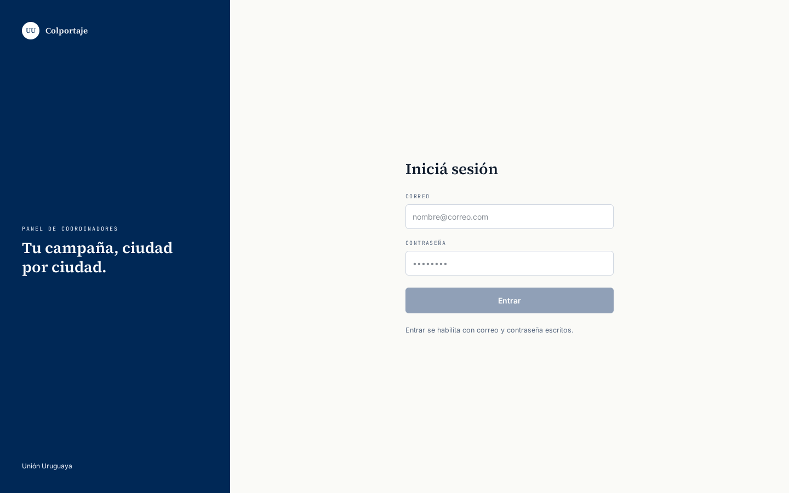

2. En «CORREO» escribí tu correo (por ejemplo, el campo muestra de ayuda `nombre@correo.com`).
3. En «CONTRASEÑA» escribí tu contraseña. «Entrar» se enciende recién cuando escribiste las dos cosas; mientras tanto, debajo dice «Entrar se habilita con correo y contraseña escritos.»

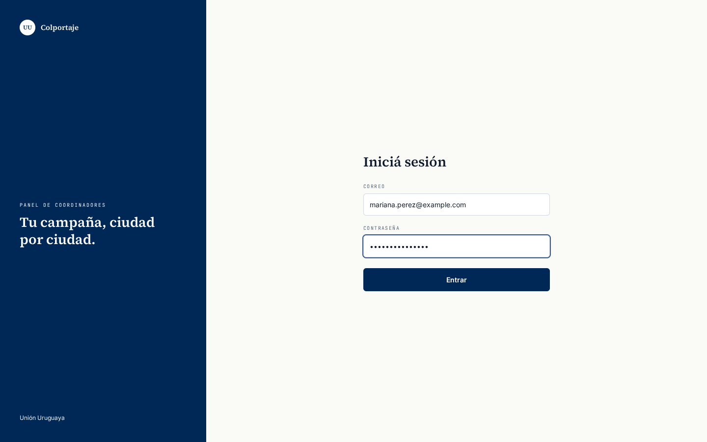

4. Tocá «Entrar». El botón pasa a «Entrando…» y los campos quedan apagados hasta que llegue la respuesta (debajo dice «Los campos y el botón quedan apagados hasta que llegue la respuesta.»).

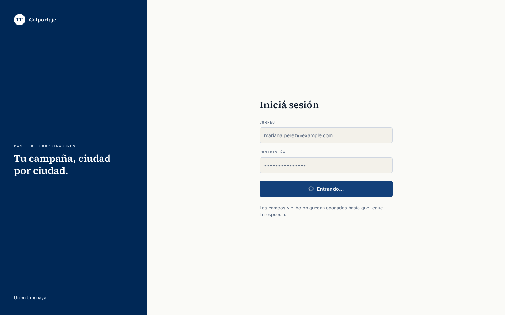

5. Si todo está bien, el panel se abre en la pestaña «Inicio».

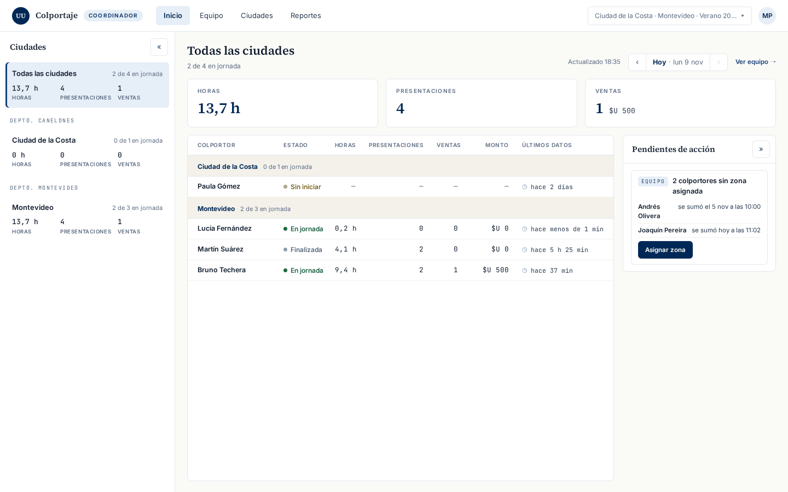

**Qué puede pasar**

| Si ves… | Qué significa | Qué hacer |
|---|---|---|
| «Entrando…» | El panel está comprobando tus datos. | Esperá unos segundos. |
| «El correo o la contraseña no son correctos.» (en un recuadro arriba de los campos) | Alguno de los dos está mal escrito. | Revisalos y probá de nuevo. La contraseña se borra y «Entrar» queda apagado hasta que la escribas otra vez. |
| «Hiciste demasiados intentos seguidos. Esperá unos minutos y volvé a intentar.» | Probaste varias veces seguidas. | Esperá unos minutos antes de volver a probar. |
| «Todavía no verificaste tu correo. Abrí el enlace que te mandamos y volvé a intentar.» | Tu cuenta nueva todavía no confirmó el correo. | Abrí el correo que te llegó, tocá el enlace y volvé a entrar. |
| «Cuenta suspendida. Contactá al administrador.» | Tu cuenta fue suspendida. | Hablá con el administrador. |
| «Sin acceso al panel» y «La cuenta … no tiene el rol de coordinador vigente. Si creés que es un error, hablá con el administrador.» | La cuenta existe pero no es de coordinador. | Tocá «Entrar con otra cuenta» o hablá con el administrador. |
| «Tu sesión venció. Entrá de nuevo para seguir donde estabas.» | Pasó mucho tiempo y el panel cerró tu sesión. | Escribí tu correo y tu contraseña (el correo no queda escrito) y tocá «Entrar». |
| «El panel no está disponible en este momento. No es un problema de tu cuenta: probá en unos minutos.» | El servicio tiene un problema por su lado. | Tocá «Reintentar» o esperá unos minutos. |
| «Sin conexión. Revisá tu internet para iniciar sesión.» | No hay internet. El aviso aparece apenas se corta la conexión, sin tocar «Entrar», y «Entrar» queda apagado mientras no haya conexión. | Revisá tu conexión. Cuando vuelva, «Entrar» se enciende de nuevo. |
| «Cerraste sesión.» | Saliste del panel hace un momento. | Nada: volvé a entrar cuando quieras. |

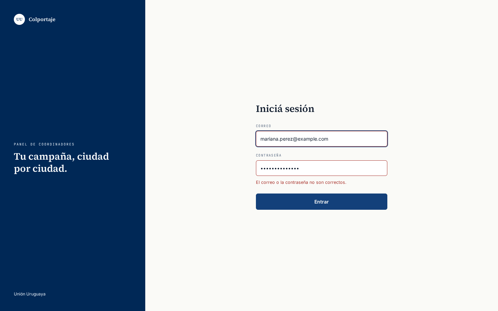
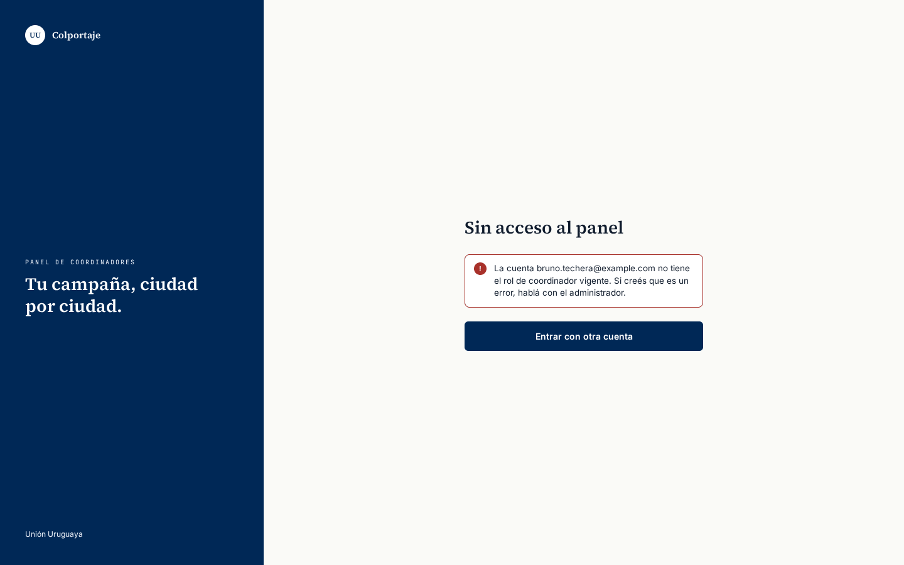
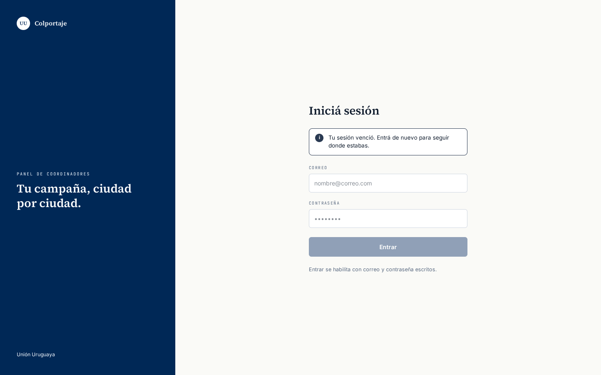
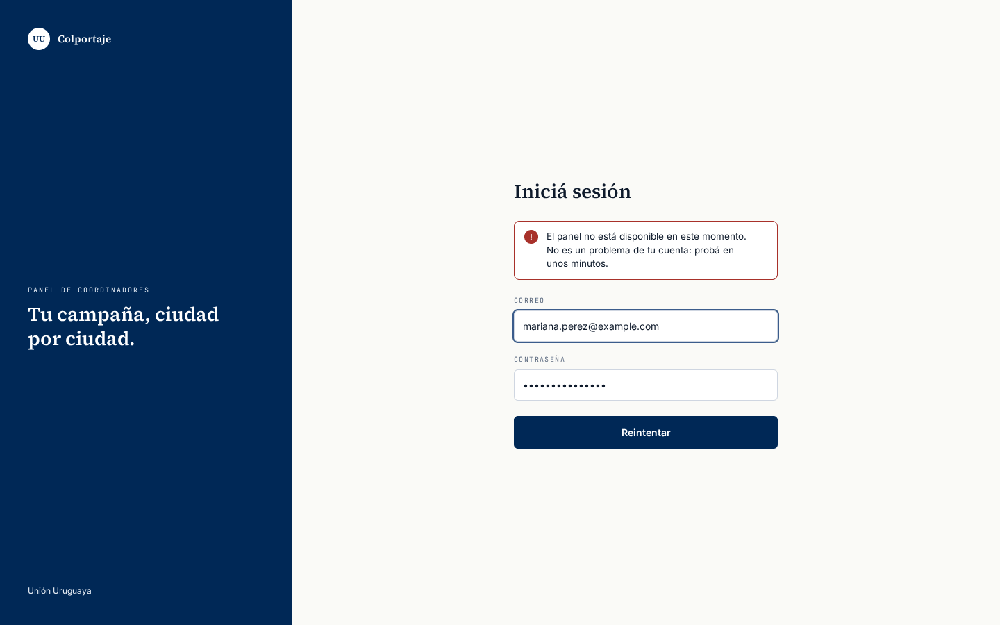
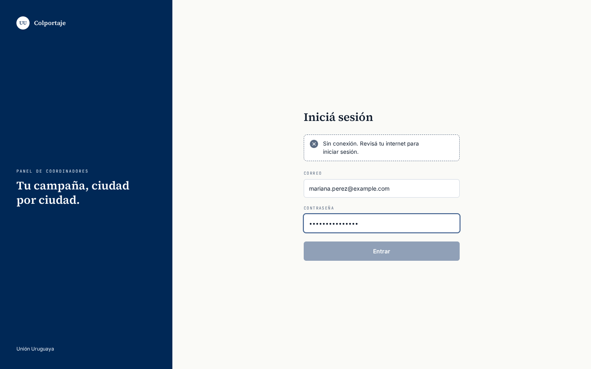
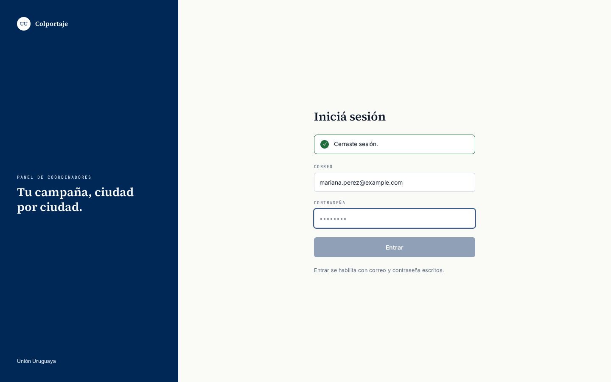

> **Consejo.** Cuando el panel te vuelve a la pantalla de acceso porque venció la sesión, el correo no queda escrito: escribí el correo y la contraseña otra vez.

### 1.2 Conocer la barra de arriba

Es lo primero que ves en todas las pantallas. Sirve para saber en qué campaña estás y para moverte entre secciones.

De izquierda a derecha encontrás:

1. El logo «UU» y la palabra «Colportaje».
2. La insignia «COORDINADOR», que te recuerda con qué rol entraste.
3. Las pestañas, en este orden: «Inicio», «Equipo», «Ciudades» y «Reportes». La pestaña donde estás aparece marcada.
4. El selector de campaña: un botón con el nombre de las ciudades, en orden alfabético, y la campaña (por ejemplo, «Ciudad de la Costa · Montevideo · Verano 2026-2027 ▾»). Si el texto es largo, en pantalla se corta con «…».
5. Tu avatar, con tus iniciales (por ejemplo, «MP» para Mariana Pérez).

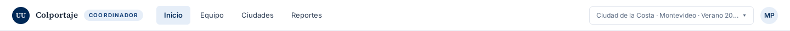

> **Nota.** Si tu campaña todavía no tiene ciudades, el selector muestra solo el nombre de la campaña. Si no tenés ninguna campaña, el botón dice «Sin campaña».

Mientras el panel termina de guardar lo último que añadiste a tu equipo, aparece «Guardando lo que añadiste a la campaña…» en la barra. Esperá a que desaparezca antes de cerrar la pestaña.

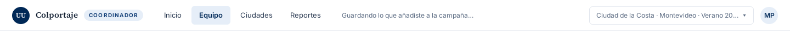

### 1.3 Cerrar sesión

Lo vas a usar cuando termines de trabajar, sobre todo en una computadora que comparten otras personas.

1. Tocá tu avatar (arriba a la derecha). Se abre un menú con tu nombre.
2. Tocá «Cerrar sesión». Mientras se cierra dice «Cerrando sesión…».
3. Vas a volver a la pantalla «Iniciá sesión» con el aviso «Cerraste sesión.»

**Qué puede pasar**

| Si ves… | Qué significa | Qué hacer |
|---|---|---|
| «Cerrando sesión…» | Se está cerrando tu sesión. | Esperá un momento. |
| «Cerraste sesión.» | Salió bien. | Nada más. |
| «No se cerró la sesión porque hay cambios que no se guardaron. Revisá el aviso de la pantalla y volvé a probar.» | Hay algo pendiente de guardar (por ejemplo, un colportor recién añadido). | Esperá a que termine de guardarse y probá de nuevo. |
| «No se pudo cerrar la sesión. Revisá tu conexión y volvé a probar.» | No hay internet. | Revisá la conexión y volvé a tocar «Cerrar sesión». |

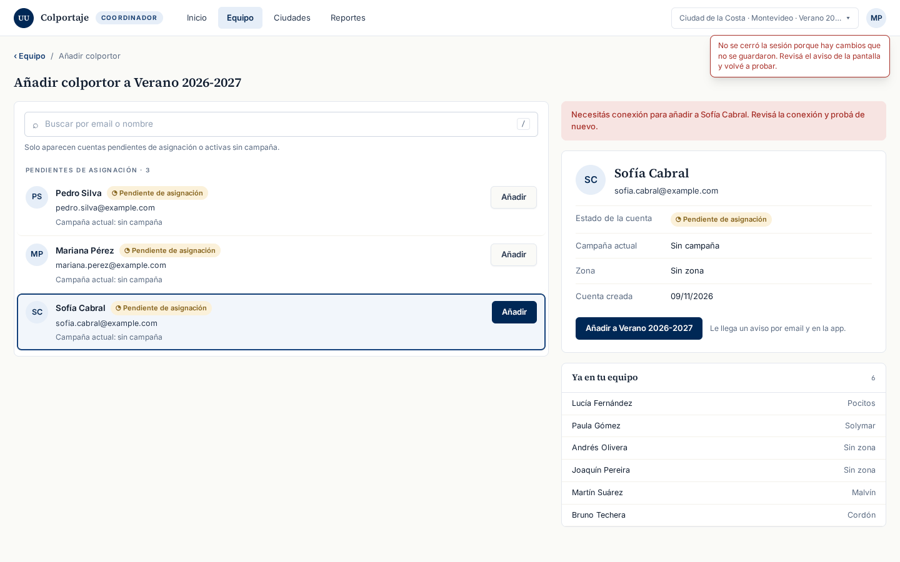

### 1.4 Si una dirección no existe

Si escribís o abrís una dirección que el panel no tiene, vas a ver «Esta sección no existe o no está disponible.» con el texto «Volvé al inicio para seguir con el tablero de tu región.» Tocá el enlace subrayado «Ir a Inicio».

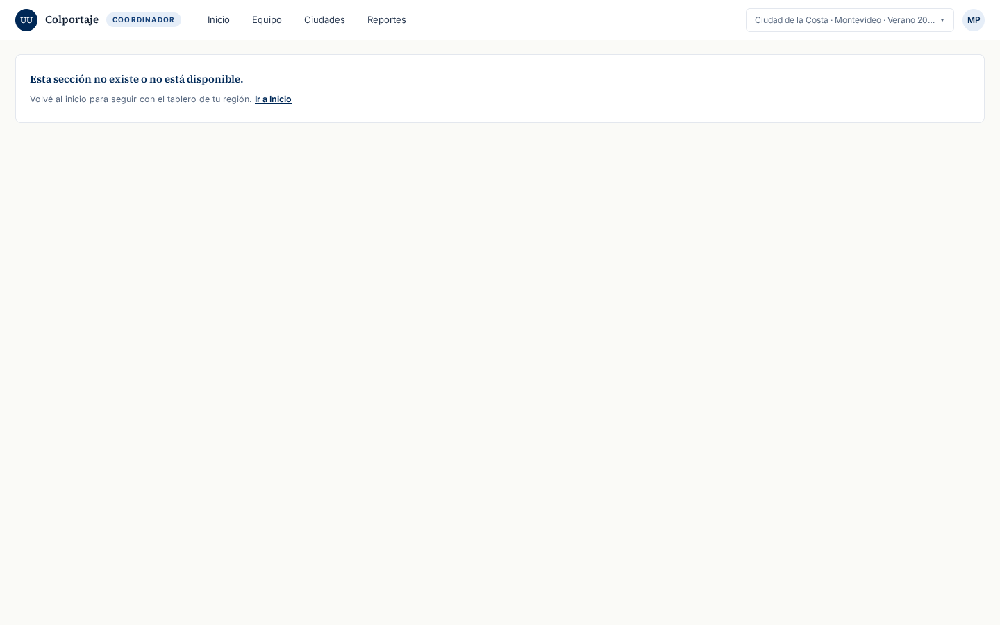

---

## 2. Elegir la campaña

El panel muestra siempre los datos de una campaña. Este capítulo explica cómo cambiar de campaña.

### 2.1 Cambiar de campaña

Lo vas a usar si coordinás más de una campaña, o si querés mirar una que todavía no empezó.

1. Tocá el selector de campaña, en la barra de arriba (el botón con las ciudades y la campaña). También lo podés abrir con Enter, con la barra espaciadora o con las flechas del teclado.
2. Se abre una lista con dos grupos: «EN CURSO» y «POR EMPEZAR». Cada campaña muestra su nombre, sus ciudades y sus fechas, por ejemplo «02/11 – 28/02 · en curso» o «empieza el 14/06/2027». La campaña que estás viendo aparece con ✓.

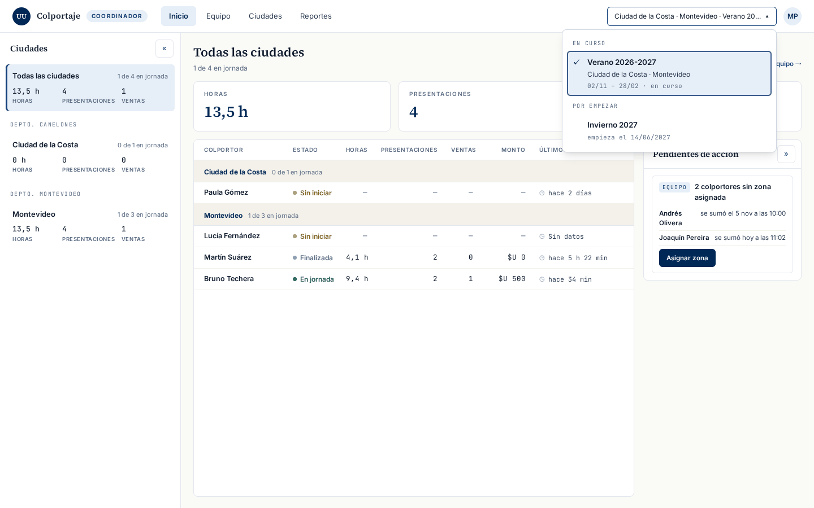

3. Tocá la campaña que querés ver (por ejemplo «Invierno 2027»). Abajo, en el centro, aparece durante unos segundos «Ahora ves Invierno 2027.» (con el nombre de la campaña elegida), el selector pasa a mostrar ese nombre y todas las pestañas pasan a mostrar esa campaña.

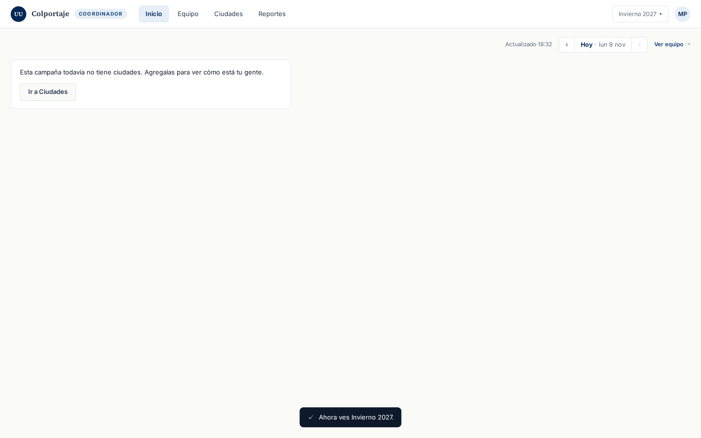

> **Consejo.** Con el teclado: Inicio y Fin saltan a la primera y a la última campaña; Esc cierra la lista sin cambiar nada.

**Qué puede pasar**

| Si ves… | Qué significa | Qué hacer |
|---|---|---|
| «Cargando tus campañas…» | La lista se está trayendo. | Esperá un momento. |
| «No pudimos traer tus campañas.» y «Reintentar» | Falló la carga. | Tocá «Reintentar». |
| «Sin conexión. La lista se carga cuando vuelva internet; seguís viendo Verano 2026-2027.» y «Reintentar» | No hay internet. Seguís con la campaña que ya tenías. | Esperá a que vuelva la conexión y tocá «Reintentar». |
| «No tenés campañas en curso ni por empezar» y «Las campañas terminadas no se eligen desde acá.» | No tenés ninguna campaña activa. | Hablá con el administrador si esperabas ver una. |
| «Ahora ves Invierno 2027.» | La campaña cambió. | Nada: seguí trabajando. |
| Botón «Sin campaña» (con el avatar de tus iniciales al lado) | No tenés ninguna campaña asignada. | Las pestañas te lo avisan; hablá con el administrador. |

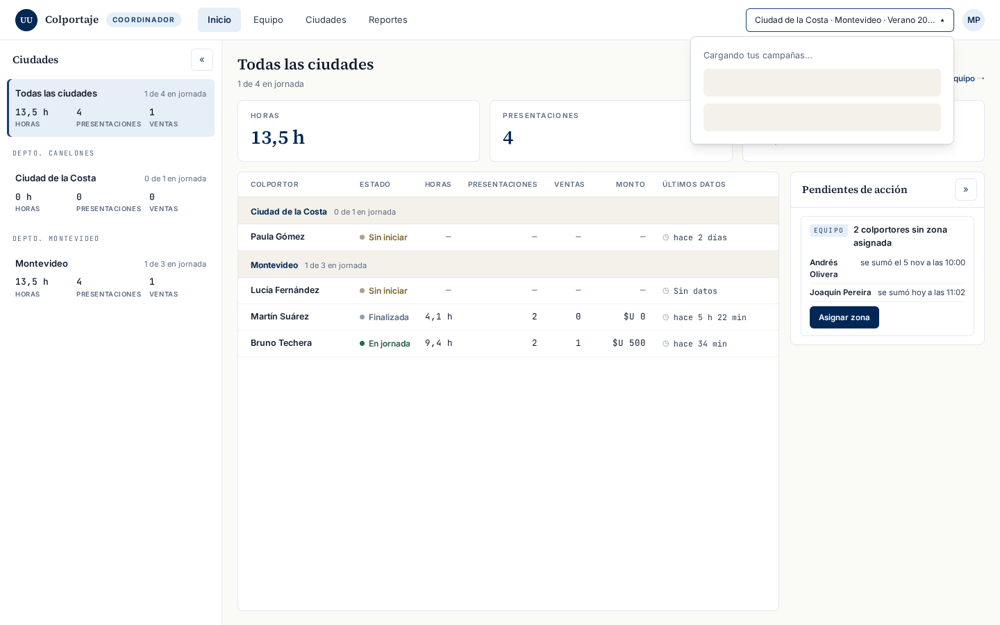
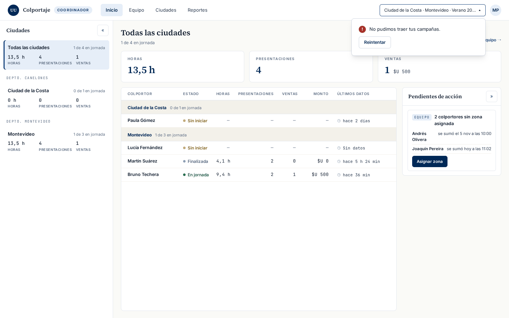
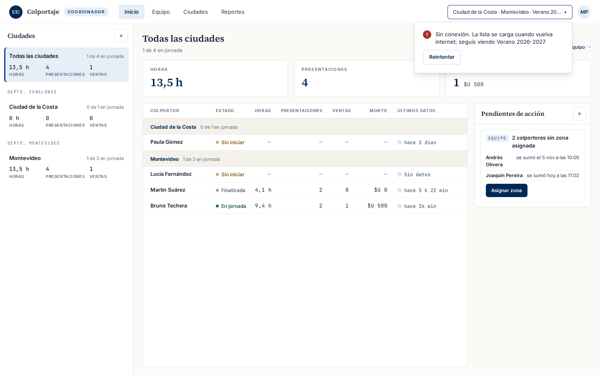
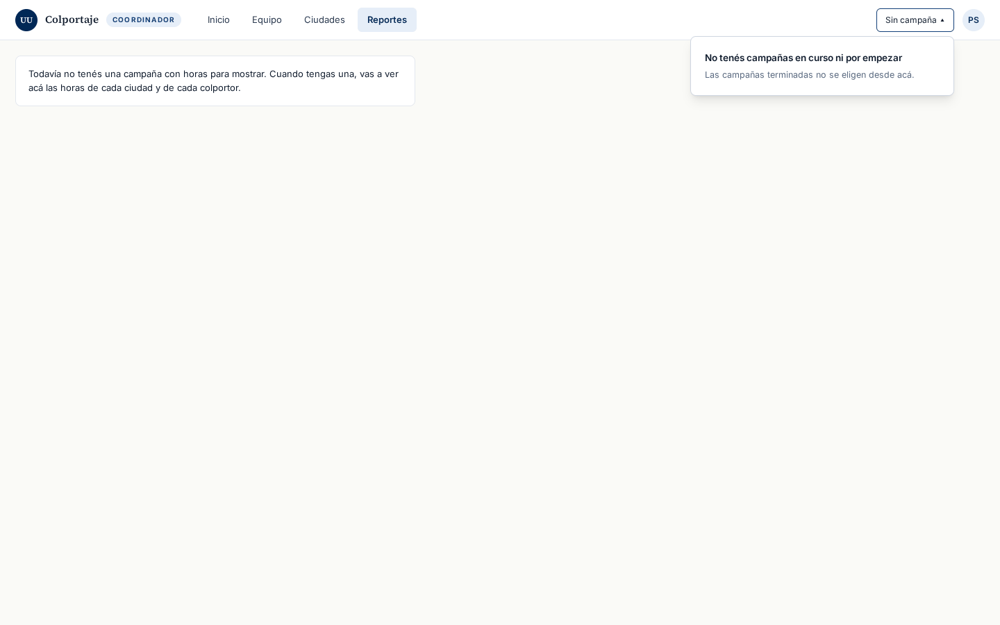

---

## 3. Inicio

«Inicio» es el tablero del día: cuántos colportores están trabajando, cuántas horas, presentaciones y ventas llevan, y qué te falta resolver.

### 3.1 Mirar cómo va el día

Lo vas a usar cada mañana y cada tarde para ver cómo está tu gente.

1. Tocá la pestaña «Inicio». Mientras carga ves «Cargando el tablero de Inicio…».
2. A la izquierda está la lista «Ciudades». Elegí «Todas las ciudades», un departamento («Todo el departamento», que aparece solo si el departamento tiene más de una ciudad) o una ciudad. Cada ciudad dice «N de M en jornada» (cuántos colportores están en jornada ahora), por ejemplo «1 de 3 en jornada». Los departamentos aparecen como «DEPTO. MONTEVIDEO», por ejemplo.

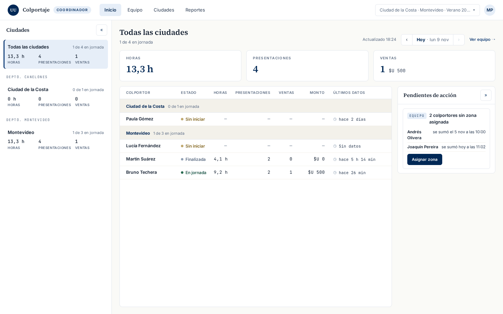

3. Arriba de las cifras vas a ver el título (la ciudad, «Departamento …» o «Todas las ciudades»), el subtítulo («Departamento Montevideo · 1 de 3 en jornada») y, si mirás hoy, «Actualizado» con la hora. Al lado del selector de día está el enlace «Ver equipo →», que te lleva a la pestaña «Equipo».
4. Debajo hay tres tarjetas: «HORAS» (por ejemplo «13,3 h»), «PRESENTACIONES» y «VENTAS» (la cantidad y el monto, por ejemplo «1» y «$U 500»).
5. Después está la tabla de colportores, con las columnas Colportor, Estado, Horas, Presentaciones, Ventas, Monto y Últimos datos.

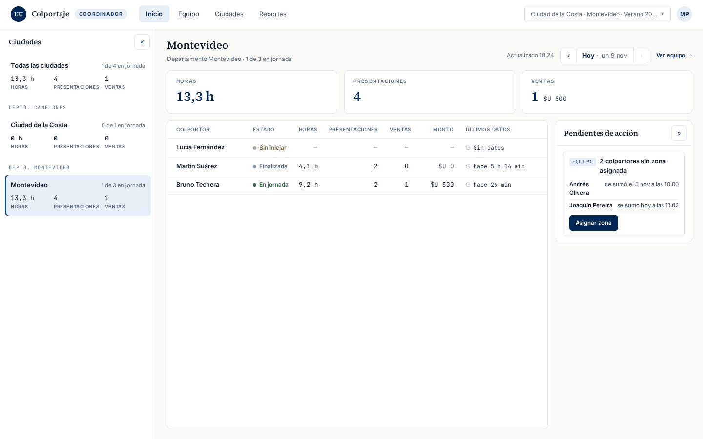

En la columna «Estado» cada colportor puede estar:

| Estado | Qué significa |
|---|---|
| «En jornada» | Empezó su jornada y todavía no la cerró. |
| «Sin cerrar» | Tiene una jornada de un día anterior que quedó abierta. Ese día sus horas figuran en «0 h»: no se cuentan hasta que la jornada se cierra. |
| «Finalizada» | Ya cerró la jornada del día. |
| «Sin iniciar» | Todavía no empezó. Sus cifras muestran «—» en lugar de ceros. |

La columna «Últimos datos» te dice cuándo mandó su última información el colportor, con un reloj ◷ adelante: «Sin datos», «hace menos de 1 min», «hace 25 min», «hace 2 h 10 min», «ayer 18:30» o «hace 2 días». Es solo informativa: no es una alarma.

Cuando elegís «Todas las ciudades» o un departamento con varias ciudades, la tabla se divide con una cabecera por ciudad, por ejemplo «Montevideo 1 de 3 en jornada».

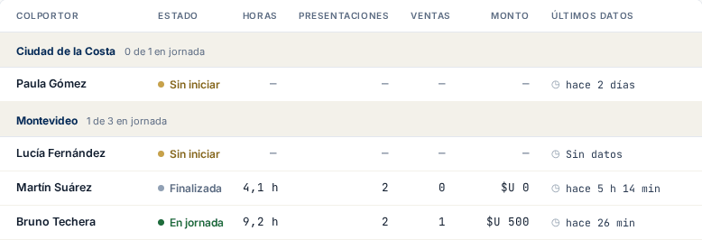

> **Importante.** Si todavía no hay presentaciones ni ventas hoy, el panel dice «Todavía no hay presentaciones ni ventas hoy: las cifras se suman a medida que cada colportor sincroniza.» Eso significa que las cifras aparecen cuando cada colportor manda sus datos desde el teléfono, que lo hace solo cuando tiene conexión.

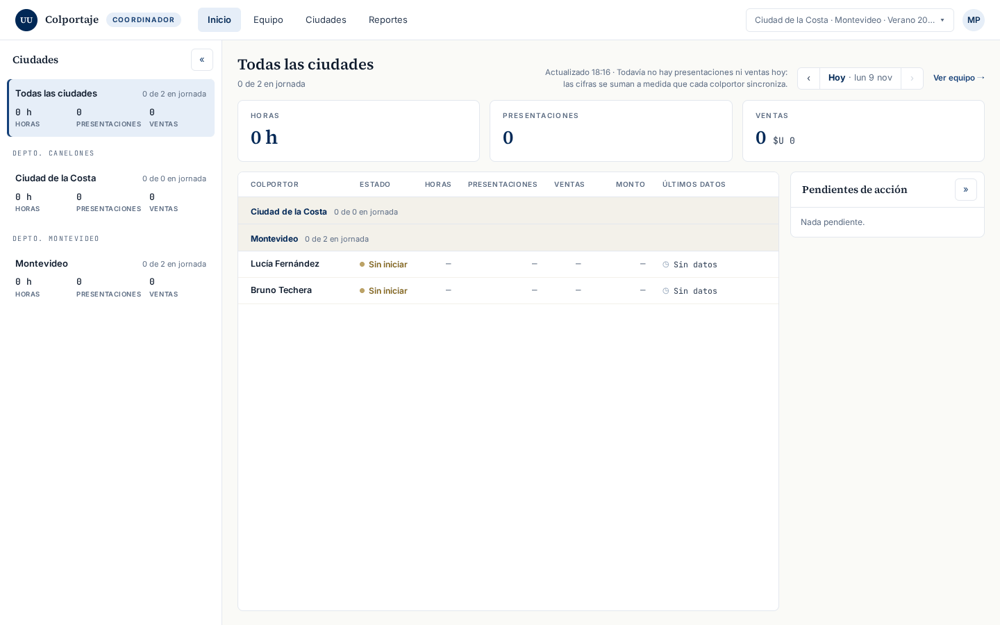

### 3.2 Ver otro día

Lo vas a usar para comparar con ayer o con días anteriores.

1. Arriba de las cifras tocá la flecha ‹ «Día anterior». El rótulo cambia de «Hoy · lun 9 nov» a «Ayer · dom 8 nov» y, un día más atrás, a la fecha sola («sáb 7 nov»). Fuera de hoy no aparece «Actualizado».
2. Mientras llega la información ves «Cargando el día…».
3. Para volver hacia hoy tocá la flecha › «Día siguiente». En hoy queda apagada: no se pueden ver días futuros.

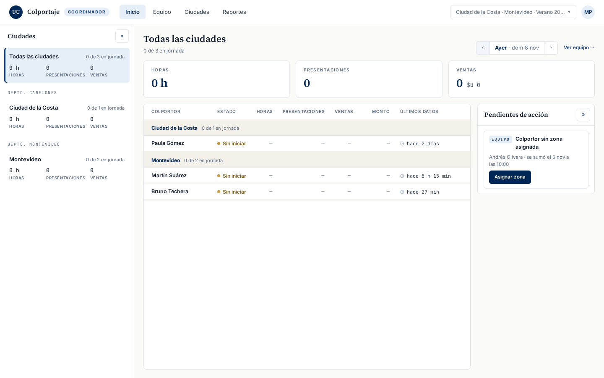
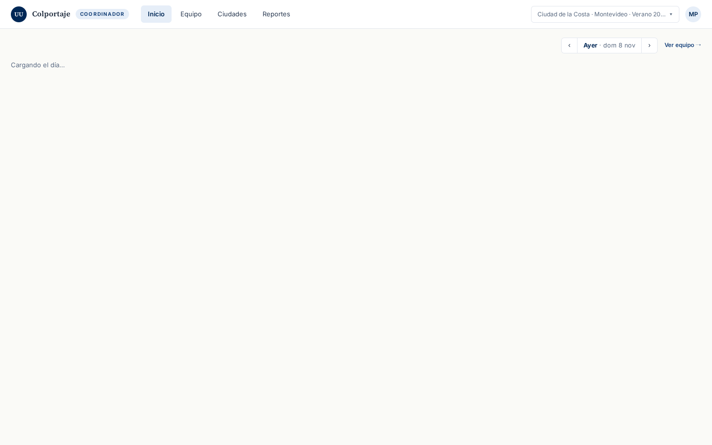

Si un colportor dejó su jornada abierta ese día, su fila dice «Sin cerrar» y sus horas figuran en «0 h».

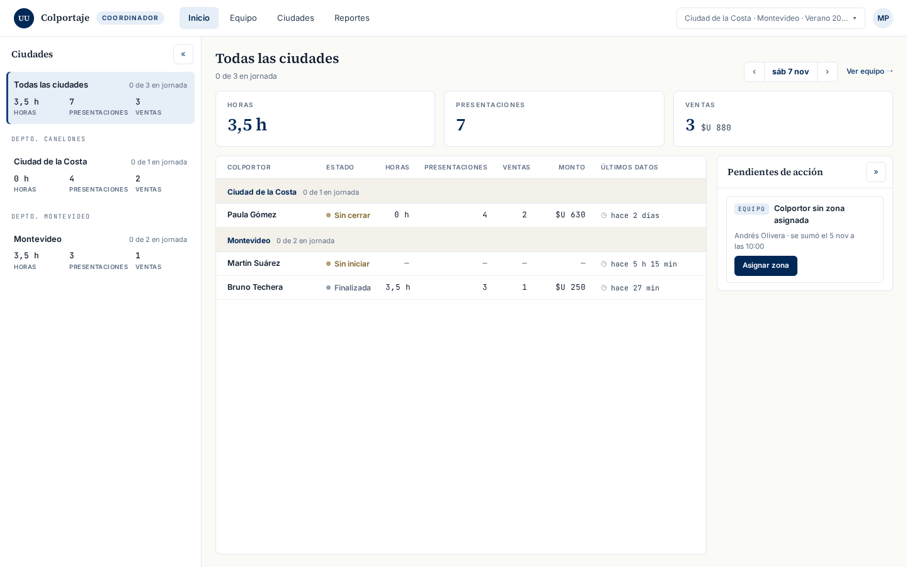

### 3.3 Atender los pendientes de acción

A la derecha de «Inicio» está la columna «Pendientes de acción»: lo que te toca resolver.

1. Si hay colportores sin zona, ves una tarjeta con la etiqueta EQUIPO: «Colportor sin zona asignada» con el nombre y, por ejemplo, «se sumó hoy a las 11:02», o «2 colportores sin zona asignada» con la lista, cada uno con «se sumó el 5 nov a las 10:00» u otra fecha. Una cuenta suspendida figura igual en la lista.
2. Tocá «Asignar zona». Te lleva a la pestaña «Ciudades» para elegir la zona (ver [Asignar un colportor a una zona](#57-asignar-un-colportor-a-una-zona)).
3. Con la flecha «Contraer pendientes» achicás la columna y con «Expandir pendientes» la volvés a abrir. Con «Contraer ciudades» y «Expandir ciudades» hacés lo mismo con la lista de la izquierda. El panel recuerda cómo las dejaste. Con la lista de ciudades contraída, cada ciudad se abrevia («C. d. l. C.», «Mon.») y muestra «en jornada / total» (por ejemplo «0/1»).

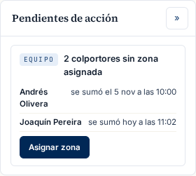
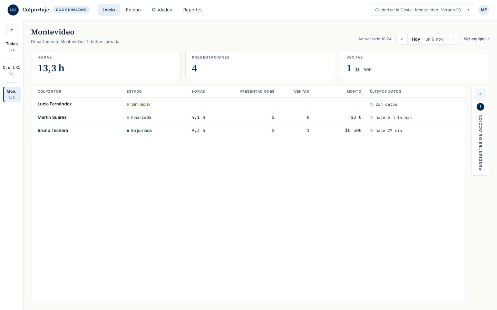

**Qué puede pasar**

| Si ves… | Qué significa | Qué hacer |
|---|---|---|
| «Cargando el tablero de Inicio…» | Se está armando el tablero. | Esperá un momento. |
| «No se pudo cargar el tablero de Inicio. Revisá tu conexión y probá de nuevo.» | No hay internet o falló la carga. | Tocá «Reintentar». |
| «No se pudo cargar el día. Revisá tu conexión y probá de nuevo.» o «No se pudo cargar el día. Probá de nuevo más tarde.» | Falló al traer ese día. | Tocá «Reintentar». |
| «La campaña ya no está disponible. Elegí otra desde el selector de arriba.» | La campaña que mirabas terminó o ya no es tuya. | Elegí otra en el selector. |
| «No tenés una campaña en curso ni por empezar, así que no hay un día para mirar todavía.» | No tenés campaña activa. | Tocá «Ir a Equipo» o hablá con el administrador. |
| «Esta campaña todavía no tiene ciudades. Agregalas para ver cómo está tu gente.» | La campaña no tiene ciudades cargadas. | Tocá «Ir a Ciudades» y agregalas (ver [Agregar una ciudad a la campaña](#53-agregar-una-ciudad-a-la-campaña)). |
| «Esta ciudad todavía no tiene colportores en la campaña.» (o «Estas ciudades todavía no tienen…») | No hay nadie anotado en esa ciudad. | Añadí colportores desde «Equipo» (ver [Añadir un colportor](#46-añadir-un-colportor)). |
| «Nada pendiente en esta ciudad.» (o «Nada pendiente.») | No hay nada que resolver. | Nada. |

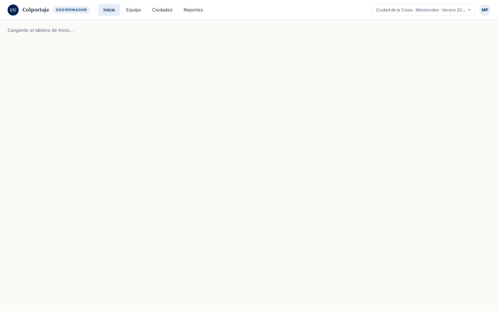
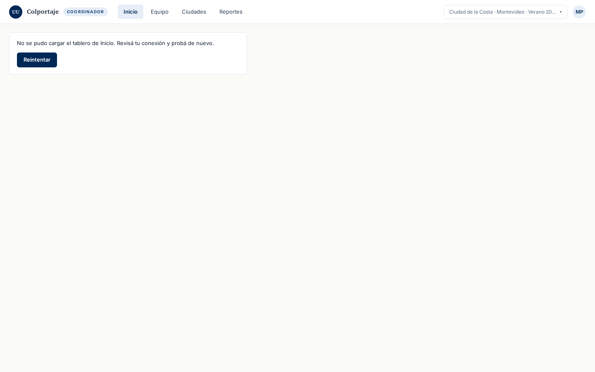
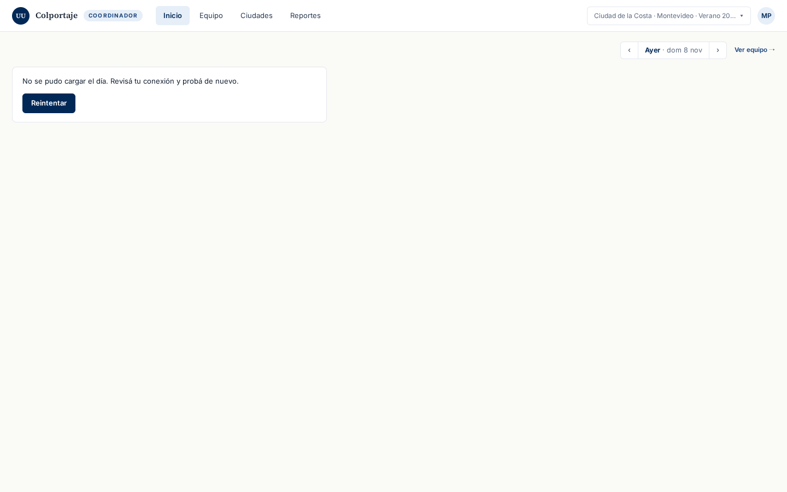
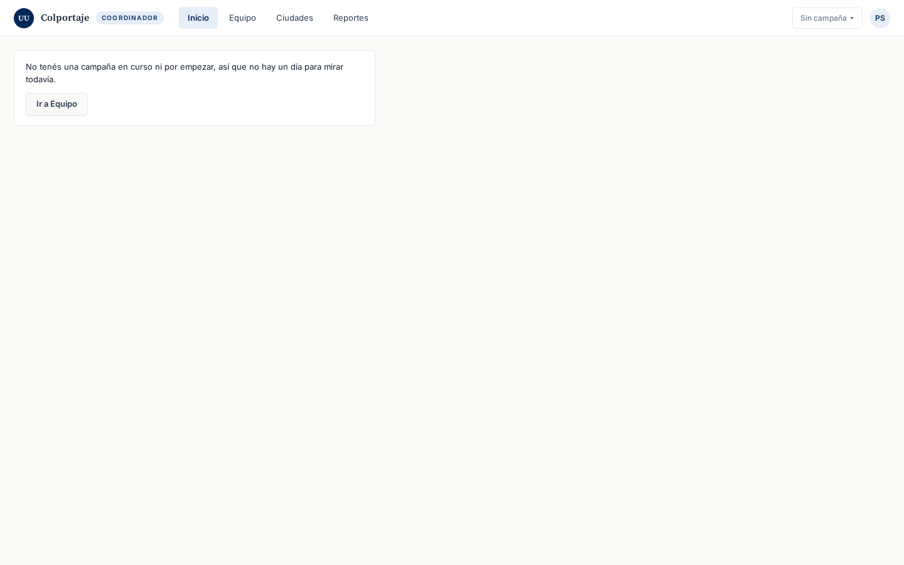
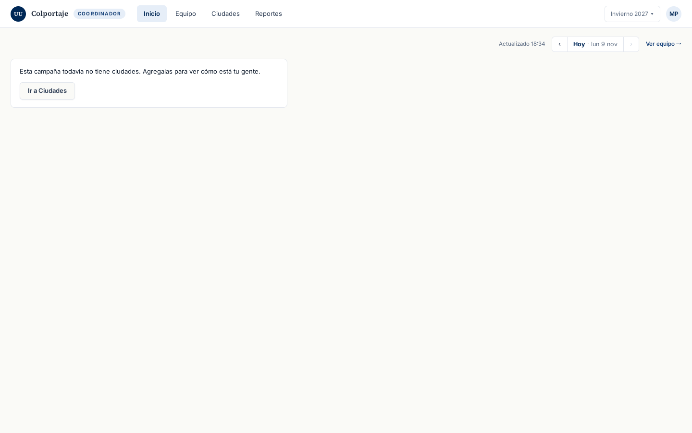
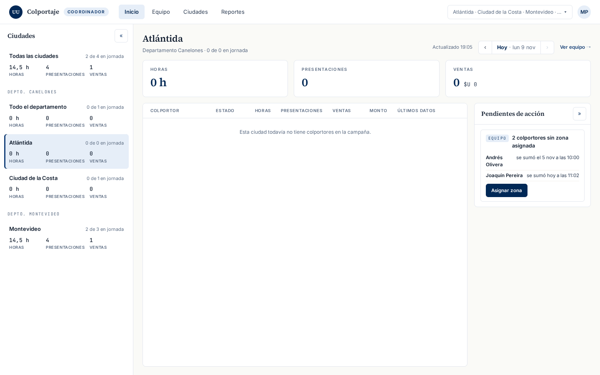

> **Nota.** En «Inicio» no aparecen hoy pendientes de cuentas ni de pedidos de libros; esas secciones están en preparación (ver el capítulo [Lo que todavía no está disponible](#8-lo-que-todavía-no-está-disponible)).

---

## 4. Equipo

«Equipo» es la lista de tus colportores: en qué zona está cada uno, cómo avanza con sus becas y cuándo fue la última vez que lo acompañaste.

### 4.1 Conocer la pantalla de Equipo

Lo vas a usar para ver todo tu equipo o el de una ciudad.

1. Tocá la pestaña «Equipo». Mientras carga ves «Cargando el equipo de la campaña…».
2. A la izquierda está la lista «Ciudades». Cada ciudad dice cuántos colportores tiene con zona y cuántos sin zona. «Todas las ciudades» dice, por ejemplo, «4 + 2 sin zona». Elegí «Todas las ciudades», un departamento o una ciudad.
3. Arriba están el título y el subtítulo, por ejemplo «4 colportores + 2 sin zona». Con una ciudad elegida suma el departamento («3 colportores + 2 sin zona · Departamento Montevideo»). A la derecha está el botón «+ Añadir colportor».
4. Debajo, el conmutador «Ver» tiene tres opciones: «Zonas» (la que aparece primero), «Becas» y «Acompañamientos».

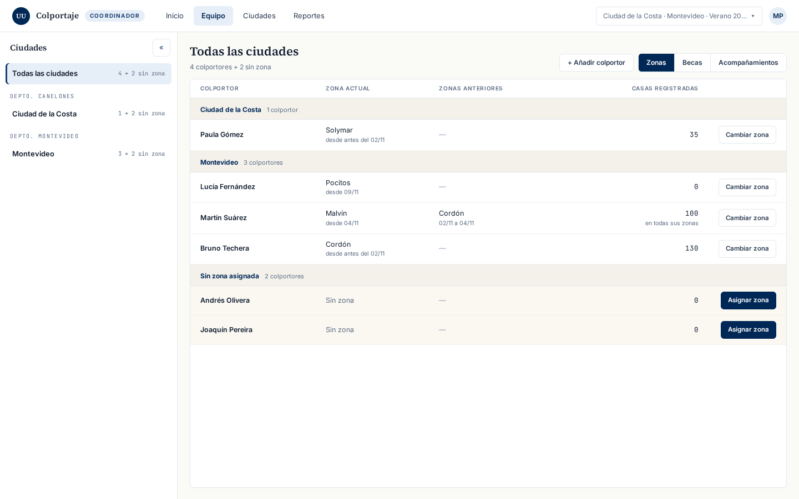

5. Si hay colportores sin zona, en las vistas «Becas» y «Acompañamientos» aparece arriba una franja con la etiqueta EQUIPO, la cantidad («2 colportores no tienen zona asignada») y el botón «Asignar zona». Una cuenta suspendida también cuenta. En la vista «Zonas» no aparece, porque los colportores sin zona figuran en un bloque propio, cada uno con su botón.

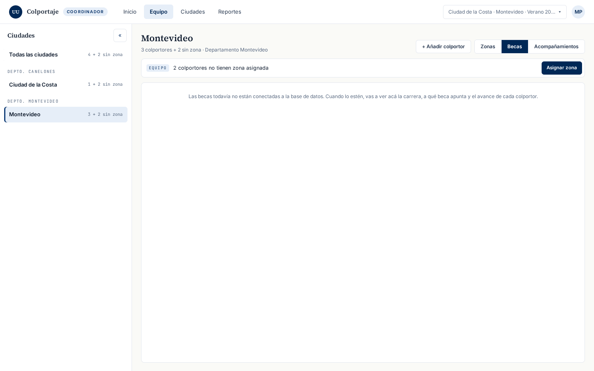

**Qué puede pasar**

| Si ves… | Qué significa | Qué hacer |
|---|---|---|
| «Cargando el equipo de la campaña…» | Se está trayendo el equipo. | Esperá un momento. |
| «No se pudo cargar el equipo de la campaña. Revisá tu conexión y probá de nuevo.» | Falló la carga. | Tocá «Reintentar». |
| «No tenés una campaña en curso ni por empezar. Cuando tengas una, vas a ver acá su equipo, sus zonas y sus acompañamientos.» | No tenés campaña activa. | Hablá con el administrador. |
| «Todavía no hay colportores en esta campaña. Añadilos con «+ Añadir colportor».» | La campaña no tiene equipo todavía. | Ver [Añadir un colportor](#46-añadir-un-colportor). |
| «Todavía no hay colportores en Montevideo. Cuando asignes alguno a una de sus zonas, aparece acá.» (con el nombre de la ciudad elegida) | Esa ciudad no tiene a nadie con zona. | Asigná colportores a una zona (ver el capítulo [Ciudades](#5-ciudades)). |

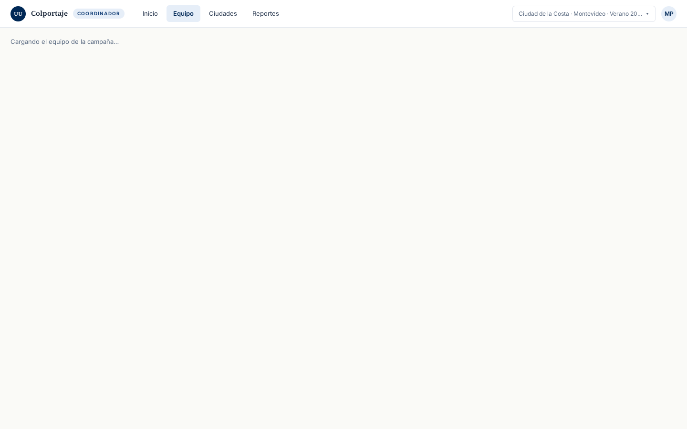
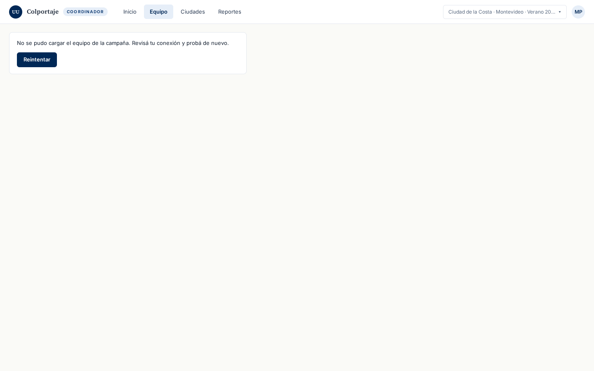
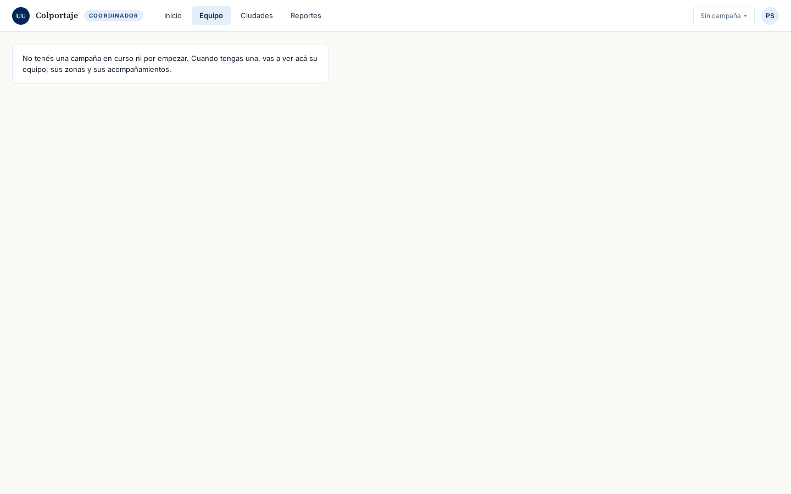
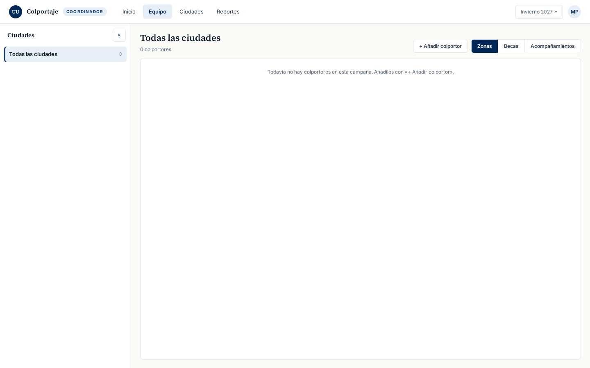

### 4.2 Ver las zonas de tu equipo

Lo vas a usar para saber quién trabaja en cada zona y quién todavía no tiene una.

1. En «Equipo», dejá el conmutador «Ver» en «Zonas».
2. La tabla tiene estas columnas: «COLPORTOR»; «ZONA ACTUAL» (con «desde 09/11» o «desde antes del 02/11»); «ZONAS ANTERIORES» (con las fechas, por ejemplo «02/11 a 04/11», y «(dada de baja)» si esa zona se eliminó después); «CASAS REGISTRADAS» (las casas que cargó, con «en todas sus zonas» si pasó por más de una); y una última columna con el botón de cada fila. Los colportores van agrupados por ciudad («Montevideo 3 colportores»).
3. Quienes no tienen zona figuran en un bloque aparte, «Sin zona asignada · 2 colportores», con «Sin zona» en la fila resaltada y el botón «Asignar zona». Quien ya tiene zona tiene el botón «Cambiar zona».
4. Cualquiera de los dos botones te lleva a la pestaña «Ciudades» para elegir la zona (ver [Asignar un colportor a una zona](#57-asignar-un-colportor-a-una-zona)).

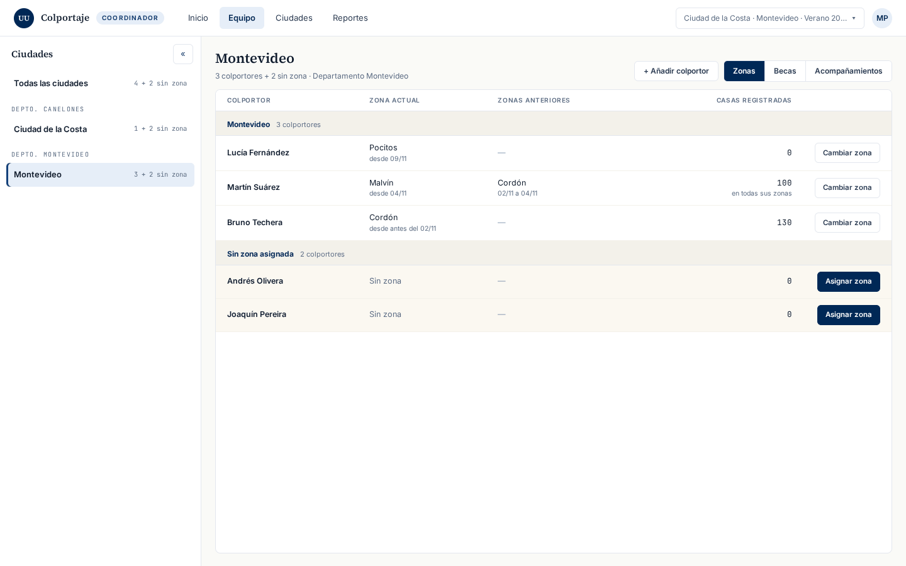

### 4.3 Ver las becas

Lo vas a usar para ver qué beca busca cada colportor y cuánto le falta.

1. En «Equipo», elegí «Becas» en el conmutador «Ver».
2. Hoy la pantalla muestra el aviso «Las becas todavía no están conectadas a la base de datos. Cuando lo estén, vas a ver acá la carrera, a qué beca apunta y el avance de cada colportor.»

> **Próximamente.** La tabla de becas (carrera de cada colportor, a qué beca apunta —«Media», «Completa» o «Sin beca»— y su avance) está en preparación y todavía no se puede usar.

### 4.4 Ver los acompañamientos

Lo vas a usar para saber a quién hace más tiempo que no acompañás en la calle.

1. En «Equipo», elegí «Acompañamientos» en el conmutador «Ver». El subtítulo suma «3 acompañamientos en la campaña · ordenado por días sin acompañar» (el número cambia con la campaña).
2. La tabla ordena a los colportores de más a menos días sin acompañar. Las columnas son: «COLPORTOR», «ZONA», las semanas de la campaña («SEMANAS S1 A S2» cuando van dos semanas: un círculo por semana, lleno con ✓ cuando lo acompañaron), «TOTAL» y «SIN ACOMPAÑAR». Cada fila tiene los botones «Ver historial» y «Registrar acompañamiento».
3. En «SIN ACOMPAÑAR» ves «Nunca» con «7 días desde el inicio» (o «0 días desde que se sumó»), o bien «hoy», «ayer» o «hace 4 días» con «último: jue 05/11». Si la campaña todavía no empezó, dice «La campaña todavía no empezó».
4. Para ver el detalle de uno, tocá «Ver historial». Se abre «HISTORIAL DE ACOMPAÑAMIENTOS · BRUNO TECHERA». Cada renglón muestra el día, las horas (o «en curso»), quién acompañó —por ejemplo «Mariana Pérez (vos)»— y cómo se cargó: «lo marcó en el celular», «cargado por vos», «cargado por <nombre>» o «cargado desde el panel», además de la nota si hay. Para cerrarlo tocá «Ocultar historial».

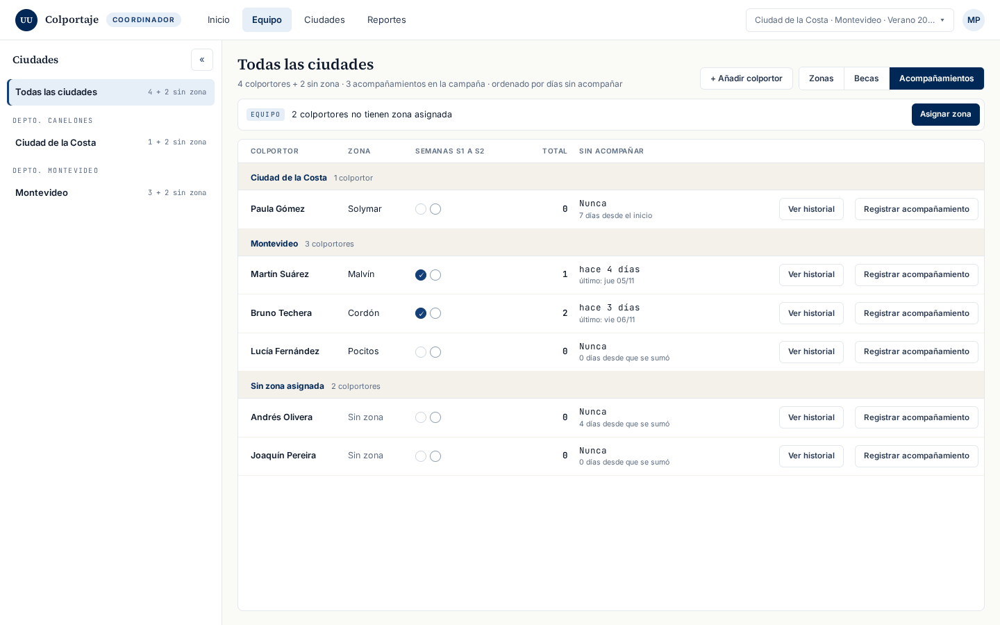
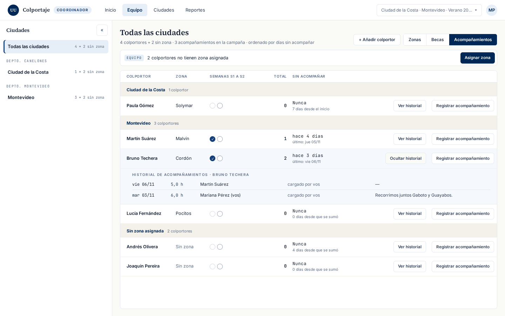

**Qué puede pasar**

| Si ves… | Qué significa | Qué hacer |
|---|---|---|
| «Nunca» con «7 días desde el inicio» | Nunca lo acompañaron en esta campaña. | Planificá un acompañamiento. |
| «La campaña todavía no empezó» | No hay días contados todavía. | Nada. |
| «Todavía no se lo acompañó en esta campaña.» (en el historial) | No hay acompañamientos registrados. | Nada. |

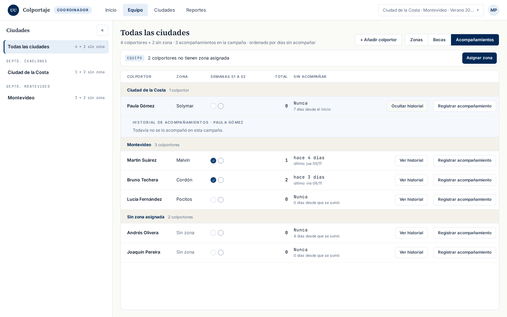

### 4.5 Registrar un acompañamiento

Lo vas a usar cuando acompañaste a un colportor en la calle y querés que quede anotado, o cuando lo acompañó otra persona y tenés que cargarlo vos.

**Antes de empezar:** necesitás conexión. El colportor tiene que haber terminado al menos una jornada en la campaña, y la campaña tiene que estar en curso o haber terminado hace 15 días o menos.

1. En «Equipo», elegí «Acompañamientos».
2. En la fila del colportor (por ejemplo Bruno Techera), tocá «Registrar acompañamiento». Se abre, debajo de esa fila, el panel «REGISTRAR ACOMPAÑAMIENTO · BRUNO TECHERA», con «Cerrar» y el texto «Elegí quién lo acompañó y la jornada. Un acompañamiento ya registrado no se cambia desde acá.» Mientras se traen sus jornadas dice «Cargando las jornadas de Bruno Techera…».

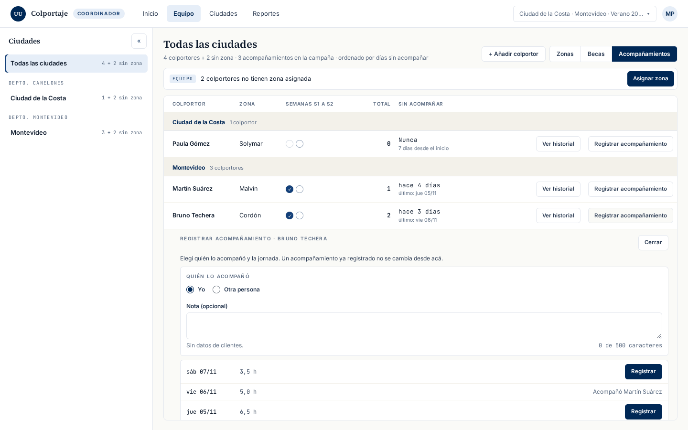

3. En «QUIÉN LO ACOMPAÑÓ» dejá «Yo» si fuiste vos. Si fue otra persona, elegí «Otra persona»: aparece «Quién acompañó» con un desplegable «Elegí quién acompañó». La lista muestra primero a los otros colportores de la campaña y después el grupo «Coordinadores y administradores».

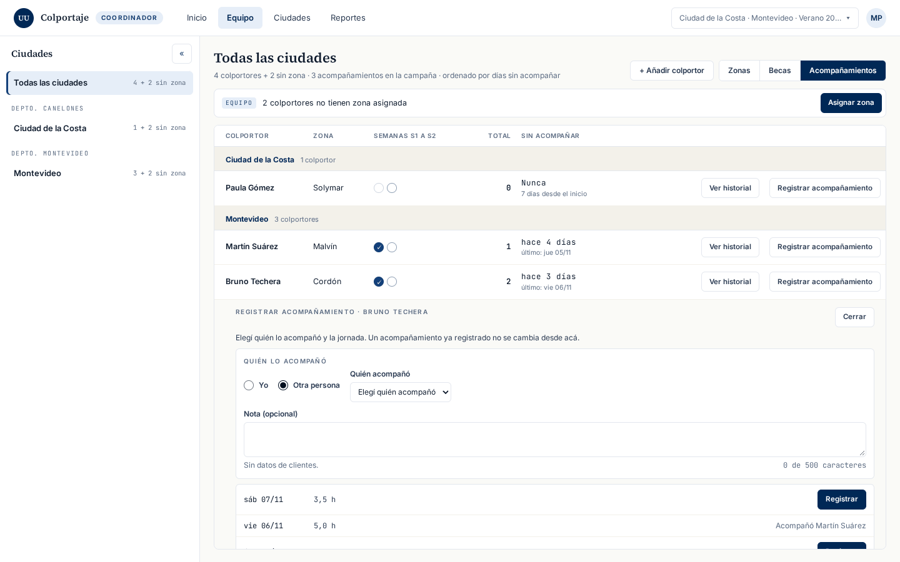

4. Si querés, escribí una «Nota (opcional)». Admite hasta 500 caracteres y debajo ves el contador («0 de 500 caracteres»). El panel te avisa «Sin datos de clientes.»: no escribas nombres ni datos de clientes.
5. En la lista de jornadas terminadas (por ejemplo «sáb 07/11 · 3,5 h»), tocá «Registrar» en la jornada que corresponde. Solo aparecen jornadas cerradas. Mientras se guarda dice «Registrando…».
6. Cuando sale bien, aparece «Acompañamiento registrado: jornada de Bruno Techera, jue 05/11.» (si no fuiste vos, suma «Acompañó» y el nombre de quien eligiste, y la fila de la jornada pasa a «Acompañó» con ese nombre). El subtítulo suma un acompañamiento y la fila del colportor se actualiza.
7. Para cerrar el panel, tocá «Cerrar».

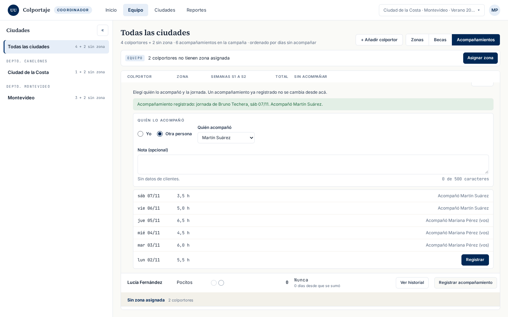

> **Importante.** Un acompañamiento ya registrado no se cambia desde acá. Si te equivocaste de jornada o de persona, hablá con el administrador.

**Qué puede pasar**

| Si ves… | Qué significa | Qué hacer |
|---|---|---|
| «Cargando las jornadas de Bruno Techera…» | Se están trayendo las jornadas. | Esperá un momento. |
| «Acompañamiento registrado: jornada de Bruno Techera, sáb 07/11. Acompañó Martín Suárez.» | Quedó registrado (aviso verde). | Nada más. |
| «Esa jornada ya figuraba a tu nombre: Bruno Techera, lun 02/11.» (o «…a nombre de» otra persona…) | Esa jornada ya tenía su acompañamiento. Es un aviso verde: no es un error. Si habías escrito una nota, se aclara que no se guardó. | No hace falta repetirlo. |
| «La nota no se guardó: un acompañamiento ya registrado no se cambia desde acá.» | Intentaste cambiar la nota de uno ya registrado. | Dejalo como está. |
| «Elegí al colportor que acompañó, o cambiá a «Yo».» | Elegiste «Otra persona» y no elegiste quién. | Elegí a alguien de la lista o volvé a «Yo». |
| «No hay otros colportores en esta campaña.» | No hay otra persona para elegir. | Usá «Yo». |
| «Joaquín Pereira todavía no terminó ninguna jornada en esta campaña. Cuando cierre una, vas a poder registrar el acompañamiento.» (con el nombre del colportor) | No hay jornadas para elegir. | Volvé cuando haya cerrado una. |
| «Todas sus jornadas terminadas ya figuran acompañadas: un acompañamiento ya registrado no se cambia desde acá.» (y desaparecen «QUIÉN LO ACOMPAÑÓ» y la nota) | Ya están todas registradas. | Nada. |
| «Necesitás conexión para registrar el acompañamiento. Revisá la conexión y probá de nuevo.» (en rojo, debajo de la jornada) | No hay internet. | Revisá la conexión y tocá «Registrar» otra vez. |
| «La campaña terminó hace más de 15 días y sus acompañamientos quedan como están. Elegí una campaña en curso o que haya terminado hace 15 días o menos.» | Pasó el plazo para registrar. | Elegí otra campaña en el selector. |
| «La nota admite hasta 500 caracteres. Acortala; no pongas datos de clientes.» | La nota es muy larga. | Acortala. |
| «Solo el coordinador de la campaña puede ver las jornadas de su equipo.» / «Solo el coordinador de la campaña puede registrar acompañamientos en ella.» | No sos el coordinador de esa campaña. | Hablá con el administrador. |
| «La jornada no existe o no es de un colportor de esta campaña. Recargá las jornadas y elegí otra.» | La jornada cambió mientras tanto. | Cerrá el panel y volvé a abrirlo. |
| «El colportor no está en esta campaña.» / «Ese colportor no está inscripto en esta campaña. Elegí a alguien de su equipo.» | La persona elegida no está en la campaña. | Elegí a otra. |
| «No se pudieron traer las jornadas. Probá de nuevo más tarde.» | Falló la carga. | Cerrá el panel y probá más tarde. |
| «No se pudo registrar el acompañamiento. Probá de nuevo más tarde.» | Falló el guardado. | Probá más tarde. |

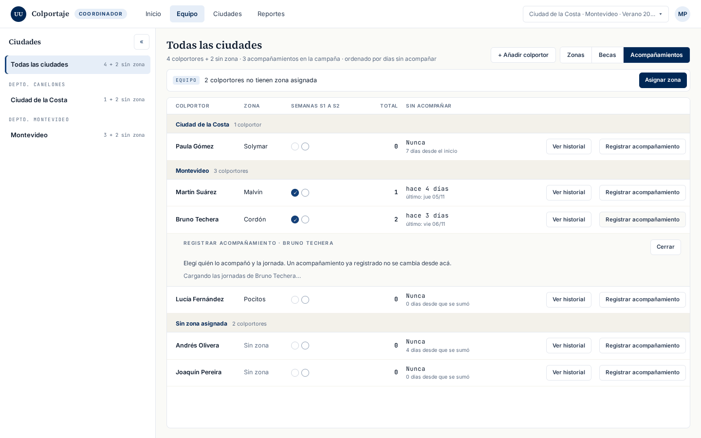
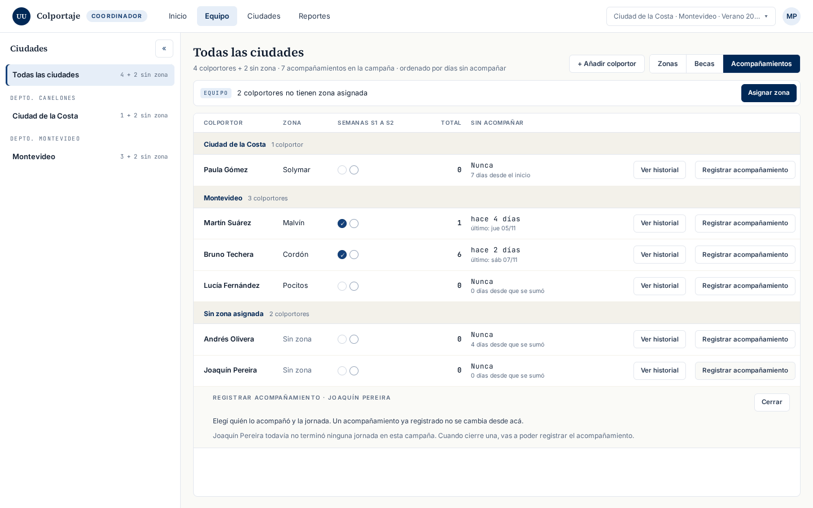

### 4.6 Añadir un colportor

Lo vas a usar cuando una persona nueva se suma a tu campaña.

**Antes de empezar:** la persona tiene que tener su cuenta creada y su correo verificado. Necesitás conexión.

1. En «Equipo», tocá «+ Añadir colportor». Se abre «Añadir colportor a Verano 2026-2027». Arriba hay un camino de regreso: «‹ Equipo / Añadir colportor».
2. Vas a ver la lista «PENDIENTES DE ASIGNACIÓN · 3»: son las cuentas sugeridas. Cada fila muestra el avatar, el nombre, el estado (◔ Pendiente de asignación, ● Activa o ⊘ Suspendida), el correo, «Campaña actual: …» o «sin campaña» y el botón «Añadir». Se cargan de a 10: al llegar al final ves «Cargando más cuentas…».

3. Para buscar a una persona, escribí su correo o su nombre en «Buscar por email o nombre» (con la tecla «/» el cursor va directo al buscador). Debajo dice «Solo aparecen cuentas pendientes de asignación o activas sin campaña.» Mientras busca ves «BUSCANDO “SOF”…» y después «1 RESULTADO PARA “SOF”» (con un «+» si hay más). Para borrar la búsqueda tocá «✕» («Borrar búsqueda»).

4. Tocá una cuenta (por ejemplo Sofía Cabral). A la derecha se muestra su detalle: «Estado de la cuenta» (◔ Pendiente de asignación), «Campaña actual» (Sin campaña), «Zona» (siempre «Sin zona» al principio) y «Cuenta creada» con la fecha. También ves la tarjeta «Ya en tu equipo», con la cantidad actual de colportores (por ejemplo «6») y el nombre y la zona de cada uno. Antes de elegir, ese lugar dice «Elegí una cuenta para ver el detalle y añadirla.»

5. Tocá «Añadir a Verano 2026-2027» (o el botón «Añadir» de la fila). Debajo del botón se aclara «Le llega un aviso por email y en la app.» Los dos botones pasan a «Añadido ✓» (apagados) y la persona aparece en «Ya en tu equipo» con «Sin zona».
6. Abajo aparece «Añadiste a Sofía Cabral a Verano 2026-2027.» con el botón «Deshacer». Tenés 8 segundos para deshacerlo; si dejás el cursor del teclado en «Deshacer», el tiempo se detiene. Pasados los 8 segundos, se guarda.

Si tocás «Deshacer», el botón vuelve a «Añadir a Verano 2026-2027», «Ya en tu equipo» vuelve a su número anterior (por ejemplo «6») y no se guarda nada. No sale ningún mensaje.

7. Para volver, tocá «‹ Equipo» o apretá Esc. Si salís o cambiás de pestaña con un aviso pendiente, el panel guarda la inscripción en ese momento, sin esperar los 8 segundos, y por un momento ves «Guardando lo que añadiste a la campaña…» al lado de las pestañas. La pantalla cambia cuando termina de guardar.

> **Consejo.** Atajos: las flechas ↑ ↓ recorren la lista, Enter elige la cuenta marcada y Esc retrocede de a un paso (primero limpia la búsqueda, después cierra los avisos y por último vuelve a «Equipo»).

> **Importante.** Quien ya estuvo en la campaña y fue quitado se puede volver a añadir: vuelve al equipo sin zona.

**Qué puede pasar**

| Si ves… | Qué significa | Qué hacer |
|---|---|---|
| «Buscando cuentas…» | Se está buscando. | Esperá un momento. |
| «No hay cuentas que coincidan con tu búsqueda.» | Nadie coincide con lo que escribiste. | Probá con otro nombre o con el correo. |
| «No hay cuentas pendientes de asignación.» | No hay sugeridas. | Buscá a la persona por nombre o correo. |
| «Cuenta suspendida. Pedí a un administrador que la reactive para añadirla.» (ayuda: «Pedile a un administrador que la reactive.») | La cuenta está suspendida. | Pedile al administrador que la reactive. |
| «Está en campaña Campaña Ejemplo Permanente. Reasignar primero.» (o «Está en otra campaña. Reasignar primero.»; ayuda: «Pedile al coordinador de Campaña Ejemplo Permanente que lo libere.») | La persona sigue en otra campaña (aparece marcada «● Activa», con «Campaña actual: …» y el botón apagado; al buscar por nombre se la ve aunque no esté en la lista sugerida). | Pedile al coordinador de esa campaña que la libere. |
| «Añadiste a Sofía Cabral a Verano 2026-2027.» | Quedó añadida. | Si fue un error, tocá «Deshacer» dentro de los 8 segundos. |
| Un motivo en rojo arriba del detalle, por ejemplo «Ya está inscripto en esta campaña.» (si tenés elegida otra cuenta, empieza con «No se pudo añadir a <nombre>.») | No se pudo añadir. | Leé el motivo (ver más abajo). |
| «Necesitás conexión para añadir a Sofía Cabral. Revisá la conexión y probá de nuevo.» | No hay internet. Aparece cuando pasan los 8 segundos y el panel intenta guardar; la cuenta vuelve a «Añadir». | Revisá la conexión y probá otra vez. |
| «No se pudo añadir la cuenta. Probá de nuevo más tarde.» | Falló el guardado. | Probá más tarde. |
| «No se pudo buscar cuentas. Probá de nuevo más tarde.» | Falló la búsqueda. | Probá más tarde. |
| «No se encontró la última cuenta de la página anterior. Volvé a buscar desde el principio.» | La lista cambió mientras la recorrías. | Borrá la búsqueda y volvé a buscar. |
| «Necesitás conexión para buscar cuentas…» / «…para cargar más cuentas…» y «Reintentar» | No hay internet. | Tocá «Reintentar» cuando vuelva. |
| «No se pudo buscar cuentas. Volvé a entrar para seguir.» y «Entrar de nuevo» | Venció tu sesión. | Tocá «Entrar de nuevo». |
| «No tenés una campaña en curso ni por empezar a la que añadir colportores.» y «‹ Equipo» | No hay campaña activa. | Volvé a «Equipo». |
| «No se pudieron cargar las cuentas para añadir a la campaña. Revisá tu conexión y probá de nuevo.» y «Reintentar» | Falló la carga de la pantalla. | Tocá «Reintentar» o «‹ Equipo». |
| «Cargando las cuentas para añadir a la campaña…» | Se está armando la pantalla. | Esperá un momento. |

Motivos que puede mostrar el aviso de que no se pudo añadir:

| Motivo | Qué significa |
|---|---|
| «La campaña no existe.» | La campaña ya no está disponible. |
| «La campaña ya terminó. Elegí una campaña en curso o por empezar.» | No se puede añadir a una campaña terminada. |
| «El usuario no existe o fue dado de baja.» | La cuenta ya no existe. |
| «El usuario todavía no verificó su email.» | La persona tiene que confirmar su correo primero. |
| «La cuenta está suspendida. Contactá al administrador.» | Hablá con el administrador. |
| «Ya está inscripto en esta campaña.» | Ya es parte del equipo. |
| «Solo el coordinador de la campaña puede inscribir colportores en ella.» | Solo el coordinador de esa campaña puede hacerlo. |

---

## 5. Ciudades

«Ciudades» es el mapa donde armás las zonas de cada ciudad y le asignás una zona a cada colportor. Una zona es un pedazo de la ciudad que trabaja una persona.

### 5.1 Conocer la pantalla de Ciudades

Lo vas a usar para ver las zonas, las casas y a quién le toca cada lugar.

1. Tocá la pestaña «Ciudades». Mientras carga ves «Cargando las zonas de la campaña…».
2. Arriba está el título «Zonas · Verano 2026-2027» y un botón por cada ciudad de la campaña, con la cantidad de zonas («1 zona», «3 zonas» o «sin zonas»), más el botón «+ Agregar ciudad».
3. El panel abre la primera ciudad por orden alfabético. Para ver otra, tocá su botón (por ejemplo «Montevideo»). A la izquierda ves la leyenda «CASAS POR ESTADO» y la lista «Zonas de Montevideo»; a la derecha, el mapa.

4. Cada zona de la lista muestra su color, su nombre, la forma (por ejemplo «Radial · 600 m»), los colportores que la trabajan (o «◔ Sin colportores») y «N ubicaciones registradas». Por ejemplo: «Cordón · Radial · 600 m · Bruno Techera · 130 ubicaciones registradas».
5. Debajo de las zonas están los colportores que todavía no tienen una. Cada fila dice el nombre y «Sin zona en Montevideo», y tiene el botón «Asignar». Si la cuenta está suspendida, la fila dice «⊘ Cuenta suspendida. Pedile a un administrador que la reactive.» y «Asignar» queda apagado.

**Qué puede pasar**

| Si ves… | Qué significa | Qué hacer |
|---|---|---|
| «Cargando las zonas de la campaña…» | Se está armando la pantalla. | Esperá un momento. |
| «No se pudieron cargar las zonas de la campaña. Revisá tu conexión y probá de nuevo.» | Falló la carga. | Tocá «Reintentar». |
| «No tenés una campaña en curso ni por empezar. Cuando tengas una, vas a poder armar acá sus ciudades y zonas.» | No tenés campaña activa. | Hablá con el administrador. |
| «Todavía no hay zonas en Atlántida. Creá la primera con «+ Nueva zona».» (con el nombre de la ciudad elegida) | La ciudad no tiene zonas. | Ver [Crear una zona](#54-crear-una-zona). |

### 5.2 Mirar el estado de las casas en el mapa

Lo vas a usar para saber cómo va la ciudad casa por casa.

1. Con una ciudad elegida, el mapa muestra las casas que cargaron los colportores, cada una de un color según su estado. La leyenda «CASAS POR ESTADO» tiene una casilla por estado, con la cantidad de cada uno: «Sin visita», «No contestó», «Entrevista agendada», «Entrevista hecha», «Rechazó», «Cobranza pendiente», «Entrega y pago» y «Venta completa». Arriba a la derecha ves el total («35 casas») o, si destildaste alguno, «N de 35 casas».
2. La leyenda explica las formas: «Círculo: visita. Cuadrado: venta y cobro. Destildar un estado lo saca del mapa.»
3. Podés acercar el mapa hasta el nivel máximo (el mismo que usa el teléfono de los colportores), con la rueda del mouse o con «+». Un grupo de casas se dibuja como una burbuja con el número; al acercar se separan. En una esquina del mapa figura «© OpenStreetMap»: es el crédito del mapa y no se puede sacar.
4. Tocá una casa del mapa. Aparece una tarjeta con su estado («– No contestó»), el tipo (Casa, Negocio o Edificio) con la zona («Casa · Zona Cordón») y «Último cambio: 09/11», solo con la fecha. No muestra montos, nombres de personas ni notas.

Las zonas se dibujan con un borde que se distingue bien del fondo del mapa, sea cual sea su color. Una zona a la que todavía no se le asignó color se dibuja en gris. Las casas en estado «Entrega y pago» se ven como un cuadrado con una franja azul clara.

> **Captura pendiente.** «Ciudades» con el mapa acercado al máximo (zoom 18 o 19), con casas de varios estados, el borde de las zonas y la atribución «© OpenStreetMap»; y una zona sin color, en gris.

> **Próximamente.** Los números de puerta del fondo del mapa todavía no se ven en el panel: aparecen cuando se actualice el mapa de calles de la ciudad. En el teléfono sí se ven al acercar.

**Qué puede pasar**

| Si ves… | Qué significa | Qué hacer |
|---|---|---|
| «Cargando las casas de Montevideo…» | Se están trayendo las casas. | Esperá un momento. |
| «Todavía no hay casas registradas en Atlántida. Aparecen acá cuando los colportores las registran y sincronizan.» | Nadie cargó casas todavía. Las casas aparecen cuando los colportores las registran y las mandan desde el teléfono. | Nada: aparecen solas. |
| «No pudimos traer las casas. Las zonas se pueden editar igual.» y «Reintentar» | Falló la carga de las casas. | Tocá «Reintentar». |
| «Sin conexión. Ves las casas como estaban a las 18:52; no se pueden guardar zonas.» | No hay internet. | Esperá a que vuelva para guardar zonas. |
| «Acercá el mapa para ver el estado de cada casa.» | Hay más de 200 casas a la vista y el mapa las agrupa en burbujas con el número. | Acercá el mapa con la rueda del mouse o con «+». |

Avisos sobre el mapa mismo:

| Si ves… | Qué significa | Qué hacer |
|---|---|---|
| «Este navegador no puede dibujar el mapa (le falta WebGL). Probá con Chrome, Edge o Firefox actualizados, o activá la aceleración por hardware en sus ajustes y recargá la página. Las zonas se siguen viendo en la lista.» | Tu navegador no puede mostrar el mapa. | Usá Chrome, Edge o Firefox actualizados, o activá la aceleración por hardware y recargá la página. |
| «No pudimos traer las calles del mapa. Las zonas se ven y se pueden editar igual.» y «Reintentar» | Faltan las calles de fondo: las zonas y las casas se ven sobre un fondo liso. | Tocá «Reintentar». |
| «El mapa tarda más de lo normal en dibujarse. Si sigue en blanco, recargá la página; si pasa de nuevo, avisale al equipo técnico.» | El mapa demora. Este aviso también puede aparecer si se corta internet con el mapa abierto. | Esperá un momento o recargá la página. |
| «Todavía no hay mapa de calles de Ciudad de la Costa. Las zonas se ven y se pueden editar igual; avisale al equipo técnico para que lo publique.» | Esa ciudad no tiene mapa de calles cargado. | Seguí trabajando con las zonas o avisale al equipo técnico. |

### 5.3 Agregar una ciudad a la campaña

Lo vas a usar cuando la campaña empieza a trabajar en una ciudad nueva.

**Antes de empezar:** necesitás conexión.

1. En «Ciudades», tocá «+ Agregar ciudad». Se abre, en la misma pantalla y arriba de la leyenda, el recuadro «Agregar ciudad a la campaña» (con «✕» para cerrarlo). La pantalla se corre hacia abajo para hacerle lugar.
2. En «BUSCAR POR NOMBRE O DEPARTAMENTO» escribí el nombre (por ejemplo «Atlántida»). Debajo ves la lista del catálogo, con el nombre y el departamento de cada ciudad. Mientras busca dice «Buscando ciudades…».

3. Tocá la ciudad en la lista. Mientras se agrega dice «Agregando la ciudad…» y después aparece un aviso verde: «Atlántida» se agregó a la campaña. Su botón aparece en la fila de ciudades («Atlántida · sin zonas») y el selector de campaña suma su nombre.
4. Para cerrar sin agregar nada, tocá «✕» o apretá Esc.

**Qué puede pasar**

| Si ves… | Qué significa | Qué hacer |
|---|---|---|
| «Buscando ciudades…» | Se está buscando. | Esperá un momento. |
| «Agregando la ciudad…» | Se está agregando. | Esperá un momento. |
| «Atlántida» se agregó a la campaña. | Quedó agregada. | Elegila para armar sus zonas. |
| «Ya están todas las ciudades del catálogo en la campaña.» | No quedan ciudades por agregar. | Nada. |
| «No hay ciudades que coincidan con «zzzz».» (con lo que escribiste) | Nada coincide con lo que escribiste. | Probá con otro nombre o con el departamento. |
| «No se pudo buscar en el catálogo. Revisá la conexión y probá de nuevo.» y «Reintentar» | No hay internet. Aparece al abrir el recuadro. | Tocá «Reintentar». |

### 5.4 Crear una zona

Lo vas a usar para repartir una ciudad entre tus colportores. Hoy las zonas se dibujan como un círculo alrededor de un punto («Radial»).

> **Próximamente.** La forma «Por esquinas» (un recorrido siguiendo las calles) todavía no se puede usar. Por ahora armá las zonas con «Radial».

**Antes de empezar:** elegí la ciudad y tené conexión.

1. En la lista «Zonas de Atlántida», tocá «+ Nueva zona». Se abre el formulario «Nueva zona», que reemplaza a la leyenda y a la lista. Mientras está abierto, «+ Agregar ciudad» queda apagado.
2. En «NOMBRE» escribí el nombre de la zona (por ejemplo «Centro Atlántida»). Admite hasta 40 caracteres.
3. En «FORMA» elegí «◯ Radial».

4. Hacé clic en el mapa donde querés el centro. En «CENTRO» pasa de «Sin elegir» a «Punto elegido en el mapa».
5. Ajustá el «RADIO» con el deslizador o escribiendo los metros en el campo (de 1 a 3000; empieza en 400). También podés arrastrar el punto del borde del círculo en el mapa. En el mapa se ve el círculo con el nombre de la zona y «400 m».

6. Mirá la vista previa. Dice «Incluye 12 ubicaciones.», «Incluye 1 ubicación.» o «No incluye ubicaciones todavía.»

7. Tocá «Guardar zona». Solo se enciende cuando tiene nombre, la forma completa y la vista previa. Después ves «Zona «Centro Atlántida» guardada.» y se abre el detalle de la zona («Centro Atlántida · Radial · 400 m · 0 ubicaciones»), con «COLPORTORES · 0», «◔ Nadie trabaja esta zona» y la sección «ASIGNAR COLPORTOR».
8. Para salir sin guardar, tocá «Cancelar» o «✕» («Cerrar el formulario de zona»).

**Qué puede pasar**

| Si ves… | Qué significa | Qué hacer |
|---|---|---|
| «El nombre puede tener hasta 40 caracteres.» | El nombre es muy largo. | Acortalo. |
| «Sin elegir» (en «CENTRO») | Todavía no hiciste clic en el mapa. | Hacé clic donde va el centro. |
| «Hacé clic en el mapa para poner el centro y arrastrá el punto del borde para cambiar el radio.» | Ayuda para la zona radial. | Seguí las indicaciones. |
| «Incluye N ubicaciones.» / «Incluye 1 ubicación.» / «No incluye ubicaciones todavía.» | Cuántas casas hay dentro. | Si es cero, igual podés guardar. |
| «Zona «Centro Atlántida» guardada.» | Quedó guardada. | Nada más. |
| «Necesitás conexión para calcular las ubicaciones de la zona. …» y «Reintentar» | No hay internet. | Tocá «Reintentar» cuando vuelva. |
| «Necesitás conexión para guardar la zona. Revisá la conexión y probá de nuevo.» | No hay internet. El formulario queda abierto con lo que cargaste. | Revisá la conexión y tocá «Guardar zona» otra vez. |

### 5.5 Editar una zona

Lo vas a usar para cambiar el nombre o la forma de una zona.

1. En la lista «Zonas de Montevideo», tocá la zona. Se abre su detalle («Cordón · Radial · 600 m · 130 ubicaciones»).

2. Tocá «Editar forma». Se abre el formulario «Editar zona» con los datos actuales y «Incluye 130 ubicaciones.»
3. Cambiá el nombre o volvé a dibujar la forma (ver [Crear una zona](#54-crear-una-zona)).
4. Tocá «Guardar zona». Para salir sin cambiar nada, tocá «Cancelar».

> **Importante.** Cambiar la forma de una zona no mueve las ubicaciones ya registradas.

### 5.6 Eliminar una zona

Lo vas a usar cuando una zona ya no se trabaja más.

1. Abrí la zona y tocá «Editar forma». Al final del formulario está el botón «Eliminar zona».

2. Tocá «Eliminar zona». El panel te pregunta «¿Eliminar la zona «Centro Atlántida»?». Según el caso agrega «Nadie la trabaja.» o «2 colportores quedan sin zona.», y siempre aclara «Las ubicaciones no se tocan.»
3. Para confirmar, tocá «Sí, eliminar zona». Para dejarla como estaba, tocá «No, conservarla».
4. Si confirmás, ves «Zona «Centro Atlántida» eliminada.» Si la zona tenía colportores, suma cuántos quedan sin zona («Zona «…» eliminada. 2 colportores quedan sin zona.» o «1 colportor queda sin zona»). Vuelve la lista de zonas.

**Qué puede pasar**

| Si ves… | Qué significa | Qué hacer |
|---|---|---|
| «¿Eliminar la zona «Centro Atlántida»? Nadie la trabaja. Las ubicaciones no se tocan.» | Nadie está asignado a esa zona. | Confirmá o conservala. |
| «¿Eliminar la zona «…»? 2 colportores quedan sin zona. Las ubicaciones no se tocan.» | Hay colportores asignados. | Confirmá o conservala. Quienes la trabajaban quedan «Sin zona». |
| «Zona «Centro Atlántida» eliminada.» (con colportores: «… 2 colportores quedan sin zona.») | Se eliminó. | Si quedaron colportores sin zona, asignalos a otra zona. |
| «Necesitás conexión para eliminar la zona…» | No hay internet. | Probá de nuevo cuando vuelva. |

### 5.7 Asignar un colportor a una zona

Lo vas a usar cuando un colportor nuevo no tiene zona o cuando querés cambiarlo de zona.

Hay dos caminos. Elegí el que te quede más cómodo. En los dos hay un último paso: tocar «Asignar a <zona>».

**Camino 1: desde la lista de colportores sin zona**

1. Debajo de las zonas, tocá «Asignar» en la fila del colportor que no tiene zona (por ejemplo Bruno Techera).
2. El panel dice «Elegí la zona para Bruno Techera, en la lista o en el mapa.» y aparece el botón «Cancelar».

3. Tocá la zona en la lista o en el mapa. Se abre el detalle de la zona con el colportor ya elegido en «ASIGNAR COLPORTOR».
4. Tocá «Asignar a Cordón». Ves «Bruno Techera quedó en Cordón.»

**Camino 2: desde el detalle de una zona**

1. Tocá la zona en la lista para abrir su detalle.
2. En «ASIGNAR COLPORTOR» abrí el desplegable «Elegir colportor». Cada nombre muestra dónde está hoy («Lucía Fernández · hoy en Pocitos») o «◔ Sin zona».

3. Elegí a la persona y tocá «Asignar a Cordón» (el nombre de la zona que abriste). Ves «Bruno Techera quedó en Cordón.»

> **Importante.** Elegir a alguien que ya tiene zona lo cambia de zona. Las ubicaciones que ya registró no se mueven con él. Debajo del desplegable el panel te lo recuerda: «Elegir a alguien con zona lo cambia de zona; sus ubicaciones registradas no se mueven.»

### 5.8 Quitar a un colportor de una zona

Lo vas a usar cuando un colportor deja de trabajar una zona y todavía no sabés a cuál pasa.

1. Abrí la zona en la lista.
2. En «COLPORTORES · 1», tocá «Quitar» al lado del nombre. No pide confirmación.
3. Ves «Bruno Techera quedó sin zona.», «COLPORTORES · 0» y «◔ Nadie trabaja esta zona». El colportor vuelve a aparecer entre los que no tienen zona.

Para cerrar el detalle de la zona, tocá «✕» («Cerrar el detalle de la zona»).

**Qué puede pasar al asignar o quitar**

| Si ves… | Qué significa | Qué hacer |
|---|---|---|
| «Bruno Techera quedó en Cordón.» | Quedó asignado. | Nada más. |
| «Bruno Techera quedó sin zona.» | Se lo quitó de la zona. | Asignale otra cuando quieras. |
| «Bruno Techera ya trabaja esta zona.» | Ya estaba en esa zona. | Elegí otra persona u otra zona. |
| «◔ Nadie trabaja esta zona» / «◔ Sin colportores» | La zona no tiene gente. | Asigná a alguien. |
| «No hay colportores de la campaña en Montevideo.» (en el desplegable) | No hay a quién asignar. | Añadí colportores desde «Equipo». |
| «⊘ Cuenta suspendida. Pedile a un administrador que la reactive.» | La cuenta del colportor está suspendida. | Pedile al administrador que la reactive. |
| «Necesitás conexión para asignar a Bruno Techera. Revisá la conexión y probá de nuevo.» / «…para quitar a Bruno Techera…» | No hay internet. | Probá de nuevo cuando vuelva. |

---

## 6. Reportes

«Reportes» muestra las horas de tu equipo por días, semanas, meses o entre dos fechas, y te deja bajarlas.

> **Próximamente.** Las presentaciones, las ventas y el monto todavía no se muestran en «Reportes»: en esos lugares aparece «—». Las cifras del día de presentaciones y ventas las ves en «Inicio».

### 6.1 Mirar un reporte

Lo vas a usar para comparar semanas o meses y ver quién viene mejor.

1. Tocá la pestaña «Reportes». Mientras carga ves «Cargando las horas de la campaña…».
2. A la izquierda está la lista «Ciudades»: «Todas las ciudades», cada departamento («DEPTO. MONTEVIDEO»), «Todo el departamento» (si tiene más de una ciudad), las ciudades con la cantidad de colportores y, si hay, «Sin zona asignada». Si abrís una ciudad, se despliega la lista de sus colportores y podés elegir uno.
3. Arriba están el título (la ciudad, el departamento, «Todas las ciudades» o el nombre del colportor) y el subtítulo, que dice qué período estás mirando (por ejemplo «Todas las ciudades · 6 colportores · S1»).
4. En «Agrupar por» elegí «Días», «Semanas» (viene elegida), «Meses» o «Rango». Con «Semanas» ves la última semana cerrada (por ejemplo «S1»), no la que está en curso.

5. Debajo hay tarjetas. La de «HORAS» muestra la cifra del período (por ejemplo «67» con «S1»), cuánto subió o bajó contra el período anterior cuando hay uno para comparar (por ejemplo «▼ 61%»), un gráfico de barras por período (la barra rayada es el período en curso) y, abajo, el total de la campaña («Campaña: 71»).
6. Abajo está la tabla: una fila por colportor, agrupados por ciudad (los que no tienen zona van en «Sin zona asignada»), con las columnas «HORAS», «PRESENTACIONES», «VENTAS» y «MONTO». Por ahora solo «HORAS» trae cifras; las otras tres muestran «—». Cuando un colportor no tiene datos, la fila lo dice («sin datos»).

7. Para ver a un solo colportor, tocá su nombre en la lista de la izquierda. El título pasa a su nombre («Bruno Techera · Montevideo · Departamento Montevideo · S1») y la tabla muestra un renglón por día, semana o mes (por ejemplo «S1 · 02/11» y «S2 · 09/11 · sin datos · últimos datos el 07/11»). Arriba aparece el botón «‹ Montevideo» para volver a la ciudad.

> **Nota.** El porcentaje por cobrar todavía no se muestra: se agrega más adelante.

**Qué puede pasar**

| Si ves… | Qué significa | Qué hacer |
|---|---|---|
| «Cargando las horas de la campaña…» | Se está armando el reporte. | Esperá un momento. |
| «No se pudieron cargar las horas de la campaña. Revisá tu conexión y probá de nuevo.» | Falló la carga. | Tocá «Reintentar». |
| «Todavía no tenés una campaña con horas para mostrar. Cuando tengas una, vas a ver acá las horas de cada ciudad y de cada colportor.» | No hay datos: no tenés campaña, o la campaña que elegiste todavía no tiene ciudades. | Esperá a que haya actividad o elegí otra campaña. |
| «Todavía no hay un período completo» | La campaña recién empieza y aún no cerró una semana, un mes o un día completo. | Esperá a que termine el primer período. |
| «Todavía no hay colportores para mostrar acá.» | La tabla está vacía. | Elegí otra ciudad. |

### 6.2 Cambiar cómo se agrupa el reporte

1. En «Agrupar por», elegí:
   - «Días»: un renglón por día (el subtítulo dice, por ejemplo, «ayer contra el día anterior»).
   - «Semanas»: un renglón por semana de la campaña (S1, S2, S3…).
   - «Meses»: un renglón por mes (el subtítulo dice, por ejemplo, «nov. a la fecha»).
   - «Rango»: vos elegís entre qué fechas (ver [Elegir un rango de fechas](#63-elegir-un-rango-de-fechas)).
2. Las tarjetas y la tabla se actualizan solas.

### 6.3 Elegir un rango de fechas

Lo vas a usar para mirar un período que no es una semana ni un mes, por ejemplo los primeros días de la campaña.

1. En «Agrupar por», elegí «Rango».
2. Aparecen «DESDE» y «HASTA». Elegí la fecha de cada una en el selector de fecha. Al principio ya vienen elegidos el inicio de la campaña y hoy.
3. Las tarjetas cambian: «HORAS» (con «Del 02/11/2026 al 06/11/2026», por ejemplo), «PROMEDIO POR DÍA» (horas por día trabajado, con «13 días trabajados (sumando colportores)»), «JORNADAS CON ACOMPAÑAMIENTO» (con «Jornadas cerradas con acompañante»), «PRESENTACIONES» y «VENTAS» (estas dos, por ahora, con «—»). En la tabla se suman «DÍAS TRABAJADOS», «PROMEDIO POR DÍA» y «CON ACOMPAÑAMIENTO». En el rango no se muestra comparación con otro período.

> **Importante.** El último día que se puede elegir es hoy, o el último día de la campaña si ya terminó. El rango tiene que estar dentro de la campaña.

**Qué puede pasar**

| Si ves… | Qué significa | Qué hacer |
|---|---|---|
| «Elegí desde qué día y hasta qué día querés ver el reporte.» | Falta una de las dos fechas. | Completá «DESDE» y «HASTA». |
| «La fecha «desde» (08/11/2026) es posterior a «hasta» (03/11/2026). Cambiá una de las dos para ver el reporte.» | Pusiste las fechas al revés. | Cambiá una de las dos. |
| «El rango tiene que estar dentro de la campaña, del 02/11/2026 al 09/11/2026. Corregí las fechas para ver el reporte.» | Alguna fecha queda fuera de la campaña. | Corregí las fechas. |

### 6.4 Elegir qué colportores ver

Lo vas a usar cuando querés comparar solo a algunos colportores.

1. Arriba de la tabla, tocá «Colportores:». Dice «Todos (6)» si no filtraste, o «1 de 6» si ya elegiste algunos. Solo aparece si hay más de una persona para elegir.
2. Se abre una lista con «BUSCAR COLPORTOR», el botón «Todos», el contador («Todos · 6 de 6 elegidos») y una casilla por colportor, agrupados por ciudad (y «Sin zona asignada»).
3. Tildá o destildá a quienes querés ver. Para volver a ver a todos tocá «Todos». Las tarjetas y la tabla se actualizan solas.

| Si ves… | Qué significa | Qué hacer |
|---|---|---|
| «Tiene que quedar al menos un colportor. Para ver a todos, tocá «Todos».» | Intentaste destildar al último. | Dejá a alguien tildado o tocá «Todos». |
| «Ningún colportor se llama así. Probá con otra parte del nombre.» | La búsqueda no encontró a nadie. | Probá con otra parte del nombre. |

### 6.5 Bajar el reporte

Lo vas a usar para guardarlo, imprimirlo o llevarlo a una planilla. Siempre baja exactamente lo que estás viendo: la misma ciudad, el mismo período y los mismos colportores.

1. Armá el reporte como lo querés ver.
2. Tocá «Informe PDF» o «Datos CSV».

**«Informe PDF»**

3. Tocá «Informe PDF». Mientras se prepara dice «Preparando informe…».
4. Se abre el informe listo para imprimir, con las cifras, los gráficos y la tabla, y una línea de filtros: lo que estás viendo («Ver»), «Agrupado por», «Período» y «Al día». El panel te avisa «Se abrió el informe para imprimir. Elegí «Guardar como PDF» como destino para quedarte con el archivo.»
5. En la ventana de impresión, en «Destino» elegí «Guardar como PDF» y tocá «Guardar».

**«Datos CSV»**

3. Tocá «Datos CSV». Mientras se genera dice «Generando datos…».
4. El navegador baja un archivo con un nombre como `reportes-todas-las-ciudades-semanas-2026-11-09.csv`, que se abre en Excel o en cualquier planilla. Lleva la ciudad, el colportor y sus cifras. El panel te avisa «Se descargó «reportes-todas-las-ciudades-semanas-2026-11-09.csv» con lo que ves en pantalla.»

> **Importante.** El archivo nunca lleva datos de clientes: solo la ciudad, el colportor y sus cifras.

**Qué puede pasar**

| Si ves… | Qué significa | Qué hacer |
|---|---|---|
| «Preparando informe…» / «Generando datos…» | Se está armando el archivo. | Esperá un momento; no hace falta tocar dos veces. |
| «Se abrió el informe para imprimir. Elegí «Guardar como PDF» como destino para quedarte con el archivo.» | El informe está listo. | Guardalo como PDF desde la ventana de impresión. |
| «Se descargó «reportes-todas-las-ciudades-semanas-2026-11-09.csv» con lo que ves en pantalla.» | El archivo se bajó. | Abrilo desde las descargas de tu navegador. |
| «No hay colportores para exportar en este reporte.» (botones apagados) | La tabla no tiene filas. | Elegí otra ciudad o período. |
| «Corregí las fechas del rango para poder exportar.» (al lado de los botones apagados) | El rango tiene un problema. | Corregí las fechas (ver [Elegir un rango de fechas](#63-elegir-un-rango-de-fechas)). |
| «No se pudo generar el archivo CSV. El reporte sigue en pantalla: probá de nuevo.» | Falló la descarga. | Probá otra vez. |
| «No se pudo preparar el informe PDF. El reporte sigue en pantalla: probá de nuevo.» | Falló el informe. | Probá otra vez. |

---

## 7. Precios

> **Próximamente.** El precio de cada libro es el mismo para todo el país, y una ciudad puede tener uno propio como excepción. Esos precios se van a manejar desde una sección que hoy está oculta en el panel. Mientras tanto no se pueden ver ni cambiar desde acá.

---

## 8. Lo que todavía no está disponible

Estas partes del panel están en preparación y no aparecen hoy:

> **Próximamente.** **Stock.** La pestaña «Stock» (libros disponibles y movimientos) no se muestra todavía.

> **Próximamente.** **Pedidos de libros.** Autorizar o rechazar los pedidos de libros de los colportores no está disponible todavía.

> **Próximamente.** **Precios.** Ver y cambiar el precio general y las excepciones por ciudad no está disponible todavía.

> **Próximamente.** **Cuentas.** La pestaña «Cuentas» no se muestra todavía.

> **Próximamente.** **Validar tickets.** La pantalla para revisar y validar los depósitos y retiros de los colportores ya está hecha y conectada, pero se muestra junto con la pestaña «Cuentas», que todavía no se ve en el panel. Cómo funciona está en [Validar tickets de depósito y retiros](#81-validar-tickets-de-depósito-y-retiros).

> **Próximamente.** **Becas.** La tabla con la carrera, la beca a la que apunta cada colportor y su avance (en «Equipo», opción «Becas») todavía no está conectada.

> **Próximamente.** **Zonas «Por esquinas».** Dibujar una zona siguiendo las calles (en «Ciudades», al crear una zona) todavía no se puede usar; por ahora las zonas se arman con «Radial».

> **Próximamente.** **Presentaciones, ventas y monto en «Reportes».** Esas tarjetas y columnas todavía no muestran cifras (aparece «—»); se agregan más adelante.

> **Próximamente.** **Porcentaje por cobrar en «Reportes».** Se agrega más adelante.

> **Próximamente.** **Recuperar la contraseña desde la pantalla de acceso.** Hoy, si la olvidaste, hablá con el administrador.

### 8.1 Validar tickets de depósito y retiros

> **Próximamente.** Esta pantalla se va a ver cuando se habilite la pestaña «Cuentas» del panel (desde «Cuentas», con «Validar tickets»). Lo que sigue explica cómo se usa para que sepas qué esperar.

Usala cuando los colportores de tu campaña depositaron el efectivo que cobraron y tenés que revisar cada comprobante. Validar un ticket lo acredita y baja la deuda del destino que eligió el colportor (casa editora o alquiler). Los tickets y retiros que ves son de la campaña que elegiste arriba, en el selector de campañas.

**Antes de empezar:** tené elegida la campaña correcta (ver [Cambiar de campaña](#21-cambiar-de-campaña)). Ves montos, talonarios y fotos de tickets; nunca datos de los clientes.

**Pasos**

1. Entrá a «Validar tickets». Arriba dice, por ejemplo, «Tickets por validar · 4» y «el más antiguo: hace 2 días». La lista junta los depósitos con foto y los retiros de efectivo, del más antiguo al más nuevo, con COLPORTOR, TALONARIO, MONTO, FECHA, ZONA y ESTADO («◔ Por validar»).
2. Se abre el primero, al costado de la lista: «Ticket de depósito», con «Ticket 1 de 4» y las flechas ‹ ›. Ves la «FOTO DEL TALONARIO», el MONTO, el TALONARIO N.º, el COLPORTOR, la ZONA, la FECHA DEL DEPÓSITO y cuándo lo mandó («ENVIADO hace 3 h»). También ves cuánto efectivo tenía el colportor en mano y cuánto debía antes del depósito, para comparar. Si el depósito fue en el banco, el panel dice «Depósito en banco», sin el nombre del banco.
3. Mirá la foto. Con «Agrandar» la ves más grande, por ejemplo para leer un talonario borroso. El enlace de la foto vence a los 5 minutos: si se vence, volvé a abrir el ticket para pedirla de nuevo.
4. Si está bien, tocá «Validar» (o la tecla V). Aparece «✓ Ticket 0457 de Laura Suárez validado.» con «Deshacer», que dura 8 segundos y devuelve el ticket a la cola en su lugar. Pasado ese tiempo, la validación se manda. El panel pasa solo al siguiente ticket.
5. Si algo no cuadra, tocá «Rechazar» (o la tecla R). El primer toque no rechaza: abre el campo «MOTIVO DEL RECHAZO · OBLIGATORIO» en el mismo lugar, con motivos rápidos («Foto ilegible», «El monto no coincide», «Talonario ya usado») que completan el campo y se pueden editar. Escribí qué tiene que corregir el colportor («Contale al colportor qué tiene que corregir»); el motivo le llega a él. Tocá «Confirmar rechazo». Si lo dejás vacío, dice «Escribí el motivo para rechazar el ticket.» El motivo admite hasta 500 caracteres.
6. Para un **retiro** (el colportor te entregó el efectivo en mano), el panel abre «Retiro por el coordinador», sin foto: dice «SIN FOTO» y «El efectivo se entrega en mano: este retiro no trae comprobante.» Su estado es «Por confirmar» (y pasa a «Confirmado»). Tocá «Confirmar» (o la tecla C) si recibiste ese monto, o «Rechazar» con un motivo: «El monto no coincide», «No recibí el efectivo» o «Está cargado dos veces».
7. Cuando no quedan más, dice «No quedan tickets por validar» y un botón te lleva de vuelta a «Cuentas».

Con el teclado: ↑ y ↓ cambian de fila, V valida, R abre el rechazo con el cursor en el motivo, C confirma un retiro y Esc cancela el rechazo.

> **Captura pendiente.** «Validar tickets» con la cola de 4 tickets y el primero abierto al costado (con la foto, el monto y los botones «Rechazar» y «Validar»); el rechazo con el motivo vacío y el aviso «Escribí el motivo para rechazar el ticket.»; el aviso «✓ Ticket … validado.» con «Deshacer»; un retiro abierto (con «SIN FOTO», «Confirmar» y «Rechazar»); y la pantalla «No quedan tickets por validar».

**Qué puede pasar**

| Si ves… | Qué significa | Qué hacer |
|---|---|---|
| «Tu sesión venció. Volvé a entrar para seguir.» (o «No se pudo… Volvé a entrar para seguir.») | Tu sesión del panel terminó mientras validabas o pedías la foto. | Entrá de nuevo (ver [Entrar al panel](#11-entrar-al-panel)). El ticket sigue en la cola. |
| Los botones «Validar», «Confirmar» o «Rechazar» apagados, con el motivo debajo | No hay conexión: validar y rechazar necesitan internet. Lo que escribiste en el motivo no se pierde. | Esperá a que vuelva la conexión y tocá de nuevo. |
| El panel muestra un motivo por el que no se pudo validar, confirmar o rechazar | La acción fue rechazada (por ejemplo, porque el ticket ya fue resuelto o no tenés permiso sobre él). El botón vuelve a poder usarse. | Leé el motivo que muestra el panel; si lo esperabas en tu campaña, avisale al administrador. |
| «Ver foto» no muestra la foto o dice que el servicio de fotos no está listo | La foto no se pudo traer (el enlace venció o el servicio de fotos no está configurado). | Volvé a abrir el ticket. Si sigue, avisale al equipo técnico. |
| Un texto de más de 500 caracteres en el motivo, con un aviso | El motivo es demasiado largo. El texto no se corta solo. | Acortalo. |
| Un depósito recién hecho no está en la lista | El depósito todavía no llegó desde el teléfono del colportor; aparece cuando llega. | Esperá a que el colportor tenga conexión. |
| Un retiro o ticket marcado «por vos» | Es uno que cargaste vos. No trae las cifras de comparación. | Nada. |
| Un ticket de otra pantalla (por ejemplo «Cuentas», «Tickets») que no está en la cola | Si «Validar» te trae un ticket que la cola no tiene, el panel abre la cola, con el primer ticket por validar a la vista, sin error. | Elegí el ticket que querías en la lista. |

> **Importante.** Esta pantalla no muestra si un retiro de alquiler ya confirmado se anuló después.
